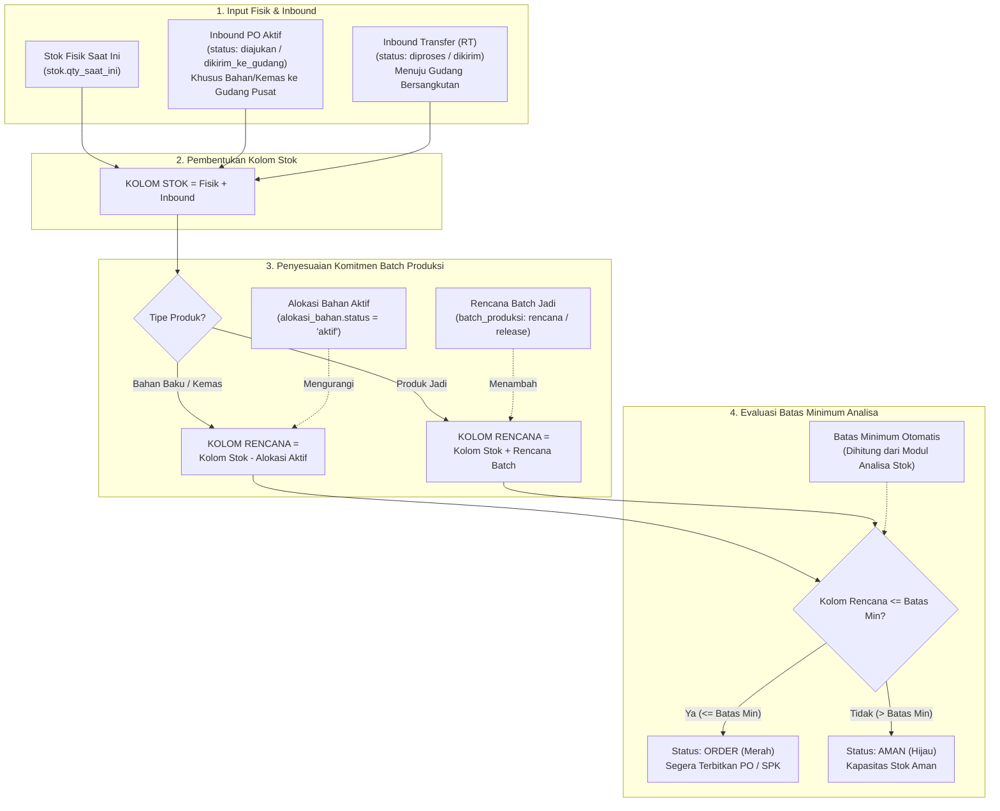

# Panduan & Spesifikasi: Alur, Fungsi, dan Tujuan "Kolom Rencana" pada Stok & Mutasi

**Proyek:** Heaven Scent Enterprise — Production Lab Online  
**Dokumen:** `.agent/alur-kolom-rencana-stok.md`  
**Area Terkait:** Modul Stok & Mutasi, Modul Analisa Stok, Modul Batch Produksi, Modul Purchasing & Request Transfer  

---

## 1. Ringkasan Eksekutif

Dalam manajemen inventori industri manufaktur (laboratorium produksi), mengetahui **berapa banyak barang yang ada di rak gudang saat ini (Stok Fisik)** saja **tidak cukup**. 

Jika sebuah pabrik hanya berpatokan pada saldo fisik, pabrik tersebut rentan mengalami **Stokout Mendadak** atau **Kegagalan Produksi**. Hal ini disebabkan oleh adanya bahan baku yang terlihat masih ada di gudang, padahal secara riil sudah dipesan atau dialokasikan untuk Surat Perintah Kerja (SPK) batch produksi yang sedang berjalan.

Oleh karena itu, sistem membagi visibilitas inventori menjadi dua sudut pandang:
1. **Kolom Stok**: Menggambarkan ketersediaan persediaan berwujud saat ini plus barang yang sudah pasti dalam perjalanan menuju gudang (*Physical & Inbound Pipeline*).
2. **Kolom Rencana**: Menggambarkan **saldo persediaan bersih yang benar-benar bebas dari komitmen operasional** (*Projected Available Balance / Net Free Stock*).

---

## 2. Diagram Alur & Rumus Matematis

### A. Diagram Alur Data (Data Flowchart)

---

### B. Rumus Matematis Perhitungan

#### 1. Perhitungan Kolom Stok
$$\text{Kolom Stok} = \text{Fisik} + \text{Inbound PO} + \text{Inbound RT}$$

*Keterangan:*
* **Fisik**: Saldo aktual pada tabel `stok.qty_saat_ini`.
* **Inbound PO**: Akumulasi kuantitas pada `purchase_order_items` berstatus `diajukan` atau `dikirim_ke_gudang` yang dialokasikan ke Gudang Pusat Bahan Baku.
* **Inbound RT**: Akumulasi kuantitas pada `request_transfer_items` berstatus `diproses` atau `dikirim` yang memiliki `gudang_tujuan_id` sama dengan gudang yang sedang dilihat.

#### 2. Perhitungan Kolom Rencana
* **Untuk Kategori Bahan Baku & Bahan Kemas (`tipe: bahan, kemas`):**
  $$\text{Kolom Rencana} = \text{Kolom Stok} - \text{Alokasi Aktif}$$
  *Alokasi Aktif* adalah total bahan yang sudah terkunci di tabel `alokasi_bahan` berstatus `aktif` untuk batch produksi yang sedang dalam persiapan atau pengerjaan.

* **Untuk Kategori Produk Jadi (`tipe: produk_jadi`):**
  $$\text{Kolom Rencana} = \text{Kolom Stok} + \text{Rencana Batch Produksi}$$
  *Rencana Batch Produksi* adalah estimasi kuantitas produk jadi yang akan dihasilkan dari batch berstatus `rencana` atau `release` yang dialokasikan menuju gudang tujuan tersebut.

#### 3. Logika Evaluasi Status Reorder
Nilai **Batas Minimum** diambil secara real-time dari algoritma Modul Analisa Stok (berdasarkan *lead time*, rata-rata konsumsi harian, dan *safety stock*):
$$\text{Status} = \begin{cases} \mathbf{ORDER} \ (\text{Badge Merah}), & \text{jika } \text{Batas Minimum} > 0 \text{ dan } \text{Kolom Rencana} \le \text{Batas Minimum} \\ \mathbf{AMAN} \ (\text{Badge Hijau}), & \text{jika } \text{Kolom Rencana} > \text{Batas Minimum} \end{cases}$$

---

## 3. Fungsi Utama Kolom Rencana

1. **Menghilangkan *Phantom Stock* (Stok Semu / Bayangan):**
   * Di rak fisik gudang, 10 drum alkohol mungkin masih berbaris rapi. Namun jika 7 drum di antaranya sudah dialokasikan untuk pengerjaan SPK batch esok hari, stok riil yang bisa dijanjikan untuk pengerjaan baru hanyalah 3 drum. Kolom Rencana mencegah pengguna "tertipu" oleh saldo fisik yang tampak melimpah.
2. **Kalkulasi Saldo Bersih Bebas (*Net Available to Promise*):**
   * Menjadi acuan tunggal bagi tim PPIC saat menyusun formulasi rencana produksi baru agar tidak terjadi *overbooking* bahan baku.
3. **Proyeksi Ketersediaan Barang Jadi (*Finished Goods Inflow*):**
   * Memberikan visibilitas kepada tim penjualan (*sales fulfillment*) terkait berapa banyak barang jadi yang akan siap dipasarkan setelah proses *batching* di laboratorium selesai.
4. **Dasar Pemicu Re-Order Otomatis:**
   * Menjadi tolok ukur bagi modul Analisa dan Purchasing untuk menentukan kapan PO bahan baru harus diterbitkan ke pemasok (*supplier*).

---

## 4. Tujuan Bisnis dan Operasional

| No | Tujuan | Penjelasan & Manfaat Nyata |
| :--- | :--- | :--- |
| **1** | **Early Warning System (Pencegahan Stockout Dini)** | Sistem memunculkan status **`ORDER`** jauh sebelum gudang kehabisan stok fisik. Tim pengadaan memiliki jeda waktu (*lead time*) yang cukup untuk mendatangkan barang dari supplier tanpa menghentikan lini produksi. |
| **2** | **Mencegah *Double Allocation* (Tumpang Tindih Bahan)** | Menghindari situasi fatal di mana satu drum bahan baku yang sama dialokasikan ke dua SPK batch yang berbeda. |
| **3** | **Sinkronisasi Tiga Pilar Divisi (Gudang, PPIC, Purchasing)** | • **Petugas Gudang**: Fokus mencocokkan stok fisik di kartu stok. • **Petugas PPIC**: Merencanakan batch produksi berdasarkan Kolom Rencana. • **Petugas Purchasing**: Menjadwalkan pengadaan saat Kolom Rencana menyentuh batas minimum. |
| **4** | **Efisiensi Modal Kerja (*Cash Flow Protection*)** | Memastikan pembelian barang hanya dilakukan saat komitmen operasional memang sudah melebihi batas aman, menghindari penumpukan bahan (*overstock*) yang mengikat kas perusahaan dan berisiko kedaluwarsa. |

---

## 5. Studi Kasus & Simulasi Perhitungan

### Studi Kasus 1: Bahan Baku (Fragrance Oil Lavender)
* **Stok Fisik di Gudang Bahan**: $120\text{ kg}$
* **Inbound PO OTW (Pembelian dalam perjalanan)**: $80\text{ kg}$
* **Kolom Stok**: $120 + 80 = \mathbf{200\text{ kg}}$
* **Alokasi Aktif (SPK Batch #101 & #102 yang sedang disiapkan)**: $160\text{ kg}$
* **Batas Minimum Analisa**: $50\text{ kg}$

**Perhitungan:**
$$\text{Kolom Rencana} = 200 - 160 = \mathbf{40\text{ kg}}$$

**Hasil Tampilan di Sistem:**
* **Kolom Stok**: `200 kg` $\rightarrow$ Badge **AMAN** ($200 > 50$).
* **Kolom Rencana**: `40 kg` $\rightarrow$ Badge **ORDER** ($40 \le 50$).

> **Pelajaran Operasional:** Jika tim purchasing hanya melihat Kolom Stok ($200\text{ kg}$), mereka akan menganggap persediaan sangat aman. Namun berkat **Kolom Rencana** ($40\text{ kg}$), sistem mendeteksi bahwa setelah kedua SPK selesai dieksekusi, sisa stok riil akan jatuh di bawah batas aman minimum ($50\text{ kg}$), sehingga tim pengadaan langsung diinstruksikan untuk membuat PO baru hari ini juga.

---

### Studi Kasus 2: Produk Jadi (Parfum 50ml EDP)
* **Stok Fisik di Gudang Fulfillment**: $300\text{ botol}$
* **Inbound Transfer OTW (Pengiriman dari Lab ke Gudang Fulfillment)**: $200\text{ botol}$
* **Kolom Stok**: $300 + 200 = \mathbf{500\text{ botol}}$
* **Rencana Batch Produksi Aktif di Lab**: $1.000\text{ botol}$
* **Batas Minimum Analisa**: $400\text{ botol}$

**Perhitungan:**
$$\text{Kolom Rencana} = 500 + 1.000 = \mathbf{1.500\text{ botol}}$$

**Hasil Tampilan di Sistem:**
* **Kolom Stok**: `500 botol` (Badge: **AMAN**)
* **Kolom Rencana**: `1.500 botol` (Badge: **AMAN**)

> **Pelajaran Operasional:** Tim sales dapat mengetahui bahwa dalam beberapa hari ke depan akan ada total ketersediaan hingga $1.500\text{ botol}$ yang siap dialokasikan ke pesanan distributor atau pesanan e-commerce.

---

## 6. Referensi Implementasi pada Source Code

Implementasi logika ini dikonsolidasikan secara transparan di dalam kode program:

1. **Pengambilan Data & Kalkulasi Server-Side:**
   * File: [`app/Http/Controllers/StokController.php`](file:///c:/Users/User/HS%20Project/production-lab-online-hs/app/Http/Controllers/StokController.php#L45-L207)
   * Method: `StokController::data()`
   * Query Alokasi Bahan: Menggunakan subquery agregat `SUM(ab.qty_dialokasikan)` dengan filter `ab.status = 'aktif'`.
   * Query Rencana Batch: Menggunakan relasi `batch_produksi` berstatus `rencana` atau `release`.
   * Integrasi Batas Min: Melalui `AnalisaService::getBatasMinimumMap()`.

2. **Penyajian Data di Frontend (User Interface):**
   * File: [`resources/views/stok/index.blade.php`](file:///c:/Users/User/HS%20Project/production-lab-online-hs/resources/views/stok/index.blade.php#L55-L65)
   * Komponen Header: Memuat kolom `Batas Min (Analisa)`, `Kolom Stok`, dan `Kolom Rencana`.
   * DataTables Renderer: Menampilkan nilai numerik berformat monospaced disertai pill status berwarna (`ORDER` merah atau `AMAN` hijau).

