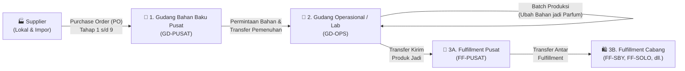
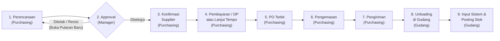
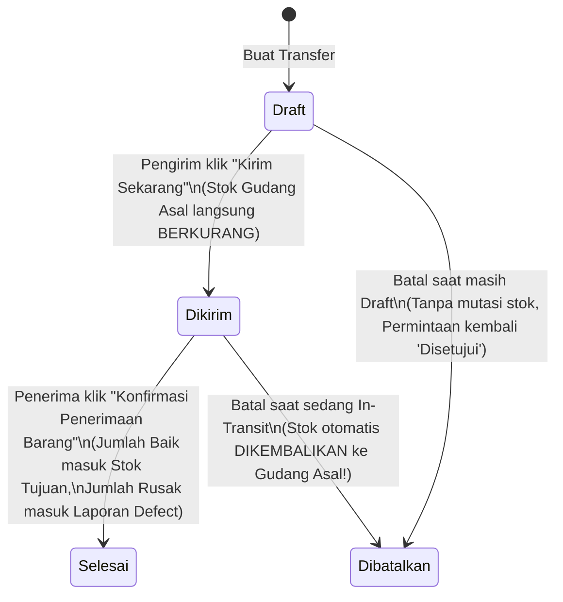
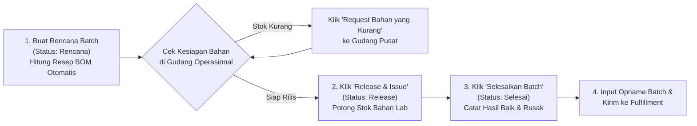

# 📖 DOKUMENTASI LENGKAP SISTEM SUPPLY CHAIN ONLINE (SC ONLINE)
**CV. Heaven Scent — Divisi Manufaktur & Rantai Pasok**  
*Panduan Lengkap Tujuan Sistem, Alur Bisnis End-to-End, & Bedah Rumus Perhitungan (Versi 2.4)*

---

## 📌 Daftar Isi
1. [Tujuan & Visi Sistem (Mengapa SC Online Dibuat?)](#1-tujuan--visi-sistem-mengapa-sc-online-dibuat)
2. [Konsep Dasar & Arsitektur Bisnis (Wajib Paham untuk Pengguna Baru)](#2-konsep-dasar--arsitektur-bisnis-wajib-paham-untuk-pengguna-baru)
   - [2.1 Tiga Tipe Barang (SKU)](#21-tiga-tipe-barang-sku)
   - [2.2 Tiga Tipe Gudang & Hierarki Lokasi](#22-tiga-tipe-gudang--hierarki-lokasi)
   - [2.3 Lima Peran Pengguna & Pembagian Wewenang](#23-lima-peran-pengguna--pembagian-wewenang)
3. [Alur Penggunaan End-to-End (Gambaran Besar)](#3-alur-penggunaan-end-to-end-gambaran-besar)
4. [Panduan Alur Penggunaan Detail per Modul](#4-panduan-alur-penggunaan-detail-per-modul)
   - [Modul 1: Master Data & Resep BOM (Fondasi Sistem)](#modul-1-master-data--resep-bom-fondasi-sistem)
   - [Modul 2: Analisa Stok, Klasifikasi ABC & Komparasi Multi-Supplier](#modul-2-analisa-stok-klasifikasi-abc--komparasi-multi-supplier)
   - [Modul 3: Purchasing 9-Tahap, Pembayaran Bertahap & Perhitungan Lead Time](#modul-3-purchasing-9-tahap-pembayaran-bertahap--perhitungan-lead-time)
   - [Modul 4: Permintaan Barang (Request) & Pengiriman Fisik (Transfer)](#modul-4-permintaan-barang-request--pengiriman-fisik-transfer)
   - [Modul 5: Produksi Parfum Multi-Produk (Batch & BOM)](#modul-5-produksi-parfum-multi-produk-batch--bom)
   - [Modul 6: Stok, Mutasi, Kartu Stok & Stock Opname](#modul-6-stok-mutasi-kartu-stok--stock-opname)
   - [Modul 7: Beranda (Dashboard) Adaptif & Laporan Analitik](#modul-7-beranda-dashboard-adaptif--laporan-analitik)
5. [Bedah Lengkap Seluruh Rumus & Perhitungan Sistem (Beserta Contoh Nyata)](#5-bedah-lengkap-seluruh-rumus--perhitungan-sistem-beserta-contoh-nyata)
   - [5.1 Rumus Analisa Bahan Lokal](#51-rumus-analisa-bahan-lokal)
   - [5.2 Rumus Analisa Bahan Impor & Klasifikasi ABC](#52-rumus-analisa-bahan-impor--klasifikasi-abc)
   - [5.3 Rumus Analisa Produk Jadi (Fulfillment Multi-Cabang)](#53-rumus-analisa-produk-jadi-fulfillment-multi-cabang)
   - [5.4 Rumus Stok Aktual, Stok Berjalan, Status Peringatan & Hierarki HPP](#54-rumus-stok-aktual-stok-berjalan-status-peringatan--hierarki-hpp)
   - [5.5 Rumus Kalkulasi Biaya PO, Prorata, Konversi Satuan & Alokasi Pembayaran Termin](#55-rumus-kalkulasi-biaya-po-prorata-konversi-satuan--alokasi-pembayaran-termin)
   - [5.6 Rumus Durasi 9-Tahap Purchasing & Rekam Jejak Lead Time Supplier](#56-rumus-durasi-9-tahap-purchasing--rekam-jejak-lead-time-supplier)
   - [5.7 Rumus Batch Produksi (Perhitungan Resep BOM, Kesiapan Bahan, Yield, Defect & Opname)](#57-rumus-batch-produksi-perhitungan-resep-bom-kesiapan-bahan-yield-defect--opname)
   - [5.8 Rumus Validasi QC Transfer & Tingkat Kerusakan (Defect Rate) Gabungan](#58-rumus-validasi-qc-transfer--tingkat-kerusakan-defect-rate-gabungan)
6. [Aturan Keamanan, Anti-Selisih & Pengendalian Operasional](#6-aturan-keamanan-anti-selisih--pengendalian-operasional)
7. [Matriks Hak Akses & Kewenangan per Peran](#7-matriks-hak-akses--kewenangan-per-peran)

---

## 1. Tujuan & Visi Sistem (Mengapa SC Online Dibuat?)

**SC Online (Supply Chain Online) Heaven Scent** adalah sistem perencanaan dan pengelolaan rantai pasok terpadu yang dirancang khusus untuk operasional pengadaan bahan, manufaktur parfum di laboratorium, hingga distribusi produk jadi **CV. Heaven Scent**.

### Masalah Operasional yang Diselesaikan
Sebelum menggunakan SC Online, operasional rantai pasok sering menghadapi 4 kendala utama:
1. **Perhitungan Terpisah-pisah:** Perhitungan kapan harus membeli alkohol, bibit parfum, dan botol kemasan tersebar di berbagai lembar kerja manual sehingga rawan selisih rumus.
2. **Perkiraan Waktu Kirim Supplier yang Tidak Akurat:** Estimasi waktu tunggu (*Lead Time*) kedatangan barang dari supplier hanya menggunakan angka perkiraan kasar, bukan berdasarkan rekam jejak kecepatan pengiriman supplier yang sebenarnya.
3. **Bahan Kurang Saat Akan Produksi:** Bagian laboratorium baru menyadari stok bahan baku atau botol kurang ketika jadwal peracikan sudah akan dimulai.
4. **Selisih Stok & Kerusakan Tanpa Riwayat yang Jelas:** Barang pecah/rusak saat pengiriman antar-gudang atau pemakaian bahan yang tumpah di laboratorium sulit ditelusuri karena belum adanya Kartu Stok terpusat dan pemeriksaan kualitas (QC) yang mengikat.

### Empat Pilar Utama SC Online
> [!IMPORTANT]
> **4 Prinsip Utama Sistem SC Online:**
> 1. **Satu Sumber Acuan Analisa Stok:** Seluruh angka **Batas Minimum (Titik Pesan Ulang)** dan **Target Stok** di seluruh gudang dihitung secara terpusat oleh modul **Analisa Stok**—tidak diinput manual secara terpisah di tabel stok.
> 2. **Rekam Jejak Waktu Kirim Otomatis (9 Tahap PO):** Setiap Purchase Order (PO) dilacak melewati **9 Tahap Berurutan**. Begitu PO selesai di tahap ke-9, durasi nyata pengiriman otomatis memperbarui rata-rata dan maksimum *Lead Time* supplier tersebut di modul Analisa Stok.
> 3. **Kartu Stok Permanen & Transparan:** Tidak ada saldo stok yang bisa berubah tanpa catatan. Setiap penambahan dan pengurangan stok fisik wajib tercatat secara kronologis di dalam **Kartu Stok (Log Pergerakan)**.
> 4. **Pemeriksaan Kualitas (QC) Anti-Selisih & Pemisahan Tugas:** Pengirim barang dilarang mengonfirmasi penerimaan barangnya sendiri. Saat barang diterima atau selesai diproduksi, berlaku rumus wajib: **$\text{Jumlah Baik} + \text{Jumlah Rusak} = \text{Jumlah Dikirim / Rencana}$**.

---

## 2. Konsep Dasar & Arsitektur Bisnis (Wajib Paham untuk Pengguna Baru)

Jika Anda baru pertama kali mempelajari sistem ini, pahami **3 elemen dasar** berikut: **Barang (SKU)**, **Gudang**, dan **Peran Pengguna**.

### 2.1 Tiga Tipe Barang (SKU)
Di dalam sistem, seluruh barang dikelompokkan ke dalam 3 tipe utama:

| Tipe Barang | Nama Bisnis | Contoh Item | Satuan Dasar | Kelompok Analisa | Cara Mendapatkan Stok |
| :--- | :--- | :--- | :---: | :---: | :--- |
| **Bahan Baku** | Bahan Baku Cair | Alkohol 96% (`ALK-01`), Bibit Parfum (`OIL-GOH`) | `ml` | Lokal / Impor | Dibeli dari Supplier melalui **Purchase Order (PO)** |
| **Bahan Kemas** | Bahan Kemasan | Botol 50ml (`BTL-P50`), Tutup Botol (`CAP-01`), Box | `pcs` | Impor / Lokal | Dibeli dari Supplier melalui **Purchase Order (PO)** |
| **Produk Jadi** | Parfum Siap Jual | Parfum GOH 50ml (`GOH-P50`) | `pcs` | Fulfillment | Diproduksi di Lab melalui **Batch Produksi** (menggunakan Bahan Baku + Bahan Kemas sesuai resep **BOM**) |

---

### 2.2 Tiga Tipe Gudang & Hierarki Lokasi
Barang bergerak secara terarah melalui 3 jenis fasilitas gudang:

1. **Gudang Bahan Baku Pusat (`GD-PUSAT`):**  
   Pintu masuk utama seluruh pembelian bahan baku dan kemasan dari supplier.
2. **Gudang Operasional / Laboratorium (`GD-OPS`):**  
   Gudang di area laboratorium produksi. Menyimpan bahan baku yang diminta dari Gudang Pusat, meraciknya menjadi parfum melalui **Batch Produksi**, dan menyimpan sementara parfum hasil jadi sebelum dikirim ke Fulfillment.
3. **Gudang Fulfillment (`FF-PUSAT`, `FF-SBY`, `FF-SOLO`):**  
   Gudang penyimpanan **Produk Jadi** siap jual. Terdiri dari **Fulfillment Pusat** yang menerima kiriman langsung dari Lab Produksi, serta **Fulfillment Cabang** yang menerima distribusi produk jadi dari Fulfillment Pusat.

---

### 2.3 Lima Peran Pengguna & Pembagian Wewenang
Sistem menerapkan pembagian hak akses berdasarkan **Jabatan (Peran)** dan **Cakupan Lokasi Gudang**:

| Peran | Contoh Pengguna | Cakupan Gudang | Fokus Tugas Harian |
| :--- | :--- | :---: | :--- |
| **Manager** | **Andyka** | Seluruh Gudang | Memantau indikator kinerja seluruh divisi, menyetujui PO & Revisi PO, menyetujui Permintaan Barang, mengesampingkan data Lead Time yang tidak wajar, serta mengelola akun & wewenang. |
| **Purchasing** | **Rina** | Seluruh Gudang | Menjalankan **Analisa Stok** (Lokal & Impor), membandingkan kinerja supplier, membuat PO dari hasil analisa, mengawal Tahap 1–7 PO, dan mencatat pembayaran/cicilan tagihan. |
| **Gudang** | **Budi** | Gudang Pusat (`GD-PUSAT`) | Melakukan bongkar muat & cek fisik barang PO datang (**Tahap 8 Unloading**), memposting saldo masuk PO (**Tahap 9 Input Sistem**), serta mengirim bahan baku ke Lab sesuai Permintaan yang disetujui. |
| **Operasional** | **Dedi** | Gudang Operasional (`GD-OPS`) | Mengelola formula **Resep (BOM)**, mengajukan **Permintaan Bahan Baku**, membuat & menjalankan **Batch Produksi** (*Rencana $\rightarrow$ Release $\rightarrow$ Selesai*), mengisi *Opname Batch*, dan mengirim produk jadi ke Fulfillment. |
| **Fulfillment** | **Sari** | Gudang Fulfillment (`FF-PUSAT`, `FF-SBY`, `FF-SOLO`) | Menerima kiriman produk jadi dari Lab, memantau **Analisa Stok Produk Jadi** lintas cabang, mengajukan **Permintaan Produk Jadi**, dan mendistribusikan stok antar-cabang. |

---

## 3. Alur Penggunaan End-to-End (Gambaran Besar)

Bagaimana seluruh divisi bekerja sama dari awal sampai parfum siap dijual di cabang? Ikuti **5 Fase Siklus Rantai Pasok** berikut:

```mermaid
flowchart TD
    subgraph F1["FASE 1: Perencanaan & Analisa Kebutuhan"]
        A1["Data Master & Resep BOM\nsudah terdaftar"] --> A2["Purchasing / Fulfillment:\nBuka Menu Analisa Stok"]
        A2 --> A3{"Apakah Stok Tersedia\n<= Batas Minimum?"}
        A3 -- "Ya (Status: ORDER / PO)" --> A4["Rekomendasi Order otomatis\ndibulatkan ke kelipatan MOQ"]
    end

    subgraph F2["FASE 2: Pengadaan & 9-Tahap Purchasing"]
        A4 -- "Untuk Bahan Lokal / Impor" --> B1["Purchasing: Buat PO\n(Tahap 1: Perencanaan)"]
        B1 --> B2["Manager: Setujui PO\n(Tahap 2: Approval)"]
        B2 --> B3["Purchasing: Konfirmasi Supplier, Bayar/Tempo,\nPO Terbit, Kemas, Kirim (Tahap 3 - 7)"]
        B3 --> B4["Gudang: Unloading & Cek Fisik\n(Tahap 8: Belum Tambah Stok)"]
        B4 --> B5["Gudang: Input Sistem & Posting\n(Tahap 9: Stok Pusat Bertambah & Catat Lead Time)"]
    end

    subgraph F3["FASE 3: Permintaan & Pengiriman Bahan ke Lab"]
        B5 --> C1["Operasional Lab: Buat Rencana Batch\n(Sistem cek Kesiapan Bahan di Lab)"]
        C1 --> C2{"Stok Bahan di\nLab Cukup?"}
        C2 -- "Kurang (Stok Kurang)" --> C3["Operasional: Buat Permintaan Bahan Baku\n& Ajukan ke Manager"]
        C3 --> C4["Manager: Setujui Permintaan"]
        C4 --> C5["Gudang Pusat: Buat Transfer Pemenuhan\n& Klik 'Kirim Sekarang' (Stok Pusat berkurang)"]
        C5 --> C6["Operasional Lab: Terima & QC Barang\n(Jumlah Baik masuk ke Stok Lab)"]
    end

    subgraph F4["FASE 4: Eksekusi Produksi Parfum (Batch)"]
        C2 -- "Cukup (Siap Rilis)" --> D1["Operasional: Klik 'Release & Issue'\n(Stok Bahan di Lab otomatis dipotong)"]
        C6 --> D1
        D1 --> D2["Proses Peracikan, Maserasi & Pengisian Botol"]
        D2 --> D3["Operasional: Klik 'Selesaikan Batch'\nInput Hasil Baik + Hasil Rusak = Target Rencana"]
        D3 --> D4["Hasil Baik otomatis masuk Stok Produk Jadi\ndi Lab + Hitung Yield (%)"]
        D4 --> D5["Operasional: Input Opname Batch\n(Bandingkan Resep Teoritis vs Pemakaian Aktual)"]
    end

    subgraph F5["FASE 5: Distribusi ke Fulfillment & Cabang"]
        D5 --> E1["Operasional: Klik 'Kirim ke Fulfillment'\n& Kirim Barang (Stok Lab berkurang)"]
        E1 --> E2["Fulfillment Pusat: Terima & QC Produk Jadi\n(Jumlah Baik masuk ke Stok Fulfillment Pusat)"]
        E2 --> E3["Fulfillment: Buat Transfer Antar-Fulfillment\nke Cabang (Surabaya / Solo)"]
    end
```

---

## 4. Panduan Alur Penggunaan Detail per Modul

---

### Modul 1: Master Data & Resep BOM (Fondasi Sistem)

Sebelum transaksi operasional dijalankan, data induk harus disiapkan di kelompok menu **Master Data**:
1. **Satuan (UOM):** Mendefinisikan satuan ukuran seperti `ml`, `liter`, `pcs`, `lusin`, `karton`, `jerigen` beserta faktor konversinya.
2. **Kategori, Varian & Klasifikasi ABC:**
   - **Klasifikasi ABC:** Mengatur kelas prioritas bahan impor beserta tambahan hari pengamannya, yaitu `Wajib A (+4 hari)`, `A (+4 hari)`, `B (+2 hari)`, dan `C (+0 hari)`.
3. **Gudang:** Mendaftarkan lokasi gudang, jenisnya (Bahan Baku Pusat, Operasional, atau Fulfillment), serta pengaturan izin stok negatif.
4. **Supplier:** Mendaftarkan pemasok lokal maupun impor beserta skema pembayaran bawaannya (Termin, Tempo, atau Lunas/Cash).
5. **Produk:**
   - Menentukan kode SKU, Nama Barang, Tipe (`Bahan Baku`, `Bahan Kemas`, `Produk Jadi`), Satuan Dasar, Minimal Pembelian (`MOQ`), Faktor Konversi satuan beli, Harga Pokok (HPP), Kelompok Analisa (`Lokal` / `Impor`), serta daftar Supplier penyedianya.
6. **BOM (Resep Produk Jadi):**
   - Menghubungkan 1 unit **Produk Jadi** dengan daftar komponen **Bahan Baku & Kemasan** beserta takaran per unitnya.
   - *Contoh Resep `Parfum GOH 50ml` (`GOH-P50`):*
     - Alkohol 96% (`ALK-01`) = `40 ml`
     - Bibit Parfum GOH (`OIL-GOH`) = `8 ml`
     - Botol 50ml (`BTL-P50`) = `1 pcs`
     - Tutup Botol (`CAP-01`) = `1 pcs`
   - Tersedia pula menu **Impor BOM** untuk mengunggah file daftar resep secara massal.

---

### Modul 2: Analisa Stok, Klasifikasi ABC & Komparasi Multi-Supplier

Menu **Analisa Stok** adalah pusat perhitungan otomatis yang memiliki **4 Tab Utama**:

#### 1. Tab Lokal
Terbagi menjadi 4 tampilan informasi yang saling terhubung:
- **Rekomendasi Order:** Menampilkan status akhir setiap bahan lokal (`ORDER` atau `TIDAK`), kuantitas yang harus dipesan setelah pembulatan MOQ, konversi ke satuan beli, dan total nominal rupiahnya.
- **Analisa Stok:** Menampilkan parameter pemakaian rata-rata 4 bulan, pemakaian harian rata-rata (*ADU*), rata-rata waktu kirim (*Total Average Lead Time*), *Safety Stock*, *Review Period*, *Batas Minimum*, dan *Target Stock*.
- **Ringkasan Lead Time:** Menampilkan perbandingan *Average Lead Time*, *Max Lead Time*, *Tambahan Buffer Hari*, dan asal datanya (otomatis dari riwayat PO selesai atau input manual).
- **Rincian 9 Tahap Lead Time:** Membedah waktu tunggu ke dalam 9 tahapan pengadaan (Skenario Rata-Rata dan Skenario Maksimum).

#### 2. Tab Impor
- Dirancang khusus untuk bahan dan kemasan impor yang memiliki waktu tunggu pengiriman panjang (misal 45–114 hari).
- Memperhitungkan **Klasifikasi ABC** (tambahan hari pengaman otomatis), **ADU Base**, **ADU ETA** (penyesuaian laju konsumsi selama masa tunggu kapal/kargo), dan **Proyeksi Stok saat Kedatangan (ETA)**.

#### 3. Tab Fulfillment (Produk Jadi)
- Menghitung kebutuhan stok produk jadi di setiap gudang cabang (`FF-PUSAT`, `FF-SBY`, `FF-SOLO`) berdasarkan penjualan rata-rata cabang, waktu distribusi, dan cadangan distribusi, lalu menggabungkannya ke tingkat Nasional (`ALL`).
- Jika berstatus `ORDER`, artinya **Laboratorium Operasional perlu menjadwalkan Batch Produksi baru**.

#### 4. Tab Riwayat Snapshot
- Ketika pengguna mengklik tombol **"Finalisasi ke Riwayat"**, sistem mengunci seluruh angka analisa saat itu sebagai arsip permanen dan bukti historis mengapa suatu PO diterbitkan pada tanggal tersebut.

#### Fitur Unggulan di Modul Analisa Stok:
- **Perbandingan Multi-Supplier:** Satu bahan baku dapat disuplai oleh beberapa pemasok. Pengguna dapat membuka jendela perbandingan untuk melihat simulasi *Average Lead Time*, *Max Lead Time*, *Batas Minimum*, dan *Target Stock* dari masing-masing pemasok berdasarkan rekam jejak PO nyata, lalu memilih pemasok terbaik.
- **Buat PO Otomatis:** Centang barang yang berstatus `ORDER`/`PO`, klik **"Buat PO"**, dan sistem langsung menyiapkan formulir PO dengan daftar barang dan jumlah rekomendasi yang sudah terisi otomatis.

---

### Modul 3: Purchasing 9-Tahap, Pembayaran Bertahap & Perhitungan Lead Time

Menu **Purchasing** mengelola siklus pesanan pembelian (PO) dari perencanaan hingga stok masuk ke Gudang Pusat dan tagihan lunas.

#### A. Pelacakan 9 Tahap Pengadaan (9-Stage Tracker)
Setiap PO wajib melewati **9 tahap secara berurutan tanpa boleh melompati tahap**:

| Urutan | Nama Tahap | Penanggung Jawab | Apa yang Terjadi pada Tahap Ini? |
| :---: | :--- | :---: | :--- |
| **1** | **Perencanaan** | Purchasing | Staf Purchasing membuat PO dan mengajukannya kepada Manager. Saat diajukan, Tahap 1 selesai dan Tahap 2 dimulai pada waktu yang sama. |
| **2** | **Approval** | Manager | Manager memeriksa harga, jumlah, dan termin pembayaran. Jika **Setuju**, lanjut ke Tahap 3. Jika **Tolak** dengan alasan wajib, dokumen dikembalikan ke Tahap 1 dan sistem membuka **Putaran Baru**. |
| **3** | **Konfirmasi Supplier** | Purchasing | Mencatat konfirmasi kesanggupan kuantitas, harga, nomor referensi supplier, dan estimasi kedatangan (ETA). |
| **4** | **Pembayaran** | Purchasing | Dua jalur penyelesaian: 1. **Tombol "Dibayarkan":** Wajib sudah mencatat minimal 1 pembayaran (DP/Termin/Pelunasan) dengan nominal $> 0$. 2. **Tombol "Lanjut Tempo":** Khusus PO berskema **Tempo**, boleh lanjut ke Tahap 5 tanpa bayar uang muka di awal. |
| **5** | **PO Terbit** | Purchasing | Dokumen PO resmi dikirimkan kepada supplier sebagai perintah pemenuhan pesanan. |
| **6** | **Pengemasan** | Purchasing | Mencatat kesiapan barang di tempat supplier: jumlah koli, berat (kg), dan catatan pengemasan. |
| **7** | **Pengiriman** | Purchasing | Barang diserahkan ke ekspedisi. **Wajib mengisi nama Ekspedisi**, serta moda pengiriman (darat/laut/udara), nomor resi, nomor kontainer, dan perkiraan tanggal tiba. |
| **8** | **Unloading (Bongkar Muat)** | Gudang | Barang tiba di Gudang Pusat. Petugas gudang membongkar muatan dan mencatat jumlah fisik kedatangan beserta kondisinya (Baik/Rusak) dan selisihnya. **Saldo stok sistem belum bertambah pada tahap ini!** |
| **9** | **Input Sistem (Posting Stok)** | Gudang | Petugas gudang menyelesaikan Tahap 9. Secara otomatis: 1. Saldo stok **Gudang Pusat** bertambah sesuai jumlah fisik yang diterima. 2. Kartu Stok **Masuk (IN)** tercatat. 3. Status PO menjadi **Selesai**. 4. Sistem menghitung durasi menit & hari untuk seluruh 9 tahap dan memperbarui rata-rata serta maksimum *Lead Time* supplier tersebut! |

#### B. Dua Mekanisme Perubahan Data PO (Direct Edit vs Ajukan Revisi)
Apabila terjadi perubahan data saat PO sedang berjalan, sistem menyediakan 2 mekanisme:
1. **Direct Edit (Ubah Data Administratif & Logistik Tanpa Persetujuan Ulang):**
   - Berlaku untuk informasi pengiriman dan catatan: catatan PO, tanggal ETA, nomor referensi supplier, nomor invoice, nama ekspedisi, moda pengiriman, nomor resi, nomor kontainer, jumlah koli, dan berat (kg).
   - Perubahan langsung tersimpan dan tercatat di riwayat perubahan PO.
2. **Ajukan Revisi (Ubah Komitmen Harga & Jumlah — Wajib Persetujuan Manager):**
   - Berlaku jika ada perubahan **jumlah barang, harga beli, diskon, PPN, ongkos kirim, atau biaya penyesuaian** (selama PO belum mencapai Tahap 8/9).
   - Staf Purchasing mengajukan usulan revisi disertai alasan. Selama revisi masih menunggu keputusan Manager, penyelesaian tahap maupun pencatatan pembayaran dikunci sementara.
   - Saat Manager menyetujui revisi, sistem menghitung ulang HPP per satuan dan Grand Total PO secara otomatis tanpa merusak perhitungan waktu tahap yang sedang berjalan.

---

### Modul 4: Permintaan Barang (Request) & Pengiriman Fisik (Transfer)

Sistem memisahkan secara tegas antara **Dokumen Permintaan (`Permintaan Barang`)** dan **Dokumen Pengiriman Fisik (`Transfer Barang`)**.

#### Mengapa Dipisahkan?
- **Permintaan Barang:** Adalah tiket permohonan internal yang membutuhkan persetujuan Manager. **Membuat, menyetujui, atau menolak Permintaan tidak pernah memotong atau menambah stok fisik.**
- **Transfer Barang:** Adalah eksekusi pengiriman fisik keluar-masuk barang antar-gudang yang dilengkapi **Surat Jalan** dan **Pemeriksaan QC Penerimaan**.

#### Alur 1: Siklus Permintaan Barang
1. **Jenis Permintaan:**
   - **Bahan Baku Operasional:** Dibuat oleh Tim Operasional Lab untuk meminta Bahan Baku/Kemasan dari Gudang Pusat (`GD-PUSAT` $\rightarrow$ `GD-OPS`).
   - **Produk Jadi Fulfillment:** Dibuat oleh Tim Fulfillment untuk meminta Produk Jadi.
2. **Siklus Status Permintaan:**
   - **Draft** $\rightarrow$ klik **Ajukan ke Manajer** $\rightarrow$ **Diajukan**.
   - Manager meninjau dokumen: klik **Setujui Permintaan** ($\rightarrow$ **Disetujui**) atau **Tolak** dengan alasan wajib ($\rightarrow$ **Ditolak**).
   - *Aturan Pengaman Revisi:* Jika Permintaan yang sudah **Disetujui** diubah kembali isinya oleh pemohon (selama belum dibuatkan Transfer), statusnya **otomatis kembali menjadi Diajukan** dan wajib disetujui ulang oleh Manager!

#### Alur 2: Siklus Pengiriman Fisik (Transfer Barang)
Terdapat 5 jenis Transfer yang didukung sistem:
1. **Pemenuhan Request Bahan:** Pengiriman bahan baku dari Gudang Pusat ke Lab (merujuk pada Permintaan Bahan yang sudah Disetujui).
2. **Kirim Produk Jadi:** Pengiriman parfum hasil produksi dari Lab ke Fulfillment (merujuk pada Batch Produksi yang sudah Selesai atau Permintaan Produk Jadi yang Disetujui).
3. **Transfer Antar-Fulfillment:** Distribusi produk jadi antar gudang Fulfillment (misal `FF-PUSAT` $\rightarrow$ `FF-SBY`), dapat dibuat langsung tanpa dokumen Permintaan.
4. **Retur Bahan Baku:** Pengembalian bahan baku dari Lab ke Gudang Pusat.
5. **Retur Produk Jadi:** Pengembalian produk jadi antar gudang.

> [!TIP]
> **Pengembalian Stok Otomatis Saat Pembatalan In-Transit:**  
> Jika barang sudah telanjur berstatus **In Transit / Dikirim** (saldo gudang pengirim sudah terpotong), namun pengiriman dibatalkan sebelum diterima gudang tujuan, pembatalan Transfer akan **otomatis mengembalikan saldo stok ke Gudang Pengirim** dan mengembalikan status Permintaan terkait menjadi **Disetujui** agar dapat dibuatkan pengiriman pengganti!

---

### Modul 5: Produksi Parfum Multi-Produk (Batch & BOM)

Menu **Produksi** mengelola proses pembuatan parfum di laboratorium. Satu nomor Batch mendukung **Multi-Produk** (meracik beberapa varian parfum sekaligus dalam satu sesi produksi).

#### Tahapan Lengkap Siklus Batch:
1. **Buat Rencana Batch (`Status: Rencana`):**
   - Staf Operasional memilih Gudang Operasional (`GD-OPS`), Gudang Tujuan (`FF-PUSAT`), Tanggal, serta satu atau beberapa **Produk Jadi** beserta **Target Rencana** masing-masing.
   - **Perhitungan Resep Otomatis:** Sistem mengalikan kebutuhan bahan per unit dengan Target Rencana dari seluruh produk yang dipilih, lalu menjumlahkannya per bahan baku ke dalam tabel **Alokasi Bahan Baku**.
   - **Indikator Kesiapan Bahan & Peringatan Dini:** Pada halaman detail batch, sistem otomatis mengecek apakah stok fisik di Gudang Operasional cukup. Jika kurang, muncul peringatan merah **`Stok Kurang`** beserta tombol pintas **`Request Bahan yang Kurang`** untuk langsung membuat Permintaan Bahan ke Gudang Pusat sejumlah kekurangannya saja.
2. **Release & Issue Bahan (`Status: Release`):**
   - Saat bahan di Gudang Operasional sudah lengkap dan proses peracikan siap dimulai, klik **"Release & Issue"**.
   - Sistem memotong saldo stok bahan baku di Gudang Operasional secara otomatis dan mencatatnya di Kartu Stok.
   - *Catatan:* Jika ada satu saja bahan yang saldonya kurang di Gudang Operasional, sistem akan menolak memulai produksi.
3. **Selesaikan Batch & Pemeriksaan Hasil (`Status: Selesai`):**
   - Setelah proses pengisian botol dan pengemasan selesai, masukkan hasil akhir untuk setiap produk jadi:
     - **Hasil Baik:** Jumlah parfum lulus QC.
     - **Hasil Rusak:** Jumlah produk gagal/pecah/bocor saat produksi.
   - **Aturan Wajib:** $\text{Hasil Baik} + \text{Hasil Rusak}$ **harus sama persis** dengan $\text{Target Rencana}$!
   - Sistem otomatis menambahkan **Hasil Baik** ke dalam saldo stok produk jadi di Gudang Operasional serta menghitung persentase **Yield (%)** dan **Defect Rate (%)**.
4. **Opname Bahan Batch (Teoritis vs Aktual):**
   - Staf Operasional dapat mencatat pemakaian bahan aktual di lapangan (misal: takaran resep teoritis alkohol 20.000 ml, tetapi pemakaian aktual 20.150 ml karena penguapan/tumpah). Selisih (*variance*) dicatat untuk evaluasi efisiensi produksi.
5. **Kirim Produk Jadi ke Fulfillment:**
   - Klik tombol **"Kirim ke Fulfillment"** untuk membuat dokumen Transfer pengiriman produk jadi berisi seluruh **Hasil Baik** dari batch tersebut menuju Gudang Fulfillment.

---

### Modul 6: Stok, Mutasi, Kartu Stok & Stock Opname

Menu **Stok & Mutasi** adalah pusat pemantauan fisik dan nilai persediaan di seluruh gudang.

1. **Tabel Saldo Stok (`Stok Aktual` vs `Stok Berjalan`):**
   - Dapat disaring per gudang spesifik atau per kelompok jenis gudang (*Bahan Baku*, *Operasional*, *Fulfillment*) serta kategori barang.
   - Menampilkan **Batas Min (Analisa)**, **Stok Aktual** (fisik di rak), **Stok Berjalan** (barang yang sedang dalam perjalanan menuju gudang tersebut), **Status** (`ORDER` merah vs `AMAN` hijau), **HPP**, dan **Nilai Stok**.
2. **Kartu Stok & Log Pergerakan:**
   - Menyajikan riwayat kronologis setiap mutasi **MASUK (IN)** dan **KELUAR (OUT)**, lengkap dengan **Saldo Sebelum $\rightarrow$ Saldo Sesudah**, nama petugas, waktu transaksi, dan nomor dokumen sumbernya (PO, Transfer, Batch Produksi, atau Opname).
3. **Mutasi Manual & Opname Fisik:**
   - **Mutasi Manual:** Mencatat penyesuaian masuk/keluar langsung dengan alasan wajib.
   - **Opname Fisik:** Pengguna cukup memasukkan **Jumlah Fisik Aktual** hasil perhitungan di rak. Sistem otomatis menghitung selisihnya ($\Delta = \text{Jumlah Fisik Baru} - \text{Saldo Sistem Saat Ini}$) dan mencatat penyesuaian `MASUK` (jika $\Delta > 0$) atau `KELUAR` (jika $\Delta < 0$) di Kartu Stok.

---

### Modul 7: Beranda (Dashboard) Adaptif & Laporan Analitik

1. **Beranda (Dashboard) Sesuai Jabatan:**
   - Halaman **Beranda** otomatis menyesuaikan indikator utama dan **Antrean Tugas Prioritas** sesuai peran pengguna yang sedang masuk:
     - **Manager:** Antrean PO butuh persetujuan/revisi, Permintaan Barang menunggu persetujuan, total komitmen tagihan PO, tingkat kerusakan gabungan bulan ini, dan peringatan stok kritis.
     - **Purchasing:** Daftar bahan lokal & impor yang perlu dipesan (`ORDER`), PO sedang berjalan, PO terlambat dari jadwal, total komitmen tagihan, dan pemantauan ekspedisi.
     - **Gudang:** Kedatangan PO siap bongkar muat (Tahap 8), PO menunggu posting stok (Tahap 9), draft transfer perlu dikirim, kiriman masuk di jalan, dan catatan kerusakan terbaru.
     - **Operasional:** Rencana batch yang siap rilis vs kurang bahan, batch yang sedang diracik, dan status permintaan bahan ke Gudang Pusat.
     - **Fulfillment:** Total saldo produk jadi di seluruh cabang, kiriman produk jadi dari Lab, transfer antar-cabang, dan produk jadi yang stoknya menipis.
2. **Pusat Laporan:**
   - Menyediakan laporan lengkap yang dapat diunduh ke Excel: **Laporan Stok Rendah**, **Laporan Produksi**, **Pemakaian Bahan**, **Laporan Defect & Kerusakan**, **Laporan Purchasing**, **Laporan Lead Time Supplier (Hari & Jam)**, serta **Laporan Distribusi Fulfillment**.

---

## 5. Bedah Lengkap Seluruh Rumus & Perhitungan Sistem (Beserta Contoh Nyata)

Bagian ini menjelaskan **seluruh rumus perhitungan** yang digunakan oleh sistem beserta simulasi angka nyatanya agar mudah dipahami dan diverifikasi.

---

### 5.1 Rumus Analisa Bahan Lokal

#### Daftar Variabel Input:
- $T_{\text{4bln}}$ = Pemakaian rata-rata per bulan selama 4 bulan terakhir (dalam satuan dasar, misal `ml` atau `pcs`).
- $RP$ = *Review Period* / periode tinjau ulang stok (standar = $15\text{ hari}$).
- $LT_{\text{avg}}$ = Total Rata-Rata Waktu Kirim (*Average Lead Time*) dari 9 tahap pengadaan (dalam hari, dibulatkan 1 angka di belakang koma).
- $LT_{\text{max}}$ = Total Waktu Kirim Terlama (*Max Lead Time*) dari 9 tahap pengadaan (dalam hari, dibulatkan 1 angka di belakang koma).
- $B_{\text{hari}}$ = Tambahan Hari Pengaman (Buffer Hari) manual.
- $S_{\text{now}}$ = Saldo stok fisik saat ini di gudang.
- $S_{\text{in}}$ = Stok yang sedang dipesan dari PO aktif (PO yang belum selesai/dibatalkan).
- $\text{MOQ}$ = *Minimum Order Quantity* / jumlah minimal pemesanan dalam satuan dasar.
- $F_{\text{konv}}$ = Faktor konversi satuan beli ke satuan dasar (standar = $1$).
- $H$ = Harga beli per satuan dasar.

#### Tahapan Rumus:
1. **Stok Pengaman / Safety Stock (dalam Hari):**
   $$\text{Safety Stock (Hari)} = \max\Big(0,\; \text{pembulatan 1 desimal}\big((LT_{\text{max}} - LT_{\text{avg}}) + B_{\text{hari}}\big)\Big)$$
2. **Pemakaian Harian Rata-Rata (ADU):**
   $$\text{ADU} = \frac{T_{\text{4bln}}}{30}$$
3. **Batas Minimum (Titik Pesan Ulang / Reorder Point):**
   $$\text{Batas Minimum} = \text{ADU} \times \big(LT_{\text{avg}} + \text{Safety Stock (Hari)}\big)$$
4. **Target Stock (Stok Ideal Maksimum):**
   $$\text{Target Stock} = \text{ADU} \times \big(LT_{\text{avg}} + \text{Safety Stock (Hari)} + RP\big)$$
5. **Stok Tersedia & Selisih terhadap Batas Minimum:**
   $$\text{Stok Tersedia} = S_{\text{now}} + S_{\text{in}}$$
   $$\text{Selisih} = \text{Stok Tersedia} - \text{Batas Minimum}$$
6. **Penentuan Status Order:**
   $$\text{Status} = \begin{cases} \text{\textbf{ORDER}}, & \text{jika } \text{Stok Tersedia} \le \text{Batas Minimum } (\text{Selisih} \le 0) \\ \text{\textbf{TIDAK}}, & \text{jika } \text{Stok Tersedia} > \text{Batas Minimum } (\text{Selisih} > 0) \end{cases}$$
7. **Kuantitas Rekomendasi Order (Pembulatan ke Atas Kelipatan MOQ):**
   $$\text{Rekomendasi MOQ (Satuan Dasar)} = \begin{cases} \left\lceil \dfrac{|\text{Selisih}|}{\text{MOQ}} \right\rceil \times \text{MOQ}, & \text{jika Status} = \text{ORDER} \\ 0, & \text{jika Status} = \text{TIDAK} \end{cases}$$
8. **Konversi ke Satuan Beli & Total Nominal Order:**
   $$\text{Rekomendasi Order (Satuan Beli)} = \text{pembulatan}\left(\frac{\text{Rekomendasi MOQ}}{F_{\text{konv}}}\right)$$
   $$\text{Total Nominal Order} = \text{pembulatan}\big(\text{Rekomendasi MOQ} \times H\big)$$

> [!NOTE]
> **Contoh Perhitungan Nyata (`ALK-01` — Alkohol 96%):**
> - **Data Awal:** $T_{\text{4bln}} = 39.303,25\text{ ml}$, $RP = 15\text{ hari}$, $LT_{\text{avg}} = 13\text{ hari}$, $LT_{\text{max}} = 22\text{ hari}$, $B_{\text{hari}} = 2\text{ hari}$, $S_{\text{now}} = 8.000\text{ ml}$, $S_{\text{in}} = 0\text{ ml}$, $\text{MOQ} = 5.000\text{ ml}$, $H = \text{Rp } 526/\text{ml}$.
> - **Langkah 1 (Safety Stock Hari):** $(22 - 13) + 2 = 11\text{ hari}$.
> - **Langkah 2 (ADU):** $39.303,25 / 30 = 1.310,1083\text{ ml/hari}$.
> - **Langkah 3 (Batas Minimum):** $1.310,1083 \times (13 + 11) = 1.310,1083 \times 24 = \mathbf{31.442,60\text{ ml}}$.
> - **Langkah 4 (Target Stock):** $1.310,1083 \times (13 + 11 + 15) = 1.310,1083 \times 39 = \mathbf{51.094,22\text{ ml}}$.
> - **Langkah 5 (Selisih & Status):** $\text{Stok Tersedia} = 8.000\text{ ml}$. Karena $8.000 \le 31.442,60$, maka $\text{Selisih} = 8.000 - 31.442,60 = \mathbf{-23.442,60\text{ ml}} \implies \text{Status: \textbf{ORDER}}$.
> - **Langkah 6 (Pembulatan MOQ 5.000 ml):** $\lceil 23.442,60 / 5.000 \rceil \times 5.000 = 5 \times 5.000 = \mathbf{25.000\text{ ml}}$.
> - **Langkah 7 (Total Nominal):** $25.000 \times \text{Rp } 526 = \mathbf{\text{Rp } 13.150.000}$.

---

### 5.2 Rumus Analisa Bahan Impor & Klasifikasi ABC

Bahan impor memiliki karakteristik waktu pengiriman yang panjang, sehingga selama menunggu barang tiba (*ETA*), laju kebutuhan harian disesuaikan menjadi **ADU ETA** dan stok diproyeksikan ke titik saat barang tiba.

#### Daftar Variabel Input:
- $\text{Out}$ = Total pemakaian keluar selama periode analisa (misal 4 bulan).
- $D_{\text{periode}}$ = Jumlah hari dalam periode analisa: $(\text{Tanggal Akhir} - \text{Tanggal Mulai}) + 1$ (standar = $122\text{ hari}$).
- $LT_{\text{avg}}$ = Rata-rata waktu kirim (*Lead Time Average*) impor (hari).
- $LT_{\text{max}}$ = Waktu kirim terlama (*Lead Time Max*) impor (hari).
- $RP$ = *Review Period* impor (standar = $30\text{ hari}$).
- $B_{\text{ABC}}$ = Tambahan hari pengaman dari **Klasifikasi ABC**:
  - **Kelas Wajib A** = $+4\text{ hari}$
  - **Kelas A (*Fast Moving*)** = $+4\text{ hari}$
  - **Kelas B (*Medium Moving*)** = $+2\text{ hari}$
  - **Kelas C (*Slow Moving*)** = $+0\text{ hari}$

#### Tahapan Rumus:
1. **Hari Pengaman Impor (Buffer Days):**
   $$\text{Buffer Days} = \text{pembulatan 1 desimal}\Big(\max(0,\; LT_{\text{max}} - LT_{\text{avg}}) + B_{\text{ABC}}\Big)$$
2. **ADU Base & ADU ETA:**
   $$\text{ADU Base} = \frac{\text{Out}}{D_{\text{periode}}}$$
   $$\text{ADU ETA} = \text{ADU Base} + \left(\frac{LT_{\text{avg}}}{RP}\right)$$
3. **Safety Stock, Minimum Stock & Target Stock Impor:**
   $$\text{Safety Stock (Unit)} = \text{pembulatan}\big(\text{ADU ETA} \times \text{Buffer Days}\big)$$
   $$\text{Minimum Stock (Batas Minimum)} = \text{pembulatan}\big(\text{ADU ETA} \times LT_{\text{avg}}\big)$$
   $$\text{Target Stock} = \Big\lfloor \text{ADU ETA} \times (LT_{\text{avg}} + \text{Buffer Days} + RP) \Big\rfloor$$
4. **Proyeksi Stok Saat Kedatangan (ETA) & Selisih terhadap Target Stock:**
   $$\text{Proyeksi} = \text{pembulatan}\big(\text{Stok Saat Ini} + \text{PO Sedang Berjalan} - \text{Minimum Stock}\big)$$
   $$\text{Selisih} = \text{pembulatan}\big(\text{Proyeksi} - \text{Target Stock}\big)$$
5. **Status PO & Pembulatan MOQ:**
   - Jika $\text{Selisih} < 0 \implies \text{Status: \textbf{PO}}$.
   - $\text{Jumlah Kekurangan} = |\text{Selisih}|$.
   - $\text{Rekomendasi PO (Dibulatkan MOQ)} = \left\lceil \dfrac{\text{Jumlah Kekurangan}}{\text{MOQ}} \right\rceil \times \text{MOQ}$.
   - $\text{Total Nominal Order} = \text{pembulatan}\big(\text{Rekomendasi PO} \times \text{Harga per Satuan}\big)$.

> [!NOTE]
> **Contoh Perhitungan Nyata (`BTL-P50` — Botol 50ml Impor):**
> - **Data Awal:** $\text{Out} = 47.312\text{ pcs}$, $D_{\text{periode}} = 122\text{ hari}$, $LT_{\text{avg}} = 81,8\text{ hari}$, $LT_{\text{max}} = 114\text{ hari}$, Kelas ABC = `A` ($B_{\text{ABC}} = +4\text{ hari}$), $RP = 30\text{ hari}$, $\text{Stok Saat Ini} = 8.000\text{ pcs}$, $\text{PO Berjalan} = 0$, $\text{MOQ} = 1.000\text{ pcs}$, $\text{Harga} = \text{Rp } 1.500$.
> - **Buffer Days:** $(114 - 81,8) + 4 = \mathbf{36,2\text{ hari}}$.
> - **ADU Base:** $47.312 / 122 = 387,8033\text{ pcs/hari}$.
> - **ADU ETA:** $387,8033 + (81,8 / 30) = 387,8033 + 2,7267 = \mathbf{390,53\text{ pcs/hari}}$.
> - **Minimum Stock:** $\text{pembulatan}(390,53 \times 81,8) = \mathbf{31.945\text{ pcs}}$.
> - **Target Stock:** $\lfloor 390,53 \times (81,8 + 36,2 + 30) \rfloor = \lfloor 390,53 \times 148 \rfloor = \mathbf{57.798\text{ pcs}}$.
> - **Proyeksi:** $8.000 + 0 - 31.945 = \mathbf{-23.945\text{ pcs}}$.
> - **Selisih:** $-23.945 - 57.798 = \mathbf{-81.743\text{ pcs}}$ ($\text{Selisih} < 0 \implies \text{Status: \textbf{PO}}$).
> - **Rekomendasi PO (MOQ 1.000):** $\lceil 81.743 / 1.000 \rceil \times 1.000 = \mathbf{82.000\text{ pcs}}$.

---

### 5.3 Rumus Analisa Produk Jadi (Fulfillment Multi-Cabang)

Untuk setiap gudang Fulfillment $g \in \{\text{Pusat, Surabaya, Solo, ...}\}$:
1. **Perhitungan Tingkat Cabang/Gudang ($g$):**
   $$\text{ADU}_g = \text{pembulatan}\left(\frac{\text{Terjual Rata-Rata 4 Bulan}_g}{30}\right)$$
   $$\text{Batas Minimum}_g = \text{ADU}_g \times (\text{Waktu Distribusi}_g + \text{Buffer Distribusi}_g)$$
   $$\text{Target Stock}_g = \text{ADU}_g \times (\text{Waktu Distribusi}_g + \text{Buffer Distribusi}_g + \text{Review Period}_g)$$
2. **Penggabungan Tingkat Nasional (`ALL`):**
   $$\text{Batas Minimum Total} = \sum_g \text{Batas Minimum}_g, \qquad \text{Target Stock Total} = \sum_g \text{Target Stock}_g$$
   $$\text{Stok Gabungan (All)} = \sum_g \text{Stok Saat Ini}_g + \text{Stok Akan Datang}_{\text{Fulfillment Pusat}}$$
   $$\text{Selisih} = \text{Stok Gabungan (All)} - \text{Target Stock Total}$$
3. **Keputusan Kebutuhan Produksi:**
   - Jika $\text{Stok Gabungan (All)} \le \text{Target Stock Total} \implies \text{Status: \textbf{ORDER}}$.
   - $\text{Rekomendasi Jumlah Produksi} = \left\lceil \dfrac{|\text{Selisih}|}{\text{MOQ Produk Jadi}} \right\rceil \times \text{MOQ Produk Jadi}$.

---

### 5.4 Rumus Stok Aktual, Stok Berjalan, Status Peringatan & Hierarki HPP

Pada layar **Stok & Mutasi**, setiap baris barang pada suatu gudang dihitung sebagai berikut:

1. **Stok Aktual:** Saldo fisik saat ini yang ada di rak gudang.
2. **Stok Berjalan:**
   $$\text{Stok Berjalan} = \begin{cases} \text{Pesanan PO Aktif} + \text{Transfer Sedang Dikirim (In-Transit)}, & \text{untuk Bahan Baku/Kemas di Gudang Pusat} \\ \text{Transfer Sedang Dikirim (In-Transit)}, & \text{untuk Bahan Baku/Kemas di Gudang Lain} \\ \text{Transfer Sedang Dikirim (In-Transit)} + \text{Target Rencana Batch Aktif}, & \text{untuk Produk Jadi} \end{cases}$$
3. **Status Peringatan Stok (`ORDER` vs `AMAN`):**
   $$\text{Selisih Stok} = (\text{Stok Aktual} + \text{Stok Berjalan}) - \text{Batas Minimum}$$
   $$\text{Status} = \begin{cases} \text{\textbf{ORDER} (Merah)}, & \text{jika } \text{Batas Minimum} > 0 \text{ dan } \text{Selisih Stok} \le 0 \\ \text{\textbf{AMAN} (Hijau)}, & \text{selain itu} \end{cases}$$
4. **Urutan Penentuan Harga Pokok (HPP) & Nilai Stok:**
   - **Untuk Bahan Baku & Kemasan:** Sistem menentukan HPP menggunakan urutan prioritas otomatis:
     1. **Prioritas 1:** HPP per satuan bersih dari **PO terbaru yang sudah diterima gudang**.
     2. **Prioritas 2:** Harga HPP bawaan pada Master Produk.
     3. **Prioritas 3:** Harga per satuan pada Analisa Lokal / Impor.
   - **Untuk Produk Jadi:** Dihitung otomatis dari akumulasi biaya resep (BOM):
     $$\text{HPP Produk Jadi} = \sum_{i \in \text{Resep BOM}} \Big(\text{Takaran per Unit}_i \times \text{HPP Bahan}_i\Big)$$
   - **Nilai Stok Rupiah:**
     $$\text{Nilai Stok} = \text{Stok Aktual} \times \text{HPP}$$

---

### 5.5 Rumus Kalkulasi Biaya PO, Prorata, Konversi Satuan & Alokasi Pembayaran Termin

Saat membuat atau merevisi PO, sistem menghitung biaya bersih dan HPP per barang dengan rumus:
1. **Konversi Satuan Beli ke Satuan Dasar:**
   Jika membeli dalam kemasan besar (misal: beli `5 Jerigen` alkohol dengan konversi `1 Jerigen = 20.000 ml`), maka:
   $$\text{Jumlah Satuan Dasar}_i = \text{Jumlah Satuan Beli}_i \times \text{Faktor Konversi}_i$$
2. **Pembagian Proporsional (Prorata) Biaya Tambahan ke Setiap Barang:**
   Apabila PO memiliki Diskon gabungan ($D_{\text{total}}$), PPN gabungan ($P_{\text{total}}$), Ongkos Kirim gabungan ($O_{\text{total}}$), atau Biaya Penyesuaian ($A_{\text{total}}$), serta $\text{Subtotal Produk} = \sum_{i=1}^N \text{Harga Barang}_i$:
   - Proporsi nilai barang ke-$i$:
     $$R_i = \frac{\text{Harga Barang}_i}{\text{Subtotal Produk}}$$
   - Bagian biaya yang dibebankan ke barang ke-$i$:
     $$\text{Diskon}_i = \text{Diskon Item}_i + (D_{\text{total}} \times R_i)$$
     $$\text{PPN}_i = \text{PPN Item}_i + (P_{\text{total}} \times R_i)$$
     $$\text{Ongkir}_i = \text{Ongkir Item}_i + (O_{\text{total}} \times R_i)$$
     $$\text{Penyesuaian}_i = \text{Penyesuaian Item}_i + (A_{\text{total}} \times R_i)$$
3. **Total Bersih per Barang & HPP per Satuan Dasar:**
   $$\text{Total Bersih}_i = \text{Harga Barang}_i - \text{Diskon}_i + \text{PPN}_i + \text{Ongkir}_i + \text{Penyesuaian}_i$$
   $$\text{HPP per Satuan Dasar}_i = \frac{\text{Total Bersih}_i}{\text{Jumlah Satuan Dasar}_i}$$
4. **Grand Total PO & Sisa Tagihan:**
   $$\text{Grand Total} = \text{Subtotal Produk} - \text{Total Diskon} + \text{Total PPN} + \text{Total Ongkir} + \text{Total Penyesuaian}$$
   $$\text{Sisa Tagihan} = \max\Big(0,\; \text{Grand Total} - \sum \text{Nominal Pembayaran}\Big)$$
5. **Alokasi Pembayaran Otomatis ke Jadwal Termin (Berurutan):**
   - Ketika staf mencatat pembayaran sejumlah uang, sistem otomatis melunasi jadwal termin secara berurutan mulai dari **Termin ke-1, Termin ke-2, dan seterusnya** hingga nominal pembayaran teralokasi seluruhnya.

---

### 5.6 Rumus Durasi 9-Tahap Purchasing & Rekam Jejak Lead Time Supplier

1. **Durasi Menit per Tahap:**
   Setiap kali satu tahap PO diselesaikan, waktu mulai tahap berikutnya dikunci sama persis dengan waktu selesai tahap sebelumnya:
   $$\text{Durasi Menit}_k = \max\left(0,\; \text{pembulatan}\left(\frac{\text{Waktu Selesai}_k - \text{Waktu Mulai}_k}{60\text{ detik}}\right)\right)$$
2. **Pengelompokan 3 Kategori Waktu Tunggu (Lead Time) PO:**
   - $\text{Lead Time Internal (Menit)} = \text{Tahap } 1 + \text{Tahap } 2 + \text{Tahap } 4 + \text{Tahap } 5 + \text{Tahap } 8 + \text{Tahap } 9$
   - $\text{Lead Time Supplier (Menit)} = \text{Tahap } 3 + \text{Tahap } 6$
   - $\text{Lead Time Logistik (Menit)} = \text{Tahap } 7$
   - $\text{Total Lead Time (Menit)} = \text{Lead Time Internal} + \text{Lead Time Supplier} + \text{Lead Time Logistik}$
3. **Konversi Menit ke Hari & Jam:**
   $$\text{Total Lead Time (Hari)} = \text{pembulatan 1 desimal}\left(\frac{\text{Total Lead Time (Menit)}}{1.440\text{ menit}}\right)$$
   $$\text{Total Lead Time (Jam)} = \text{pembulatan 2 desimal}\left(\frac{\text{Total Lead Time (Menit)}}{60\text{ menit}}\right)$$
4. **Pembaruan Rata-Rata & Maksimum Lead Time (Saat Tahap 9 Selesai):**
   Baik untuk **Tingkat Supplier** maupun **Tingkat Supplier + Barang**:
   $$\text{Total Transaksi Baru } (N_{\text{baru}}) = N_{\text{lama}} + 1$$
   $$\text{Akumulasi Menit Baru } (M_{\text{baru}}) = M_{\text{lama}} + \text{Total Lead Time (Menit)}$$
   $$\text{Average Lead Time (Hari)} = \text{pembulatan 1 desimal}\left(\frac{M_{\text{baru}} / N_{\text{baru}}}{1.440}\right)$$
   $$\text{Max Lead Time (Hari)} = \max\big(\text{Max Lead Time Lama},\; \text{Total Lead Time (Hari)}\big)$$

---

### 5.7 Rumus Batch Produksi (Perhitungan Resep BOM, Kesiapan Bahan, Yield, Defect & Opname)

1. **Perhitungan Kebutuhan Bahan Multi-Produk (BOM):**
   Jika satu Batch memproduksi daftar produk jadi $P$, maka total kebutuhan untuk setiap bahan baku/kemasan $m$ adalah:
   $$\text{Total Alokasi Bahan}_m = \sum_{p \in P} \Big(\text{Takaran Resep per Unit}_{p, m} \times \text{Target Rencana}_p\Big)$$
2. **Evaluasi Kesiapan Bahan di Gudang Operasional:**
   Untuk setiap bahan $m$:
   - $\text{Kekurangan Fisik}_m = \max\big(0,\; \text{Total Alokasi Batch Ini}_m - \text{Stok Fisik Lab}_m\big)$
   - $\text{Sisa Stok Rencana Lab}_m = \text{Stok Fisik Lab}_m - \sum_{\text{semua rencana batch}} \text{Total Alokasi Aktif}_m$
   - **Status Kesiapan Batch:**
     - Jika ada bahan dengan $\text{Kekurangan Fisik}_m > 0 \implies$ **`Stok Kurang`** (Merah — belum bisa mulai produksi, harus meminta/mengirim bahan dari Gudang Pusat).
     - Jika $\text{Kekurangan Fisik}_m = 0$ namun $\text{Sisa Stok Rencana Lab}_m < 0 \implies$ **`Defisit Rencana`** (Kuning — stok fisik cukup untuk batch ini, tetapi akan kurang jika seluruh rencana batch lain yang antre dijalankan).
     - Jika seluruh bahan cukup $\implies$ **`Siap Rilis`** (Hijau).
3. **Aturan Penyelesaian Batch, Persentase Hasil (Yield %) & Cacat (Defect Rate %):**
   - Syarat wajib penyelesaian per produk jadi:
     $$\text{Hasil Baik} + \text{Hasil Rusak} = \text{Target Rencana}$$
   - Persentase Keberhasilan Produksi (**Yield**):
     $$\text{Yield (\%)} = \frac{\text{Hasil Baik}}{\text{Target Rencana}} \times 100\%$$
   - Persentase Cacat Produksi (**Defect Rate Batch**):
     $$\text{Defect Rate (\%)} = \frac{\text{Hasil Rusak}}{\text{Hasil Baik} + \text{Hasil Rusak}} \times 100\%$$
4. **Selisih (Variance) Opname Bahan Batch:**
   $$\text{Selisih Pemakaian}_m = \text{Pemakaian Aktual}_m - \text{Takaran Teoritis Resep (BOM)}_m$$
   - $\text{Selisih} > 0$: Pemakaian aktual **lebih boros** dari takaran resep (misal tumpah/menguap).
   - $\text{Selisih} < 0$: Pemakaian aktual **lebih hemat** dari takaran resep.
   - $\text{Selisih} = 0$: Presisi 100% sesuai resep BOM.

---

### 5.8 Rumus Validasi QC Transfer & Tingkat Kerusakan (Defect Rate) Gabungan

1. **Validasi QC Penerimaan Transfer Anti-Selisih:**
   Saat gudang tujuan menerima kiriman barang, sistem memastikan untuk setiap barang:
   $$\text{Jumlah Baik} + \text{Jumlah Rusak} = \text{Jumlah Dikirim}$$
   - Jika tidak sama persis, konfirmasi penerimaan ditolak.
   - Hanya **$\text{Jumlah Baik}$** yang masuk menambah saldo stok gudang tujuan.
   - Jika $\text{Jumlah Rusak} > 0$, penerima wajib mengisi alasan kerusakan.
2. **Rumus Tingkat Kerusakan (Defect Rate) Gabungan:**
   Sistem menggabungkan 3 sumber kerusakan fisik (barang rusak saat Transfer antar-gudang, barang kurang/rusak saat bongkar muat PO, dan barang gagal saat Batch Produksi):
   $$\text{Defect Rate Gabungan (\%)} = \text{pembulatan 2 desimal}\left(\frac{\sum \text{Jumlah Rusak}}{\sum \text{Jumlah Total Diperiksa}} \times 100\%\right)$$

---

## 6. Aturan Keamanan, Anti-Selisih & Pengendalian Operasional

Untuk menjaga ketertiban stok dan keuangan, sistem menerapkan 7 aturan pengendalian otomatis:

| No | Nama Pengendalian | Aturan & Cara Kerja di Sistem |
| :-: | :--- | :--- |
| **1** | **Urutan 9 Tahap PO Ketat** | PO tidak dapat melompati tahap (misal dari Tahap 3 langsung ke Tahap 8). Setiap tahap harus diselesaikan secara berurutan dengan waktu yang valid. |
| **2** | **Kunci Transaksi Saat Revisi PO Menunggu** | Jika sebuah PO memiliki usulan revisi harga/jumlah yang masih menunggu persetujuan Manager, penyelesaian tahap maupun pencatatan pembayaran dikunci sementara hingga Manager memberikan keputusan. |
| **3** | **Cegah Lebih Bayar (Anti-Overpayment)** | Pembayaran PO tidak boleh melebihi **Sisa Tagihan**. Selain itu, revisi PO tidak boleh menurunkan **Grand Total** menjadi lebih kecil daripada total uang yang sudah telanjur dibayarkan ke supplier. |
| **4** | **Reset Persetujuan Permintaan Saat Diubah** | Apabila dokumen **Permintaan Barang** yang sudah berstatus **Disetujui** diubah isinya oleh pemohon, statusnya otomatis kembali menjadi **Diajukan** dan wajib disetujui ulang oleh Manager. |
| **5** | **Satu Pengiriman Aktif per Permintaan** | Satu dokumen Permintaan yang disetujui hanya boleh memiliki maksimal **1 dokumen Transfer aktif** (yang tidak dibatalkan) untuk mencegah pengiriman ganda atas tiket permintaan yang sama. |
| **6** | **Pemisahan Petugas Pengirim & Penerima** | Petugas yang mengirim barang pada dokumen **Transfer** **dilarang mengonfirmasi penerimaan** atas kiriman tersebut di gudang tujuan (kecuali Manager). |
| **7** | **Pencegahan Stok Minus** | Gudang menolak pengeluaran stok apabila jumlah fisik yang diminta melebihi saldo yang tersedia di gudang saat itu. |

---

## 7. Matriks Hak Akses & Kewenangan per Peran

| Menu & Aktivitas Operasional | Purchasing | Gudang | Operasional | Fulfillment | Manager |
| :--- | :---: | :---: | :---: | :---: | :---: |
| **Melihat Beranda (Dashboard)** | ✅ | ✅ | ✅ | ✅ | ✅ |
| **Master Produk (Tambah / Ubah)** | ✅ | ❌ *(Lihat)* | ❌ *(Lihat)* | ❌ *(Lihat)* | ✅ |
| **Kelola Formula Resep (BOM)** | ❌ *(Lihat)* | ❌ *(Lihat)* | ✅ | ❌ *(Lihat)* | ✅ |
| **Impor File Resep (BOM)** | ❌ | ❌ | ❌ | ❌ | ✅ |
| **Lihat & Jalankan Analisa Stok** | ✅ | ❌ | ❌ | ✅ | ✅ |
| **Kunci Finalisasi Analisa ke Riwayat** | ✅ | ❌ | ❌ | ✅ | ✅ |
| **Buat PO dari Analisa / Manual** | ✅ | ❌ | ❌ | ❌ | ✅ |
| **Lihat Harga Beli, HPP & Tagihan PO** | ✅ | ❌ | ❌ | ❌ | ✅ |
| **Setujui / Tolak PO & Revisi PO** | ❌ | ❌ | ❌ | ❌ | ✅ |
| **Bongkar Muat (Tahap 8) & Input Stok PO (Tahap 9)** | ❌ | ✅ | ❌ | ❌ | ✅ |
| **Catat Pembayaran PO** | ✅ | ❌ | ❌ | ❌ | ✅ |
| **Buat Permintaan Bahan Baku & Kemasan** | ❌ | ❌ | ✅ | ❌ | ✅ |
| **Buat Permintaan Produk Jadi** | ❌ | ❌ | ❌ | ✅ | ✅ |
| **Setujui / Tolak Permintaan Barang** | ❌ | ❌ | ❌ | ❌ | ✅ |
| **Transfer Bahan Baku (Buat / Kirim / Terima)** | ❌ | ✅ *(Buat/Kirim/Terima)* | ✅ *(Terima)* | ❌ | ✅ |
| **Transfer Produk Jadi (Buat / Kirim / Terima)** | ❌ | ✅ | ✅ *(Buat/Kirim)* | ✅ *(Buat/Kirim/Terima)* | ✅ |
| **Buat, Rilis, Selesaikan & Opname Batch Produksi** | ❌ | ❌ | ✅ | ❌ | ✅ |
| **Mutasi Stok Manual** | ✅ | ✅ | ❌ | ✅ | ✅ |
| **Opname Fisik Gudang** | ❌ | ❌ | ✅ | ❌ | ✅ |
| **Lihat Kartu Stok & Log Pergerakan** | ✅ | ✅ | ✅ | ✅ | ✅ |
| **Lihat Laporan Kerusakan (Defect)** | ❌ | ✅ | ✅ | ✅ | ✅ |
| **Kelola Akun Pengguna & Wewenang Jabatan** | ❌ | ❌ | ❌ | ❌ | ✅ |

---
*Dokumentasi Resmi Sistem Supply Chain Online (SC Online) — CV. Heaven Scent (Versi 2.4).*