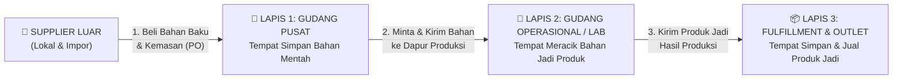
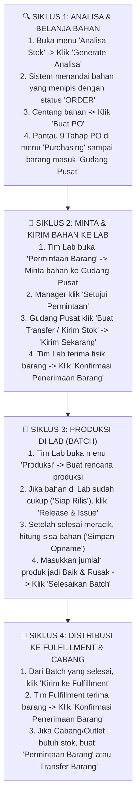
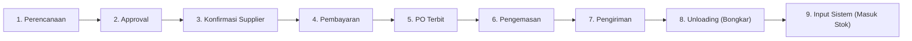
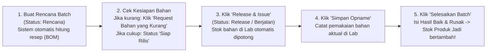

# 📖 Panduan Lengkap Penggunaan Sistem SC Online — Heaven Scent
## (Buku Pedoman Operasional untuk Pengguna Non-Teknis)

> [!NOTE]
> **Untuk Siapa Panduan Ini?**
> Panduan ini disusun khusus untuk **seluruh tim operasional CV. Heaven Scent** (Tim Gudang, Tim Produksi/Laboratorium, Tim Purchasing, Tim Fulfillment/Outlet, Tim Finance, hingga Manager/Owner). Panduan ini menjelaskan **tujuan sistem, alur kerja dari hulu ke hilir, langkah penggunaan setiap menu di layar, serta cara memahami angka perhitungan sistem menggunakan bahasa bisnis sehari-hari.**

---

## Daftar Isi
1. [Mengenal SC Online: Apa Tujuan Sistem Ini?](#1-mengenal-sc-online-apa-tujuan-sistem-ini)
2. [Peta Lokasi Heaven Scent (Analogi "Rumah Besar")](#2-peta-lokasi-heaven-scent-analogi-rumah-besar)
3. [Mengenal Menu di Layar Anda](#3-mengenal-menu-di-layar-anda)
4. [Alur Besar Operasional (Dari Beli Bahan Sampai Jadi Produk)](#4-alur-besar-operasional-dari-beli-bahan-sampai-jadi-produk)
5. [Panduan Langkah-demi-Langkah Setiap Menu Operasional](#5-panduan-langkah-demi-langkah-setiap-menu-operasional)
   - [5.1 Menu Analisa Stok (Melihat Rekomendasi Belanja & Produksi)](#51-menu-analisa-stok-melihat-rekomendasi-belanja--produksi)
   - [5.2 Menu Purchasing (Membeli Bahan ke Supplier dalam 9 Tahap)](#52-menu-purchasing-membeli-bahan-ke-supplier-dalam-9-tahap)
   - [5.3 Menu Permintaan Barang (Minta Stok Antar Gudang)](#53-menu-permintaan-barang-minta-stok-antar-gudang)
   - [5.4 Menu Transfer Barang (Kirim Fisik, Surat Jalan & Cek Barang Rusak)](#54-menu-transfer-barang-kirim-fisik-surat-jalan--cek-barang-rusak)
   - [5.5 Menu Produksi (Meracik Batch di Lab & Cek Sisa Bahan)](#55-menu-produksi-meracik-batch-di-lab--cek-sisa-bahan)
   - [5.6 Menu Stok & Mutasi (Cek Saldo, Kartu Stok & Hitung Fisik/Opname)](#56-menu-stok--mutasi-cek-saldo-kartu-stok--hitung-fisikopname)
6. [Cara Mudah Memahami Perhitungan Sistem (Tanpa Rumus Rumit)](#6-cara-mudah-memahami-perhitungan-sistem-tanpa-rumus-rumit)
7. [Cerita Simulasi Sehari-hari: Perjalanan 1 Botol Reed Diffuser](#7-cerita-simulasi-sehari-hari-perjalanan-1-botol-reed-diffuser)
8. [Panduan Tugas Harian Berdasarkan Jabatan (SOP Per Bagian)](#8-panduan-tugas-harian-berdasarkan-jabatan-sop-per-bagian)
9. [Tanya Jawab & Solusi Kendala Umum (FAQ Operasional)](#9-tanya-jawab--solusi-kendala-umum-faq-operasional)

---

## 1. Mengenal SC Online: Apa Tujuan Sistem Ini?

Sebelum menggunakan sistem terpadu, operasional sehari-hari sering menghadapi pertanyaan seperti:
- *"Bibit parfum Magnolia di Gudang Pusat tinggal berapa liter? Kapan harus pesan lagi ke supplier supaya tidak kehabisan?"*
- *"Supplier A kemarin janji kirim 5 hari, tapi kenyataannya berapa hari baru sampai?"*
- *"Tim Lab mau produksi 200 botol hari ini, apakah botol kaca dan cairannya di Lab cukup?"*
- *"Kemarin Gudang Pusat kirim 100 botol ke Gudang Fulfillment, kenapa yang masuk rak cuma 98 botol? Yang 2 botol ke mana?"*
- *"Berapa modal (HPP) sebenarnya untuk membuat 1 botol produk jadi jika harga bahan dan ongkos kirim dari supplier berubah-ubah?"*

**SC Online (Supply Chain Online) Heaven Scent** hadir untuk menjawab semua pertanyaan tersebut secara **otomatis, akurat, dan tercatat rapi**.

### 4 Tujuan Utama Sistem Ini Bagi Pekerjaan Anda:
1. **Memberi Tahu Kapan & Berapa Harus Belanja:** Sistem menghitung otomatis bahan apa yang stoknya mulai menipis (**ORDER**) dan bahan apa yang masih cukup (**AMAN**), lengkap dengan saran jumlah yang harus dipesan.
2. **Menjaga Stok Tetap Jujur & Transparan:** Tidak ada barang yang bisa hilang tanpa jejak. Setiap barang yang dikirim harus cocok jumlahnya saat diterima (**Jumlah Baik + Jumlah Rusak = Jumlah Dikirim**).
3. **Memudahkan Tim Produksi (Laboratorium):** Saat Tim Lab ingin membuat produk, sistem otomatis menghitungkan takaran resepnya (BOM) dan langsung memberi peringatan dini jika ada bahan di Lab yang kurang.
4. **Melindungi Kerahasiaan Harga & Wewenang Tiap Divisi:** Staf Gudang atau Produksi fokus pada jumlah fisik barang tanpa perlu melihat harga rupiah/tagihan supplier, dan petugas di satu gudang tidak bisa sembarangan mengubah stok di gudang lain.

---

## 2. Peta Lokasi Heaven Scent (Analogi "Rumah Besar")

Agar mudah membayangkan alur barang di dalam SC Online, bayangkan Heaven Scent memiliki **3 area utama (3 Lapis Lokasi)** yang masing-masing punya fungsi khusus:

| Lapis Lokasi | Nama Lokasi | Analogi Mudah | Barang Apa yang Disimpan di Sini? |
| :--- | :--- | :--- | :--- |
| **1. Gudang Pusat** | **Gudang Bahan Baku Pusat** | **Pintu Gerbang & Lumbung Utama** | Hanya menyimpan **Bahan Baku** (alkohol, bibit parfum, pelarut) dan **Bahan Kemas** (botol kosong, tutup, box, stiker) yang baru dibeli dari Supplier. |
| **2. Gudang Operasional / Lab** | **Gudang Operasional / Laboratorium** | **Dapur Produksi / Peracikan** | Tempat menyimpan bahan mentah yang diminta dari Gudang Pusat, lalu **meraciknya menjadi Produk Jadi**. |
| **3. Gudang Fulfillment & Cabang** | **Gudang Fulfillment Pusat & Cabang/Outlet** | **Etalase & Toko Distribusi** | Hanya menyimpan **Produk Jadi** (Parfum, Reed Diffuser, Linen Spray, dll.) yang sudah lulus pemeriksaan kualitas (QC) dan siap didistribusikan ke cabang/pelanggan. |

> [!IMPORTANT]
> **Aturan Emas Perpindahan Barang:**
> Barang **tidak bisa pindah sendiri** antar gudang. Jika Laboratorium butuh bahan dari Gudang Pusat, atau Cabang butuh Produk Jadi dari Fulfillment Pusat, harus diawali dengan **Permintaan Barang** lalu dikirim secara fisik menggunakan **Transfer Barang (Surat Jalan)**.

---

## 3. Mengenal Menu di Layar Anda

Ketika Anda masuk ke dalam sistem, di sisi kiri layar terdapat **Menu Navigasi** yang dikelompokkan menjadi 6 bagian:

| Kelompok Menu | Nama Menu di Layar | Fungsi Singkat untuk Anda |
| :--- | :--- | :--- |
| **MENU** | **Beranda** | Layar utama untuk melihat ringkasan tugas prioritas hari ini, peringatan stok kritis, pesanan pembelian yang terlambat, dan grafik barang rusak. |
| **OPERASIONAL** | **Purchasing** | Tempat membuat pesanan pembelian (PO) ke Supplier dan memantau 9 tahap perjalanan barang sejak dipesan hingga masuk ke Gudang Pusat. |
| **OPERASIONAL** | **Produksi** | Tempat Tim Lab merencanakan pembuatan produk (Batch), mengecek kecukupan bahan, memotong stok bahan sesuai resep, dan mencatat hasil produksi. |
| **OPERASIONAL** | **Permintaan Barang** | Tempat membuat "Tiket Permintaan" stok ke gudang lain (misal: Lab meminta bahan ke Gudang Pusat, atau Cabang meminta produk jadi ke Fulfillment). |
| **OPERASIONAL** | **Transfer Barang** | Tempat membuat "Surat Jalan Pengiriman" antar gudang, mencetak Surat Jalan, dan mengonfirmasi penerimaan barang di gudang tujuan. |
| **OPERASIONAL** | **Analisa Stok** | Pusat perhitungan otomatis yang memberi rekomendasi barang apa yang harus segera dibeli (Lokal/Impor) atau diproduksi ulang (Fulfillment). |
| **STOK & MUTASI** | **Stok & Mutasi** | Tempat melihat saldo stok saat ini di tiap gudang, melakukan hitung fisik (**Opname Fisik**), atau **Mutasi Manual**. |
| **STOK & MUTASI** | **Log Pergerakan** | "Buku Catatan Sejarah" (Kartu Stok) yang merekam setiap barang masuk dan keluar lengkap dengan tanggal, jam, dan nama petugasnya. |
| **MASTER DATA** | **Produk, Kategori, Varian, Klasifikasi ABC, Gudang, Supplier, Satuan (UOM), BOM (Resep), Impor BOM, Divisi** | Katalog data induk perusahaan (daftar barang, kategori, resep produk, daftar supplier, dan satuan ukuran seperti Liter, Mililiter, Jerigen, Pcs). |
| **LAPORAN** | **Laporan & Lead Time Supplier** | Tempat melihat dan mengunduh laporan ke Excel (Laporan Stok Rendah, Produksi, Pembelian, Barang Rusak, hingga Kecepatan Pengiriman Supplier). |
| **SISTEM** | **Pengguna & Peran/Wewenang** | Khusus Manager untuk mengatur akun staf dan pembagian wewenang tiap jabatan. |

---

## 4. Alur Besar Operasional (Dari Beli Bahan Sampai Jadi Produk)

Secara keseluruhan, operasional di Heaven Scent berjalan melalui **4 Siklus Berurutan**:

---

## 5. Panduan Langkah-demi-Langkah Setiap Menu Operasional

Mari kita bahas cara menggunakan setiap menu utama langkah demi langkah sesuai tombol yang tampil di layar.

---

### 5.1 Menu Analisa Stok (Melihat Rekomendasi Belanja & Produksi)

Menu **Analisa Stok** adalah tempat Anda melihat rekomendasi otomatis: *"Hari ini bahan apa yang harus dipesan ke supplier dan berapa banyak?"*

Di bagian atas layar **Analisa Stok**, terdapat **4 Tab**:
1. **Lokal**: Untuk menganalisa bahan baku dan kemasan yang dibeli dari supplier dalam negeri.
2. **Impor**: Untuk menganalisa bahan baku dan kemasan yang dibeli dari luar negeri (dilengkapi pengelompokan prioritas **Kelas A, B, C**).
3. **Fulfillment**: Untuk menganalisa kecukupan stok Produk Jadi di seluruh Gudang Fulfillment Pusat & Cabang.
4. **Riwayat Snapshot**: Arsip hasil analisa yang sudah pernah disimpan/dikunci sebelumnya.

#### Langkah-Langkah Menggunakan Analisa Stok (3 Fase Mudah):
1. **Fase 1 — Klik Tombol `Generate Analisa` (atau `Generate Analisa Impor`):**
   - Sistem akan menghitung pemakaian bahan dan menampilkan rekomendasi di tabel.
   - Perhatikan kolom **Status**:
     - 🔴 **`ORDER`** (atau **`PO`** pada tab Impor): Artinya stok sudah menyentuh atau berada di bawah batas minimum. **Harus segera dipesan!**
     - 🟢 **`AMAN`** (atau **`TIDAK`**): Artinya stok di gudang (ditambah pesanan yang sedang di jalan) masih mencukupi.
2. **Fase 2 — Klik Tombol `Checking (Generate Ulang)` (Opsional):**
   - Gunakan tombol ini jika saat Anda sedang memeriksa tabel analisa, ada barang baru yang baru saja diterima gudang atau ada PO baru yang dibuat, agar sistem langsung menyegarkan angka stok terbaru.
   - Jika suatu bahan memiliki lebih dari satu supplier, Anda juga dapat membandingkan kecepatan kirim dan rekomendasi antar-supplier sebelum memutuskan membeli ke siapa.
3. **Membuat PO Langsung dari Analisa:**
   - Centang kotak pada baris bahan yang berstatus **`ORDER`**.
   - Tombol hijau **`Buat PO`** akan muncul di pojok kanan atas. Klik tombol tersebut!
   - Anda akan langsung diarahkan ke formulir pembuatan PO yang sudah terisi otomatis dengan daftar bahan dan jumlah rekomendasinya.
4. **Fase 3 — Klik Tombol `Finalisasi ke Riwayat`:**
   - Jika Anda ingin menyimpan/mengunci tabel hasil analisa hari ini sebagai arsip laporan, klik **`Finalisasi ke Riwayat`**.

---

### 5.2 Menu Purchasing (Membeli Bahan ke Supplier dalam 9 Tahap)

Menu **Purchasing** mencatat seluruh pesanan pembelian (**Purchase Order / PO**) ke Supplier.
Agar semua divisi mengetahui posisi pesanan secara transparan, setiap PO memiliki **9 Tahap Perjalanan** yang harus dilalui secara berurutan di bagian atas halaman detail PO:

#### Apa yang Dilakukan di Setiap Tahap?
| Tahap | Nama Tahap di Layar | Siapa yang Mengerjakan & Apa Artinya? |
| :---: | :--- | :--- |
| **1** | **Perencanaan** | Staf Purchasing membuat daftar pesanan PO (memilih Supplier, mengisi jumlah beli, satuan beli seperti Kg/Jerigen, harga, diskon, PPN, dan ongkos kirim), lalu mengajukannya ke Manager. |
| **2** | **Approval** | Manager memeriksa rincian harga dan jumlah pesanan, lalu menyetujui (atau menolak/meminta revisi) PO tersebut. |
| **3** | **Konfirmasi Supplier** | Staf Purchasing menghubungi Supplier untuk memastikan kesanggupan jumlah barang, harga, dan estimasi tanggal kedatangan (ETA). |
| **4** | **Pembayaran** | Mencatat pembayaran uang muka (DP), cicilan termin, atau pelunasan. Jika skema pembayaran PO adalah **Tempo**, Staf Purchasing dapat mengklik tombol **Lanjut Tempo** untuk melanjutkan proses tanpa perlu bayar di muka. |
| **5** | **PO Terbit** | Dokumen PO resmi diterbitkan dan dikirimkan kepada Supplier. |
| **6** | **Pengemasan** | Mencatat informasi kesiapan barang yang sedang dikemas oleh Supplier (jumlah koli, berat kg, dan catatan kemas). |
| **7** | **Pengiriman** | Barang sudah dikirim oleh Supplier melalui ekspedisi. Wajib mengisi nama **Ekspedisi**, moda pengiriman (darat/laut/udara), nomor resi/kontainer, dan perkiraan tanggal tiba. |
| **8** | **Unloading (Bongkar Muat)** | Barang tiba di Gudang Pusat! Petugas Gudang membongkar muatan dan mencatat jumlah fisik barang yang datang beserta kondisinya (**Baik** atau **Rusak**). *(Catatan: Di tahap ke-8 ini barang baru dicatat di area bongkar muat, saldo stok gudang belum bertambah).* |
| **9** | **Input Sistem (Posting Stok)** | Setelah pengecekan selesai, Petugas Gudang menyelesaikan **Tahap 9 (Input Sistem)**. Saat inilah **saldo stok di Gudang Pusat resmi bertambah otomatis**, status PO menjadi **Selesai**, dan sistem otomatis merekam lama waktu pengiriman Supplier tersebut! |

> [!TIP]
> **Bagaimana Jika Ada Perubahan Data Saat PO Sudah Berjalan?**
> - **Ubah Info Pengiriman/Catatan (Direct Edit):** Jika hanya ingin melengkapi nomor resi, nama ekspedisi, nomor invoice, atau catatan, klik tombol **`Direct Edit`**. Perubahan langsung tersimpan tanpa perlu persetujuan ulang Manager.
> - **Revisi Harga atau Jumlah Barang (`Ajukan Revisi`):** Jika Supplier mengubah harga, diskon, ongkir, atau jumlah barang (selama PO belum sampai di tahap Unloading), klik tombol **`Ajukan Revisi`**. Setelah Manager menyetujui usulan revisi tersebut, perhitungan harga dan HPP di PO akan otomatis diperbarui.

---

### 5.3 Menu Permintaan Barang (Minta Stok Antar Gudang)

Ingat aturan emas kita: **Meminta barang** dan **Mengirim barang** adalah dua langkah yang terpisah.
Menu **Permintaan Barang** digunakan ketika suatu gudang membutuhkan pasokan barang dari gudang lain.

Terdapat **2 Jenis Permintaan**:
1. **Bahan Baku Operasional**: Digunakan oleh Tim Lab untuk meminta bahan baku atau kemasan ke Gudang Pusat guna keperluan produksi.
2. **Produk Jadi Fulfillment**: Digunakan oleh Gudang Fulfillment untuk meminta stok parfum siap jual.

#### Langkah-Langkah di Menu Permintaan Barang:
1. **Membuat Permintaan:**
   - Buka menu **`Permintaan Barang`** -> Klik **`Buat Permintaan`**.
   - Pilih **Jenis Permintaan**, **Gudang Pemohon** (gudang Anda), dan **Gudang Penyedia** (gudang tempat Anda meminta).
   - Pilih daftar barang dan isi jumlah yang diminta, lalu simpan.
2. **Mengajukan ke Manager:**
   - Klik tombol **`Ajukan ke Manajer`**. Status dokumen berubah menjadi **Diajukan** (kuning).
3. **Persetujuan Manager:**
   - Manager membuka detail permintaan tersebut, lalu mengklik tombol hijau **`Setujui Permintaan`** (atau **`Tolak`** beserta alasannya).
   - Setelah disetujui, status berubah menjadi **Disetujui** (hijau).
   - *(Penting: Sampai tahap ini, saldo stok fisik di gudang belum berubah karena barangnya belum dikirim).*
4. **Lanjut ke Pengiriman Fisik:**
   - Setelah berstatus **Disetujui**, Petugas Gudang Penyedia mengklik tombol **`Buat Transfer / Kirim Stok`** di pojok kanan atas halaman permintaan tersebut.

> [!NOTE]
> **Bagaimana Jika Permintaan Sudah Disetujui Manager, Tapi Jumlahnya Ingin Diubah?**
> Selama barangnya belum dibuatkan pengiriman (Transfer), pemohon masih bisa mengklik tombol **`Revisi Permintaan`**. Namun demi keamanan, setiap kali permintaan yang sudah disetujui diubah isinya, statusnya akan **otomatis kembali menjadi "Diajukan"** sehingga wajib disetujui ulang oleh Manager.

---

### 5.4 Menu Transfer Barang (Kirim Fisik, Surat Jalan & Cek Barang Rusak)

Menu **Transfer Barang** digunakan untuk mencatat pengiriman fisik barang dari **Gudang Asal (Pengirim)** ke **Gudang Tujuan (Penerima)**.

#### Langkah-Langkah di Menu Transfer Barang:
1. **Membuat Draft Transfer:**
   - Dapat dibuat langsung dengan mengklik tombol **`Buat Transfer / Kirim Stok`** dari halaman Permintaan Barang yang sudah disetujui, dari halaman Batch Produksi yang sudah selesai, atau melalui menu **`Transfer Barang`** -> **`Buat Transfer`** (misalnya untuk kirim stok antar cabang Fulfillment).
2. **Mengirim Barang (Barang Berangkat):**
   - Saat barang fisik diserahkan ke pengantar/kurir, Petugas Gudang Pengirim mengklik tombol **`Kirim Sekarang (In Transit)`**.
   - **Apa yang terjadi di sistem?**
     - Status berubah menjadi **In Transit (Dikirim)**.
     - Saldo stok di **Gudang Pengirim langsung berkurang** saat itu juga.
     - Saldo stok di **Gudang Penerima belum bertambah** (karena barang masih di perjalanan), tetapi tercatat sebagai **Stok Berjalan**.
   - Klik tombol **`Cetak Surat Jalan`** untuk mencetak dokumen pengiriman yang dibawa bersama barang.
3. **Menerima Barang di Gudang Tujuan (QC Penerimaan):**
   - Saat barang tiba di Gudang Tujuan, **Petugas Gudang Penerima** membuka detail Transfer tersebut lalu mengklik tombol hijau **`Konfirmasi Penerimaan Barang`**.
   - Akan muncul jendela pemeriksaan fisik (QC). Untuk setiap barang, masukkan:
     - **Jumlah Baik**: Jumlah barang yang utuh dan layak pakai.
     - **Jumlah Rusak**: Jumlah barang yang pecah/bocor/rusak selama perjalanan.
     - **Keterangan Rusak**: Wajib diisi jika ada barang yang rusak (contoh: *"2 botol retak di kardus nomor 3"*).

> [!CAUTION]
> **2 Aturan Pengaman Ketat Saat Menerima Transfer Barang:**
> 1. **Aturan Anti-Selisih (`Jumlah Baik + Jumlah Rusak = Jumlah Dikirim`):**
>    Jika Gudang Pengirim mengirim **100 pcs**, maka saat diterima total **Jumlah Baik + Jumlah Rusak harus pas 100 pcs** (contoh: 98 Baik + 2 Rusak). Jika Anda mengisi 95 Baik + 0 Rusak (total 95), tombol konfirmasi **tidak akan bisa diklik**! Hanya **98 pcs (Jumlah Baik)** yang akan masuk menambah saldo stok Gudang Tujuan, sedangkan **2 pcs (Jumlah Rusak)** otomatis tercatat di Laporan Kerusakan (Defect).
> 2. **Aturan Pemisahan Petugas Pengirim & Penerima:**
>    Petugas yang mengklik **`Kirim Sekarang`** **TIDAK BOLEH** menjadi orang yang mengklik **`Konfirmasi Penerimaan Barang`** (kecuali Manager). Tujuannya agar pengirim tidak bisa mengonfirmasi sendiri barang yang dikirimnya. Penerimaan wajib dikonfirmasi oleh petugas di Gudang Tujuan!

---

### 5.5 Menu Produksi (Meracik Batch di Lab & Cek Sisa Bahan)

Menu **Produksi** digunakan oleh Tim Laboratorium / Operasional untuk mengelola proses peracikan parfum (**Batch Produksi**). Satu nomor Batch mendukung **Multi-Produk** (dapat meracik beberapa varian produk jadi sekaligus dalam satu sesi produksi).

#### Langkah-Langkah Menggunakan Menu Produksi:
1. **Langkah 1 — Buat Rencana Produksi (`Rencana`):**
   - Buka menu **`Produksi`** -> Klik **`Buat Batch Produksi`**.
   - Pilih **Gudang Operasional** (tempat meracik) dan **Gudang Tujuan** (tujuan pengiriman produk jadi, misal Gudang Fulfillment Pusat).
   - Pilih satu atau beberapa **Produk Jadi** yang akan diproduksi beserta **Target Rencana** masing-masing.
   - Begitu disimpan, sistem otomatis membaca resep (**BOM**) dan menghitung daftar **Alokasi Bahan Baku** yang dibutuhkan!
2. **Langkah 2 — Periksa Kotak "Kesiapan Bahan":**
   - Di bagian atas halaman detail Batch, perhatikan kotak indikator **Kesiapan Bahan**:
     - 🔴 **`Stok Kurang`** (muncul peringatan merah): Artinya saldo fisik bahan baku di Lab saat ini belum mencukupi. Anda cukup mengklik tombol **`Request Bahan yang Kurang`** di panel kanan, maka sistem otomatis membuatkan Permintaan Barang ke Gudang Pusat sesuai jumlah bahan yang kurang!
     - 🟡 **`Defisit Rencana`**: Artinya stok fisik di Lab cukup untuk Batch ini saja, tetapi jika digabung dengan rencana Batch lain yang sedang antre, stoknya akan kurang.
     - 🟢 **`Siap Rilis`**: Artinya seluruh bahan baku dan kemasan sudah tersedia lengkap di Gudang Operasional/Lab!
3. **Langkah 3 — Mulai Produksi: Klik Tombol `Release & Issue`:**
   - Saat bahan sudah lengkap dan Tim Lab siap mulai meracik, klik tombol **`Release & Issue`**.
   - Status Batch berubah menjadi **`Release (Berjalan)`** dan **saldo stok bahan baku di Gudang Operasional/Lab otomatis dipotong** sesuai takaran resep.
4. **Langkah 4 — Catat Pemakaian Bahan Aktual: Klik `Simpan Opname`:**
   - Selama atau setelah proses meracik, catat realisasi pemakaian bahan di lapangan pada bagian **Opname Bahan Batch** lalu klik **`Simpan Opname`**. Sistem akan menghitung apakah pemakaian bahan aktual sama persis dengan resep, lebih hemat, atau lebih boros (misalnya karena penguapan/tumpah).
5. **Langkah 5 — Input Hasil Produk Jadi: Klik `Selesaikan Batch`:**
   - Setelah proses pengisian botol selesai, masukkan hasil akhir untuk setiap produk jadi:
     - **Hasil Baik**: Jumlah parfum jadi yang lulus QC dan siap jual.
     - **Hasil Rusak**: Jumlah parfum yang gagal/cacat saat produksi.
   - **Syarat Wajib:** Jumlah **`Hasil Baik + Hasil Rusak`** harus sama persis dengan **`Target Rencana`**!
   - Klik **`Selesaikan Batch`**. Saldo stok Produk Jadi sejumlah **Hasil Baik** akan otomatis bertambah di Gudang Operasional dan sistem langsung menghitung persentase keberhasilan (**Yield %**).
6. **Langkah 6 — Kirim Hasil Produksi ke Gudang Fulfillment:**
   - Setelah Batch berstatus **Selesai**, klik tombol **`Kirim ke Fulfillment`** di pojok kanan atas untuk membuat pengiriman (Transfer) produk jadi menuju Gudang Fulfillment.

---

### 5.6 Menu Stok & Mutasi (Cek Saldo, Kartu Stok & Hitung Fisik/Opname)

Di kelompok menu **STOK & MUTASI**, terdapat 2 layar utama:

#### A. Layar `Stok & Mutasi`
Menampilkan daftar saldo seluruh barang di gudang dengan **4 kolom informasi utama**:
1. **Batas Min (Analisa)**: Angka batas minimum stok aman hasil perhitungan menu Analisa Stok.
2. **Stok Aktual**: Jumlah barang fisik yang **benar-benar ada di rak gudang saat ini**.
3. **Stok Berjalan**: Jumlah barang yang **sedang dalam perjalanan menuju gudang tersebut** (mencakup pesanan PO yang sedang berjalan menuju Gudang Pusat, Transfer barang yang sedang *In Transit* di jalan, serta Rencana Batch Produksi yang sedang berjalan untuk Produk Jadi).
4. **Status (`AMAN` / `ORDER`)**:
   - Jika **`Stok Aktual + Stok Berjalan`** masih di atas **`Batas Min`**, maka statusnya 🟢 **`AMAN`**.
   - Jika **`Stok Aktual + Stok Berjalan`** sudah menyentuh atau berada di bawah **`Batas Min`**, maka statusnya 🔴 **`ORDER`**.

Di pojok kanan atas layar **Stok & Mutasi**, terdapat 2 tombol:
- **`Opname Fisik`**: Digunakan saat kegiatan hitung fisik gudang (Stock Opname). Anda cukup memasukkan jumlah fisik hasil hitungan nyata di rak, lalu sistem otomatis menyesuaikan selisihnya (kurang/lebih) ke dalam Kartu Stok.
- **`Mutasi Manual`**: Digunakan oleh petugas berwenang untuk mencatat pemasukan atau pengeluaran stok manual disertai alasan yang jelas.

#### B. Layar `Log Pergerakan` (Kartu Stok Digital)
Jika Anda ingin menelusuri riwayat keluar-masuk suatu barang, bukalah menu **`Log Pergerakan`** (atau klik tombol **Kartu Stok** pada baris barang di tabel stok). Anda dapat melihat tanggal, jam, jenis transaksi (Pembelian PO, Transfer, Produksi Batch, atau Opname), jumlah masuk/keluar, saldo sebelum dan sesudah, serta nama petugasnya.

---

## 6. Cara Mudah Memahami Perhitungan Sistem (Tanpa Rumus Rumit)

Anda tidak perlu menghitung manual dengan kalkulator karena sistem sudah menghitung semuanya secara otomatis. Namun, agar Anda memahami **bagaimana sistem menghasilkan angka rekomendasi**, berikut penjelasan logikanya dengan bahasa sehari-hari:

### 1. Bagaimana Sistem Menghitung "Pemakaian Harian Rata-Rata (ADU)"?
- **Untuk Bahan Lokal & Produk Jadi:** Sistem mengambil angka rata-rata pemakaian/penjualan per bulan selama 4 bulan terakhir, lalu membaginya dengan **30 hari**.
  - *Contoh:* Jika rata-rata pemakaian Alkohol sebulan adalah **30.000 ml**, maka pemakaian hariannya adalah `30.000 ÷ 30 = 1.000 ml per hari`.
- **Untuk Bahan Impor:** Karena waktu tunggu pengiriman kapal/kargo dari luar negeri sangat panjang, sistem membagi total pemakaian periode analisa (misal 122 hari) untuk mendapatkan pemakaian harian dasar (**ADU Base**), lalu menambahkan faktor penyesuaian selama masa tunggu pengiriman (**ADU ETA**).

### 2. Bagaimana Sistem Tahu "Berapa Lama Supplier Mengirim Barang (Lead Time)"?
- Setiap kali sebuah PO melewati **Tahap 1 sampai Tahap 9 (Input Sistem)**, sistem mencatat waktu nyata (dalam menit, jam, dan hari) yang dibutuhkan di setiap tahap:
  - **Waktu Internal:** Tahap Perencanaan (1), Approval (2), Pembayaran (4), Penerbitan PO (5), Bongkar Muat/Unloading (8), dan Input Sistem (9).
  - **Waktu Supplier:** Tahap Konfirmasi Supplier (3) dan Pengemasan (6).
  - **Waktu Logistik/Pengiriman:** Tahap Pengiriman Ekspedisi (7).
- Dari seluruh PO yang sudah selesai, sistem otomatis menghitung **Rata-Rata Waktu Tunggu (Average Lead Time)** dan **Waktu Tunggu Terlama (Max Lead Time)** dalam dua tingkatan:
  1. **Spesifik per Supplier & Barang:** *"Berapa hari rata-rata Supplier A mengirim Botol 50ml?"*
  2. **Rata-Rata Umum Supplier:** Jika barang tersebut baru pertama kali dibeli dari Supplier A, sistem melihat rata-rata kecepatan Supplier A saat mengirim barang-barang lainnya.

### 3. Apa Itu "Stok Pengaman / Cadangan Darurat (Safety Stock)"?
- **Stok Pengaman** adalah cadangan ekstra yang disiapkan untuk mengantisipasi keterlambatan pengiriman Supplier.
- Sistem menghitungnya dari **selisih antara Waktu Tunggu Terlama (Max Lead Time) dikurangi Waktu Tunggu Rata-Rata (Average Lead Time)**, ditambah dengan **Hari Cadangan Tambahan (Buffer Hari)**.
  - *Contoh:* Jika Supplier rata-rata mengirim dalam **13 hari**, namun pernah terlambat hingga **22 hari** (selisih keterlambatan 9 hari), ditambah cadangan manual **2 hari**, maka **Stok Pengaman** kita adalah `9 + 2 = 11 hari` pemakaian!

### 4. Apa Itu "Batas Minimum (Titik Pesan Ulang)" dan "Target Stok"?
- **Batas Minimum:** Adalah **"Garis Alarm"**. Begitu stok kita turun menyentuh angka ini, kita **wajib memesan ulang hari itu juga** agar stok tidak habis saat menunggu barang PO tiba.
  - *Cara Hitung Bahasa Sehari-hari:* `Pemakaian Harian × (Rata-Rata Hari Kirim + Hari Stok Pengaman)`.
- **Target Stok:** Adalah jumlah stok ideal yang ingin kita capai supaya kita tidak perlu memesan setiap hari, melainkan cukup bertahan hingga **Periode Tinjau Ulang berikutnya** (misal 15 hari untuk Lokal, 30 hari untuk Impor).
  - *Cara Hitung Bahasa Sehari-hari:* `Pemakaian Harian × (Rata-Rata Hari Kirim + Hari Stok Pengaman + Periode Tinjau Ulang)`.

### 5. Bagaimana Sistem Menghitung "Jumlah Rekomendasi Pesanan (MOQ)"?
- Sistem menjumlahkan **Stok Fisik Saat Ini + Stok PO yang Sedang di Jalan**, lalu membandingkannya dengan **Batas Minimum** (untuk Lokal) atau **Target Stok setelah dikurangi kebutuhan masa tunggu** (untuk Impor).
- Jika hasilnya kurang (minus), sistem melihat aturan **MOQ (Minimal Pembelian Supplier)** dan **membulatkan jumlah kekurangan tersebut ke atas** mengikuti kelipatan minimal pembelian Supplier!
  - *Contoh:* Jika kekurangan alkohol kita adalah **23.442 ml**, sedangkan Supplier mewajibkan pembelian kelipatan jerigen **5.000 ml (MOQ)**, maka sistem otomatis membulatkan rekomendasi pesanan ke atas menjadi **25.000 ml (5 Jerigen)**.

### 6. Apa Arti Kelas Wajib A, A, B, dan C pada Bahan Impor (Klasifikasi ABC)?
- Untuk bahan impor yang waktu tunggunya berbulan-bulan, sistem memberikan tambahan hari pengaman otomatis berdasarkan tingkat kepentingannya:
  - 🥇 **Kelas Wajib A & Kelas A (*Fast Moving*):** Barang prioritas utama, otomatis mendapat tambahan pengaman **+4 hari**.
  - 🥈 **Kelas B (*Medium Moving*):** Barang prioritas menengah, otomatis mendapat tambahan pengaman **+2 hari**.
  - 🥉 **Kelas C (*Slow Moving*):** Barang perputaran lambat, tambahan pengaman **+0 hari**.

### 7. Bagaimana Sistem Menghitung Modal Barang (HPP) Secara Otomatis?
- **Untuk Bahan Baku & Kemasan:** Saat membeli barang lewat PO, sering terdapat **Diskon**, **PPN (Pajak)**, **Ongkos Kirim**, atau **Biaya Tambahan**. Sistem membagi rata biaya-biaya tersebut secara proporsional ke setiap barang di dalam PO, lalu membaginya ke satuan dasar terkecil (misal per `ml` atau per `pcs`). Begitu barang PO diterima di gudang, harga bersih dari PO terbaru itulah yang otomatis menjadi **HPP Bahan**!
- **Untuk Produk Jadi (Parfum):** Sistem otomatis mengalikan takaran setiap bahan di dalam **Resep (BOM)** dengan **HPP Bahan** masing-masing, lalu menjumlahkannya menjadi **HPP 1 Botol Produk Jadi**.

---

## 7. Cerita Simulasi Sehari-hari: Perjalanan 1 Botol Reed Diffuser

Mari kita ikuti contoh nyata bagaimana seluruh tim bekerja sama di dalam sistem untuk memproduksi **100 Botol Parfum / Reed Diffuser 50ml**:

### 🌅 Pagi Hari — Tim Purchasing & Gudang Pusat
1. **Rina (Purchasing)** membuka menu **`Analisa Stok`** -> klik **`Generate Analisa`**.
2. Rina melihat bahan **Alkohol 96%** dan **Botol Kaca 50ml** berstatus merah **`ORDER`**. Rina mencentang keduanya lalu klik **`Buat PO`**.
3. Setelah **Andyka (Manager)** menyetujui PO tersebut di Tahap 2, Rina mengawal tahapan PO mulai dari Konfirmasi Supplier (Tahap 3), Pembayaran/Tempo (Tahap 4), PO Terbit (Tahap 5), Pengemasan (Tahap 6), hingga Pengiriman Ekspedisi (Tahap 7).
4. Ketika truk ekspedisi tiba di Gudang Pusat, **Budi (Petugas Gudang Pusat)** membongkar muatan, mencatat hasil hitung fisik di **Tahap 8 (Unloading)**, lalu menyelesaikan **Tahap 9 (Input Sistem)**.
5. Saldo **Alkohol 96%** dan **Botol Kaca 50ml** di **Gudang Pusat** kini resmi bertambah!

### ☀️ Siang Hari — Tim Lab Produksi & Pengiriman Bahan
6. **Dedi (Tim Operasional Lab)** mendapat jadwal membuat **100 botol Parfum 50ml**. Dedi membuka menu **`Produksi`** -> klik **`Buat Batch Produksi`** dan memasukkan target 100 botol.
7. Sistem otomatis menghitung resepnya (BOM): butuh **4.000 ml Alkohol**, **800 ml Bibit Parfum**, **100 pcs Botol 50ml**, dan **100 pcs Tutup Botol**.
8. Ternyata di Gudang Lab saat ini botol kaca tinggal 20 pcs (kurang 80 pcs). Indikator merah **`Stok Kurang`** langsung muncul di layar Dedi.
9. Dedi cukup mengklik tombol **`Request Bahan yang Kurang`** di halaman Batch tersebut! Sistem otomatis membuatkan tiket **Permintaan Barang** sebanyak 80 pcs botol kaca ke Gudang Pusat.
10. **Andyka (Manager)** membuka tiket permintaan tersebut dan mengklik **`Setujui Permintaan`**.
11. **Budi (Gudang Pusat)** mengklik **`Buat Transfer / Kirim Stok`** -> **`Kirim Sekarang (In Transit)`**, mencetak Surat Jalan, lalu mengirim 80 botol kaca ke Lab.
12. Sesampainya di Lab, **Dedi** memeriksa fisik botol: semuanya utuh (80 Baik, 0 Rusak). Dedi mengklik **`Konfirmasi Penerimaan Barang`**.

### 🌇 Sore Hari — Proses Meracik & Distribusi ke Fulfillment
13. Karena botol kaca sudah diterima di Lab, indikator kesiapan di halaman Batch Dedi otomatis berubah menjadi hijau **`Siap Rilis`**!
14. Dedi mengklik tombol **`Release & Issue`** (stok bahan di Lab otomatis terpotong) dan mulai meracik parfum.
15. Selesai meracik, Dedi mencatat pemakaian bahan aktual lewat **`Simpan Opname`**, lalu memeriksa hasil botol jadi: **99 botol Bagus (`Hasil Baik = 99`)** dan **1 botol cacat tutup (`Hasil Rusak = 1`)**. Totalnya pas `99 + 1 = 100 botol` (Keberhasilan / Yield = 99%).
16. Dedi mengklik **`Selesaikan Batch`**, lalu langsung mengklik **`Kirim ke Fulfillment`** untuk mengirim 99 botol bagus tadi ke Gudang Fulfillment Pusat.
17. **Sari (Tim Fulfillment)** menerima 99 botol tersebut, memeriksa kondisinya, dan mengklik **`Konfirmasi Penerimaan Barang`**. Kini 99 botol parfum resmi masuk ke stok Gudang Fulfillment dan siap didistribusikan ke cabang Surabaya atau Solo!

---

## 8. Panduan Tugas Harian Berdasarkan Jabatan (SOP Per Bagian)

Berikut adalah daftar ceklis pekerjaan harian untuk masing-masing bagian:

### 👩‍💼 1. Bagian Purchasing (Contoh: Rina)
- [ ] Buka **`Beranda`** -> Cek daftar bahan lokal/impor yang perlu dipesan dan PO yang mendekati jatuh tempo.
- [ ] Buka **`Analisa Stok`** -> Klik **`Generate Analisa`** (Lokal & Impor) untuk melihat barang berstatus **`ORDER`**.
- [ ] Centang bahan yang perlu dibeli -> Klik **`Buat PO`**.
- [ ] Buka **`Purchasing`** -> Perbarui progres Tahap 3 s/d Tahap 7 pada PO yang sedang berjalan, serta catat pembayaran/cicilan termin.
- [ ] Jika ada perubahan harga atau jumlah dari supplier saat PO berjalan, klik **`Ajukan Revisi`** pada detail PO.

### 📦 2. Bagian Gudang Pusat (Contoh: Budi)
- [ ] Buka **`Purchasing`** -> Untuk PO yang barangnya sudah tiba di gudang, catat hasil cek fisik bongkar muat di **Tahap 8 (Unloading)** dan masukkan ke saldo stok lewat **Tahap 9 (Input Sistem)**.
- [ ] Buka **`Permintaan Barang`** -> Cek permintaan bahan dari Lab yang sudah berstatus **Disetujui**, lalu klik **`Buat Transfer / Kirim Stok`**.
- [ ] Buka **`Transfer Barang`** -> Klik **`Kirim Sekarang (In Transit)`** dan **`Cetak Surat Jalan`** saat barang diserahkan ke pengantar.

### 🧪 3. Bagian Produksi / Laboratorium Operasional (Contoh: Dedi)
- [ ] Buka **`Produksi`** -> Buat rencana Batch Produksi harian.
- [ ] Jika muncul indikator merah **`Stok Kurang`**, klik **`Request Bahan yang Kurang`**.
- [ ] Buka **`Transfer Barang`** -> Klik **`Konfirmasi Penerimaan Barang`** saat kiriman bahan dari Gudang Pusat tiba di Lab.
- [ ] Kembali ke **`Produksi`** -> Klik **`Release & Issue`** saat mulai meracik, isi **`Simpan Opname`**, lalu klik **`Selesaikan Batch`** dan **`Kirim ke Fulfillment`**.
- [ ] Buka **`Stok & Mutasi`** -> Lakukan **Opname Fisik** secara berkala untuk mencocokkan saldo fisik rak.

### 🏬 4. Bagian Fulfillment & Cabang (Contoh: Sari)
- [ ] Buka **`Transfer Barang`** -> Klik **`Konfirmasi Penerimaan Barang`** saat kiriman Produk Jadi dari Lab tiba di Gudang Fulfillment.
- [ ] Buka **`Analisa Stok`** (Tab **Fulfillment**) -> Pantau kebutuhan stok produk jadi di setiap cabang.
- [ ] Buka **`Permintaan Barang`** atau **`Transfer Barang`** -> Proses pengiriman stok produk jadi dari Fulfillment Pusat ke cabang (Surabaya, Solo, dll.).

### 👨‍💼 5. Bagian Manager / Owner (Contoh: Andyka)
- [ ] Buka **`Beranda`** -> Pantau ringkasan antrean persetujuan, komitmen pembayaran PO, stok kritis, dan tingkat kerusakan barang (Defect Rate).
- [ ] Buka **`Purchasing`** -> Berikan persetujuan PO baru di **Tahap 2 (Approval)** atau tinjau **Usulan Revisi PO**.
- [ ] Buka **`Permintaan Barang`** -> Klik **`Setujui Permintaan`** atau **`Tolak`** pada tiket permintaan barang.
- [ ] Buka **`Laporan`** & **`Lead Time Supplier`** -> Evaluasi ketepatan waktu pengiriman supplier dan laporan bulanan.

---

## 9. Tanya Jawab & Solusi Kendala Umum (FAQ Operasional)

### ❓ 1. "Kenapa tombol `Release & Issue` di halaman Produksi tidak bisa diklik atau muncul pesan gagal?"
**Penyebab & Solusi:**
Sistem menolak memulai produksi jika **saldo fisik bahan baku di Gudang Operasional/Lab saat itu kurang** dari yang dibutuhkan resep (BOM).
- Periksa tabel **Alokasi Bahan Baku** di halaman Batch tersebut, cari baris bahan yang berstatus merah (`Kurang`).
- Klik tombol **`Request Bahan yang Kurang`** untuk meminta kekurangannya ke Gudang Pusat, atau pastikan kiriman Transfer bahan yang sudah sampai di Lab telah diklik **`Konfirmasi Penerimaan Barang`**.

### ❓ 2. "Kenapa di halaman Transfer Barang tidak muncul tombol `Konfirmasi Penerimaan Barang`?"
**Penyebab & Solusi:**
Di layar tertulis: *"Penerimaan memerlukan petugas gudang yang berbeda."*
- Hal ini terjadi karena **akun Anda sendiri yang sebelumnya mengklik tombol `Kirim Sekarang`** pada dokumen Transfer tersebut. Sesuai aturan audit internal, pengirim tidak diperbolehkan mengonfirmasi penerimaan barangnya sendiri.
- Mintalah petugas yang berwenang di **Gudang Tujuan (Penerima)** atau **Manager** untuk masuk menggunakan akunnya dan mengklik **`Konfirmasi Penerimaan Barang`**.

### ❓ 3. "Saat mau klik `Konfirmasi Penerimaan Barang` (di Transfer) atau `Selesaikan Batch` (di Produksi), kenapa tombol Simpannya tidak aktif?"
**Penyebab & Solusi:**
Periksa kembali penjumlahan angka yang Anda masukkan:
- Pada **Transfer Barang**: Total **`Jumlah Baik + Jumlah Rusak`** wajib **sama persis** dengan **`Jumlah Dikirim`**. Selain itu, apabila **`Jumlah Rusak` lebih dari 0**, kolom **Keterangan Rusak wajib diisi** (tidak boleh dikosongkan).
- Pada **Batch Produksi**: Total **`Hasil Baik + Hasil Rusak`** untuk setiap produk jadi wajib **sama persis** dengan **`Target Rencana`**.

### ❓ 4. "Barang dari Supplier sudah sampai di Gudang Pusat dan sudah dicatat di Tahap 8 (Unloading), tapi kenapa di menu `Stok & Mutasi` saldonya belum bertambah?"
**Penyebab & Solusi:**
Pada **Tahap 8 (Unloading)**, barang baru dicatat di area bongkar muat untuk pemeriksaan fisik. Saldo stok Gudang Pusat baru akan bertambah secara resmi setelah Petugas Gudang menyelesaikan **Tahap 9 (Input Sistem)** pada halaman detail PO tersebut.

### ❓ 5. "Bagaimana jika terjadi salah kirim atau pembatalan pada Transfer yang statusnya sudah telanjur `In Transit (Dikirim)`?"
**Penyebab & Solusi:**
Selama barang tersebut **belum dikonfirmasi diterima** oleh gudang tujuan, petugas pengirim (atau Manager) masih dapat membuka detail Transfer tersebut lalu mengklik tombol merah **`Batalkan Transfer`** disertai alasan pembatalannya. Sistem akan **otomatis mengembalikan saldo stok** yang tadi terpotong kembali ke Gudang Pengirim secara utuh!

### ❓ 6. "Kenapa akun saya hanya menampilkan tanda strip (`—`) pada kolom Harga, HPP, dan Nilai Stok?"
**Penyebab & Solusi:**
Hal tersebut adalah fitur keamanan **Kerahasiaan Harga**. Hanya jabatan yang memiliki wewenang keuangan & pengadaan (Purchasing dan Manager) yang dapat melihat nominal harga beli, HPP, dan nilai rupiah persediaan.
