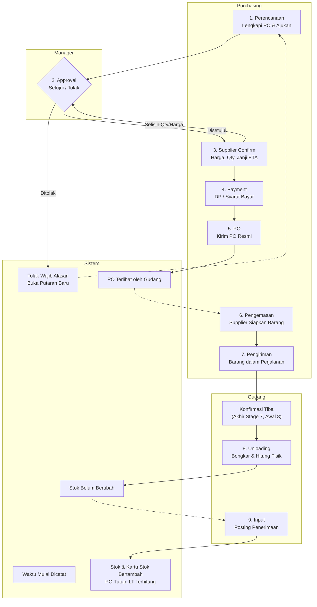
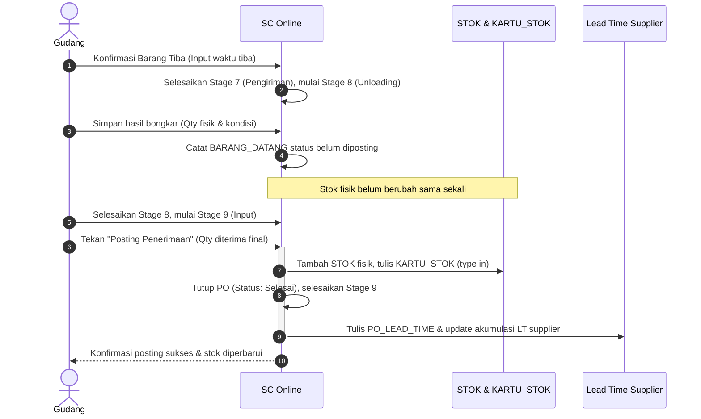
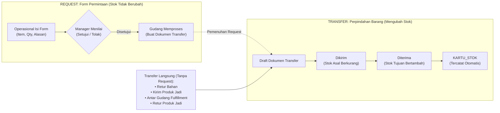
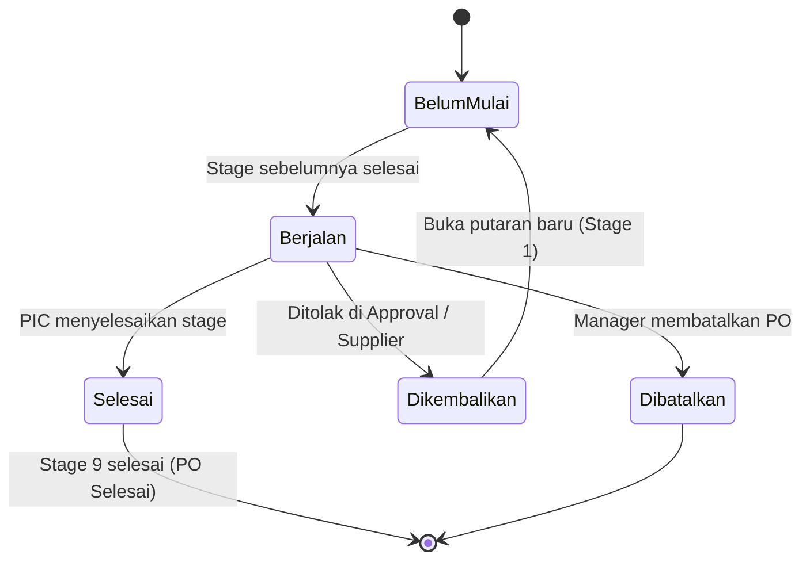
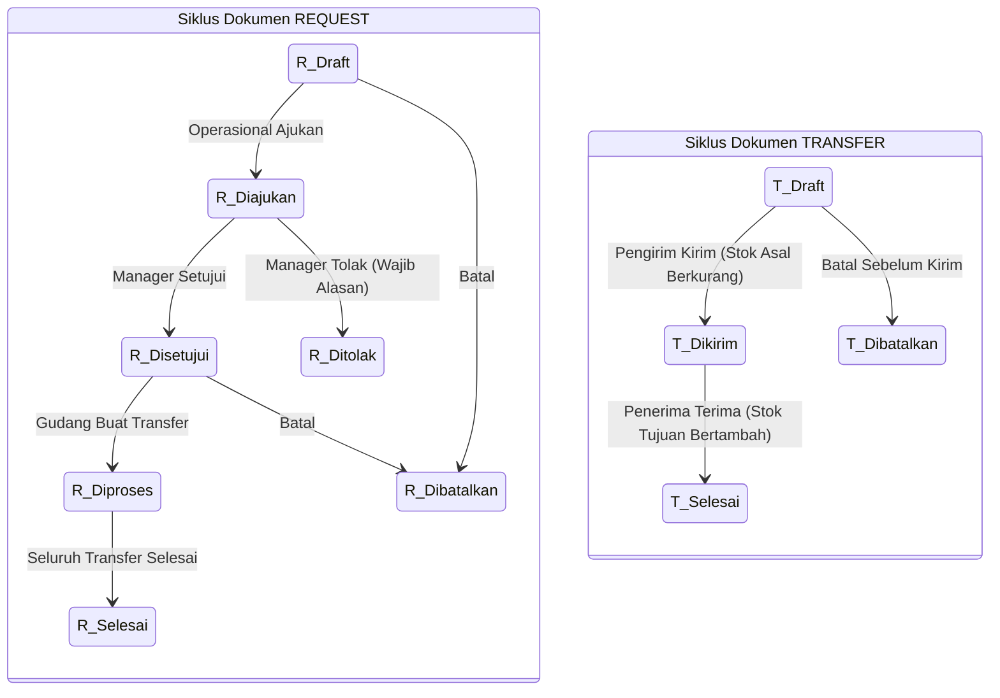
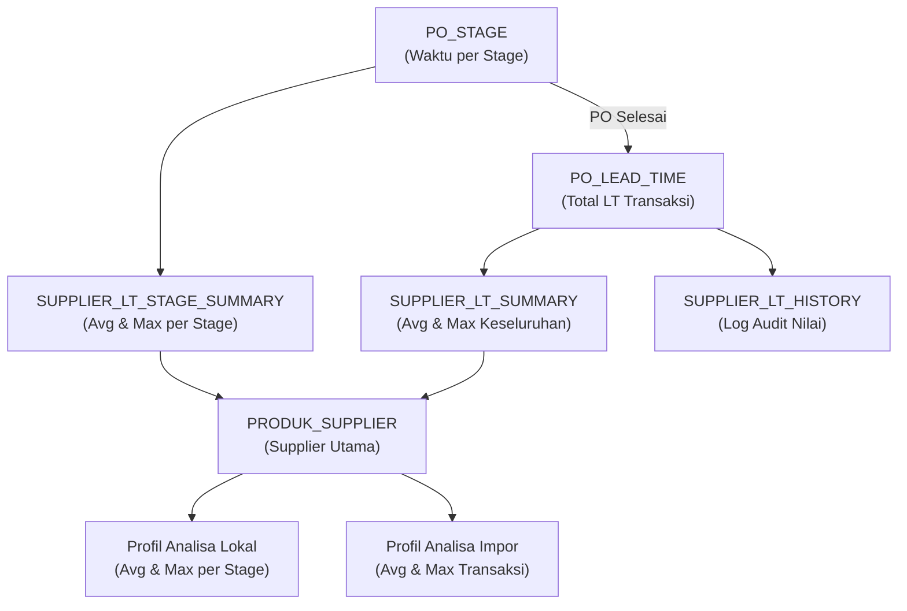
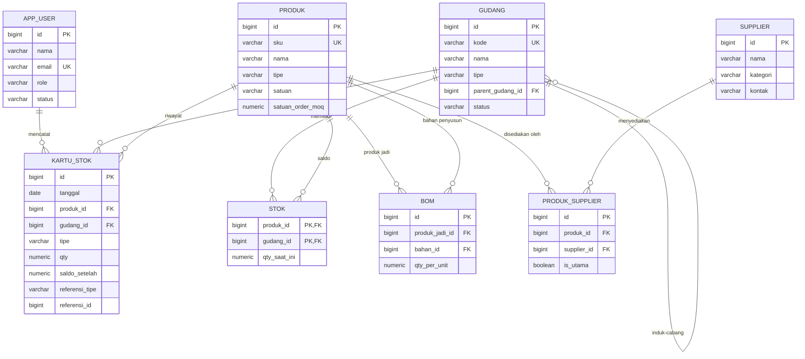
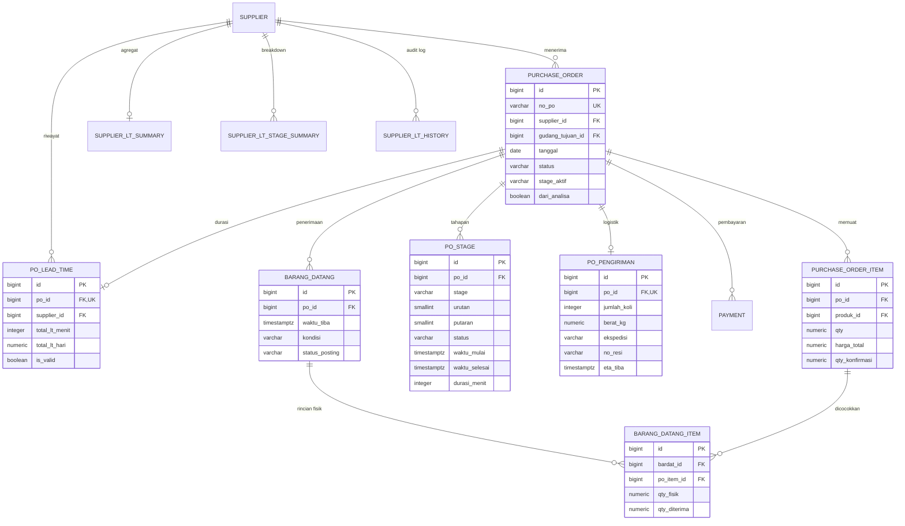
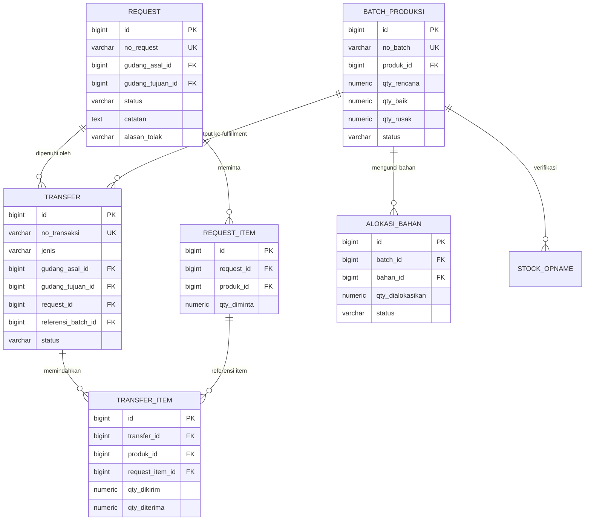
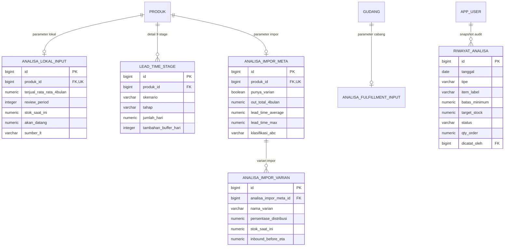

# RANCANGAN SISTEM SUPPLY CHAIN ONLINE (SC ONLINE)
**Product Requirements Document (PRD)**  
*Alur Sistem, Struktur Menu, Functional Requirement, Rumus Analisa, ERD & Rancangan Database*  
**CV. Heaven Scent — Divisi IT**  
**Versi:** 2.2 — Purchasing 9 Stage, Lead Time, Request & Transfer  
**Tanggal:** 3 November 2026  
**Status Acuan:** Acuan Utama / Terkini (Menggantikan PRD v2.0 dan Dokumen Rekomendasi v2.1)

---

## Daftar Isi
- [Kontrol Dokumen](#kontrol-dokumen)
  - [Riwayat Versi](#riwayat-versi)
  - [Panduan Membaca](#panduan-membaca)
  - [Konvensi Penulisan](#konvensi-penulisan)
- [1. Ringkasan Eksekutif](#1-ringkasan-eksekutif)
  - [1.1 Perubahan Utama](#11-perubahan-utama)
  - [1.2 Yang Dipertahankan](#12-yang-dipertahankan)
  - [1.3 Yang Perlu Diputuskan](#13-yang-perlu-diputuskan)
- [2. Ruang Lingkup, Aktor & Role](#2-ruang-lingkup-aktor--role)
  - [2.1 Role Aplikasi](#21-role-aplikasi)
  - [2.2 Pihak Eksternal](#22-pihak-eksternal)
  - [2.3 Tanggung Jawab per Stage](#23-tanggung-jawab-per-stage)
- [3. Alur Sistem End-to-End (Best Case)](#3-alur-sistem-end-to-end-best-case)
  - [3.1 Alur Purchasing](#31-alur-purchasing)
  - [3.2 Alur Produksi](#32-alur-produksi)
  - [3.3 Alur Request](#33-alur-request)
  - [3.4 Alur Transfer](#34-alur-transfer)
  - [3.5 Alur Fulfillment & Distribusi](#35-alur-fulfillment--distribusi)
  - [3.6 Alur Analisa Stok & Keterhubungannya](#36-alur-analisa-stok--keterhubungannya)
- [4. Struktur Menu Aplikasi](#4-struktur-menu-aplikasi)
  - [4.1 Rincian Sub-Tab per Menu](#41-rincian-sub-tab-per-menu)
  - [4.2 Hak Akses Menu Purchasing](#42-hak-akses-menu-purchasing)
- [5. Functional Requirements](#5-functional-requirements)
  - [5.1 Dashboard](#51-dashboard)
  - [5.2 Purchasing](#52-purchasing)
  - [5.3 Lead Time Supplier](#53-lead-time-supplier)
  - [5.4 Produksi (Batch)](#54-produksi-batch)
  - [5.5 Request](#55-request)
  - [5.6 Transfer](#56-transfer)
  - [5.7 Analisa Stok](#57-analisa-stok)
  - [5.8 Stok & Mutasi, Master Data, Laporan](#58-stok--mutasi-master-data-laporan)
- [6. Rumus dan Istilah dalam Sistem (Analisa Stok)](#6-rumus-dan-istilah-dalam-sistem-analisa-stok)
  - [6.1 Istilah Umum](#61-istilah-umum)
  - [6.2 Profil Bahan Lokal](#62-profil-bahan-lokal)
  - [6.3 Profil Bahan Impor](#63-profil-bahan-impor)
  - [6.4 Profil Produk Jadi (Fulfillment)](#64-profil-produk-jadi-fulfillment)
  - [6.5 Perhitungan Lead Time](#65-perhitungan-lead-time)
  - [6.6 Integrasi Lead Time dengan Analisa Stok](#66-integrasi-lead-time-dengan-analisa-stok)
- [7. Entity Relationship Diagram (ERD)](#7-entity-relationship-diagram-erd)
  - [7.1 Master Data dan Stok](#71-master-data-dan-stok)
  - [7.2 Purchasing dan Lead Time](#72-purchasing-dan-lead-time)
  - [7.3 Request, Transfer, dan Produksi](#73-request-transfer-dan-produksi)
  - [7.4 Analisa Stok](#74-analisa-stok)
  - [7.5 Penjelasan Entitas Utama](#75-penjelasan-entitas-utama)
- [8. Rancangan Database](#8-rancangan-database)
  - [8.1 Master Data](#81-master-data)
  - [8.2 Stok & Kartu Stok](#82-stok--kartu-stok)
  - [8.3 Purchasing (Header-Detail)](#83-purchasing-header-detail)
  - [8.4 Lead Time](#84-lead-time)
  - [8.5 Request (Header-Detail)](#85-request-header-detail)
  - [8.6 Transfer (Header-Detail)](#86-transfer-header-detail)
  - [8.7 Produksi](#87-produksi)
  - [8.8 Analisa Stok](#88-analisa-stok)
- [9. Riwayat Keputusan](#9-riwayat-keputusan)
- [10. Ringkasan Need Clarification](#10-ringkasan-need-clarification)
  - [10.1 NC yang Ditutup di v2.2](#101-nc-yang-ditutup-di-v22)
  - [10.2 NC Purchasing dan Lead Time](#102-nc-purchasing-dan-lead-time)
  - [10.3 NC Request dan Transfer](#103-nc-request-dan-transfer)
  - [10.4 NC dari PRD v2.0](#104-nc-dari-prd-v20)
- [Lampiran A. Keterlacakan Perubahan dari v2.0](#lampiran-a-keterlacakan-perubahan-dari-v20)
- [Lampiran B. Skenario Uji](#lampiran-b-skenario-uji)

---

## Kontrol Dokumen

### Riwayat Versi
| Versi | Tanggal | Isi Perubahan |
| :--- | :--- | :--- |
| **1.0** | — | Draft awal rancangan SC Online. |
| **2.0** | — | Konsolidasi menu per proses bisnis, simulasi role, Alert Stock 2 kolom, modul Analisa Stok, dan mesin Request & Transfer generik. |
| **2.1** | 2 November 2026 | Rekomendasi revisi Purchasing dan Lead Time berbasis 8 stage, berupa dokumen review. |
| **2.2** | 3 November 2026 | **PRD lengkap (Acuan Terkini):** Purchasing 9 stage, pemisahan Pengemasan dan Pengiriman, pencatatan waktu sampai menit, serta pemisahan Request dan Transfer. |

### Panduan Membaca
| Pembaca | Bagian Utama | Yang Dicari |
| :--- | :--- | :--- |
| **Stakeholder** | Bab 1, Bab 3, Bab 9, Bab 10 | Perubahan proses, keputusan, dan hal yang perlu disepakati |
| **System Analyst** | Bab 2, Bab 3, Bab 5, Bab 6 | Aktor, alur, aturan bisnis, dan rumus |
| **Developer** | Bab 5, Bab 6.5, Bab 7, Bab 8 | Spesifikasi input, proses, output, validasi, dan skema data |
| **QA / Tester** | Bab 5, Lampiran B | Validasi dan skenario uji |

### Konvensi Penulisan
- **Harus**: Berarti wajib dipenuhi oleh sistem.
- **Dapat**: Berarti tersedia sebagai opsi atau pilihan bagi pengguna.
- **Stage**: Tahapan proses di dalam modul Purchasing.
- **Status Dokumen**: Kondisi siklus hidup keseluruhan dokumen PO/Request/Transfer.
- **LT**: Singkatan dari *Lead Time*.
- **Format Angka**: Pada teks naratif dan rumus memakai koma desimal (contoh: $1,03$). Nilai skema database dan cuplikan teknis memakai titik desimal (contoh: `1.03`), selaras dengan PRD v2.0.
- **NC (*Need Clarification*)**: Hal yang belum disepakati atau membutuhkan konfirmasi bisnis. Setiap NC di Bab 10 memiliki perilaku *default* sementara agar implementasi tetap terarah, namun default tersebut bukan keputusan bisnis final.
- **NEED CONFIRMATION** dari PRD v2.0 diberi kode **NC-V2** dan tetap terbuka sampai diputuskan oleh pemangku kepentingan.

---

## 1. Ringkasan Eksekutif

Dokumen ini adalah **PRD lengkap SC Online versi 2.2** dan secara resmi **menggantikan PRD v2.0 serta dokumen rekomendasi v2.1**. 

Purchasing kini memakai **9 stage**, setiap stage mencatat waktu secara presisi sampai satuan menit, dan modul **Request** dipisahkan secara struktural dari **Transfer**. Seluruh rumus Analisa Stok pada Bab 6.2 sampai 6.4 dipertahankan konsisten tanpa perubahan.

### 1.1 Perubahan Utama
| Area | v2.0 | v2.2 | Alasan |
| :--- | :--- | :--- | :--- |
| **Workflow Purchasing** | 5 status PO | 9 stage: Perencanaan, Approval, Supplier Confirm, Payment, PO, Pengemasan, Pengiriman, Unloading, Input | Setiap tahap terukur secara objektif dan memiliki PIC yang jelas |
| **Pengemasan & Pengiriman** | Hanya ada sebagai tahap LT manual | Dua stage terpisah dengan durasi masing-masing | Memisahkan waktu persiapan supplier dari waktu transit barang |
| **Satuan Waktu LT** | Hari bulat, tanggal | Tanggal dan jam sampai menit; durasi disimpan dalam menit. Durasi hari bertoleransi 1 angka di belakang koma (pembulatan half-up: digit kedua $< 5 \to 0$, $\ge 5 \to 1$); durasi jam 2 desimal | Contoh: 13.00 ke 13.45 keesokan hari = $24,75\text{ jam} = 1,0\text{ hari}$ ($1,03$ dibulatkan jadi $1,0$) |
| **Sumber Lead Time** | Input manual per produk | Riwayat transaksi valid per supplier; parameter manual menjadi cadangan | Average dan Maximum LT mengikuti data aktual real-time |
| **Request & Transfer** | Satu menu, satu dokumen generik | Dua menu dan dua dokumen terpisah: Request (form permintaan), Transfer (perpindahan barang) | Permintaan dan pergerakan stok memiliki tujuan, aktor, dan siklus berbeda |
| **Penerimaan Barang** | Satu langkah Barang Datang | Unloading (hitung fisik), lalu Input (posting stok) | Stok bertambah setelah barang selesai dihitung dan siap dipakai |
| **Akses Gudang** | Tidak punya akses menu Purchasing | Akses terbatas ke sub-tab Penerimaan (Konfirmasi Tiba, Unloading, Input) | Menutup inkonsistensi tanggung jawab operasional gudang |

### 1.2 Yang Dipertahankan
1. Struktur *header-detail* Purchase Order dan pencatatan Payment berjenjang (Tempo / Termin / Pelunasan).
2. Seluruh rumus matematis Profil Bahan Lokal, Bahan Impor, dan Produk Jadi.
3. Alert Stock 2 kolom (Kolom Stok vs Kolom Rencana), tombol Buat PO, dan Simpan Snapshot.
4. Lima jenis pergerakan internal dan aturan mutasi stoknya.
5. Modul Produksi (Batch & Alokasi Bahan), Stock Opname, Master Data, dan Laporan.

### 1.3 Yang Perlu Diputuskan
Empat NC berdampak paling besar yang memerlukan kesepakatan bisnis final:
- **NC-02**: Arti final stage PO (kapan PO resmi terbit/terkirim).
- **NC-03**: Mekanisme stage Payment untuk skema Tempo (apakah durasi 0 menit otomatis).
- **NC-04**: Definisi Total Max Lokal (apakah menjumlahkan max per stage atau mencari durasi transaksi terlama).
- **NC-05**: Kenaikan Average LT yang secara aljabar tidak mengubah Batas Minimum Lokal.
*(Daftar lengkap seluruh NC diuraikan di Bab 10).*

---

## 2. Ruang Lingkup, Aktor & Role

SC Online mencakup rantai pasok terintegrasi dari pembelian bahan baku/kemas sampai produk jadi diterima customer. Aktor bisnis dipetakan menjadi Role aplikasi yang menentukan menu yang terlihat dan aksi yang boleh dilakukan.

### 2.1 Role Aplikasi
| Role | Contoh User | Tanggung Jawab Utama | Menu yang Diakses |
| :--- | :--- | :--- | :--- |
| **Purchasing** | Rina | Analisa kebutuhan bahan, PO ke supplier, pembayaran/hutang, pemantauan Pengemasan dan Pengiriman | Dashboard, Purchasing, Analisa Stok, Stok & Mutasi, Master Data, Laporan |
| **Gudang** | Budi | Konfirmasi barang tiba, Unloading, Input, kelola stok bahan baku/kemas, proses Request, dan Transfer | Dashboard, Purchasing (Penerimaan), Request, Transfer, Stok & Mutasi, Master Data, Laporan |
| **Operasional** | Dedi | Rencana & eksekusi produksi, stock opname, membuat Request Bahan, kirim produk jadi | Dashboard, Produksi, Request, Transfer, Stok & Mutasi, Master Data, Laporan |
| **Fulfillment** | Sari | Analisa & distribusi produk jadi ke gudang cabang, kirim ke customer | Dashboard, Analisa Stok, Transfer, Stok & Mutasi, Master Data, Laporan |
| **Manager** | Andyka | Approval PO dan Request, validasi data LT, pengawasan lintas modul | Seluruh menu, dengan wewenang approval di semua tahap |

### 2.2 Pihak Eksternal
| Pihak | Peran | Akses Sistem |
| :--- | :--- | :--- |
| **Supplier** | Mengonfirmasi pesanan dan menyiapkan barang | Tidak login; datanya dicatat dan diperbarui oleh Purchasing |
| **Ekspedisi** | Mengantar barang ke gudang tujuan | Tidak login; datanya dicatat oleh Purchasing dan Gudang |

### 2.3 Tanggung Jawab per Stage
- **PIC**: Role yang bertanggung jawab atas jalannya stage.
- **Penyelesai**: Role yang menekan tombol aksi penyelesaian stage.
- *Catatan:* Stage 7 dipantau Purchasing, tetapi diselesaikan oleh Gudang karena Gudang yang melihat barang tiba secara fisik. Manager tetap memiliki wewenang untuk bertindak di semua tahap.

| No | Stage | PIC | Penyelesai | Aktivitas yang Diukur |
| :---: | :--- | :--- | :--- | :--- |
| **1** | **Perencanaan** | Purchasing | Purchasing | Menyusun dan mengajukan dokumen PO |
| **2** | **Approval** | Manager | Manager | Keputusan persetujuan manajerial |
| **3** | **Supplier Confirm** | Purchasing | Purchasing | Menunggu dan mencatat konfirmasi kesanggupan supplier |
| **4** | **Payment** | Purchasing | Purchasing | Memenuhi syarat bayar sebelum PO diterbitkan |
| **5** | **PO** | Purchasing | Purchasing | Menerbitkan dokumen PO resmi ke supplier |
| **6** | **Pengemasan** | Purchasing | Purchasing | Persiapan dan *packing* barang oleh supplier |
| **7** | **Pengiriman** | Purchasing | Gudang | Barang dalam perjalanan ekspedisi menuju gudang |
| **8** | **Unloading** | Gudang | Gudang | Bongkar muatan dan penghitungan fisik barang |
| **9** | **Input** | Gudang | Gudang | Verifikasi akhir dan posting penerimaan ke stok |

---

## 3. Alur Sistem End-to-End (Best Case)

Berikut diagram hubungan antarmodul dalam SC Online:

```mermaid
flowchart TD
    Supplier["Supplier (Eksternal)"]
    Analisa["Analisa Stok<br/>(Batas Minimum, Target)"]
    Purchasing["Purchasing<br/>(9 Stage Pipeline)"]
    StokPusat["Stok Bahan<br/>Gudang Pusat"]
    Request["Request<br/>(Form Permintaan)"]
    Transfer["Transfer<br/>(Perpindahan Barang)"]
    Produksi["Produksi Batch<br/>(Lab / Pengolahan)"]
    Fulfillment["Fulfillment<br/>(Pusat & Cabang)"]
    Customer["Customer / End User"]

    Supplier -->|Barang Masuk| Purchasing
    Analisa -->|Buat PO| Purchasing
    Purchasing -.->|Average LT, Max LT| Analisa
    Purchasing -->|Input (Posting)| StokPusat
    
    Request -->|Dipenuhi oleh| Transfer
    StokPusat --> Transfer
    Transfer <-->|Bahan / Produk Jadi| Produksi
    Transfer -->|Produk Jadi| Fulfillment
    Fulfillment --> Customer
```
*Gambar 1. Hubungan antarmodul SC Online*

---

### 3.1 Alur Purchasing

#### 3.1.1 Langkah Proses
1. **Analisa Kebutuhan**: Purchasing (atau Fulfillment untuk produk jadi) membuka menu Analisa Stok, mengisi/meninjau data historis (Terjual/Out Rata-rata 4 Bulan, Stok Saat Ini, dsb.) sesuai profil item (Lokal/Impor).
2. **Kalkulasi Otomatis**: Sistem menghitung ADU, Buffer, Batas Minimum, Target Stock, Selisih, dan Status (Order/Tidak) mengikuti rumus Bab 6.
3. **Pemicu PO**: Untuk item berstatus Order, Purchasing menekan tombol **"Buat PO"** agar sistem membuat draft PO otomatis (SKU, qty, dan harga terisi otomatis), atau membuat PO manual dari menu Purchasing.
4. **Stage 1 (Perencanaan)**: Purchasing melengkapi detail PO (bisa multi-item). Sistem mencatat waktu mulai saat PO dibuat, lalu Purchasing mengajukan PO.
5. **Stage 2 (Approval)**: Manager menyetujui atau menolak. Penolakan wajib menyertakan alasan dan mengembalikan PO ke Perencanaan.
6. **Stage 3 (Supplier Confirm)**: Purchasing mencatat konfirmasi kesanggupan supplier atas qty, harga, dan janji ETA.
7. **Stage 4 (Payment)**: Purchasing mencatat pembayaran awal atau pemenuhan syarat bayar yang harus diselesaikan sebelum PO diterbitkan.
8. **Stage 5 (PO)**: Purchasing menerbitkan PO resmi ke supplier. Sejak titik ini, dokumen PO mulai terlihat oleh Gudang.
9. **Stage 6 (Pengemasan)**: Supplier menyiapkan dan mengemas barang. Stage selesai saat barang siap dan diserahkan ke pihak ekspedisi.
10. **Stage 7 (Pengiriman)**: Barang dalam perjalanan. Purchasing memperbarui ekspedisi, no. resi, dan ETA. Stage selesai saat Gudang mengonfirmasi barang tiba secara fisik.
11. **Stage 8 (Unloading)**: Gudang membongkar muatan dan menghitung fisik barang per item. Stok gudang belum berubah pada tahap ini.
12. **Stage 9 (Input)**: Gudang memposting penerimaan. Saldo stok Gudang Pusat bertambah otomatis, status PO menjadi Selesai, dan riwayat Lead Time tercatat.
13. **Pelunasan**: Purchasing mencatat pembayaran bertahap (Tempo/Termin/Pelunasan) terhadap PO; status lunas/belum lunas dan sisa tagihan terekam otomatis. Pelunasan dapat terjadi setelah PO Selesai.

#### 3.1.2 Diagram Alur Purchasing 9 Stage

*Gambar 2. Alur Purchasing 9 stage per aktor*

#### 3.1.3 Aturan Perpindahan Stage
Waktu selesai sebuah stage otomatis menjadi waktu mulai stage berikutnya, sehingga tidak ada jeda waktu yang terlewat.

| Stage | Mulai Saat | Selesai Saat | Stage Berikutnya |
| :--- | :--- | :--- | :--- |
| **1 Perencanaan** | PO draft dibuat | Purchasing mengajukan PO | 2 Approval |
| **2 Approval** | PO diajukan | Manager menyetujui | 3 Supplier Confirm; ditolak kembali ke stage 1 |
| **3 Supplier Confirm** | Approval selesai | Supplier mengonfirmasi | 4 Payment; ditolak supplier ke stage 1; selisih ke stage 2 |
| **4 Payment** | Supplier Confirm selesai | Syarat bayar sebelum PO terpenuhi | 5 PO |
| **5 PO** | Payment selesai | PO resmi terkirim ke supplier | 6 Pengemasan |
| **6 Pengemasan** | PO selesai | Barang siap dan diserahkan ke ekspedisi | 7 Pengiriman |
| **7 Pengiriman** | Pengemasan selesai | Gudang mengonfirmasi barang tiba | 8 Unloading |
| **8 Unloading** | Barang tiba | Bongkar dan hitung fisik selesai | 9 Input |
| **9 Input** | Unloading selesai | Gudang memposting penerimaan | PO Selesai |

#### 3.1.4 Perbedaan Pengemasan dan Pengiriman
| Aspek | 6. Pengemasan | 7. Pengiriman |
| :--- | :--- | :--- |
| **Arti** | Persiapan dan pengepakan barang oleh supplier | Perjalanan barang menuju gudang tujuan |
| **Posisi Barang** | Masih berada di lokasi supplier | Di ekspedisi atau armada pengiriman |
| **Titik Mulai** | Stage PO selesai | Barang diserahkan ke ekspedisi |
| **Titik Selesai** | Barang diserahkan ke ekspedisi | Barang tiba di gudang tujuan |
| **Data yang Dicatat** | Tanggal siap kirim, jumlah koli, berat, catatan progres | Ekspedisi, moda transportasi, no. resi, no. kontainer, ETA |
| **Pencatat** | Purchasing | Purchasing; waktu tiba dicatat oleh Gudang |
| **Durasi** | Mengukur kesigapan pemrosesan supplier | Mengukur waktu transit logistik |
| **Efek Stok** | Tidak ada efek ke stok | Tidak ada efek ke stok |

#### 3.1.5 Keterkaitan dengan Penerimaan dan Stok
Stok **hanya bertambah pada Stage 9 (Input)**, bukan saat barang tiba atau unloading. Hal ini selaras dengan definisi standar rantai pasok bahwa Lead Time berakhir saat barang "siap dipakai/dijual".


*Gambar 3. Urutan penerimaan barang sampai stok bertambah*

---

### 3.2 Alur Produksi
1. Operasional membuat **Rencana Produksi (Batch)**; sistem menghitung kebutuhan bahan dari BOM dan otomatis membuat **Alokasi Bahan** (status `Aktif`) tanpa memotong stok fisik.
2. Batch dimajukan ke status **Release & Issue**: bahan ditarik riil dari stok Gudang Operasional, status Alokasi berubah menjadi mutasi keluar (*out*).
3. Batch diselesaikan: kuantitas baik (*good qty*) dan kuantitas rusak (*defect*) dicatat; *yield* dihitung otomatis.
4. Operasional dapat melakukan **Stock Opname** berkala untuk membandingkan pemakaian teoritis (BOM) dengan pemakaian aktual.
5. Batch yang Selesai dapat langsung diajukan sebagai **Transfer jenis Kirim Produk Jadi** ke Fulfillment Pusat, langsung dari menu Produksi tanpa berpindah menu.

---

### 3.3 Alur Request
> **Prinsip Utama:** Request adalah **form permintaan barang**. Request hanya mencatat kebutuhan dan persetujuan manajerial, serta **TIDAK PERNAH mengubah saldo stok**.

1. **Pembuatan Form**: Operasional mengisi form Request: gudang asal, gudang tujuan, daftar item, qty diminta, dan catatan urgensi kebutuhan.
2. **Pengajuan**: Operasional menekan tombol Ajukan. Status berubah dari `Draft` menjadi `Diajukan`.
3. **Persetujuan**: Manager menyetujui atau menolak. Penolakan wajib menyertakan alasan.
4. **Pemrosesan**: Gudang memproses Request yang disetujui dengan membuat dokumen **Transfer** pemenuhan. Status Request berubah menjadi `Diproses`.
5. **Penyelesaian**: Saat seluruh Transfer pemenuhan berstatus `Selesai`, status Request otomatis berubah menjadi `Selesai`.

---

### 3.4 Alur Transfer
> **Prinsip Utama:** Transfer adalah **dokumen perpindahan barang**. Dokumen ini adalah **SATU-SATUNYA dokumen internal yang memindahkan dan memotong/menambah stok antar-gudang**.

1. **Pembuatan Dokumen**: Role pengirim membuat Transfer: jenis mutasi, gudang asal, gudang tujuan, item, dan qty dikirim (dibuat dari Request yang disetujui, atau langsung untuk 4 jenis lainnya).
2. **Pengiriman**: Pengirim menekan tombol Kirim. Status menjadi `Dikirim`, stok gudang asal berkurang seketika, dan Kartu Stok mencatat mutasi *out*.
3. **Penerimaan & QC**: Penerima memeriksa fisik barang dan mengisi kuantitas diterima (serta catatan kerusakan jika ada).
4. **Penyelesaian**: Penerima menekan tombol Terima. Status menjadi `Selesai`, stok gudang tujuan bertambah sebesar kuantitas diterima, Kartu Stok mencatat mutasi *in*, dan selisih tercatat per item.


*Gambar 4. Pemisahan arsitektur Request dan Transfer*

#### 5 Jenis Pergerakan Transfer Internal
| Jenis Transfer | Dokumen Awal | Dari $\to$ Ke | Pembuat | Penerima |
| :--- | :--- | :--- | :--- | :--- |
| **Request Bahan** | Request, lalu Transfer pemenuhan | Gudang Bahan $\to$ Operasional | Operasional (Req); Gudang (Trf) | Operasional |
| **Retur Bahan** | Transfer langsung | Operasional $\to$ Gudang Bahan | Operasional | Gudang |
| **Kirim Produk Jadi** | Transfer langsung | Operasional $\to$ Fulfillment Pusat | Operasional | Fulfillment |
| **Antar Gudang Fulfillment** | Transfer langsung | Antar Gudang Cabang (Pusat $\to$ SBY/Solo/Jkt) | Fulfillment | Fulfillment |
| **Retur Produk Jadi** | Transfer langsung | Fulfillment $\to$ Operasional | Fulfillment | Operasional |

---

### 3.5 Alur Fulfillment & Distribusi
1. Fulfillment Pusat menerima produk jadi dari Operasional melalui Transfer jenis **Kirim Produk Jadi**.
2. Tim Fulfillment memeriksa **Analisa Stok Produk Jadi** per cabang; hasil agregasi total (`ALL`) menjadi sinyal kebutuhan produksi tambahan ke tim Operasional.
3. Fulfillment membuat Transfer jenis **Antar Gudang Fulfillment** untuk mendistribusikan stok ke cabang (misal: Pusat ke Surabaya, Solo, atau Jakarta).
4. Mutasi keluar ke customer akhir dicatat pada modul Stok & Mutasi, dengan kategori terpisah untuk pesanan reguler, affiliate, atau kebutuhan sampel/KOL.
5. Produk rusak atau retur dikirim kembali ke Operasional melalui Transfer jenis **Retur Produk Jadi**.

---

### 3.6 Alur Analisa Stok & Keterhubungannya
1. **Acuan Tunggal Re-order**: Hasil Batas Minimum & Target Stock dari Analisa Stok otomatis menjadi acuan penentuan status `ORDER` / `AMAN` pada **Kolom Stok** dan **Kolom Rencana** di menu Stok & Mutasi. Tidak ada lagi input manual angka batas minimum di master data.
2. **Pembuatan PO Otomatis**: Tombol "Buat PO" di Analisa Stok akan men-generate draft PO bertanda khusus *"Dari Analisa"* di stage Perencanaan, yang dapat diedit atau dilengkapi oleh Purchasing sebelum diajukan.
3. **Jejak Audit Snapshot**: Setiap kali user menekan tombol "Simpan Snapshot ke Riwayat", hasil hitungan saat itu (tanggal, SKU/gudang, Batas Minimum, Target Stock, Status, Qty Order, LT yang dipakai, sumber LT, dan user pencatat) disimpan permanen di tab Riwayat.
4. **Pembaruan Lead Time**: Saat PO selesai diinput, data riwayat LT supplier ter-update secara otomatis dan menjadi sumber input baru untuk modul Analisa Stok bila syarat validasi terpenuhi (Bab 6.6).

---

## 4. Struktur Menu Aplikasi

Menu dikelompokkan berdasarkan proses bisnis inti perusahaan:

| Menu | Purchasing | Gudang | Operasional | Fulfillment | Manager |
| :--- | :---: | :---: | :---: | :---: | :---: |
| **Dashboard** | ✓ | ✓ | ✓ | ✓ | ✓ |
| **Purchasing** | ✓ | ✓ *(terbatas)* | — | — | ✓ |
| **Produksi (Batch)** | — | — | ✓ | — | ✓ |
| **Request** | — | ✓ | ✓ | — | ✓ |
| **Transfer** | — | ✓ | ✓ | ✓ | ✓ |
| **Analisa Stok** | ✓ | — | — | ✓ | ✓ |
| **Stok & Mutasi** | ✓ | ✓ | ✓ | ✓ | ✓ |
| **Master Data** | ✓ | ✓ | ✓ | ✓ | ✓ |
| **Laporan** | ✓ | ✓ | ✓ | ✓ | ✓ |

### 4.1 Rincian Sub-Tab per Menu
| Menu | Sub-Tab / Bagian Utama |
| :--- | :--- |
| **Dashboard** | Kartu metrik ringkasan + daftar *Action Items* ("Perlu Tindakan Saya") disesuaikan per role. |
| **Purchasing** | Daftar PO (Lokal & Impor, stage aktif, filter) • Detail PO (linimasa 9 stage) • Pembayaran • Penerimaan (Konfirmasi Tiba, Unloading, Input) • Lead Time Supplier. |
| **Produksi (Batch)** | Daftar & form Rencana Produksi, kalkulasi BOM otomatis, status batch, aksi Ajukan Transfer. |
| **Request** | Daftar Request • Form Permintaan • Detail Request (riwayat persetujuan & Transfer pemenuhan). |
| **Transfer** | Filter per jenis mutasi • Form Buat Baru • Daftar dengan aksi sesuai status & wewenang role. |
| **Analisa Stok** | Bahan Lokal • Bahan Impor • Produk Jadi (Fulfillment) • Riwayat Snapshot. |
| **Stok & Mutasi** | Stok (Alert 2 kolom) • Mutasi (manual in/out + kartu stok terintegrasi) • Opname. |
| **Master Data** | Master Produk • Gudang • Supplier (relasi produk & supplier utama) • Lead Time & Buffer • BOM. |
| **Laporan** | Produksi • Pemakaian Bahan • Defect • Low Stock • Purchasing/Hutang • Lead Time Supplier • Pergerakan Fulfillment. |

### 4.2 Hak Akses Menu Purchasing
| Sub-Tab Purchasing | Purchasing | Gudang | Manager |
| :--- | :--- | :--- | :--- |
| **Daftar & Detail PO** | Kelola penuh | Lihat PO yang telah menyelesaikan Stage 5 (PO) | Lihat dan Approval |
| **Pembayaran** | Kelola pembayaran | Tidak ada akses | Lihat |
| **Penerimaan** | Monitoring / Lihat | Kelola penuh (Tiba, Bongkar, Posting) | Lihat dan Koreksi |
| **Lead Time Supplier** | Monitoring / Analisa | Tidak ada akses | Lihat dan Validasi |

---

## 5. Functional Requirements

### 5.1 Dashboard
| FR-ID | Deskripsi Requirement |
| :--- | :--- |
| **FR-DASH-01** | Sistem harus menampilkan kartu ringkasan metrik yang relevan dengan role yang sedang aktif (mis. jumlah PO/Request/Transfer yang butuh tindakan, jumlah item berstatus `ORDER`). |
| **FR-DASH-02** | Sistem harus menyajikan daftar transaksi pending yang menunggu aksi dari role yang login, dilengkapi tautan langsung ke form terkait. |
| **FR-DASH-03** | Daftar tindakan harus mencakup dokumen pada stage yang menjadi tanggung jawab role tersebut serta transaksi yang mengalami keterlambatan (*overdue*). |

### 5.2 Purchasing

#### 5.2.1 Requirement Umum
| FR-ID | Deskripsi Requirement |
| :--- | :--- |
| **FR-PUR-01** | Satu Purchase Order dapat memuat banyak item (*header-detail*): SKU, kuantitas, dan harga dicatat per item pada tabel detail. |
| **FR-PUR-02** | PO harus melalui 9 stage berurutan. Status dokumen induk PO terdiri dari: `Draft`, `Berjalan`, `Selesai`, atau `Dibatalkan`. |
| **FR-PUR-03** | Penerimaan barang dicatat per item pada stage Unloading dan diposting ke saldo stok pada stage Input. Selisih qty dicatat transparan. |
| **FR-PUR-04** | Pembayaran dicatat per dokumen PO dengan skema Tempo / Termin / Pelunasan. Sistem menghitung akumulasi pelunasan dan sisa tagihan. |
| **FR-PUR-05** | Harga pokok per satuan (HPP) dihitung otomatis dari total harga item dibagi kuantitas barang. |
| **FR-PUR-15** | Setiap stage wajib menyimpan: waktu mulai, waktu selesai, durasi (menit), PIC, user pencatat, dan timestamp pencatatan. Durasi ditampilkan dalam jam (2 desimal) dan hari dengan toleransi 1 desimal (pembulatan half-up: digit kedua $< 5 \to 0$, $\ge 5 \to 1$). |
| **FR-PUR-16** | Tampilan Detail PO harus menyajikan visualisasi linimasa (*timeline*) 9 stage, riwayat penolakan, durasi tiap stage, dan Total Lead Time berjalan. |
| **FR-PUR-17** | Manager berhak membatalkan PO sebelum stage Unloading selesai dengan menyertakan alasan pembatalan wajib. |
| **FR-PUR-18** | Purchasing dan Gudang dapat menutup PO yang diterima sebagian (*partial fulfillment*) sesuai kebijakan operasional. |

#### 5.2.2 Spesifikasi Detail per Stage Purchasing

##### Stage 1: Perencanaan (FR-PUR-06)
- **Tujuan**: Menyusun draf PO yang lengkap dan siap diajukan.
- **Aktor**: Purchasing.
- **Pemicu Mulai**: PO dibuat manual atau otomatis via tombol "Buat PO" dari Analisa Stok. Waktu mulai dicatat saat draf terbentuk.
- **Input**: Supplier, gudang tujuan, item, qty, harga total, estimasi ETA awal, sumber dana.
- **Proses**: Sistem membuat record `PURCHASE_ORDER` berstatus `Draft`, menginisialisasi `PO_STAGE` stage 1, dan menghitung HPP per item.
- **Output**: PO diajukan; status dokumen berubah menjadi `Berjalan`.
- **Validasi**: Supplier wajib dipilih. Minimal 1 item. Qty dan harga $> 0$. Gudang tujuan wajib diisi.
- **Selesai Saat**: Purchasing menekan tombol "Ajukan". Beralih ke Stage 2.

##### Stage 2: Approval (FR-PUR-07)
- **Tujuan**: Memastikan kelayakan dan persetujuan manajerial atas pembelian.
- **Aktor**: Manager.
- **Pemicu Mulai**: PO selesai diajukan dari Stage 1.
- **Input**: Keputusan (Setujui atau Tolak) dan catatan penolakan jika ditolak.
- **Proses**: Jika disetujui, membuka Stage 3. Jika ditolak, menandai stage `Dikembalikan` dan membuka putaran baru di Stage 1.
- **Output**: PO disetujui atau kembali ke Purchasing disertai catatan koreksi.
- **Validasi**: Hanya user dengan role Manager yang dapat melakukan aksi. Alasan penolakan wajib diisi.
- **Selesai Saat**: Manager menekan tombol "Setujui". Beralih ke Stage 3.

##### Stage 3: Supplier Confirm (FR-PUR-08)
- **Tujuan**: Memastikan supplier sanggup memenuhi pesanan sesuai spesifikasi, harga, dan jadwal.
- **Aktor**: Purchasing.
- **Pemicu Mulai**: Stage Approval disetujui.
- **Input**: Waktu konfirmasi, nomor referensi/SO supplier, qty terkonfirmasi, harga terkonfirmasi, komitmen ETA supplier.
- **Proses**: Membandingkan qty/harga konfirmasi dengan draf yang disetujui. Jika ada selisih, PO dikembalikan ke Approval (BR-05). Jika supplier menolak, kembali ke Stage 1.
- **Output**: Konfirmasi supplier tersimpan tanpa menimpa data awal.
- **Validasi**: Waktu selesai $\ge$ waktu mulai dan tidak boleh di masa depan. Komitmen ETA wajib diisi.
- **Selesai Saat**: Purchasing menyimpan konfirmasi tanpa deviasi harga/qty. Beralih ke Stage 4.

##### Stage 4: Payment (FR-PUR-09)
- **Tujuan**: Memenuhi kewajiban pembayaran uang muka atau syarat finansial sebelum barang diproses.
- **Aktor**: Purchasing.
- **Pemicu Mulai**: Stage Supplier Confirm selesai.
- **Input**: Skema bayar, tanggal bayar, nominal uang muka/termin, bukti transfer.
- **Proses**: Mencatat record `PAYMENT` dan memperbarui saldo sisa tagihan. Untuk skema Tempo murni tanpa DP, stage ini selesai otomatis dengan durasi 0 menit (default NC-03).
- **Output**: Syarat bayar terpenuhi.
- **Validasi**: Nominal $> 0$ dan $\le$ sisa tagihan. Skema bayar wajib dipilih.
- **Selesai Saat**: Purchasing menekan tombol "Syarat Bayar Terpenuhi". Beralih ke Stage 5.

##### Stage 5: PO (FR-PUR-10)
- **Tujuan**: Menerbitkan dan mengirimkan dokumen Purchase Order resmi ke supplier.
- **Aktor**: Purchasing.
- **Pemicu Mulai**: Syarat pembayaran terpenuhi (Stage 4 selesai).
- **Input**: Waktu kirim PO resmi, lampiran dokumen final.
- **Proses**: Mengunci dokumen PO dan membuka hak akses visibilitas PO ke petugas Gudang.
- **Output**: PO resmi terkirim dan muncul di antrean Penerimaan Gudang.
- **Validasi**: Waktu kirim $\ge$ waktu mulai dan tidak boleh di masa depan.
- **Selesai Saat**: Purchasing menandai PO resmi terkirim. Beralih ke Stage 6.

##### Stage 6: Pengemasan (FR-PUR-11)
- **Tujuan**: Mengukur durasi persiapan, perakitan, dan pengepakan barang oleh supplier.
- **Aktor**: Purchasing (berdasarkan update progres dari supplier).
- **Pemicu Mulai**: Stage PO selesai.
- **Input**: Waktu barang siap, jumlah koli/kemasan, total berat (kg), catatan progres, pembaruan ETA.
- **Proses**: Menyimpan data teknis pengemasan ke record `PO_PENGIRIMAN`.
- **Output**: Durasi pengemasan supplier tercatat valid.
- **Validasi**: Waktu selesai $\ge$ waktu mulai. Titik selesai adalah saat barang diserahkan ke kurir/ekspedisi.
- **Selesai Saat**: Purchasing mencatat barang diserahkan ke pihak logistik. Beralih ke Stage 7.

##### Stage 7: Pengiriman (FR-PUR-12)
- **Tujuan**: Mengukur durasi perjalanan logistik barang dari gudang supplier ke gudang perusahaan.
- **Aktor**: Purchasing (input data ekspedisi), Gudang (konfirmasi fisik tiba).
- **Pemicu Mulai**: Barang diserahkan ke ekspedisi (Stage 6 selesai).
- **Input**: Nama ekspedisi, moda transportasi (darat/laut/udara), nomor resi, no. kontainer (opsional), ETA tiba, waktu fisik tiba.
- **Proses**: Menampilkan PO di tab "Barang Dalam Perjalanan" Gudang. Saat Gudang menekan tombol konfirmasi, membuat header `BARANG_DATANG`.
- **Output**: Durasi transit tercatat. Barang berstatus tiba di area bongkar gudang.
- **Validasi**: Nama ekspedisi wajib ada. Waktu tiba tidak boleh mendahului waktu kirim.
- **Selesai Saat**: Petugas Gudang menekan tombol "Konfirmasi Barang Tiba". Beralih ke Stage 8.

##### Stage 8: Unloading (FR-PUR-13)
- **Tujuan**: Membongkar muatan, melakukan sampling mutu, dan menghitung kuantitas fisik.
- **Aktor**: Gudang.
- **Pemicu Mulai**: Barang dikonfirmasi tiba di gerbang gudang.
- **Input**: Waktu bongkar selesai, qty fisik per SKU, status kondisi barang, nama penerima.
- **Proses**: Menyimpan record `BARANG_DATANG_ITEM` dengan status belum diposting, serta menghitung selisih fisik vs dokumen PO.
- **Output**: Laporan hitung fisik per item. Saldo stok gudang belum berubah.
- **Validasi**: Kuantitas fisik $\ge 0$. Kondisi fisik wajib dipilih (Baik / Rusak Sebagian).
- **Selesai Saat**: Gudang menekan tombol "Unloading Selesai". Beralih ke Stage 9.

##### Stage 9: Input (FR-PUR-14)
- **Tujuan**: Membukukan persediaan yang lolos QC ke saldo stok sistem dan menutup siklus PO.
- **Aktor**: Gudang.
- **Pemicu Mulai**: Stage Unloading selesai.
- **Input**: Kuantitas diterima final per SKU, catatan selisih/retur, timestamp posting.
- **Proses**: Dalam satu transaksi database atomik:
  1. Menambah saldo pada tabel `STOK`.
  2. Menulis mutasi `in` pada tabel `KARTU_STOK`.
  3. Mengubah status `BARANG_DATANG` menjadi `diposting`.
  4. Menutup dokumen PO (status: `Selesai`).
  5. Menghitung dan menyimpan `PO_LEAD_TIME`.
  6. Memperbarui tabel agregat Lead Time supplier.
- **Output**: Saldo stok bertambah riil, dokumen PO Selesai, performa Lead Time tercatat.
- **Validasi**: Kuantitas diterima $\ge 0$. Posting hanya dapat dilakukan satu kali. Jika salah satu langkah gagal, seluruh transaksi di-rollback.
- **Selesai Saat**: Gudang menekan tombol "Posting Penerimaan".

#### 5.2.3 Status Dokumen dan Indikator Stage
Sistem menggunakan dua lapis status independen:
1. **Status Dokumen**: Menggambarkan kondisi administrasi PO (`Draft`, `Berjalan`, `Selesai`, `Dibatalkan`).
2. **Stage Aktif**: Menggambarkan posisi tahapan operasional PO (Stage 1 s.d. 9).

| Status v2.0 | Stage v2.2 | Status Dokumen v2.2 |
| :--- | :--- | :--- |
| Draft | 1. Perencanaan, berjalan | Draft |
| Diajukan | 2. Approval, berjalan | Berjalan |
| Disetujui | 2. Approval, selesai | Berjalan |
| Dikirim ke Gudang | 5. PO, selesai (visibel ke Gudang) | Berjalan |
| Diterima Gudang | 8. Unloading, selesai | Berjalan |
| Selesai | 9. Input, selesai | Selesai |
| *(Baru)* | Stage terakhir saat dibatalkan | Dibatalkan |

##### Indikator Stage
| Indikator | Warna UI | Kriteria |
| :--- | :---: | :--- |
| **Belum Mulai** | Abu-abu | Stage sebelumnya belum diselesaikan. |
| **Berjalan** | Biru | Waktu mulai terisi, waktu selesai masih kosong. |
| **Terlambat** | Merah | Durasi berjalan melebihi rata-rata (*Average*) stage tersebut pada supplier terkait. |
| **Dikembalikan** | Oranye | Stage ditolak manajerial dan membuka putaran (*loop*) baru. |
| **Selesai** | Hijau | Waktu selesai telah terisi secara valid. |


*Gambar 5. Siklus hidup indikator stage*

#### 5.2.4 Business Rules Purchasing
- **BR-01**: Stage wajib berjalan berurutan dari 1 sampai 9 tanpa lompatan.
- **BR-02**: Stage hanya boleh diselesaikan oleh role penyelesai yang berwenang (Bab 2.3).
- **BR-03**: Waktu mulai suatu stage otomatis mengambil timestamp waktu selesai dari stage sebelumnya.
- **BR-04**: Waktu dicatat dalam tanggal dan jam sampai menit (WIB). Waktu aktual boleh dicatat mundur (*backdate*), tetapi dilarang berada di masa depan atau mendahului waktu mulai.
- **BR-05**: Setelah Approval selesai, jika terjadi perubahan harga/qty di Supplier Confirm, dokumen wajib dikembalikan ke Approval ulang.
- **BR-06**: Penolakan membuka putaran (*round*) baru mulai dari Stage 1. Putaran lama tetap tersimpan dan waktunya diakumulasikan ke Total Lead Time.
- **BR-07**: PO hanya dapat dibatalkan sebelum stage Unloading selesai oleh Manager dengan alasan wajib. PO batal tidak dihitung dalam metrik Lead Time.
- **BR-08**: Saldo stok fisik **hanya bertambah saat Stage 9 (Input)** dieksekusi.
- **BR-09**: Stage Payment terpisah dari status Lunas. Status Lunas dihitung dari total nominal record `PAYMENT` dan diperbolehkan tercapai setelah PO Selesai.
- **BR-10**: Satu nomor PO menghasilkan tepat satu transaksi Lead Time, berapapun jumlah SKU di dalamnya.
- **BR-11**: Stage Pengemasan dan Pengiriman tidak boleh digabungkan. Gudang tidak dapat mengonfirmasi kedatangan sebelum Stage Pengemasan dinyatakan selesai oleh Purchasing.

### 5.3 Lead Time Supplier
| FR-ID | Deskripsi Requirement |
| :--- | :--- |
| **FR-LT-01** | Sistem menghitung durasi per stage dan Total Lead Time (dalam menit) saat PO mencapai status Selesai. |
| **FR-LT-02** | Sistem memperbarui akumulasi performa supplier secara kumulatif dari transaksi valid secara atomik bersamaan dengan posting Stage 9. |
| **FR-LT-03** | Menu Lead Time Supplier menampilkan jumlah transaksi, Average LT, Maximum LT, dan breakdown durasi tiap stage dalam jam (2 desimal) dan hari bertoleransi 1 desimal (pembulatan half-up: digit kedua $< 5 \to 0$, $\ge 5 \to 1$). |
| **FR-LT-04** | Manager dapat menganulir transaksi LT yang anomali/tidak valid dengan menyertakan alasan wajib; sistem akan menghitung ulang akumulasi supplier secara otomatis. |
| **FR-LT-05** | Setiap perubahan nilai akumulasi LT harus mencatat log permanen ke tabel `SUPPLIER_LT_HISTORY` (*append-only*). |
| **FR-LT-06** | Halaman metrik harus menyajikan subtotal durasi: Internal Perusahaan, Supplier, dan Logistik Ekspedisi. |

### 5.4 Produksi (Batch)
| FR-ID | Deskripsi Requirement |
| :--- | :--- |
| **FR-PRD-01** | Saat Rencana Produksi dibuat, sistem menghitung kebutuhan bahan dari BOM $\times$ qty rencana dan langsung mencatat Alokasi Bahan berstatus `Aktif` tanpa memotong saldo stok fisik. |
| **FR-PRD-02** | Siklus batch mengikuti: `Rencana` $\to$ `Release & Issue` (bahan fisik ditarik riil dari gudang, alokasi dilepas) $\to$ `Selesai` (qty baik dan cacat dicatat) atau `Dibatalkan` (alokasi dilepas tanpa mutasi fisik). |
| **FR-PRD-03** | Batch berstatus Selesai dapat langsung dialihkan menjadi dokumen Transfer jenis *Kirim Produk Jadi* ke Fulfillment Pusat. |

### 5.5 Request
#### 5.5.1 Requirement Umum
| FR-ID | Deskripsi Requirement |
| :--- | :--- |
| **FR-REQ-01** | Satu Request dapat memuat banyak item (*header-detail*); kuantitas diminta dicatat per item. |
| **FR-REQ-02** | Request melalui siklus status: `Draft` $\to$ `Diajukan` $\to$ `Disetujui` $\to$ `Diproses` $\to$ `Selesai`, dengan alternatif akhir `Ditolak` atau `Dibatalkan`. |
| **FR-REQ-03** | Dokumen Request **TIDAK MENGUBAH** saldo tabel `STOK` maupun `KARTU_STOK` pada status apapun. |
| **FR-REQ-04** | Hanya Request berstatus `Disetujui` yang dapat ditarik menjadi dokumen Transfer pemenuhan. |
| **FR-REQ-05** | Status Request otomatis berubah menjadi `Selesai` saat seluruh dokumen Transfer pemenuhannya telah berstatus Selesai. |

#### 5.5.2 Spesifikasi Form Request
- **Tujuan**: Mencatat kebutuhan pengajuan barang antar unit kerja secara formal.
- **Aktor**: Operasional (pembuat), Manager (penilai), Gudang (pemroses).
- **Input**: Gudang asal, gudang tujuan, daftar item, kuantitas diminta, catatan keperluan.
- **Validasi**: Gudang asal dan tujuan tidak boleh sama. Minimal 1 item. Qty diminta $> 0$. Catatan alasan wajib diisi saat menolak. Edit hanya diizinkan saat status `Draft`.

#### 5.5.3 Status Request
| Status | Arti Operasional | Aksi Berikutnya | Pelaku |
| :--- | :--- | :--- | :--- |
| **Draft** | Form draf belum diajukan | Ajukan atau Batalkan | Operasional |
| **Diajukan** | Menunggu persetujuan manajerial | Setujui atau Tolak | Manager |
| **Disetujui** | Disetujui, siap dipenuhi | Buat Transfer pemenuhan | Gudang |
| **Diproses** | Dokumen Transfer pemenuhan telah dibuat | Menunggu barang diterima | Sistem |
| **Selesai** | Seluruh kuantitas telah selesai ditransfer | Arsip dokumen | Sistem |
| **Ditolak** | Permintaan tidak disetujui | Selesai (arsip) | Manager |
| **Dibatalkan** | Dibatalkan sebelum dibuatkan Transfer | Selesai (arsip) | Pemohon / Manager |

### 5.6 Transfer
#### 5.6.1 Requirement Umum
| FR-ID | Deskripsi Requirement |
| :--- | :--- |
| **FR-TRF-01** | Satu Transfer dapat memuat banyak item; qty dikirim dan qty diterima dicatat per item agar deviasi/selisih terdeteksi per SKU. |
| **FR-TRF-02** | Sistem menyediakan 5 jenis mutasi: Pemenuhan Request Bahan, Retur Bahan, Kirim Produk Jadi, Antar Gudang Fulfillment, dan Retur Produk Jadi. |
| **FR-TRF-03** | Seluruh jenis transfer menggunakan pipeline status: `Draft` $\to$ `Dikirim` $\to$ `Selesai` (atau `Dibatalkan` dari draft). |
| **FR-TRF-04** | Transisi status diverifikasi ketat berbasis wewenang role (misal: hanya Gudang yang berhak mengirim pemenuhan bahan). |
| **FR-TRF-05** | Stok fisik gudang asal berkurang saat status `Dikirim`, dan stok gudang tujuan bertambah saat status `Selesai`. Mutasi tercatat otomatis di Kartu Stok. |
| **FR-TRF-06** | Transfer jenis *Pemenuhan Request Bahan* wajib memiliki referensi ke dokumen Request yang disetujui. |
| **FR-TRF-07** | Sistem mencatat hasil inspeksi mutu saat penerimaan transfer (`qty_baik`, `qty_rusak`, dan `keterangan_rusak`). Invarian eksak: `qty_dikirim = qty_baik + qty_rusak`. Hanya `qty_baik` yang masuk ke saldo stok fisik gudang tujuan, sedangkan `qty_rusak` disimpan permanen sebagai data kerusakan transit (*in-transit defect*). |
| **FR-TRF-08** | Halaman Index Transfer menyajikan dashboard metrik dan tabulasi akumulasi barang rusak bulanan per gudang (Total Qty Rusak Bulan Ini, Rasio Rusak %, Top Gudang Terdampak, serta matriks bulanan per gudang) dilengkapi filter interaktif periode bulan/tahun dan gudang. |

#### 5.6.2 Spesifikasi Form Transfer
- **Tujuan**: Memindahkan barang secara fisik dan membukukan mutasi stok persediaan.
- **Input**: Jenis mutasi, gudang asal, gudang tujuan, referensi Request/Batch (jika ada), item, qty dikirim, catatan.
- **Validasi**: Qty dikirim $> 0$ dan $\le$ stok fisik gudang asal. Qty diterima $\ge 0$. Untuk jenis *Kirim Produk Jadi*, gudang asal kosong (stok berasal dari output batch).


*Gambar 6. State diagram Request dan Transfer*

#### 5.6.4 Evaluasi Arsitektur Pemisahan Request & Transfer
| Aspek Evaluasi | Request | Transfer |
| :--- | :--- | :--- |
| **Pertanyaan Bisnis** | *"Barang apa yang dibutuhkan dan apakah disetujui?"* | *"Barang apa yang bergerak, dari mana, ke mana?"* |
| **Hasil Akhir** | Keputusan Manajerial | Mutasi Fisik & Finansial Stok |
| **Aktor Utama** | Operasional & Manager | Gudang, Operasional, Fulfillment |
| **Dampak ke Stok** | **TIDAK ADA** | **MUTASI RIIL (In / Out)** |
| **Hubungan Relasional** | Dipenuhi oleh 1 atau lebih Transfer | Dapat berdiri sendiri atau merujuk Request |

### 5.7 Analisa Stok
| FR-ID | Deskripsi Requirement |
| :--- | :--- |
| **FR-ANL-01** | Sistem menyediakan 3 profil analisa persediaan: Bahan Lokal, Bahan Impor, dan Produk Jadi (Fulfillment). |
| **FR-ANL-02** | Hasil Batas Minimum & Target Stock dari Analisa Stok menjadi sumber tunggal bagi status persediaan di menu Stok & Mutasi. |
| **FR-ANL-03** | Pengguna dapat menekan tombol "Buat PO" pada item berstatus `Order` / `PO` untuk membuat draf Purchase Order otomatis. |
| **FR-ANL-04** | Pengguna dapat menyimpan hasil kalkulasi berkala ke tab Riwayat melalui tombol "Simpan Snapshot" untuk keperluan audit. |
| **FR-ANL-05** | Profil Lokal dan Impor wajib membaca nilai Lead Time historis supplier utama secara otomatis; jika belum ada riwayat transaksi, fallback ke parameter manual. |
| **FR-ANL-06** | Saat nilai agregat Lead Time supplier berubah, sistem memberi notifikasi ke Purchasing dan memperbarui kalkulasi analisa. |

### 5.8 Stok & Mutasi, Master Data, Laporan
| FR-ID | Deskripsi Requirement |
| :--- | :--- |
| **FR-STK-01** | Menu Stok menampilkan **Kolom Stok** (fisik + inbound) dan **Kolom Rencana** (memperhitungkan komitmen produksi), masing-masing dengan badge indikator `ORDER` atau `AMAN`. |
| **FR-STK-02** | Menu Mutasi mencatat penyesuaian manual dan menampilkan Kartu Stok gabungan (*ledger*) dari seluruh aktivitas mutasi. |
| **FR-STK-03** | Menu Opname menyajikan deviasi antara pemakaian bahan teoritis BOM dengan realisasi aktual lapangan. |
| **FR-MST-01** | Modul Master Data menyediakan pengelolaan: Produk, Gudang (induk-cabang), Supplier (dan relasi supplier utama), Lead Time & Buffer, dan BOM. |
| **FR-LAP-01** | Modul Laporan menyajikan analisa: Produksi, Pemakaian Bahan, Defect, Low Stock, Purchasing & Hutang, Lead Time Supplier, dan Mutasi Fulfillment. |

---

## 6. Rumus dan Istilah dalam Sistem (Analisa Stok)

### 6.1 Istilah Umum
| Istilah | Definisi Operasional |
| :--- | :--- |
| **ADU (*Average Daily Usage*)** | Rata-rata pemakaian bahan atau penjualan harian. |
| **Lead Time (LT)** | Waktu tunggu dari sejak pesanan dibuat sampai barang tiba dan siap digunakan di gudang. |
| **Buffer / Safety Stock** | Persediaan pengaman untuk mengantisipasi lonjakan permintaan atau keterlambatan pengiriman. |
| **Review Period** | Interval siklus peninjauan ulang persediaan (dalam satuan hari). |
| **Batas Minimum (ROP)** | Titik batas pemesanan kembali (*Reorder Point*). |
| **Target Stock** | Batas persediaan maksimum yang ideal setelah pesanan berikutnya tiba. |
| **Satuan Order / MOQ** | Nilai minimum atau kelipatan kuantitas pemesanan supplier. |
| **Klasifikasi ABC** | Pengelompokan nilai strategis item impor: Wajib A = 4 hari, A = 4 hari, B = 2 hari, C = 0 hari buffer tambahan. |
| **Total LT** | Durasi riil suatu PO dari awal Stage 1 (Perencanaan) sampai akhir Stage 9 (Input). |
| **Average LT** | Total menit seluruh transaksi valid dibagi jumlah transaksi valid. |
| **Maximum LT** | Durasi Total LT terpanjang di antara seluruh transaksi valid. |

---

### 6.2 Profil Bahan Lokal

#### 1) Perhitungan Komponen Lead Time
Lead Time dihitung per tahapan (9 stage) untuk dua skenario:
$$\text{Total Average Lead Time} = \sum_{i=1}^{9} \text{Stage}_{i,\text{avg}}$$
$$\text{Total Max Lead Time} = \sum_{i=1}^{9} \text{Stage}_{i,\text{max}}$$
$$\text{Total Buffer (Safety Stock dalam hari)} = (\text{Total Max LT} - \text{Total Average LT}) + \text{Tambahan Buffer Manual}$$

#### 2) Analisa Kebutuhan
$$\text{ADU} = \frac{\text{Terjual / Out (Rata-rata 4 Bulan)}}{30}$$
$$\text{Batas Minimum} = \text{ADU} \times (\text{Total Average LT} + \text{Safety Stock})$$
$$\text{Target Stock} = \text{ADU} \times (\text{Total Average LT} + \text{Safety Stock} + \text{Review Period})$$

#### 3) Keputusan Pemesanan (Analisa Order)
$$\text{Kondisi Order} = (\text{Stok Saat Ini} + \text{Akan Datang}) \le \text{Batas Minimum}$$
$$\text{Selisih} = (\text{Stok Saat Ini} + \text{Akan Datang}) - \text{Batas Minimum}$$
$$\text{Qty Order} = \left\lceil \frac{|\text{Selisih}|}{\text{MOQ}} \right\rceil \times \text{MOQ} \quad (\text{hanya dihitung jika berstatus Order})$$
$$\text{Total Nominal Order} = \text{Qty Order} \times \text{Harga Satuan}$$

---

### 6.3 Profil Bahan Impor

#### 1) Kebutuhan Dasar & ADU ETA
$$\text{Out} = \begin{cases} \text{Persentase Varian} \times \text{Out Rata-rata 4 Bulan}, & \text{untuk item bervarian} \\ \text{Out Rata-rata 4 Bulan}, & \text{untuk item non-varian} \end{cases}$$
$$\text{ADU Base} = \frac{\text{Out}}{122} \quad (\approx 4 \text{ bulan})$$
$$\text{ADU ETA} = \begin{cases} \text{ADU Base} + \left( \text{ADU Base} \times \frac{\text{Lead Time Average}}{30} \right), & \text{item bervarian} \\ \text{ADU Base} + \left( \frac{\text{Lead Time Average}}{\text{Review Period}} \right), & \text{item non-varian} \end{cases}$$

#### 2) Parameter Persediaan
$$\text{Buffer Days} = (\text{Lead Time Max} - \text{Lead Time Average}) + \text{Tambahan Hari Klasifikasi ABC}$$
$$\text{Safety Stock (Qty)} = \text{ADU ETA} \times \text{Buffer Days}$$
$$\text{Minimum Stock} = \text{ADU ETA} \times \text{Lead Time Average}$$
$$\text{Target Stock} = \text{ADU ETA} \times (\text{Lead Time Average} + \text{Review Period}) + \text{Safety Stock}$$

#### 3) Proyeksi & Keputusan PO
$$\text{Proyeksi} = \text{Stok Saat Ini} + \text{Inbound Before ETA} - (\text{ADU ETA} \times \text{Lead Time Average})$$
$$\text{Selisih} = \text{Proyeksi} - \text{Target Stock}$$
$$\text{Status} = \begin{cases} \mathbf{PO}, & \text{jika } \text{Selisih} < 0 \\ \mathbf{Tidak\ PO}, & \text{jika } \text{Selisih} \ge 0 \end{cases}$$
$$\text{Qty Order} = \left\lceil \frac{|\text{Selisih}|}{\text{MOQ}} \right\rceil \times \text{MOQ} \quad (\text{jika Status} = \text{PO})$$

---

### 6.4 Profil Produk Jadi (Fulfillment)
Dihitung per gudang cabang, lalu diagregasikan ke level konsolidasi (`ALL`):

#### 1) Tingkat Gudang Cabang
$$\text{ADU}_{\text{gudang}} = \frac{\text{Terjual Rata-rata 4 Bulan}}{30}$$
$$\text{Batas Minimum}_{\text{gudang}} = \text{ADU}_{\text{gudang}} \times (\text{LT Distribusi} + \text{Buffer Distribusi})$$
$$\text{Target Stock}_{\text{gudang}} = \text{ADU}_{\text{gudang}} \times (\text{LT Distribusi} + \text{Buffer Distribusi} + \text{Review Period})$$

#### 2) Tingkat Konsolidasi (Level ALL)
$$\text{Batas Minimum}_{\text{Total}} = \sum \text{Batas Minimum}_{\text{gudang}}$$
$$\text{Target Stock}_{\text{Total}} = \sum \text{Target Stock}_{\text{gudang}}$$
$$\text{Stok All} = \sum \text{Stok Fisik}_{\text{seluruh gudang}} + \text{Akan Datang (Fulfillment Pusat)}$$
$$\text{Status ALL} = \begin{cases} \mathbf{ORDER}, & \text{jika } \text{Stok All} \le \text{Target Stock}_{\text{Total}} \\ \mathbf{AMAN}, & \text{jika } \text{Stok All} > \text{Target Stock}_{\text{Total}} \end{cases}$$
$$\text{Qty Order (Sinyal Produksi Lab)} = \left\lceil \frac{|\text{Stok All} - \text{Target Stock}_{\text{Total}}|}{\text{Satuan Order}} \right\rceil \times \text{Satuan Order}$$

---

### 6.5 Perhitungan Lead Time

#### 6.5.1 Satuan dan Presisi Waktu
- Waktu dicatat dalam tanggal, jam, dan menit.
- Durasi disimpan dalam **menit bulat**.
- Konversi standar: $1\text{ hari} = 24\text{ jam} = 1.440\text{ menit}$ (hari kalender, termasuk hari libur/akhir pekan).
- Durasi jam ditampilkan 2 desimal:
  $$\text{Durasi Jam} = \frac{\text{Menit}}{60}$$
- **Toleransi Durasi Hari: Tepat 1 Angka di Belakang Koma (1 Desimal)**:
  Untuk angka desimal ke-2 dan seterusnya, dibulatkan menggunakan kaidah matematika standar *half-up* (angka $< 5$ dibulatkan ke bawah menjadi $0$, angka $\ge 5$ dibulatkan ke atas menjadi $1$):
  $$\text{Durasi Hari} = \text{round}\left(\frac{\text{Menit}}{1.440}, 1\right)$$

#### 6.5.2 Simulasi Durasi Transaksi Nyata
| Stage | Timestamp Mulai | Timestamp Selesai | Menit | Jam | Hari (1 Desimal) |
| :--- | :--- | :--- | :---: | :---: | :---: |
| **1. Perencanaan** | 03 Nov 13:00 | 04 Nov 13:45 | 1.485 | 24,75 | 1,0 *(1,03 dibulatkan)* |
| **2. Approval** | 04 Nov 13:45 | 05 Nov 09:15 | 1.170 | 19,50 | 0,8 *(0,81 dibulatkan)* |
| **3. Supplier Confirm** | 05 Nov 09:15 | 06 Nov 16:00 | 1.845 | 30,75 | 1,3 *(1,28 dibulatkan)* |
| **4. Payment** | 06 Nov 16:00 | 07 Nov 10:30 | 1.110 | 18,50 | 0,8 *(0,77 dibulatkan)* |
| **5. PO** | 07 Nov 10:30 | 07 Nov 14:00 | 210 | 3,50 | 0,2 *(0,15 dibulatkan)* |
| **6. Pengemasan** | 07 Nov 14:00 | 10 Nov 11:00 | 4.140 | 69,00 | 2,9 *(2,88 dibulatkan)* |
| **7. Pengiriman** | 10 Nov 11:00 | 12 Nov 08:30 | 2.730 | 45,50 | 1,9 *(1,90 dibulatkan)* |
| **8. Unloading** | 12 Nov 08:30 | 12 Nov 11:15 | 165 | 2,75 | 0,1 *(0,11 dibulatkan)* |
| **9. Input** | 12 Nov 11:15 | 12 Nov 14:00 | 165 | 2,75 | 0,1 *(0,11 dibulatkan)* |
| **TOTAL LEAD TIME** | **03 Nov 13:00** | **12 Nov 14:00** | **13.020** | **217,00** | **9,0 *(9,04 dibulatkan)*** |

#### 6.5.4 Akumulasi Average dan Maximum LT
Metode perhitungan identik dengan metode *Average Cost*:
$$\text{Total Menit Baru} = \text{Total Menit Lama} + \text{Menit Transaksi Baru}$$
$$\text{Jumlah Transaksi Baru} = \text{Jumlah Transaksi Lama} + 1$$
$$\text{Average LT (Menit)} = \frac{\text{Total Menit Baru}}{\text{Jumlah Transaksi Baru}}$$
$$\text{Maximum LT} = \max(\text{Maximum LT Lama}, \text{LT Transaksi Baru})$$


*Gambar 8. Aliran data Lead Time ke modul Analisa Stok*

#### 6.5.6 Subtotal Performa Tanggung Jawab
- **Waktu Internal**: Stage 1 (Perencanaan), Stage 2 (Approval), Stage 4 (Payment), Stage 5 (PO), Stage 8 (Unloading), Stage 9 (Input).
- **Waktu Supplier**: Stage 3 (Supplier Confirm), Stage 6 (Pengemasan).
- **Waktu Logistik Ekspedisi**: Stage 7 (Pengiriman).

---

### 6.6 Integrasi Lead Time dengan Analisa Stok

#### 6.6.1 Pemetaan Sumber Data
| Profil Analisa | Komponen Input | Sumber Data Aktual |
| :--- | :--- | :--- |
| **Bahan Lokal** | Stage rata-rata | `SUPPLIER_LT_STAGE_SUMMARY.average_hari` |
| **Bahan Lokal** | Stage maksimum | `SUPPLIER_LT_STAGE_SUMMARY.max_hari` |
| **Bahan Impor** | Lead Time Average | `SUPPLIER_LT_SUMMARY.average_lt_hari` |
| **Bahan Impor** | Lead Time Max | `SUPPLIER_LT_SUMMARY.max_lt_hari` |
| **Lokal & Impor** | Tambahan Buffer & Klasifikasi ABC | Parameter manual tersimpan |
| **Produk Jadi** | Lead Time & Buffer Distribusi | Parameter manual tersimpan |

#### 6.6.3 Efek Aljabar ROP pada Profil Lokal (Catatan NC-05)
Secara matematis:
$$\text{Batas Minimum} = \text{ADU} \times (\text{Avg} + (\text{Max} - \text{Avg}) + \text{Tambahan}) = \text{ADU} \times (\text{Max} + \text{Tambahan})$$
Hal ini menunjukkan bahwa kenaikan *Average LT* pada profil lokal hanya mengecilkan nilai buffer hari, sedangkan Batas Minimum tetap konstan selama nilai *Maximum LT* tidak berubah.

---

## 7. Entity Relationship Diagram (ERD)

### 7.1 Master Data dan Stok

*Gambar 9. ERD Master Data dan Stok*

---

### 7.2 Purchasing dan Lead Time

*Gambar 10. ERD Purchasing dan Lead Time*

---

### 7.3 Request, Transfer, dan Produksi

*Gambar 11. ERD Request, Transfer, dan Produksi*

---

### 7.4 Analisa Stok

*Gambar 12. ERD Modul Analisa Stok*

---

### 7.5 Penjelasan Entitas Utama
| Entitas | Deskripsi Fungsional | Relasi Utama |
| :--- | :--- | :--- |
| **PRODUK** | Master katalog seluruh SKU (bahan baku, kemas, dan barang jadi). | Relasi 1:N ke STOK, BOM, KARTU_STOK, PRODUK_SUPPLIER. |
| **GUDANG** | Master lokasi penyimpanan logistik dengan struktur hierarki induk-cabang. | Relasi 1:N ke STOK, KARTU_STOK, BATCH_PRODUKSI, REQUEST, TRANSFER. |
| **STOK** | Saldo persediaan fisik *on-hand* per produk per gudang. | Diperbarui secara atomik oleh posting PO dan Transfer. |
| **KARTU_STOK** | Buku besar (*ledger*) mutasi inventori append-only dengan referensi polimorfik. | Merujuk ke dokumen sumber (`purchase_order`, `transfer`, `batch_produksi`). |
| **PURCHASE_ORDER** | Header pengadaan barang ke supplier eksternal. | 1:N ke detail item, tahapan stage, pembayaran, dan penerimaan fisik. |
| **PO_STAGE** | Log waktu linimasa 9 stage Purchasing per putaran (*round*). | N:1 ke PURCHASE_ORDER; sumber kalkulasi Lead Time. |
| **REQUEST** | Form pengajuan kebutuhan material internal (tanpa mutasi stok). | 1:N ke REQUEST_ITEM; dipenuhi oleh dokumen TRANSFER. |
| **TRANSFER** | Dokumen pergerakan fisik barang internal (satu-satunya pengubah stok internal). | 1:N ke TRANSFER_ITEM; merujuk REQUEST atau BATCH_PRODUKSI. |
| **BATCH_PRODUKSI** | Surat perintah kerja (SPK) dan realisasi produksi lab. | 1:N ke ALOKASI_BAHAN, STOCK_OPNAME, dan TRANSFER output. |
| **RIWAYAT_ANALISA** | Snapshot hasil kalkulasi Analisa Stok untuk jejak rekam audit. | N:1 ke APP_USER (pencatat). |

---

## 8. Rancangan Database

### 8.1 Master Data

#### PRODUK
```sql
CREATE TABLE produk (
    id BIGSERIAL PRIMARY KEY,
    sku VARCHAR(30) UNIQUE NOT NULL,
    nama VARCHAR(150) NOT NULL,
    tipe VARCHAR(20) NOT NULL, -- bahan, kemas, produk_jadi
    satuan VARCHAR(10) NOT NULL,
    satuan_order_moq NUMERIC(15,2) NOT NULL DEFAULT 1,
    created_at TIMESTAMP NOT NULL DEFAULT CURRENT_TIMESTAMP,
    updated_at TIMESTAMP NOT NULL DEFAULT CURRENT_TIMESTAMP
);
```

#### BOM (Bill of Materials)
```sql
CREATE TABLE bom (
    id BIGSERIAL PRIMARY KEY,
    produk_jadi_id BIGINT NOT NULL REFERENCES produk(id),
    bahan_id BIGINT NOT NULL REFERENCES produk(id),
    qty_per_unit NUMERIC(15,4) NOT NULL
);
```

#### GUDANG
```sql
CREATE TABLE gudang (
    id BIGSERIAL PRIMARY KEY,
    kode VARCHAR(20) UNIQUE NOT NULL,
    nama VARCHAR(150) NOT NULL,
    tipe VARCHAR(30) NOT NULL, -- bahan_baku, operasional, fulfillment_pusat, fulfillment_cabang
    parent_gudang_id BIGINT REFERENCES gudang(id),
    status VARCHAR(10) NOT NULL DEFAULT 'aktif'
);
```

#### SUPPLIER
```sql
CREATE TABLE supplier (
    id BIGSERIAL PRIMARY KEY,
    nama VARCHAR(150) NOT NULL,
    kategori VARCHAR(10) NOT NULL, -- lokal, impor
    kontak VARCHAR(100),
    alamat TEXT,
    termin_default VARCHAR(15) -- tempo, termin, pelunasan
);
```

#### PRODUK_SUPPLIER *(Baru di v2.2)*
```sql
CREATE TABLE produk_supplier (
    id BIGSERIAL PRIMARY KEY,
    produk_id BIGINT NOT NULL REFERENCES produk(id),
    supplier_id BIGINT NOT NULL REFERENCES supplier(id),
    is_utama BOOLEAN NOT NULL DEFAULT FALSE,
    CONSTRAINT uq_produk_supplier UNIQUE (produk_id, supplier_id)
);
```

#### APP_USER
```sql
CREATE TABLE app_user (
    id BIGSERIAL PRIMARY KEY,
    nama VARCHAR(100) NOT NULL,
    email VARCHAR(150) UNIQUE NOT NULL,
    role VARCHAR(20) NOT NULL, -- purchasing, gudang, operasional, fulfillment, manager
    status VARCHAR(10) NOT NULL DEFAULT 'aktif'
);
```

---

### 8.2 Stok & Kartu Stok

#### STOK
```sql
CREATE TABLE stok (
    produk_id BIGINT NOT NULL REFERENCES produk(id),
    gudang_id BIGINT NOT NULL REFERENCES gudang(id),
    qty_saat_ini NUMERIC(15,2) NOT NULL DEFAULT 0,
    updated_at TIMESTAMP NOT NULL DEFAULT CURRENT_TIMESTAMP,
    PRIMARY KEY (produk_id, gudang_id)
);
```

#### KARTU_STOK
```sql
CREATE TABLE kartu_stok (
    id BIGSERIAL PRIMARY KEY,
    tanggal DATE NOT NULL,
    produk_id BIGINT NOT NULL REFERENCES produk(id),
    gudang_id BIGINT NOT NULL REFERENCES gudang(id),
    tipe VARCHAR(5) NOT NULL, -- in, out
    qty NUMERIC(15,2) NOT NULL,
    saldo_setelah NUMERIC(15,2) NOT NULL,
    referensi_tipe VARCHAR(30) NOT NULL, -- purchase_order, transfer, batch_produksi, mutasi_manual
    referensi_id BIGINT NOT NULL,
    catatan VARCHAR(255)
);
```

---

### 8.3 Purchasing (Header-Detail)

#### PURCHASE_ORDER
```sql
CREATE TABLE purchase_order (
    id BIGSERIAL PRIMARY KEY,
    no_po VARCHAR(30) UNIQUE NOT NULL,
    supplier_id BIGINT NOT NULL REFERENCES supplier(id),
    gudang_tujuan_id BIGINT NOT NULL REFERENCES gudang(id),
    tanggal DATE NOT NULL,
    eta DATE,
    eta_supplier DATE,
    no_referensi_supplier VARCHAR(50),
    sumber_dana VARCHAR(50),
    status VARCHAR(25) NOT NULL DEFAULT 'draft', -- draft, berjalan, selesai, dibatalkan
    stage_aktif VARCHAR(20) NOT NULL DEFAULT 'perencanaan', -- perencanaan, approval, supplier_confirm, payment, po, pengemasan, pengiriman, unloading, input
    dari_analisa BOOLEAN NOT NULL DEFAULT FALSE,
    alasan_batal VARCHAR(255),
    dibatalkan_oleh BIGINT REFERENCES app_user(id),
    created_by BIGINT NOT NULL REFERENCES app_user(id),
    created_at TIMESTAMP NOT NULL DEFAULT CURRENT_TIMESTAMP,
    updated_at TIMESTAMP NOT NULL DEFAULT CURRENT_TIMESTAMP
);
```

#### PURCHASE_ORDER_ITEM
```sql
CREATE TABLE purchase_order_item (
    id BIGSERIAL PRIMARY KEY,
    po_id BIGINT NOT NULL REFERENCES purchase_order(id) ON DELETE CASCADE,
    produk_id BIGINT NOT NULL REFERENCES produk(id),
    qty NUMERIC(15,2) NOT NULL,
    harga_total NUMERIC(18,2) NOT NULL,
    qty_konfirmasi NUMERIC(15,2),
    harga_konfirmasi NUMERIC(18,2)
);
```

#### PO_STAGE *(Baru di v2.2)*
```sql
CREATE TABLE po_stage (
    id BIGSERIAL PRIMARY KEY,
    po_id BIGINT NOT NULL REFERENCES purchase_order(id) ON DELETE CASCADE,
    stage VARCHAR(20) NOT NULL,
    urutan SMALLINT NOT NULL,
    putaran SMALLINT NOT NULL DEFAULT 1,
    status VARCHAR(15) NOT NULL DEFAULT 'berjalan', -- berjalan, selesai, dikembalikan
    waktu_mulai TIMESTAMPTZ NOT NULL,
    waktu_selesai TIMESTAMPTZ,
    durasi_menit INTEGER,
    pic_user_id BIGINT REFERENCES app_user(id),
    dicatat_oleh BIGINT REFERENCES app_user(id),
    dicatat_pada TIMESTAMPTZ,
    catatan VARCHAR(255),
    CONSTRAINT uq_po_stage_round UNIQUE (po_id, stage, putaran),
    CONSTRAINT chk_waktu_stage CHECK (waktu_selesai IS NULL OR waktu_selesai >= waktu_mulai)
);
```

#### PO_PENGIRIMAN *(Baru di v2.2)*
```sql
CREATE TABLE po_pengiriman (
    id BIGSERIAL PRIMARY KEY,
    po_id BIGINT UNIQUE NOT NULL REFERENCES purchase_order(id) ON DELETE CASCADE,
    jumlah_koli INTEGER,
    berat_kg NUMERIC(12,2),
    catatan_pengemasan VARCHAR(255),
    ekspedisi VARCHAR(100),
    moda VARCHAR(10), -- darat, laut, udara
    no_resi VARCHAR(60),
    no_kontainer VARCHAR(30),
    eta_tiba TIMESTAMPTZ
);
```

#### PAYMENT
```sql
CREATE TABLE payment (
    id BIGSERIAL PRIMARY KEY,
    po_id BIGINT NOT NULL REFERENCES purchase_order(id),
    skema VARCHAR(15) NOT NULL, -- tempo, termin, pelunasan
    tanggal_bayar DATE NOT NULL,
    nominal NUMERIC(18,2) NOT NULL,
    bukti_file VARCHAR(255)
);
```

#### BARANG_DATANG
```sql
CREATE TABLE barang_datang (
    id BIGSERIAL PRIMARY KEY,
    po_id BIGINT NOT NULL REFERENCES purchase_order(id),
    tanggal_terima DATE NOT NULL,
    waktu_tiba TIMESTAMPTZ NOT NULL,
    kondisi VARCHAR(20) NOT NULL, -- baik, rusak_sebagian
    status_posting VARCHAR(15) NOT NULL DEFAULT 'belum', -- belum, diposting
    diposting_oleh BIGINT REFERENCES app_user(id),
    diposting_pada TIMESTAMPTZ
);
```

#### BARANG_DATANG_ITEM
```sql
CREATE TABLE barang_datang_item (
    id BIGSERIAL PRIMARY KEY,
    bardat_id BIGINT NOT NULL REFERENCES barang_datang(id) ON DELETE CASCADE,
    po_item_id BIGINT NOT NULL REFERENCES purchase_order_item(id),
    qty_fisik NUMERIC(15,2) NOT NULL,
    qty_diterima NUMERIC(15,2)
);
```

---

### 8.4 Lead Time

#### PO_LEAD_TIME *(Baru di v2.2)*
```sql
CREATE TABLE po_lead_time (
    id BIGSERIAL PRIMARY KEY,
    po_id BIGINT UNIQUE NOT NULL REFERENCES purchase_order(id),
    supplier_id BIGINT NOT NULL REFERENCES supplier(id),
    waktu_mulai TIMESTAMPTZ NOT NULL,
    waktu_selesai TIMESTAMPTZ NOT NULL,
    total_lt_menit INTEGER NOT NULL,
    total_lt_hari NUMERIC(10,1) NOT NULL, -- toleransi 1 desimal (half-up)
    lt_internal_menit INTEGER NOT NULL,
    lt_supplier_menit INTEGER NOT NULL,
    lt_logistik_menit INTEGER NOT NULL,
    is_valid BOOLEAN NOT NULL DEFAULT TRUE,
    alasan_tidak_valid VARCHAR(255),
    divalidasi_oleh BIGINT REFERENCES app_user(id)
);
```

#### SUPPLIER_LT_SUMMARY *(Baru di v2.2)*
```sql
CREATE TABLE supplier_lt_summary (
    supplier_id BIGINT PRIMARY KEY REFERENCES supplier(id),
    jumlah_transaksi INTEGER NOT NULL DEFAULT 0,
    total_lt_menit BIGINT NOT NULL DEFAULT 0,
    average_lt_hari NUMERIC(10,1) NOT NULL DEFAULT 0, -- toleransi 1 desimal
    max_lt_hari NUMERIC(10,1) NOT NULL DEFAULT 0,     -- toleransi 1 desimal
    diperbarui_pada TIMESTAMPTZ NOT NULL DEFAULT CURRENT_TIMESTAMP
);
```

#### SUPPLIER_LT_STAGE_SUMMARY *(Baru di v2.2)*
```sql
CREATE TABLE supplier_lt_stage_summary (
    id BIGSERIAL PRIMARY KEY,
    supplier_id BIGINT NOT NULL REFERENCES supplier(id),
    stage VARCHAR(20) NOT NULL,
    jumlah_transaksi INTEGER NOT NULL DEFAULT 0,
    total_menit BIGINT NOT NULL DEFAULT 0,
    average_hari NUMERIC(10,1) NOT NULL DEFAULT 0, -- toleransi 1 desimal
    max_hari NUMERIC(10,1) NOT NULL DEFAULT 0,     -- toleransi 1 desimal
    CONSTRAINT uq_supplier_stage UNIQUE (supplier_id, stage)
);
```

#### SUPPLIER_LT_HISTORY *(Baru di v2.2)*
```sql
CREATE TABLE supplier_lt_history (
    id BIGSERIAL PRIMARY KEY,
    supplier_id BIGINT NOT NULL REFERENCES supplier(id),
    po_id BIGINT REFERENCES purchase_order(id),
    jenis_event VARCHAR(20) NOT NULL, -- transaksi_baru, invalidasi, koreksi
    jumlah_sebelum INTEGER NOT NULL,
    jumlah_sesudah INTEGER NOT NULL,
    total_menit_sebelum BIGINT NOT NULL,
    total_menit_sesudah BIGINT NOT NULL,
    average_sebelum NUMERIC(10,1) NOT NULL,
    average_sesudah NUMERIC(10,1) NOT NULL,
    max_sebelum NUMERIC(10,1) NOT NULL,
    max_sesudah NUMERIC(10,1) NOT NULL,
    dicatat_oleh BIGINT REFERENCES app_user(id),
    dicatat_pada TIMESTAMPTZ NOT NULL DEFAULT CURRENT_TIMESTAMP
);
```

---

### 8.5 Request (Header-Detail)

#### REQUEST *(Baru di v2.2)*
```sql
CREATE TABLE request (
    id BIGSERIAL PRIMARY KEY,
    no_request VARCHAR(30) UNIQUE NOT NULL,
    gudang_asal_id BIGINT NOT NULL REFERENCES gudang(id),
    gudang_tujuan_id BIGINT NOT NULL REFERENCES gudang(id),
    status VARCHAR(20) NOT NULL DEFAULT 'draft', -- draft, diajukan, disetujui, diproses, selesai, ditolak, dibatalkan
    catatan TEXT,
    alasan_tolak VARCHAR(255),
    disetujui_oleh BIGINT REFERENCES app_user(id),
    disetujui_pada TIMESTAMPTZ,
    created_by BIGINT NOT NULL REFERENCES app_user(id),
    created_at TIMESTAMP NOT NULL DEFAULT CURRENT_TIMESTAMP,
    updated_at TIMESTAMP NOT NULL DEFAULT CURRENT_TIMESTAMP
);
```

#### REQUEST_ITEM *(Baru di v2.2)*
```sql
CREATE TABLE request_item (
    id BIGSERIAL PRIMARY KEY,
    request_id BIGINT NOT NULL REFERENCES request(id) ON DELETE CASCADE,
    produk_id BIGINT NOT NULL REFERENCES produk(id),
    qty_diminta NUMERIC(15,2) NOT NULL
);
```

---

### 8.6 Transfer (Header-Detail)

#### TRANSFER *(Baru di v2.2)*
```sql
CREATE TABLE transfer (
    id BIGSERIAL PRIMARY KEY,
    no_transaksi VARCHAR(30) UNIQUE NOT NULL,
    jenis VARCHAR(30) NOT NULL, -- pemenuhan_request_bahan, retur_bahan, kirim_produk_jadi, antar_fulfillment, retur_produk_jadi
    gudang_asal_id BIGINT REFERENCES gudang(id),
    gudang_tujuan_id BIGINT NOT NULL REFERENCES gudang(id),
    request_id BIGINT REFERENCES request(id),
    referensi_batch_id BIGINT REFERENCES batch_produksi(id),
    status VARCHAR(20) NOT NULL DEFAULT 'draft', -- draft, dikirim, selesai, dibatalkan
    catatan TEXT,
    created_by BIGINT NOT NULL REFERENCES app_user(id),
    created_at TIMESTAMP NOT NULL DEFAULT CURRENT_TIMESTAMP,
    updated_at TIMESTAMP NOT NULL DEFAULT CURRENT_TIMESTAMP
);
```

#### TRANSFER_ITEM *(Baru di v2.2)*
```sql
CREATE TABLE transfer_item (
    id BIGSERIAL PRIMARY KEY,
    transfer_id BIGINT NOT NULL REFERENCES transfer(id) ON DELETE CASCADE,
    produk_id BIGINT NOT NULL REFERENCES produk(id),
    request_item_id BIGINT REFERENCES request_item(id),
    qty_dikirim NUMERIC(15,2) NOT NULL,
    qty_diterima NUMERIC(15,2), -- total diterima lolos fisik (identik dengan qty_baik)
    qty_baik NUMERIC(15,2),     -- kuantitas baik (masuk ke saldo fisik stok)
    qty_rusak NUMERIC(15,2) NOT NULL DEFAULT 0, -- kuantitas rusak transit
    keterangan_rusak TEXT       -- catatan detail kerusakan transit
);
```

---

### 8.7 Produksi

#### BATCH_PRODUKSI
```sql
CREATE TABLE batch_produksi (
    id BIGSERIAL PRIMARY KEY,
    no_batch VARCHAR(30) UNIQUE NOT NULL,
    produk_id BIGINT NOT NULL REFERENCES produk(id),
    qty_rencana NUMERIC(15,2) NOT NULL,
    qty_baik NUMERIC(15,2),
    qty_rusak NUMERIC(15,2),
    gudang_tujuan_rencana_id BIGINT NOT NULL REFERENCES gudang(id),
    status VARCHAR(15) NOT NULL DEFAULT 'rencana', -- rencana, release, selesai, dibatalkan
    tanggal DATE NOT NULL
);
```

#### ALOKASI_BAHAN
```sql
CREATE TABLE alokasi_bahan (
    id BIGSERIAL PRIMARY KEY,
    batch_id BIGINT NOT NULL REFERENCES batch_produksi(id) ON DELETE CASCADE,
    bahan_id BIGINT NOT NULL REFERENCES produk(id),
    qty_dialokasikan NUMERIC(15,2) NOT NULL,
    status VARCHAR(15) NOT NULL DEFAULT 'aktif' -- aktif, dilepas, dibatalkan
);
```

#### STOCK_OPNAME
```sql
CREATE TABLE stock_opname (
    id BIGSERIAL PRIMARY KEY,
    batch_id BIGINT NOT NULL REFERENCES batch_produksi(id),
    bahan_id BIGINT NOT NULL REFERENCES produk(id),
    pemakaian_teoritis NUMERIC(15,2) NOT NULL,
    pemakaian_aktual NUMERIC(15,2) NOT NULL,
    keterangan VARCHAR(255)
);
```

---

### 8.8 Analisa Stok

#### ANALISA_LOKAL_INPUT
```sql
CREATE TABLE analisa_lokal_input (
    id BIGSERIAL PRIMARY KEY,
    produk_id BIGINT UNIQUE NOT NULL REFERENCES produk(id),
    terjual_rata_rata_4bulan NUMERIC(15,2) NOT NULL,
    review_period INTEGER NOT NULL,
    stok_saat_ini NUMERIC(15,2) NOT NULL,
    akan_datang NUMERIC(15,2) NOT NULL,
    harga_per_satuan NUMERIC(15,2) NOT NULL,
    sumber_lt VARCHAR(10) NOT NULL DEFAULT 'manual' -- historis, manual
);
```

#### LEAD_TIME_STAGE
```sql
CREATE TABLE lead_time_stage (
    id BIGSERIAL PRIMARY KEY,
    produk_id BIGINT NOT NULL REFERENCES produk(id),
    skenario VARCHAR(10) NOT NULL, -- average, max
    tahap VARCHAR(20) NOT NULL, -- 9 tahapan stage
    jumlah_hari NUMERIC(10,1) NOT NULL, -- toleransi 1 desimal
    tambahan_buffer_hari INTEGER
);
```

#### ANALISA_IMPOR_META
```sql
CREATE TABLE analisa_impor_meta (
    id BIGSERIAL PRIMARY KEY,
    produk_id BIGINT UNIQUE NOT NULL REFERENCES produk(id),
    punya_varian BOOLEAN NOT NULL DEFAULT FALSE,
    out_total_4bulan NUMERIC(15,2) NOT NULL,
    lead_time_average NUMERIC(10,1) NOT NULL, -- toleransi 1 desimal
    lead_time_max NUMERIC(10,1) NOT NULL,     -- toleransi 1 desimal
    klasifikasi_abc VARCHAR(10) NOT NULL, -- wajib_a, a, b, c
    review_period INTEGER NOT NULL,
    harga_per_satuan NUMERIC(15,2) NOT NULL,
    sumber_lt VARCHAR(10) NOT NULL DEFAULT 'manual'
);
```

#### ANALISA_IMPOR_VARIAN
```sql
CREATE TABLE analisa_impor_varian (
    id BIGSERIAL PRIMARY KEY,
    analisa_impor_meta_id BIGINT NOT NULL REFERENCES analisa_impor_meta(id) ON DELETE CASCADE,
    nama_varian VARCHAR(50),
    persentase_distribusi NUMERIC(5,4) NOT NULL,
    stok_saat_ini NUMERIC(15,2) NOT NULL,
    inbound_before_eta NUMERIC(15,2) NOT NULL
);
```

#### ANALISA_FULFILLMENT_INPUT
```sql
CREATE TABLE analisa_fulfillment_input (
    id BIGSERIAL PRIMARY KEY,
    gudang_id BIGINT UNIQUE NOT NULL REFERENCES gudang(id),
    terjual_rata_rata_4bulan NUMERIC(15,2) NOT NULL,
    lead_time_distribusi INTEGER NOT NULL,
    buffer_distribusi INTEGER NOT NULL,
    review_period INTEGER NOT NULL,
    stok_saat_ini NUMERIC(15,2) NOT NULL,
    akan_datang NUMERIC(15,2) DEFAULT 0
);
```

#### RIWAYAT_ANALISA
```sql
CREATE TABLE riwayat_analisa (
    id BIGSERIAL PRIMARY KEY,
    tanggal DATE NOT NULL,
    tipe VARCHAR(30) NOT NULL,
    item_label VARCHAR(100) NOT NULL,
    batas_minimum NUMERIC(15,2) NOT NULL,
    target_stock NUMERIC(15,2) NOT NULL,
    status VARCHAR(10) NOT NULL,
    qty_order NUMERIC(15,2),
    supplier_id BIGINT REFERENCES supplier(id),
    average_lt_dipakai NUMERIC(10,1), -- toleransi 1 desimal
    max_lt_dipakai NUMERIC(10,1),     -- toleransi 1 desimal
    sumber_lt VARCHAR(10),
    dicatat_oleh BIGINT NOT NULL REFERENCES app_user(id)
);
```

---

## 9. Riwayat Keputusan
| No | Topik Keputusan | Keputusan Bisnis / Arsitektur | Status di v2.2 |
| :---: | :--- | :--- | :--- |
| **1** | Struktur Alert Stock | Ditampilkan sebagai 2 kolom independen: Kolom Stok (fisik + inbound) dan Kolom Rencana (memperhitungkan komitmen produksi). | Berlaku |
| **2** | Cakupan Rencana Produksi | Rencana Produksi berstatus `Rencana` ke atas ikut diperhitungkan pada Kolom Rencana untuk memberi sinyal dini. | Berlaku |
| **3** | Arah Pengaruh Produksi | Bahan Baku: mengurangi ketersediaan. Produk Jadi: menambah proyeksi ketersediaan mendatang. | Berlaku |
| **4** | Pelepasan Alokasi Bahan | Alokasi otomatis dilepas tanpa mutasi fisik saat batch dibatalkan; berubah jadi mutasi riil saat `Release & Issue`. | Berlaku |
| **5** | Struktur Menu Aplikasi | Dikelompokkan per proses bisnis terintegrasi, bukan 1:1 dari dokumen parsial. | Berlaku (Request & Transfer dipisah jadi 2 menu) |
| **6** | Simulasi Hak Akses Role | Role switcher (Purchasing, Gudang, Operasional, Fulfillment, Manager) menentukan menu dan otorisasi aksi. | Berlaku (Gudang diberi akses terbatas ke Purchasing) |
| **7** | Mesin Request & Transfer | Awalnya dirancang mesin generik tunggal di v2.0. | **Diganti Keputusan No. 18** |
| **8** | Modul Analisa Stok | Dibuat sebagai modul mandiri mereplikasi persis struktur 3 sheet Excel acuan (Lokal, Impor, Fulfillment). | Berlaku |
| **9** | Pembuatan PO Otomatis | Tersedia tombol "Buat PO" dari Analisa Stok; opsi pembuatan PO manual tetap dipertahankan. | Berlaku |
| **10** | Sumber Tunggal ROP | Analisa Stok menjadi sumber tunggal nilai Batas Minimum dan Target Stock di seluruh sistem. | Berlaku |
| **11** | Riwayat Analisa | Menggunakan mekanisme Snapshot manual via tombol simpan untuk keperluan jejak audit sederhana. | Berlaku (Snapshot kini mencatat metadata LT) |
| **12** | Struktur Header-Detail | Dokumen PO, Request, dan Transfer wajib mendukung banyak item (*multi-SKU*) dalam satu nomor transaksi. | Berlaku |
| **13** | Workflow Purchasing | Purchasing mengadopsi 9 stage linier yang selaras dengan 9 tahapan Lead Time lokal. | **Baru di v2.2** |
| **14** | Pemisahan Pengemasan & Pengiriman | Dua stage terpisah: Pengemasan (supplier siapkan barang) dan Pengiriman (ekspedisi/transit). | **Baru di v2.2** |
| **15** | Presisi Waktu Sampai Menit | Waktu dicatat bertanggal dan berjam sampai menit ($1\text{ hari} = 1.440\text{ menit}$). Durasi disimpan dalam menit. | **Baru di v2.2** |
| **16** | Dua Lapis Status PO | Memisahkan status dokumen (`Draft`, `Berjalan`, `Selesai`, `Dibatalkan`) dari penunjuk `stage_aktif`. | **Baru di v2.2** |
| **17** | LT Kumulatif Supplier | Average dan Maximum LT dihitung dinamis dari seluruh transaksi valid dengan metode *cumulative average*. | **Baru di v2.2** |
| **18** | Pemisahan Request & Transfer | Request (form permohonan) dan Transfer (mutasi stok) dipisah menjadi dua menu dan dua entitas tabel berbeda. | **Baru di v2.2** |

---

## 10. Ringkasan Need Clarification

### 10.1 NC yang Ditutup di v2.2
- **NC-01**: Pemisahan Pengemasan dan Pengiriman $\to$ *Ditutup di v2.2: Resmi dipisah menjadi Stage 6 dan Stage 7.*
- **NC-06**: Titik mulai pengukuran LT $\to$ *Ditutup di v2.2: Dihitung sejak draf PO pertama kali dibuat.*
- **NC-11**: Penanggung jawab konfirmasi kedatangan $\to$ *Ditutup di v2.2: Petugas Gudang yang menekan tombol konfirmasi barang tiba.*

### 10.2 NC Purchasing dan Lead Time
| Kode NC | Topik Clarification | Perilaku Default Sementara v2.2 |
| :--- | :--- | :--- |
| **NC-02** | Definisi final penerbitan Stage 5 (PO). | Stage selesai saat Purchasing menandai PO resmi terkirim ke supplier. |
| **NC-03** | Stage Payment untuk skema pembayaran Tempo. | Stage selesai otomatis seketika dengan durasi 0 menit. |
| **NC-04** | Definisi Total Max Lead Time Lokal. | Tetap menjumlahkan nilai max per stage sesuai rumus Bab 6.2 sampai disepakati. |
| **NC-05** | Efek aljabar Batas Minimum Lokal yang tidak terpengaruh Average LT. | Rumus Bab 6.2 tetap dipertahankan persis sesuai sheet acuan. |
| **NC-07** | Penentuan supplier utama untuk produk multi-supplier. | Flag `is_utama = true` pada tabel `PRODUK_SUPPLIER`. |
| **NC-08** | Penanganan pesanan yang diterima sebagian (*partial delivery*). | PO ditutup berdasarkan qty yang diterima riil. |
| **NC-09** | Syarat jumlah transaksi valid sebelum LT historis menggantikan manual. | Minimal 1 transaksi valid; jika 0 transaksi, fallback ke manual. |
| **NC-10** | Kriteria detail transaksi PO yang valid untuk perhitungan LT. | Mengikuti kriteria default di Bab 6.5.5. |
| **NC-12** | Kebutuhan status "Diterima Gudang". | Tercakup secara visual di Stage 8 (Unloading Selesai). |
| **NC-13** | Penambahan role khusus Finance/Kasir. | Pembayaran sementara dikelola role Purchasing, diawasi Manager. |
| **NC-15** | Frekuensi update Lead Time ke Analisa Stok. | Real-time saat transaksi Stage 9 (Input) selesai diposting. |
| **NC-17** | Penetapan gudang tujuan pada dokumen PO. | Wajib diisi sejak Stage 1 (default Gudang Pusat). |
| **NC-18** | Wewenang pembatalan PO di tengah jalan. | Hanya diizinkan bagi Manager sebelum Stage 8 selesai. |
| **NC-19** | Status stok barang tiba sebelum diposting (*quarantine/holding*). | Belum dihitung ke saldo stok fisik sampai Stage 9 selesai. |
| **NC-20** | Tanggung jawab keterlambatan ekspedisi pihak ketiga. | Dipantau di bawah subtotal waktu logistik transit. |

### 10.3 NC Request dan Transfer
| Kode NC | Topik Clarification | Perilaku Default Sementara v2.2 |
| :--- | :--- | :--- |
| **NC-21** | Kebutuhan dokumen Request untuk transfer antar-cabang Fulfillment. | Tidak memerlukan Request formal; cukup Transfer Langsung antar cabang. |
| **NC-22** | Pemenuhan Request yang dikirim bertahap (*multi-transfer*). | Request otomatis Selesai jika seluruh transfer pemenuhan telah selesai. |

### 10.4 NC dari PRD v2.0
| Kode NC | Topik Clarification dari v2.0 | Status |
| :--- | :--- | :--- |
| **NC-V2-1** | Validasi ketersediaan stok fisik gudang asal sebelum Transfer dikirim. | Wajib divalidasi sistem; dilarang transfer jika stok minus. |
| **NC-V2-7** | Kewajaran satuan rumus `ADU ETA` non-varian pada Profil Impor. | Direplikasi persis dari sheet Excel acuan sampai ada revisi formula dari tim bisnis. |

---

## Lampiran A. Keterlacakan Perubahan dari v2.0

| Dokumen v2.0 | Dokumen v2.2 | Rincian Perubahan & Peningkatan |
| :--- | :--- | :--- |
| **Bab 3.1 Alur Purchasing** | Bab 3.1 | Dari 5 status PO berjenjang dirombak menjadi 9 stage linier terukur. |
| **Bab 3.3 Alur Request & Transfer** | Bab 3.3 & Bab 3.4 | Dipisah menjadi dua alur terpisah: Request (form) dan Transfer (mutasi). |
| **Bab 3.3 Fulfillment (nomor ganda)** | Bab 3.5 | Nomor bab dirapikan menjadi Bab 3.5. |
| **Bab 3.5 Analisa Stok** | Bab 3.6 | Ditambahkan integrasi otomatis dengan riwayat Lead Time aktual. |
| **FR-PUR-02** | FR-PUR-02, FR-PUR-06 s.d. 14 | Breakdown fungsional rinci untuk masing-masing dari 9 stage PO. |
| **FR-PUR-03** | FR-PUR-03, 13, 14 | Proses "Barang Datang" dipecah menjadi dua tahap: Unloading dan Input. |
| **FR-RT-01** | FR-REQ-01, FR-TRF-01 | Spesifikasi header-detail dipisah per entitas dokumen. |
| **FR-RT-02** | FR-TRF-02 | Jenis Request Bahan diubah polanya menjadi Request + Transfer Pemenuhan. |
| **FR-RT-03** | FR-REQ-02, FR-TRF-03 | Pipeline status disesuaikan mandiri untuk masing-masing dokumen. |
| **REQUEST_TRANSFER** | REQUEST & TRANSFER | Tabel generik v2.0 dipecah menjadi dua tabel header: `request` dan `transfer`. |
| **REQUEST_TRANSFER_ITEM** | REQUEST_ITEM & TRANSFER_ITEM | `qty_diminta` dipindahkan ke request; `qty_dikirim` & `qty_diterima` ke transfer. |
| **PURCHASE_ORDER.status** | status + stage_aktif | Pemisahan lapis status dokumen dengan stage yang sedang aktif. |
| **LEAD_TIME_STAGE.jumlah_hari** | `NUMERIC(10,1)` | Tipe data diubah dari integer ke numeric 1 desimal untuk mendukung toleransi 1 angka belakang koma. |
---

## Lampiran B. Skenario Uji (Test Cases)

| ID TC | Judul Skenario Uji | Langkah Pengujian | Kriteria Hasil yang Diharapkan |
| :---: | :--- | :--- | :--- |
| **TC-01** | Alur Normal 9 Stage | Selesaikan berurutan Stage 1 s.d. 9 pada sebuah PO. | PO berstatus Selesai, stok fisik gudang bertambah 1 kali pada stage 9, record `po_lead_time` terbentuk. |
| **TC-02** | Larangan Melompati Stage | Mencoba mengeksekusi Stage 3 saat Stage 2 masih berstatus berjalan. | Sistem menolak aksi (*validation error*) dan mempertahankan urutan stage. |
| **TC-03** | Perhitungan Presisi Durasi | Input waktu mulai 3 Nov 13:00 dan waktu selesai 4 Nov 13:45. | Tersimpan $1.485\text{ menit}$, ditampilkan sebagai $24,75\text{ jam}$ atau $1,0\text{ hari}$ ($1,03$ dibulatkan ke 1 desimal half-up). |
| **TC-04** | Validasi Entri Backdate | Mengisi waktu selesai kemarin (tetap setelah waktu mulai). | Aksi berhasil; kolom `dicatat_pada` menyimpan waktu riil saat tombol ditekan. |
| **TC-05** | Tolak Waktu di Masa Depan | Mencoba input waktu selesai melebihi waktu sistem saat ini. | Sistem menolak dengan pesan validasi waktu dilarang di masa depan. |
| **TC-06** | Kontinuitas Waktu Stage | Selesaikan Stage 6 (Pengemasan). | Waktu mulai Stage 7 otomatis terisi persis sama dengan waktu selesai Stage 6. |
| **TC-07** | Isolasi Pengemasan & Transit | Selesaikan Stage 6 lalu Stage 7. | Tersimpan 2 baris terpisah pada `po_stage` dengan durasinya masing-masing. |
| **TC-08** | Konfirmasi Tiba Prematur | Petugas gudang mencoba konfirmasi barang tiba saat Stage 6 masih aktif. | Sistem memblokir aksi konfirmasi tiba sebelum Stage Pengemasan selesai. |
| **TC-09** | Penegakan Role Stage | Purchasing mencoba menekan tombol Unloading Selesai (Stage 8). | Sistem menolak otorisasi (akses terbatas hanya untuk role Gudang). |
| **TC-10** | Netralitas Stok Unloading | Selesaikan Stage 8 (Unloading). | Saldo pada tabel `stok` dan `kartu_stok` terbukti tidak mengalami perubahan sama sekali. |
| **TC-11** | Atomisitas Transaksi Input | Simulasikan kegagalan penulisan tabel `po_lead_time` saat posting Stage 9. | Seluruh transaksi di-rollback otomatis, saldo stok batal bertambah (*ACID compliance*). |
| **TC-12** | Siklus Penolakan Approval | Manager menolak PO di Stage 2. | Terbuka putaran (*round*) baru di Stage 1; durasi putaran lama tetap dihitung di LT. |
| **TC-13** | Akumulasi Lead Time Rata-rata | Supplier dengan 5 transaksi (total 60 hari) mendapat 1 transaksi baru 18 hari. | Nilai average baru terhitung otomatis: $(60 + 18) \div 6 = 13,00\text{ hari}$. |
| **TC-14** | Pembatalan Transaksi Anomali | Manager menganulir 1 transaksi terlama yang tidak wajar. | Average dan Max LT supplier dihitung ulang dari sisa transaksi valid yang ada. |
| **TC-15** | Pengecualian PO Dibatalkan | Batalkan dokumen PO sebelum proses Unloading selesai. | Dokumen berstatus `Dibatalkan` dan durasinya tidak dimasukkan ke metrik performa supplier. |
| **TC-16** | Fallback Parameter Manual | Buka modul Analisa Stok untuk produk baru tanpa riwayat PO supplier. | Sistem otomatis menggunakan angka lead time manual dengan label sumber `"manual"`. |
| **TC-17** | Konsistensi Rumus Lokal | Naikkan nilai Average LT dari 12 ke 13 hari dengan Max LT tetap 18 hari. | Batas Minimum lokal terbukti tetap stabil di angka $26.202,17$. |
| **TC-18** | Netralitas Stok Request | Buat, ajukan, dan setujui sebuah dokumen Request Bahan. | Saldo stok fisik dan kartu stok di seluruh gudang terbukti tidak bergeser. |
| **TC-19** | Penolakan Request Wajib Alasan | Manager menolak Request tanpa mengisi teks alasan. | Sistem menolak aksi; saat teks alasan diisi, status Request berubah menjadi `Ditolak`. |
| **TC-20** | Otorisasi Transfer dari Request | Mencoba membuat Transfer dari Request yang masih berstatus `Diajukan`. | Sistem menolak aksi; hanya Request berstatus `Disetujui` yang diizinkan diproses. |
| **TC-21** | Mutasi Stok Pengiriman Transfer | Gudang mengirim 2.000 unit barang dari saldo stok gudang asal 8.000 unit. | Stok gudang asal menjadi 6.000 unit, kartu stok mencatat mutasi *out* referensi `transfer`. |
| **TC-22** | Pencatatan Deviasi QC Transfer | Penerima menerima 1.950 unit dari total 2.000 unit yang dikirim. | Stok gudang tujuan bertambah 1.950 unit; selisih 50 unit tercatat transparan di detail item. |
| **TC-23** | Pencegahan Stok Minus Transfer | Mencoba mengirim transfer dengan kuantitas melebihi stok fisik gudang asal. | Sistem memblokir aksi pengiriman dengan peringatan saldo fisik tidak mencukupi. |
| **TC-24** | Otomasi Penyelesaian Request | Selesaikan seluruh dokumen Transfer pemenuhan yang terhubung ke suatu Request. | Dokumen Request induk secara otomatis berubah statusnya menjadi `Selesai`. |
| **TC-25** | Transfer Langsung Non-Request | Buat dokumen Transfer jenis Retur Bahan tanpa nomor referensi Request. | Dokumen tersimpan dan tereksekusi normal dengan kolom `request_id` bernilai `NULL`. |

