# RANCANGAN SISTEM SUPPLY CHAIN ONLINE (SC ONLINE)
**Product Requirements Document (PRD)**  
*Alur Sistem, Struktur Menu, Functional Requirement, Rumus Analisa, ERD & Rancangan Database*  
**CV. Heaven Scent — Divisi IT**  
**Versi:** 2.4 — Purchasing 9 Stage, Lead Time, Request, Transfer & Produksi  
**Tanggal:** 4 November 2026  
**Status Acuan:** Acuan Utama / Terkini (Direvisi dari v2.2 dan menggantikan seluruh versi sebelumnya)

---

## Daftar Isi
- [Kontrol Dokumen](#kontrol-dokumen)
  - [Riwayat Versi](#riwayat-versi)
  - [Panduan Membaca](#panduan-membaca)
  - [Konvensi Penulisan](#konvensi-penulisan)
- [1. Ringkasan Eksekutif](#1-ringkasan-eksekutif)
  - [1.1 Perubahan Utama](#11-perubahan-utama)
  - [1.2 Yang Dipertahankan](#12-yang-dipertahankan)
  - [1.3 Yang Perlu Diputuskan](#13-yang-perlu-diputuskan)
- [2. Ruang Lingkup, Aktor & Role](#2-ruang-lingkup-aktor--role)
  - [2.1 Role Aplikasi](#21-role-aplikasi)
  - [2.2 Pihak Eksternal](#22-pihak-eksternal)
  - [2.3 Tanggung Jawab per Stage](#23-tanggung-jawab-per-stage)
- [3. Alur Sistem End-to-End (Best Case)](#3-alur-sistem-end-to-end-best-case)
  - [3.1 Alur Purchasing](#31-alur-purchasing)
  - [3.2 Alur Produksi](#32-alur-produksi)
  - [3.3 Alur Request](#33-alur-request)
  - [3.4 Alur Transfer](#34-alur-transfer)
  - [3.5 Alur Fulfillment & Distribusi](#35-alur-fulfillment--distribusi)
  - [3.6 Alur Analisa Stok & Keterhubungannya](#36-alur-analisa-stok--keterhubungannya)
- [4. Struktur Menu Aplikasi](#4-struktur-menu-aplikasi)
  - [4.1 Rincian Sub-Tab per Menu](#41-rincian-sub-tab-per-menu)
  - [4.2 Hak Akses Menu Purchasing](#42-hak-akses-menu-purchasing)
- [5. Functional Requirements](#5-functional-requirements)
  - [5.1 Dashboard](#51-dashboard)
  - [5.2 Purchasing](#52-purchasing)
  - [5.3 Lead Time Supplier](#53-lead-time-supplier)
  - [5.4 Produksi (Batch)](#54-produksi-batch)
  - [5.5 Request](#55-request)
  - [5.6 Transfer](#56-transfer)
  - [5.7 Analisa Stok](#57-analisa-stok)
  - [5.8 Stok & Mutasi, Master Data, Laporan](#58-stok--mutasi-master-data-laporan)
- [6. Rumus dan Istilah dalam Sistem (Analisa Stok)](#6-rumus-dan-istilah-dalam-sistem-analisa-stok)
  - [6.1 Istilah Umum](#61-istilah-umum)
  - [6.2 Profil Bahan Lokal](#62-profil-bahan-lokal)
  - [6.3 Profil Bahan Impor](#63-profil-bahan-impor)
  - [6.4 Profil Produk Jadi (Fulfillment)](#64-profil-produk-jadi-fulfillment)
  - [6.5 Perhitungan Lead Time](#65-perhitungan-lead-time)
  - [6.6 Integrasi Lead Time dengan Analisa Stok](#66-integrasi-lead-time-dengan-analisa-stok)
- [7. Entity Relationship Diagram (ERD)](#7-entity-relationship-diagram-erd)
  - [7.1 Master Data dan Stok](#71-master-data-dan-stok)
  - [7.2 Purchasing dan Lead Time](#72-purchasing-dan-lead-time)
  - [7.3 Request, Transfer, dan Produksi](#73-request-transfer-dan-produksi)
  - [7.4 Analisa Stok](#74-analisa-stok)
  - [7.5 Penjelasan Entitas Utama](#75-penjelasan-entitas-utama)
- [8. Rancangan Database](#8-rancangan-database)
  - [8.1 Master Data](#81-master-data)
  - [8.2 Stok & Kartu Stok](#82-stok--kartu-stok)
  - [8.3 Purchasing (Header-Detail)](#83-purchasing-header-detail)
  - [8.4 Lead Time](#84-lead-time)
  - [8.5 Request (Header-Detail)](#85-request-header-detail)
  - [8.6 Transfer (Header-Detail)](#86-transfer-header-detail)
  - [8.7 Produksi](#87-produksi)
  - [8.8 Analisa Stok](#88-analisa-stok)
- [9. Riwayat Keputusan](#9-riwayat-keputusan)
- [10. Ringkasan Need Clarification](#10-ringkasan-need-clarification)
  - [10.1 NC yang Sudah Ditutup](#101-nc-yang-sudah-ditutup)
  - [10.2 NC Purchasing dan Lead Time](#102-nc-purchasing-dan-lead-time)
  - [10.3 NC Request, Transfer, dan Produksi](#103-nc-request-transfer-dan-produksi)
  - [10.4 NC dari PRD v2.0](#104-nc-dari-prd-v20)
- [Lampiran A. Keterlacakan Perubahan dari v2.0](#lampiran-a-keterlacakan-perubahan-dari-v20)
- [Lampiran B. Skenario Uji](#lampiran-b-skenario-uji)

---

## Kontrol Dokumen

### Riwayat Versi
| Versi | Tanggal | Isi Perubahan |
| :--- | :--- | :--- |
| **1.0** | — | Draft awal rancangan SC Online. |
| **2.0** | — | Konsolidasi menu per proses bisnis, simulasi role, Alert Stock 2 kolom, modul Analisa Stok, dan mesin Request & Transfer generik. |
| **2.1** | 2 November 2026 | Rekomendasi revisi Purchasing dan Lead Time berbasis 8 stage, berupa dokumen review. |
| **2.2** | 3 November 2026 | Purchasing 9 stage, pemisahan Pengemasan dan Pengiriman, pencatatan waktu sampai menit, serta pemisahan Request dan Transfer. |
| **2.4** | 4 November 2026 | **PRD lengkap (Acuan Terkini):** Multi-supplier per produk & LT 2-level (`supplier` + `supplier-produk`), mekanisme Stage 4 (`Dibayarkan` / `Lanjut Tempo`), revisi data pasca-approval (`PO_REVISI` & `PO_LOG_PERUBAHAN`), 2 jenis Request & relasi 1:1 Request–Transfer, Batch multi-produk (`BATCH_PRODUKSI_ITEM`), serta aturan operasional presisi hari LT 1 desimal half-up dan rekap kerusakan transit Transfer bulanan per gudang. |

### Panduan Membaca
| Pembaca | Bagian Utama | Yang Dicari |
| :--- | :--- | :--- |
| **Stakeholder** | Bab 1, Bab 3, Bab 9, Bab 10 | Perubahan proses, keputusan, dan hal yang perlu disepakati |
| **System Analyst** | Bab 2, Bab 3, Bab 5, Bab 6 | Aktor, alur, aturan bisnis, dan rumus |
| **Developer** | Bab 5, Bab 6.5, Bab 7, Bab 8 | Spesifikasi input, proses, output, validasi, dan skema data |
| **QA** | Bab 5, Lampiran B | Validasi dan skenario uji |

### Konvensi Penulisan
- **Harus** berarti wajib dipenuhi sistem. **Dapat** berarti tersedia sebagai pilihan bagi user.
- **Stage** adalah tahapan proses Purchasing. **Status dokumen** adalah kondisi keseluruhan PO.
- **LT** adalah *Lead Time*. Format angka di teks memakai koma desimal. Contoh nilai database memakai titik desimal, seperti PRD v2.0.
- **NC (*Need Clarification*)** adalah hal yang belum disepakati. Setiap NC di Bab 10 memiliki perilaku *default* sementara agar pengembangan tetap terarah, tetapi default itu bukan keputusan bisnis final.
- **NEED CONFIRMATION** dari PRD v2.0 diberi kode **NC-V2** dan tetap terbuka sampai diputuskan.
- **Override Operasional Terkunci**:
  1. Perhitungan Lead Time untuk satuan **hari** hanya bertoleransi **1 angka di belakang koma** (`NUMERIC(10,1)`), dengan pembulatan digit kedua dan seterusnya mengikuti aturan *half-up* (angka $< 5 \to 0$, angka $\ge 5 \to 1$). Satuan jam tetap ditampilkan 2 desimal, dan perhitungan internal tetap menggunakan menit bulat ($1\text{ hari} = 1.440\text{ menit}$).
  2. Modul **Transfer** wajib menyimpan `qty_rusak` (bersama `qty_baik` dan `keterangan_rusak` per item) serta menyajikan kalkulasi & dashboard informasi bulanan per gudang mengenai jumlah barang rusak (termasuk dashboard di halaman Index Transfer).

---

## 1. Ringkasan Eksekutif

Dokumen ini adalah **PRD lengkap SC Online versi 2.4**. Dokumen ini direvisi dari v2.2 dan **menggantikan seluruh versi sebelumnya**. Purchasing memakai **9 stage**, Lead Time memakai **waktu aktual**, **satu produk dapat memiliki banyak supplier**, dan **satu batch dapat menghasilkan banyak produk jadi**. Rumus Analisa Stok pada Bab 6.2 sampai 6.4 tidak berubah.

### 1.1 Perubahan Utama
| Area | v2.0 | v2.4 | Alasan |
| :--- | :--- | :--- | :--- |
| **Workflow Purchasing** | 5 status PO | 9 stage: Perencanaan, Approval, Supplier Confirm, Payment, PO, Pengemasan, Pengiriman, Unloading, Input | Setiap tahap terukur dan punya penanggung jawab |
| **Pengemasan dan Pengiriman** | Hanya ada sebagai tahap LT manual | Dua stage terpisah dengan durasi masing-masing | Memisahkan waktu persiapan supplier dari waktu perjalanan barang |
| **Satuan waktu LT** | Hari bulat, tanggal | Tanggal dan jam sampai menit; durasi disimpan dalam menit. Jam ditampilkan 2 desimal; **hari bertoleransi 1 angka di belakang koma** (pembulatan half-up: digit ke-2 $< 5 \to 0$, $\ge 5 \to 1$) | Contoh 13.00 sampai 13.45 keesokan hari = $24,75\text{ jam} = 1,0\text{ hari}$ ($1,03$ dibulatkan jadi $1,0$) |
| **Sumber LT** | Input manual per produk | Riwayat transaksi valid per **supplier-produk**; parameter manual menjadi cadangan | Satu produk dapat memiliki banyak supplier dengan LT berbeda |
| **Stage Payment** | Pembayaran hanya dicatat setelah penerimaan | Selesai saat tombol **Dibayarkan** diklik, walau belum lunas. Tempo memakai tombol **Lanjut Tempo** | PO tidak tertahan oleh pelunasan; pembayaran dicatat terpisah |
| **Analisa Stok** | Input per produk | Barang dan supplier dipilih setiap analisa | LT mengikuti pasangan yang dipilih tanpa memicu Order ganda |
| **Perubahan data** | Belum diatur | Data operasional bebas diedit; data komitmen perlu approval Manager lewat revisi | Perubahan tetap terkendali tanpa mereset LT |
| **Produksi** | Satu batch satu produk | Satu batch banyak produk jadi dan terkait banyak Request | Sesuai pola produksi |
| **Request & Transfer** | Satu menu, satu dokumen generik | Dua menu dan dua dokumen. Ada **Request Bahan** dan **Request Produk Jadi**; **1 Request = 1 Transfer**; `qty_rusak` Transfer direkap bulanan per gudang + dashboard index | Permintaan dan pergerakan stok punya tujuan, aktor, siklus, dan pemantauan kerusakan berbeda |
| **Penerimaan barang** | Satu langkah Barang Datang | Unloading (hitung fisik), lalu Input (posting stok) | Stok bertambah setelah barang siap dipakai |
| **Akses Gudang** | Tidak punya akses menu Purchasing, padahal mengonfirmasi Barang Datang | Akses terbatas ke sub-tab Penerimaan | Menutup ketidaksesuaian Bab 2 dan Bab 4 v2.0 |

### 1.2 Yang Dipertahankan
- Struktur *header-detail* PO dan pencatatan Payment Tempo / Termin / Pelunasan.
- Seluruh rumus Profil Bahan Lokal, Bahan Impor, dan Produk Jadi.
- Alert Stock 2 kolom, tombol Buat PO, dan Simpan Snapshot.
- Lima jenis pergerakan internal dan aturan perubahan stoknya.
- Modul Produksi, Stock Opname, Master Data, dan Laporan, kecuali penyesuaian rujukan.

### 1.3 Yang Perlu Diputuskan
Empat NC berdampak paling besar: **NC-02** (arti stage PO), **NC-04** (definisi Total Max Lokal), **NC-05** (Average LT tidak mengubah Batas Minimum Lokal), dan **NC-08** (barang datang bertahap). Daftar lengkap ada di Bab 10.

---

## 2. Ruang Lingkup, Aktor & Role

SC Online mencakup rantai pasok dari pembelian bahan baku/kemas sampai produk jadi diterima customer. Aktor bisnis dipetakan menjadi Role aplikasi yang menentukan menu yang terlihat dan aksi yang boleh dilakukan.

### 2.1 Role Aplikasi
| Role | Contoh User | Tanggung Jawab Utama | Menu yang Diakses |
| :--- | :--- | :--- | :--- |
| **Purchasing** | Rina | Analisa kebutuhan bahan, PO ke supplier, pembayaran/hutang, pemantauan Pengemasan dan Pengiriman | Dashboard, Purchasing, Analisa Stok, Stok & Mutasi, Master Data, Laporan |
| **Gudang** | Budi | Konfirmasi barang tiba, Unloading, Input, kelola stok bahan baku/kemas, memproses Request Bahan, dan Transfer | Dashboard, Purchasing (Penerimaan), Request, Transfer, Stok & Mutasi, Master Data, Laporan |
| **Operasional** | Dedi | Rencana & eksekusi produksi, stock opname, membuat Request Bahan, memproses Request Produk Jadi, kirim produk jadi | Dashboard, Produksi, Request, Transfer, Stok & Mutasi, Master Data, Laporan |
| **Fulfillment** | Sari | Analisa & distribusi produk jadi ke gudang cabang, membuat Request Produk Jadi, kirim ke customer | Dashboard, Analisa Stok, **Request**, Transfer, Stok & Mutasi, Master Data, Laporan |
| **Manager** | Andyka | Approval PO, **revisi data**, dan Request, validasi data LT, pengawasan lintas modul | Seluruh menu, dengan wewenang approval di semua tahap |

### 2.2 Pihak Eksternal
| Pihak | Peran | Akses Sistem |
| :--- | :--- | :--- |
| **Supplier** | Mengonfirmasi pesanan dan menyiapkan barang | Tidak login; datanya dicatat Purchasing |
| **Ekspedisi** | Mengantar barang ke gudang | Tidak login; datanya dicatat Purchasing |

### 2.3 Tanggung Jawab per Stage
PIC adalah role yang bertanggung jawab atas stage. Penyelesai adalah role yang menekan aksi penyelesaian. Stage 7 dipantau Purchasing, tetapi diselesaikan Gudang karena Gudang yang melihat barang tiba secara fisik. Manager tetap dapat bertindak di semua tahap.

| No | Stage | PIC | Penyelesai | Aktivitas yang Diukur |
| :---: | :--- | :--- | :--- | :--- |
| **1** | **Perencanaan** | Purchasing | Purchasing | Menyusun dan mengajukan PO |
| **2** | **Approval** | Manager | Manager | Keputusan persetujuan |
| **3** | **Supplier Confirm** | Purchasing | Purchasing | Menunggu dan mencatat konfirmasi supplier |
| **4** | **Payment** | Purchasing | Purchasing | Mencatat pembayaran, atau melanjutkan PO Tempo |
| **5** | **PO** | Purchasing | Purchasing | Menerbitkan PO resmi ke supplier |
| **6** | **Pengemasan** | Purchasing | Purchasing | Persiapan barang oleh supplier |
| **7** | **Pengiriman** | Purchasing | Gudang | Barang dalam perjalanan menuju gudang |
| **8** | **Unloading** | Gudang | Gudang | Bongkar dan hitung fisik |
| **9** | **Input** | Gudang | Gudang | Posting penerimaan ke stok |

---

## 3. Alur Sistem End-to-End (Best Case)

Bab ini menjelaskan alur normal setiap modul. Aturan rinci dan validasi berada di Bab 5.

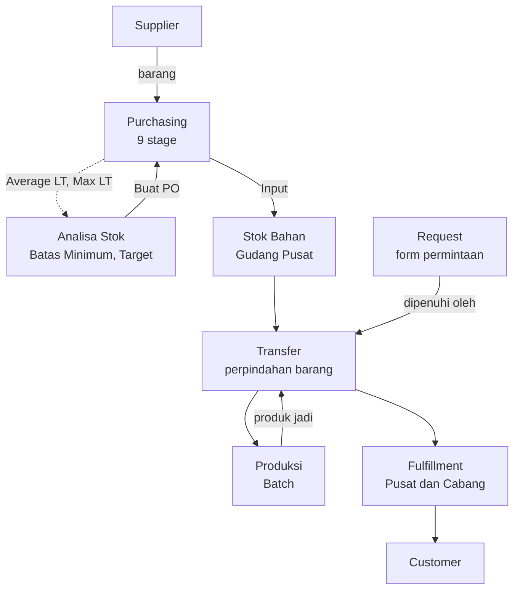
*Gambar 1. Hubungan antarmodul SC Online*

---

### 3.1 Alur Purchasing

#### 3.1.1 Langkah Proses
1. Purchasing (atau Fulfillment untuk produk jadi) membuka menu **Analisa Stok**, mengisi/meninjau data historis (Terjual/Out Rata-rata 4 Bulan, Stok Saat Ini, dsb.) sesuai profil item (Lokal/Impor).
2. Purchasing **memilih barang dan supplier** untuk analisa tersebut. Sistem memakai LT pasangan supplier-produk yang dipilih.
3. Sistem menghitung ADU, Buffer, Batas Minimum, Target Stock, Selisih, dan Status (`Order`/`Tidak`) mengikuti rumus pada Bab 6.
4. Untuk item berstatus `Order`, Purchasing menekan tombol **"Buat PO"** agar sistem membuat draft PO otomatis (SKU, qty, harga, dan supplier terpilih ter-carry), atau membuat PO manual dari menu Purchasing tanpa melalui Analisa.
5. **Perencanaan**: Purchasing melengkapi PO. Satu PO dapat memuat banyak item. Sistem mencatat waktu mulai saat PO dibuat, lalu Purchasing mengajukan PO.
6. **Approval**: Manager menyetujui atau menolak. Penolakan mengembalikan PO ke Perencanaan.
7. **Supplier Confirm**: Purchasing mencatat kesanggupan supplier atas qty, harga, dan janji ETA.
8. **Payment**: Purchasing mencatat pembayaran lalu menekan **`Dibayarkan`**, walaupun baru DP atau cicilan. Untuk Tempo, Purchasing menekan **`Lanjut Tempo`** tanpa pembayaran. Keduanya melanjutkan PO ke stage PO.
9. **PO**: Purchasing menerbitkan PO resmi ke supplier. Sejak titik ini PO terlihat oleh Gudang.
10. **Pengemasan**: Supplier menyiapkan barang. Stage selesai saat barang siap dan diserahkan ke ekspedisi.
11. **Pengiriman**: Barang dalam perjalanan. Purchasing memperbarui ekspedisi, resi, dan ETA. Stage selesai saat Gudang mengonfirmasi barang tiba.
12. **Unloading**: Gudang membongkar dan menghitung fisik barang per item. Stok belum berubah.
13. **Input**: Gudang memposting penerimaan. Stok Gudang Pusat bertambah otomatis, PO berstatus `Selesai`, dan riwayat LT terbentuk (level supplier & level supplier-produk).
14. Purchasing mencatat pembayaran berikutnya (Tempo/Termin/Pelunasan) terhadap PO secara terpisah dari stage; status lunas/belum lunas dan sisa tagihan terekam otomatis. Pelunasan dapat terjadi setelah PO `Selesai`.

#### 3.1.2 Diagram Alur
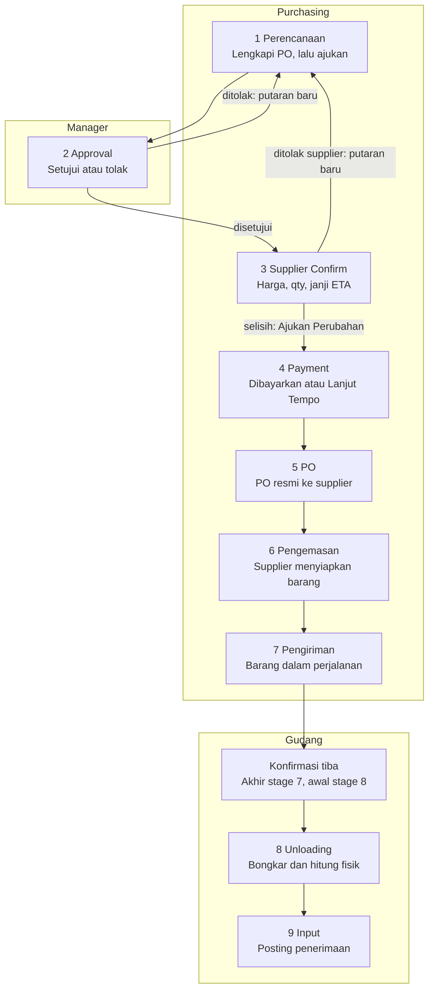
*Gambar 2. Alur Purchasing 9 stage per aktor*

#### 3.1.3 Perpindahan Stage
Waktu selesai sebuah stage otomatis menjadi waktu mulai stage berikutnya, sehingga tidak ada waktu yang tidak terhitung.

| Stage | Mulai Saat | Selesai Saat | Stage Berikutnya |
| :--- | :--- | :--- | :--- |
| **1 Perencanaan** | PO draft dibuat | Purchasing mengajukan PO | 2 Approval |
| **2 Approval** | PO diajukan | Manager menyetujui | 3 Supplier Confirm; ditolak ke stage 1 |
| **3 Supplier Confirm** | Approval selesai | Supplier mengonfirmasi | 4 Payment; ditolak supplier ke stage 1; selisih lewat `Ajukan Perubahan` |
| **4 Payment** | Supplier Confirm selesai | Purchasing menekan `Dibayarkan` atau `Lanjut Tempo` | 5 PO |
| **5 PO** | Payment selesai | PO resmi terkirim ke supplier | 6 Pengemasan |
| **6 Pengemasan** | PO selesai | Barang siap dan diserahkan ke ekspedisi | 7 Pengiriman |
| **7 Pengiriman** | Pengemasan selesai | Gudang mengonfirmasi barang tiba | 8 Unloading |
| **8 Unloading** | Barang tiba | Bongkar dan hitung fisik selesai | 9 Input |
| **9 Input** | Unloading selesai | Gudang memposting penerimaan | PO `Selesai` |

#### 3.1.4 Perbedaan Pengemasan dan Pengiriman
| Aspek | 6 Pengemasan | 7 Pengiriman |
| :--- | :--- | :--- |
| **Arti** | Persiapan barang oleh supplier | Barang dalam perjalanan menuju gudang |
| **Posisi barang** | Di tempat supplier | Di ekspedisi atau armada pengirim |
| **Mulai** | PO selesai | Barang diserahkan ke ekspedisi |
| **Selesai** | Barang diserahkan ke ekspedisi | Barang tiba di gudang tujuan |
| **Data utama** | Tanggal siap kirim, jumlah koli, berat, catatan progres | Ekspedisi, moda, no. resi, no. kontainer, ETA tiba |
| **Dicatat oleh** | Purchasing | Purchasing; waktu tiba oleh Gudang |
| **Durasi** | Mengukur kesiapan supplier | Mengukur waktu transit |
| **Efek ke stok** | Tidak ada | Tidak ada |

#### 3.1.5 Keterkaitan dengan Penerimaan dan Stok
PRD v2.0 menambah stok saat Barang Datang dikonfirmasi. Sejak v2.2 proses itu dipecah menjadi **Unloading** dan **Input**. Stok bertambah di Input karena definisi Lead Time berakhir saat barang *"siap dipakai/dijual"* (Bab 6.1). Perlakuan barang yang sudah tiba tetapi belum diposting dicatat di **NC-19**.

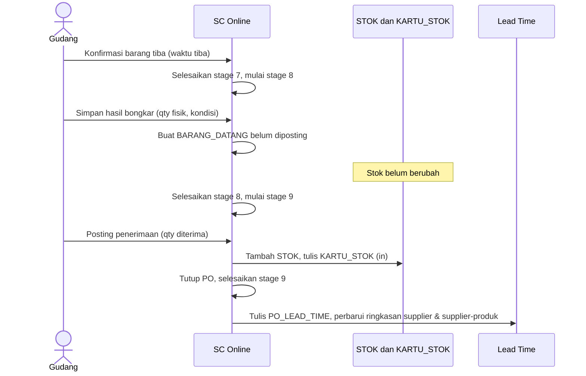
*Gambar 3. Urutan penerimaan barang sampai stok bertambah*

#### 3.1.6 Perubahan Data setelah Approval
Data operasional dapat langsung diedit. Data yang mengubah komitmen perlu approval Manager lewat revisi. Revisi tidak memindahkan stage dan tidak mereset LT. Rincian aturannya ada di Bab 5.2.5.

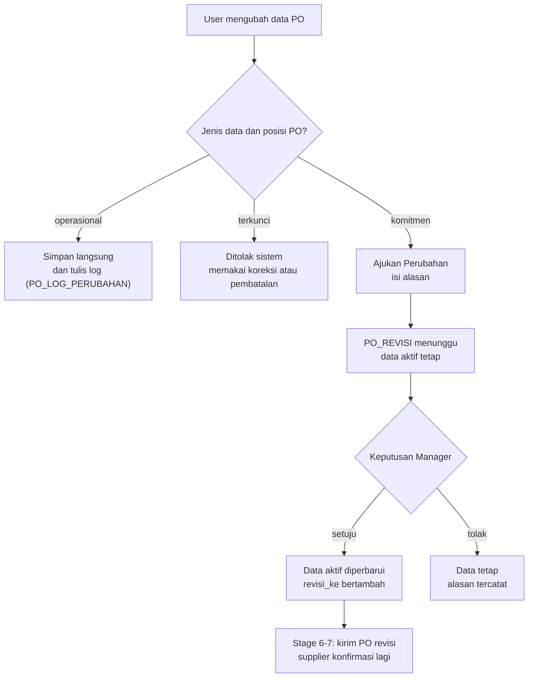
*Gambar 4. Alur perubahan data setelah approval*

---

### 3.2 Alur Produksi
1. Operasional membuat **Rencana Produksi (Batch)** yang dapat memuat **banyak produk jadi**. Sistem menghitung kebutuhan bahan dari BOM seluruh produk, menggabungkannya per bahan, dan langsung membuat **Alokasi Bahan** (status `Aktif`) tanpa mengurangi stok fisik.
2. Operasional dapat membuat **dua Request Bahan atau lebih** untuk satu batch. Setiap Request dipenuhi **tepat satu Transfer**.
3. Batch dimajukan ke **Release & Issue**: bahan ditarik riil dari stok Gudang Operasional, Alokasi berubah menjadi mutasi keluar.
4. Batch diselesaikan; `qty_baik` dan `qty_rusak` tercatat **per produk**, yield terhitung otomatis **per produk**.
5. Operasional dapat melakukan **Stock Opname** untuk membandingkan pemakaian teoritis (BOM) dengan pemakaian aktual.
6. Batch yang `Selesai` dapat diajukan sebagai **Transfer** jenis *Kirim Produk Jadi* ke Fulfillment Pusat, langsung dari menu Produksi tanpa berpindah menu. Satu Transfer dapat memuat banyak produk.

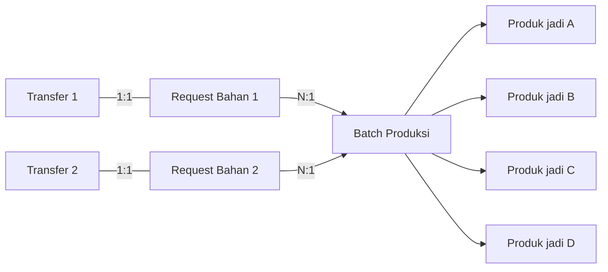
*Gambar 5. Relasi batch, Request, Transfer, dan produk jadi*

---

### 3.3 Alur Request
**Request** adalah form permintaan barang. Request mencatat kebutuhan dan persetujuan, dan **tidak pernah mengubah stok**. Ada **dua jenis Request**, dan keduanya memerlukan approval Manager:

| Jenis Request | Peminta | Pihak Diminta | Arah Barang | Dipenuhi Oleh |
| :--- | :--- | :--- | :--- | :--- |
| **Request Bahan** | Operasional | Gudang Bahan Baku Pusat | Gudang Bahan Baku Pusat ke Operasional | Transfer `Pemenuhan Request Bahan` |
| **Request Produk Jadi** | Fulfillment | Operasional | Operasional ke Fulfillment | Transfer `Kirim Produk Jadi` |

Langkah proses:
1. Peminta mengisi form Request: jenis, gudang asal, gudang tujuan, batch bila terkait produksi, item, qty diminta, dan catatan kebutuhan.
2. Peminta mengajukan Request. Status berubah dari `Draft` menjadi `Diajukan`.
3. Manager menyetujui atau menolak. Penolakan wajib menyertakan alasan.
4. Pihak diminta memproses Request yang disetujui dengan membuat **satu Transfer**. Status berubah menjadi `Diproses`.
5. Saat Transfer tersebut berstatus `Selesai`, Request otomatis berstatus `Selesai`. Bila qty terkirim kurang dari qty diminta, sisanya memakai **Request baru**.

---

### 3.4 Alur Transfer
**Transfer** adalah dokumen perpindahan barang. Inilah **satu-satunya dokumen internal yang memindahkan stok antar gudang**. Transfer dibuat dari Request yang disetujui, atau langsung untuk jenis selain *Pemenuhan Request Bahan*.

1. Role pengirim membuat Transfer: jenis, gudang asal, gudang tujuan, item, dan `qty_dikirim`.
2. Pengirim menekan **Kirim**. Status menjadi `Dikirim` dan stok gudang asal berkurang.
3. Penerima menghitung barang serta mengisi hasil inspeksi penerimaan per item (`qty_baik` / `qty_diterima`, `qty_rusak`, dan `keterangan_rusak` dengan invarian eksak $\text{qty\_dikirim} = \text{qty\_baik} + \text{qty\_rusak}$).
4. Penerima menekan **Terima**. Status menjadi `Selesai`, stok gudang tujuan bertambah sebesar `qty_baik` (`qty_diterima`), selisih/`qty_rusak` tercatat per item dan terakumulasi ke laporan serta dashboard kerusakan bulanan per gudang.

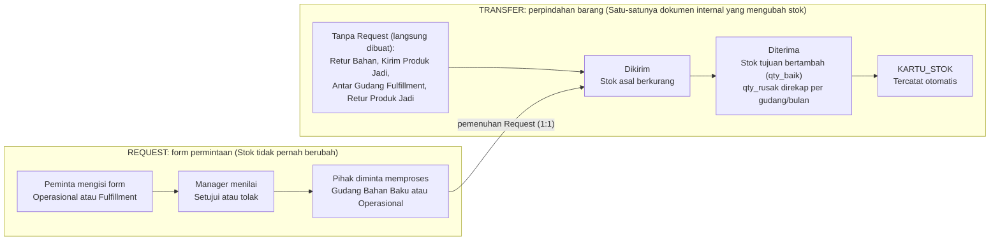
*Gambar 6. Pemisahan Request dan Transfer*

| Jenis | Dokumen Awal | Dari — Ke | Pembuat | Penerima |
| :--- | :--- | :--- | :--- | :--- |
| **Pemenuhan Request Bahan** | Request, lalu Transfer | Gudang Bahan Baku Pusat ke Operasional | Operasional (Request); Gudang (Transfer) | Operasional |
| **Retur Bahan** | Transfer langsung | Operasional ke Gudang | Operasional | Gudang |
| **Kirim Produk Jadi** | Transfer langsung, atau pemenuhan Request Produk Jadi | Operasional ke Fulfillment Pusat | Fulfillment (Request); Operasional (Transfer) | Fulfillment |
| **Antar Gudang Fulfillment** | Transfer langsung | Antar gudang Fulfillment (mis. Pusat ke SBY, Solo, Jakarta) | Fulfillment | Fulfillment |
| **Retur Produk Jadi** | Transfer langsung | Fulfillment ke Operasional | Fulfillment | Operasional |

---

### 3.5 Alur Fulfillment & Distribusi
1. Fulfillment Pusat menerima produk jadi dari Operasional melalui Transfer jenis *Kirim Produk Jadi*.
2. Fulfillment memeriksa Analisa Stok Produk Jadi per gudang cabang; hasil agregasi `ALL` menjadi sinyal kebutuhan produksi tambahan ke Operasional.
3. Bila membutuhkan produk jadi, Fulfillment membuat **Request Produk Jadi** ke Operasional.
4. Fulfillment membuat Transfer jenis *Antar Gudang Fulfillment* untuk mendistribusikan stok ke cabang (mis. Pusat ke SBY ke Solo/Jakarta).
5. Mutasi keluar ke customer dicatat di Stok & Mutasi, dengan kategori terpisah untuk kebutuhan Affiliate/KOL.
6. Produk cacat diretur ke Operasional melalui Transfer jenis *Retur Produk Jadi*.

---

### 3.6 Alur Analisa Stok & Keterhubungannya
1. Hasil **Batas Minimum** & **Target Stock** dari Analisa Stok otomatis menjadi acuan status `Order`/`Tidak` pada Kolom Stok dan Kolom Rencana di menu Stok & Mutasi; tidak ada lagi input Batas Minimum manual terpisah.
2. Tombol **Buat PO** di Analisa Stok membuat draft PO bertanda `"Dari Analisa"` di stage Perencanaan (membawa supplier terpilih), tetap dapat diedit/dilengkapi oleh Purchasing sebelum diajukan.
3. Setiap kali user menekan **"Simpan Snapshot ke Riwayat"**, hasil hitungan saat itu (tanggal, item/gudang, supplier, Batas Minimum, Target Stock, Status, Qty Order, LT yang dipakai, sumber LT, dan siapa yang menyimpan) dicatat permanen di tab Riwayat untuk penelusuran keputusan di kemudian hari.
4. Saat PO selesai, riwayat LT **supplier** dan **supplier-produk** diperbarui. Nilai **supplier-produk** menjadi sumber LT Analisa Stok bila syaratnya terpenuhi (Bab 6.6).

---

## 4. Struktur Menu Aplikasi

Menu digabung per proses bisnis, bukan per submenu di dokumen sumber. Tanda `✓` berarti role dapat mengakses menu; Manager selalu dapat mengakses seluruh menu dan melakukan aksi approval di tahap manapun. Request & Transfer dipecah menjadi dua menu.

| Menu | Purchasing | Gudang | Operasional | Fulfillment | Manager |
| :--- | :---: | :---: | :---: | :---: | :---: |
| **Dashboard** | ✓ | ✓ | ✓ | ✓ | ✓ |
| **Purchasing** *(berubah)* | ✓ | ✓ *(terbatas)* | - | - | ✓ |
| **Produksi (Batch)** *(berubah)* | - | - | ✓ | - | ✓ |
| **Request** *(baru)* | - | ✓ | ✓ | ✓ | ✓ |
| **Transfer** *(baru)* | - | ✓ | ✓ | ✓ | ✓ |
| **Analisa Stok** *(berubah)* | ✓ | - | - | ✓ | ✓ |
| **Stok & Mutasi** | ✓ | ✓ | ✓ | ✓ | ✓ |
| **Master Data** | ✓ | ✓ | ✓ | ✓ | ✓ |
| **Laporan** | ✓ | ✓ | ✓ | ✓ | ✓ |

### 4.1 Rincian Sub-Tab per Menu
| Menu | Sub-Tab / Bagian |
| :--- | :--- |
| **Dashboard** | Ringkasan kartu statistik + daftar *"perlu tindakan saya"*, disesuaikan per role. |
| **Purchasing** | Daftar PO (Lokal & Impor, stage aktif, indikator, filter stage) • Detail PO (linimasa 9 stage, `Ajukan Perubahan`, riwayat revisi, log perubahan langsung) • Pembayaran • Penerimaan (Konfirmasi Tiba, Unloading, Input) • Lead Time Supplier (per supplier dan per supplier-produk). |
| **Produksi (Batch)** | Daftar & form Rencana Produksi dengan banyak produk jadi, kebutuhan bahan otomatis dari BOM, Request terkait, status batch, aksi Ajukan Transfer. |
| **Request** | Filter per jenis (Request Bahan, Request Produk Jadi) • Daftar Request • Form Permintaan • Detail Request (riwayat persetujuan dan Transfer pemenuhan). |
| **Transfer** | Dashboard & rekap bulanan barang rusak (`qty_rusak`) per gudang • Filter per jenis (Pemenuhan Request Bahan, Retur Bahan, Kirim Produk Jadi, Antar Fulfillment, Retur Produk Jadi) • Form Buat Baru • Daftar dengan aksi sesuai status & role. |
| **Analisa Stok** | Bahan Lokal • Bahan Impor • Produk Jadi (Fulfillment) • Riwayat. Lokal dan Impor memiliki pilihan barang dan supplier, perbandingan supplier, dan label sumber LT. |
| **Stok & Mutasi** | Stok (dengan status Alert 2 kolom) • Mutasi (manual in/out + kartu stok) • Opname. |
| **Master Data** | Produk • Gudang • Supplier (termasuk daftar supplier per produk) • Lead Time & Buffer (parameter cadangan dan Tambahan Buffer) • BOM. |
| **Laporan** | Produksi • Pemakaian Bahan • Defect (termasuk kerusakan transit per gudang per bulan) • Low Stock • Purchasing/Hutang • Lead Time Supplier • Pergerakan Stok Fulfillment. |

### 4.2 Hak Akses Menu Purchasing
| Sub-tab | Purchasing | Gudang | Manager |
| :--- | :--- | :--- | :--- |
| **Daftar PO dan Detail PO** | Kelola | Lihat PO yang menyelesaikan stage 5 | Lihat dan approve (PO & Revisi) |
| **Pembayaran** | Kelola | - | Lihat |
| **Penerimaan** | Lihat | Kelola | Lihat dan koreksi |
| **Lead Time Supplier** | Lihat | - | Lihat dan validasi |

*Catatan:* Fulfillment tidak mengakses menu Purchasing. Angka LT yang dibutuhkan Fulfillment dibaca di Analisa Stok. Role Finance belum ada (**NC-13**).

---

## 5. Functional Requirements

Setiap requirement memiliki ID tetap. FR yang diubah atau dipindahkan dari v2.0 tercatat di Lampiran A.

### 5.1 Dashboard
| FR-ID | Deskripsi Requirement |
| :--- | :--- |
| **FR-DASH-01** | Sistem menampilkan kartu ringkasan yang relevan dengan role yang sedang login (mis. jumlah PO/Request/Transfer yang perlu tindakan, jumlah item berstatus `ORDER`). |
| **FR-DASH-02** | Sistem menampilkan daftar transaksi (PO/Request/Transfer) yang menunggu tindakan dari role yang sedang login, dengan tautan langsung ke menu terkait. |
| **FR-DASH-03** | Daftar tindakan mencakup PO pada stage yang menjadi tanggung jawab role tersebut, stage berindikator `Terlambat`, dan **revisi data yang menunggu approval Manager**. |

---

### 5.2 Purchasing

#### 5.2.1 Requirement Umum
| FR-ID | Deskripsi Requirement |
| :--- | :--- |
| **FR-PUR-01** | Satu Purchase Order dapat memuat banyak item (*header-detail*): SKU, qty, dan harga dicatat per item pada tabel detail, sesuai kebutuhan bahwa satu PO tidak dibatasi satu SKU. |
| **FR-PUR-02** | PO melalui 9 stage berurutan (Bab 5.2.2). Status dokumen PO adalah `Draft`, `Berjalan`, `Selesai`, atau `Dibatalkan`. |
| **FR-PUR-03** | Barang Datang dicatat per item PO pada stage Unloading dan diposting pada stage Input; qty diterima dapat berbeda dari qty PO (selisih tercatat), dan hanya PO yang menyelesaikan stage Pengiriman yang dapat diproses Unloading. |
| **FR-PUR-04** | Payment dicatat per PO dengan skema Tempo/Termin/Pelunasan; sistem menjumlah seluruh pembayaran suatu PO untuk menentukan status `Lunas`/`Belum Lunas` dan sisa tagihan. |
| **FR-PUR-05** | Harga per satuan (HPP) dihitung otomatis dari harga total item dibagi qty, ditampilkan sebagai bagian dari detail item PO. |
| **FR-PUR-15** | Setiap stage menyimpan waktu mulai, waktu selesai, durasi (menit), PIC, pencatat, dan waktu pencatatan. Durasi ditampilkan dalam jam (2 desimal) dan hari (**toleransi 1 angka di belakang koma**, pembulatan half-up: digit ke-2 $< 5 \to 0$, $\ge 5 \to 1$). |
| **FR-PUR-16** | Detail PO menampilkan linimasa 9 stage beserta putaran penolakan, durasi tiap stage, dan Total LT berjalan. |
| **FR-PUR-17** | Manager dapat membatalkan PO sebelum stage Unloading selesai, dengan alasan wajib. |
| **FR-PUR-18** | Purchasing dan Gudang dapat menutup PO yang diterima sebagian mengikuti aturan default **NC-08**. |
| **FR-PUR-19** | Setelah Approval selesai, perubahan data komitmen hanya dapat dilakukan lewat **`Ajukan Perubahan`** (Bab 5.2.5). |
| **FR-PUR-20** | Manager menyetujui atau menolak revisi setelah melihat perbandingan data lama dan baru. Alasan wajib saat menolak. |
| **FR-PUR-21** | Setiap perubahan langsung dan setiap revisi tercatat dengan nilai lama, nilai baru, pelaku, dan waktu. |

#### 5.2.2 Spesifikasi per Stage
Setiap tabel menjelaskan aktor, input, proses, output, dan validasi satu stage. Waktu mulai selalu terisi otomatis oleh sistem.

##### Stage 1: Perencanaan (FR-PUR-06)
| Atribut | Spesifikasi |
| :--- | :--- |
| **Tujuan** | Menyusun PO yang siap diajukan. |
| **Aktor** | Purchasing. |
| **Pemicu mulai** | PO dibuat manual atau dari tombol Buat PO. Waktu mulai = waktu PO dibuat (**NC-06**). |
| **Input** | Supplier, gudang tujuan, item, qty, harga total, skema bayar, ETA awal, sumber dana. |
| **Proses sistem** | Membuat `PURCHASE_ORDER` berstatus `Draft`, membuat `PO_STAGE` stage 1, dan menghitung HPP per item. |
| **Output** | PO diajukan; status dokumen menjadi `Berjalan`. |
| **Validasi** | Supplier wajib ada dan **setiap item terdaftar pada supplier tersebut (`PRODUK_SUPPLIER` aktif)**. Minimal 1 item. Qty dan harga total $> 0$. Gudang tujuan wajib (**NC-17**). |
| **Selesai saat** | Purchasing menekan `Ajukan`. Lanjut ke stage 2. |

##### Stage 2: Approval (FR-PUR-07)
| Atribut | Spesifikasi |
| :--- | :--- |
| **Tujuan** | Memastikan PO disetujui sebelum disampaikan ke supplier. |
| **Aktor** | Manager. |
| **Pemicu mulai** | PO diajukan. |
| **Input** | Keputusan `Setujui` atau `Tolak`; catatan penolakan. |
| **Proses sistem** | `Setujui` membuka stage 3. `Tolak` menandai stage `Dikembalikan` dan membuka putaran baru mulai stage 1. |
| **Output** | PO disetujui, atau PO kembali ke Purchasing dengan alasan. |
| **Validasi** | Hanya Manager yang dapat memutuskan. Alasan wajib saat `Tolak`. |
| **Selesai saat** | Manager menekan `Setujui`. Lanjut ke stage 3. |

##### Stage 3: Supplier Confirm (FR-PUR-08)
| Atribut | Spesifikasi |
| :--- | :--- |
| **Tujuan** | Memastikan supplier sanggup memenuhi PO. |
| **Aktor** | Purchasing. |
| **Pemicu mulai** | Approval selesai. |
| **Input** | Waktu konfirmasi, no. referensi supplier, qty terkonfirmasi, harga terkonfirmasi, ETA supplier. |
| **Proses sistem** | Membandingkan qty dan harga terkonfirmasi dengan PO yang disetujui. **Selisih wajib diajukan sebagai revisi (`BR-05`)**. Supplier menolak mengembalikan PO ke Perencanaan. |
| **Output** | Konfirmasi supplier tercatat tanpa menimpa angka yang disetujui. |
| **Validasi** | Waktu selesai tidak boleh lebih awal dari waktu mulai dan tidak boleh di masa depan. ETA supplier wajib. |
| **Selesai saat** | Purchasing menyimpan konfirmasi tanpa selisih, atau setelah revisi disetujui. Lanjut ke stage 4. |

##### Stage 4: Payment (FR-PUR-09)
| Atribut | Spesifikasi |
| :--- | :--- |
| **Tujuan** | Mencatat pembayaran awal, atau melanjutkan PO Tempo, tanpa menunggu pelunasan. |
| **Aktor** | Purchasing. |
| **Pemicu mulai** | Supplier Confirm selesai. |
| **Input** | Termin dan Pelunasan: tanggal bayar, nominal, bukti bayar (tabel `PAYMENT`). Tempo: tidak ada input pembayaran. |
| **Proses sistem** | Termin dan Pelunasan: menyimpan `PAYMENT`, memperbarui sisa tagihan, dan mengaktifkan tombol **`Dibayarkan`**. Tempo: menampilkan tombol **`Lanjut Tempo`**. Waktu selesai terisi waktu klik dan dapat disesuaikan ke waktu aktual (`BR-04`). |
| **Output** | Stage 4 selesai dan PO lanjut ke stage 5, walaupun status masih `Belum Lunas` (`BR-09`). |
| **Validasi** | Tombol `Dibayarkan` aktif bila ada `PAYMENT` dengan nominal $> 0$. Nominal tidak melebihi sisa tagihan. `Lanjut Tempo` hanya tampil bila skema bayar PO adalah `Tempo`. Tidak ada revisi `menunggu` pada PO. |
| **Selesai saat** | Purchasing menekan `Dibayarkan` atau `Lanjut Tempo`. Pembayaran berikutnya dicatat di sub-tab Pembayaran dan tidak mengubah durasi stage 4. |

##### Stage 5: PO (FR-PUR-10)
| Atribut | Spesifikasi |
| :--- | :--- |
| **Tujuan** | Menerbitkan PO resmi ke supplier. |
| **Aktor** | Purchasing. |
| **Pemicu mulai** | Payment selesai. |
| **Input** | Waktu kirim PO ke supplier, dokumen PO. |
| **Proses sistem** | Mengunci dokumen PO dan membuka visibilitas PO untuk Gudang. Peran ini menggantikan status *Dikirim ke Gudang* pada v2.0. |
| **Validasi** | Waktu selesai $\ge$ waktu mulai dan tidak boleh di masa depan. Tidak ada revisi `menunggu`. Arti final stage mengikuti **NC-02**. |
| **Selesai saat** | Purchasing menandai PO terkirim. Lanjut ke stage 6. |

##### Stage 6: Pengemasan (FR-PUR-11)
| Atribut | Spesifikasi |
| :--- | :--- |
| **Tujuan** | Mengukur waktu supplier menyiapkan barang. |
| **Aktor** | Purchasing, berdasarkan informasi supplier. |
| **Pemicu mulai** | Stage PO selesai. |
| **Input** | Waktu barang siap, jumlah koli, berat, catatan progres, pembaruan ETA. |
| **Proses sistem** | Menyimpan data ke `PO_PENGIRIMAN`. Pembaruan ETA tidak menimpa ETA awal maupun ETA supplier. |
| **Output** | Durasi Pengemasan tercatat. |
| **Validasi** | Waktu selesai $\ge$ waktu mulai dan tidak boleh di masa depan. Waktu selesai adalah waktu barang diserahkan ke ekspedisi. |
| **Selesai saat** | Purchasing mencatat barang diserahkan ke ekspedisi. Lanjut ke stage 7. |

##### Stage 7: Pengiriman (FR-PUR-12)
| Atribut | Spesifikasi |
| :--- | :--- |
| **Tujuan** | Mengukur waktu perjalanan barang menuju gudang. |
| **Aktor** | Purchasing (data perjalanan), Gudang (konfirmasi tiba). |
| **Pemicu mulai** | Pengemasan selesai. |
| **Input** | Ekspedisi, moda (darat/laut/udara), no. resi, no. kontainer bila ada, ETA tiba, waktu tiba. |
| **Proses sistem** | Menyimpan data ke `PO_PENGIRIMAN`, menampilkan PO pada daftar Barang Dalam Perjalanan Gudang, dan membuat `BARANG_DATANG` saat Gudang mengonfirmasi tiba. |
| **Output** | Durasi Pengiriman tercatat. Barang tiba di gudang tujuan. |
| **Validasi** | Ekspedisi wajib sebelum konfirmasi tiba. Waktu tiba $\ge$ waktu mulai Pengiriman dan tidak boleh di masa depan. |
| **Selesai saat** | Gudang menekan `Konfirmasi Tiba`. Lanjut ke stage 8. |

##### Stage 8: Unloading (FR-PUR-13)
| Atribut | Spesifikasi |
| :--- | :--- |
| **Tujuan** | Memastikan jumlah dan kondisi fisik barang. |
| **Aktor** | Gudang. |
| **Pemicu mulai** | Barang tiba. |
| **Input** | Waktu bongkar selesai, qty fisik per item, kondisi, penerima. |
| **Proses sistem** | Menyimpan `BARANG_DATANG` dan `BARANG_DATANG_ITEM` berstatus belum diposting, serta menghitung selisih terhadap qty PO. Stok belum berubah. |
| **Output** | Hasil hitung fisik per item. |
| **Validasi** | Qty fisik $\ge 0$. Kondisi wajib. Waktu selesai $\ge$ waktu mulai dan tidak boleh di masa depan. |
| **Selesai saat** | Gudang menekan `Unloading Selesai`. Lanjut ke stage 9. |

##### Stage 9: Input (FR-PUR-14)
| Atribut | Spesifikasi |
| :--- | :--- |
| **Tujuan** | Membukukan barang yang diterima ke stok dan menutup PO. |
| **Aktor** | Gudang. |
| **Pemicu mulai** | Unloading selesai. |
| **Input** | Qty diterima final per item, catatan selisih, waktu posting. |
| **Proses sistem** | Dalam satu transaksi database: menambah `STOK`, menulis `KARTU_STOK` tipe `in` dengan referensi `purchase_order`, menandai `BARANG_DATANG` diposting, menutup PO, menulis `PO_LEAD_TIME`, dan memperbarui akumulasi LT supplier (`SUPPLIER_LT_*`) serta supplier-produk (`SUPPLIER_PRODUK_LT_*`). |
| **Output** | Stok gudang tujuan bertambah, PO `Selesai`, Total LT terbentuk. |
| **Validasi** | Qty diterima $\ge 0$. Posting hanya sekali per `BARANG_DATANG`. Gagal di salah satu langkah membatalkan seluruh transaksi. |
| **Selesai saat** | Gudang menekan `Posting`. Status dokumen menjadi `Selesai`. |

#### 5.2.3 Status dan Indikator
Status dipisah menjadi dua lapis. **Status dokumen** menjawab *"PO ini hidup atau tidak"*. **Stage aktif** menjawab *"PO ini sedang di mana"*.

| Status v2.0 | Stage v2.4 | Status Dokumen |
| :--- | :--- | :--- |
| Draft | 1 Perencanaan, berjalan | `Draft` |
| Diajukan | 2 Approval, berjalan | `Berjalan` |
| Disetujui | 2 Approval, selesai | `Berjalan` |
| Dikirim ke Gudang | 5 PO, selesai (PO terlihat oleh Gudang) | `Berjalan` |
| Diterima Gudang *(masukan user, tidak ada di PRD v2.0)* | 8 Unloading, selesai (**NC-12**) | `Berjalan` |
| Selesai | 9 Input, selesai | `Selesai` |
| *(baru)* | Stage terakhir saat dibatalkan | `Dibatalkan` |

##### Indikator Stage
| Indikator Stage | Warna | Arti |
| :--- | :---: | :--- |
| **Belum Mulai** | Abu-abu | Stage sebelumnya belum selesai. |
| **Berjalan** | Biru | Waktu mulai terisi, waktu selesai kosong. |
| **Terlambat** | Merah | Berjalan lebih lama dari Average stage itu pada supplier yang sama. Tidak aktif bila supplier belum punya riwayat. |
| **Dikembalikan** | Oranye | Stage ditolak dan membuka putaran baru. |
| **Selesai** | Hijau | Waktu selesai terisi. |

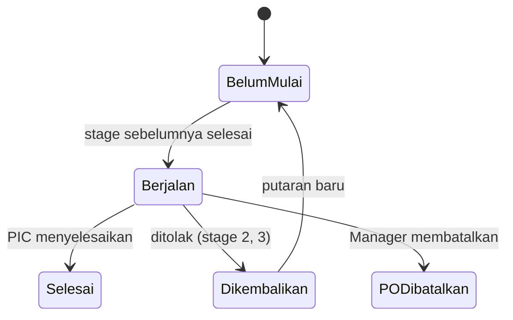
*Gambar 7. Siklus indikator stage*

#### 5.2.4 Business Rules Purchasing
| ID | Aturan |
| :--- | :--- |
| **BR-01** | Stage berjalan berurutan dari 1 sampai 9 dan tidak boleh melompat. |
| **BR-02** | Stage hanya diselesaikan oleh role penyelesai (Bab 2.3). Manager tetap dapat bertindak di semua tahap. |
| **BR-03** | Waktu mulai stage terisi otomatis dari waktu selesai stage sebelumnya, sehingga stage tersambung tanpa celah. |
| **BR-04** | Waktu dicatat dalam tanggal dan jam sampai menit, zona waktu WIB. Waktu aktual boleh mundur, tetapi tidak boleh di masa depan atau lebih awal dari waktu mulai. Waktu entri tersimpan terpisah pada `dicatat_pada`. |
| **BR-05** | Setelah Approval selesai, perubahan data komitmen harus lewat revisi yang disetujui Manager. Revisi tidak memindahkan stage dan tidak mereset waktu stage (Bab 5.2.5). |
| **BR-06** | Penolakan membuka putaran baru mulai Perencanaan. Putaran lama tetap tersimpan dan waktunya tetap terhitung dalam LT. |
| **BR-07** | PO hanya dapat dibatalkan sebelum Unloading selesai, oleh Manager, dengan alasan (**NC-18**). PO `Dibatalkan` tidak dihitung dalam LT. |
| **BR-08** | Stok hanya bertambah saat Input. Tidak ada stage lain yang mengubah `STOK` atau `KARTU_STOK` (**NC-19**). |
| **BR-09** | Stage Payment tidak sama dengan status `Lunas`. Stage selesai saat tombol `Dibayarkan` atau `Lanjut Tempo` diklik. `Lunas` dihitung dari total `PAYMENT` dan boleh tercapai setelah PO `Selesai`. Status `Belum Lunas` tidak menahan stage mana pun. |
| **BR-10** | Satu PO menghasilkan **satu transaksi LT pada level supplier**, dan **satu transaksi LT untuk setiap produk pada level supplier-produk**. Daftar produk mengikuti item PO saat PO `Selesai`. |
| **BR-11** | Pengemasan tidak boleh digabung dengan Pengiriman. Gudang tidak dapat mengonfirmasi tiba sebelum stage Pengemasan selesai. Bila barang sudah tiba lebih dulu, Purchasing menyelesaikan stage 6 dengan waktu aktual, lalu Gudang mengonfirmasi tiba. |

#### 5.2.5 Perubahan Data setelah Approval
| Kelompok | Contoh Data | Aturan |
| :--- | :--- | :--- |
| **Boleh langsung diedit** | Catatan, ETA terbaru, ekspedisi, moda, no. resi, no. kontainer, jumlah koli, berat, no. referensi supplier | Tanpa approval; tercatat di `PO_LOG_PERUBAHAN` |
| **Perlu approval Manager** | Item, qty, harga, ETA awal, sumber dana, skema bayar | Lewat `Ajukan Perubahan` (`PO_REVISI`) |
| **Tidak diedit langsung** | Pembayaran tercatat, penerimaan yang sudah diposting, nomor PO, supplier setelah PO terbit | Memakai koreksi atau pembatalan |

##### Perlakuan Revisi Berdasarkan Posisi PO
| Posisi PO | Perlakuan Revisi |
| :--- | :--- |
| **Stage 3 sampai 5** | Stage **tidak dapat diselesaikan** sampai revisi diputuskan, agar PO tidak terbit dengan data yang belum disetujui. |
| **Stage 6 dan 7** | Pencatatan stage tetap berjalan karena barang bergerak. Bila disetujui, PO revisi dikirim ulang dan supplier mengonfirmasi lagi. |
| **Stage 8 dan 9** | Item, qty, dan harga **terkunci**. Perbedaan dicatat sebagai selisih penerimaan (`FR-PUR-03`). |
| **PO Selesai** | Tidak dapat direvisi. Koreksi stok memakai Mutasi manual. |

##### Langkah Revisi
1. Purchasing menekan **`Ajukan Perubahan`**, mengubah data, dan mengisi alasan.
2. Sistem menyimpan usulan pada `PO_REVISI`. Data aktif belum berubah dan PO diberi tanda `Menunggu Approval Revisi`.
3. Manager melihat perbandingan data lama dan baru, lalu menyetujui atau menolak.
4. Bila disetujui, data aktif diperbarui dan `revisi_ke` bertambah 1. Bila ditolak, data tetap dan alasan wajib tercatat.

##### Efek pada Lead Time
| Kondisi | Efek pada Lead Time |
| :--- | :--- |
| Qty, harga, atau catatan berubah | Tidak ada. LT dihitung dari waktu stage, bukan isi data. |
| Revisi menunggu di stage 3 sampai 5 | Durasi stage bertambah sesuai waktu tunggu nyata. |
| PO dibatalkan dan dibuat PO baru | PO lama tidak dihitung. PO baru mulai dari awal. |
| Item ditambah atau dihapus | Riwayat supplier-produk mengikuti item PO saat PO `Selesai`. |

*Catatan:* Ganti supplier setelah PO terbit memakai pembatalan PO dan PO baru, agar LT supplier tidak tercampur.

---

### 5.3 Lead Time Supplier
| FR-ID | Deskripsi Requirement |
| :--- | :--- |
| **FR-LT-01** | Sistem menghitung LT per stage dan Total LT dalam menit dari waktu aktual saat PO `Selesai` (Bab 6.5). |
| **FR-LT-02** | Sistem memperbarui akumulasi **level supplier** dan **level supplier-produk** secara kumulatif dari transaksi valid, dalam transaksi database yang sama dengan posting Input. |
| **FR-LT-03** | Halaman Lead Time Supplier menampilkan jumlah transaksi, Average LT, Maximum LT, riwayat LT tiap transaksi, dan durasi tiap stage, **per supplier dan per supplier-produk**, dalam jam (2 desimal) dan hari (**toleransi 1 desimal half-up**: digit ke-2 $< 5 \to 0$, $\ge 5 \to 1$). |
| **FR-LT-04** | Manager dapat menandai transaksi tidak valid dengan alasan wajib. Sistem menghitung ulang akumulasi (supplier & supplier-produk) dan mencatat perubahan. |
| **FR-LT-05** | Setiap perubahan akumulasi menulis baris `SUPPLIER_LT_HISTORY` berisi nilai sebelum dan sesudah. Baris ini tidak dapat diubah atau dihapus. |
| **FR-LT-06** | Halaman menampilkan subtotal waktu internal, supplier, dan logistik (Bab 6.5.6). |

---

### 5.4 Produksi (Batch)
| FR-ID | Deskripsi Requirement |
| :--- | :--- |
| **FR-PRD-01** | Saat Rencana Produksi dibuat, sistem menghitung kebutuhan bahan dari $\text{BOM} \times \text{qty rencana}$ setiap produk, menggabungkannya per bahan, dan langsung membuat Alokasi Bahan berstatus `Aktif` tanpa mengubah stok fisik. |
| **FR-PRD-02** | Batch mengikuti alur status `Rencana` $\to$ `Release & Issue` (bahan ditarik riil dari stok Operasional, Alokasi dilepas) $\to$ `Selesai` (`qty_baik`/`qty_rusak` dicatat per produk) atau `Dibatalkan` (Alokasi dilepas tanpa mutasi stok). |
| **FR-PRD-03** | Batch berstatus `Selesai` dapat langsung diajukan sebagai Transfer jenis *Kirim Produk Jadi* ke Fulfillment Pusat tanpa berpindah menu. Satu Transfer dapat memuat banyak produk. |
| **FR-PRD-04** | Satu batch dapat memuat banyak produk jadi (*header-detail* `BATCH_PRODUKSI_ITEM`). Sistem tidak membatasi jumlah produk. |
| **FR-PRD-05** | Satu batch dapat terkait dua Request atau lebih. Detail batch menampilkan kebutuhan BOM, total diminta, dan total diterima per bahan. |

---

### 5.5 Request

#### 5.5.1 Requirement
| FR-ID | Deskripsi Requirement |
| :--- | :--- |
| **FR-REQ-01** | Satu Request dapat memuat banyak item (*header-detail*); qty diminta dicatat per item. Berasal dari FR-RT-01. |
| **FR-REQ-06** | Sistem menyediakan 2 jenis Request: **Request Bahan** (Operasional ke Gudang Bahan Baku Pusat) dan **Request Produk Jadi** (Fulfillment ke Operasional). Keduanya memerlukan approval Manager. |
| **FR-REQ-02** | Request melalui status `Draft` $\to$ `Diajukan` $\to$ `Disetujui` $\to$ `Diproses` $\to$ `Selesai`, dengan akhir alternatif `Ditolak` atau `Dibatalkan`. Berasal dari FR-RT-03. |
| **FR-REQ-03** | Request **tidak mengubah** `STOK` maupun `KARTU_STOK` pada status apa pun. |
| **FR-REQ-04** | Hanya Request berstatus `Disetujui` yang dapat dibuatkan Transfer pemenuhan. **Satu Request hanya memiliki satu Transfer**. |
| **FR-REQ-05** | Status Request menjadi `Selesai` otomatis saat Transfer-nya berstatus `Selesai`. Sisa qty yang tidak terkirim memakai Request baru. |
| **FR-REQ-07** | Request dapat merujuk satu batch (`referensi_batch_id`). Satu batch dapat dirujuk banyak Request. |
| **FR-REQ-08** | Request `Disetujui` yang belum memiliki Transfer dapat diubah oleh peminta. Perubahan mengembalikan status ke `Diajukan` untuk approval ulang. Setelah Transfer dibuat, Request terkunci. |

#### 5.5.2 Spesifikasi Form dan Aksi
| Atribut | Spesifikasi |
| :--- | :--- |
| **Tujuan** | Mencatat permintaan barang secara resmi. |
| **Aktor** | Operasional atau Fulfillment membuat; Manager menilai; Gudang atau Operasional memproses. |
| **Input** | Jenis, gudang asal, gudang tujuan, batch terkait bila ada, item, qty diminta, catatan kebutuhan. |
| **Proses sistem** | Membuat `REQUEST` dan `REQUEST_ITEM`, memberi nomor, dan mencatat setiap perubahan status dengan pelaku dan waktu. |
| **Output** | Request berstatus `Diajukan`, lalu muncul pada daftar tindakan Manager. |
| **Validasi** | Gudang asal dan tujuan wajib dan tidak boleh sama. Minimal 1 item. Qty diminta $> 0$. Alasan wajib saat `Tolak`. Hanya `Draft` (atau `Disetujui` yang belum punya Transfer sesuai `FR-REQ-08`) yang dapat diedit. |

#### 5.5.3 Status Request
| Status | Arti | Aksi Berikutnya | Pelaku |
| :--- | :--- | :--- | :--- |
| **Draft** | Form belum diajukan | Ajukan atau Batalkan | Peminta |
| **Diajukan** | Menunggu persetujuan | Setujui atau Tolak | Manager |
| **Disetujui** | Siap diproses | Buat Transfer, Edit (kembali ke Diajukan), atau Batalkan | Pihak diminta (Transfer); Peminta (Edit); Manager (Batalkan) |
| **Diproses** | Sudah ada Transfer pemenuhan | Menunggu Transfer Selesai | Sistem |
| **Selesai** | Transfer Selesai | - | Sistem |
| **Ditolak** | Tidak disetujui | - | - |
| **Dibatalkan** | Dibatalkan sebelum diproses | - | - |

---

### 5.6 Transfer

#### 5.6.1 Requirement
| FR-ID | Deskripsi Requirement |
| :--- | :--- |
| **FR-TRF-01** | Satu Transfer dapat memuat banyak item (*header-detail*); qty dikirim dan qty diterima dicatat per item agar selisih diketahui per SKU. Berasal dari FR-RT-01. |
| **FR-TRF-02** | Sistem menyediakan 5 jenis Transfer: `Pemenuhan Request Bahan` (Gudang Bahan Baku Pusat $\to$ Operasional), `Retur Bahan` (Operasional $\to$ Gudang), `Kirim Produk Jadi` (Operasional $\to$ Fulfillment Pusat), `Antar Gudang Fulfillment`, dan `Retur Produk Jadi` (Fulfillment $\to$ Operasional). Berasal dari FR-RT-02. |
| **FR-TRF-03** | Seluruh jenis memakai pipeline `Draft` $\to$ `Dikirim` $\to$ `Selesai`, dengan `Dibatalkan` hanya dari `Draft`. Berasal dari FR-RT-03. |
| **FR-TRF-04** | Setiap transisi status yang menyebabkan stok berpindah tervalidasi terhadap role yang berwenang pada tahap tersebut (mis. hanya Gudang yang dapat memproses dan mengirim Pemenuhan Request Bahan). Berasal dari FR-RT-04. |
| **FR-TRF-05** | Stok berkurang dari gudang asal saat dokumen dikirim, dan bertambah ke gudang tujuan saat diterima; setiap perubahan tercatat di Kartu Stok dengan referensi ke dokumen Transfer. Berasal dari FR-RT-05. |
| **FR-TRF-06** | Transfer jenis *Pemenuhan Request Bahan* wajib merujuk Request Bahan yang disetujui. *Kirim Produk Jadi* dapat merujuk Request Produk Jadi yang disetujui atau dibuat langsung. Jenis lainnya tidak memakai Request. |
| **FR-TRF-07** | Satu Request hanya dapat dirujuk satu Transfer (`UNIQUE(request_id)` bila terisi). Bila Transfer `Draft` dibatalkan, Request kembali ke status `Disetujui`. |
| **FR-TRF-08** *(Override Operasional)* | Sistem wajib menyimpan `qty_baik`, `qty_rusak`, dan `keterangan_rusak` per item saat penerimaan Transfer dengan invarian eksak $\text{qty\_dikirim} = \text{qty\_baik} + \text{qty\_rusak}$ (`qty_diterima = qty_baik`). Hanya `qty_baik` yang menambah saldo stok fisik gudang tujuan, sedangkan `qty_rusak` disimpan permanen sebagai dasar kalkulasi barang rusak transit. |
| **FR-TRF-09** *(Override Operasional)* | Halaman Index Transfer (`transfer/index`) wajib menyajikan **dashboard ringkasan & tabulasi bulanan per gudang** atas akumulasi barang rusak (`qty_rusak`), mencakup KPI Total Barang Rusak Bulan Berjalan, Rasio Kerusakan (%), Gudang Terdampak Tertinggi, serta rekap matriks per bulan per gudang dengan filter bulan/tahun & gudang. |

#### 5.6.2 Spesifikasi Form dan Aksi
| Atribut | Spesifikasi |
| :--- | :--- |
| **Tujuan** | Memindahkan barang antar gudang dan mencatat perubahan stok serta kerusakan transit. |
| **Aktor** | Role pengirim dan role penerima sesuai jenis (Bab 3.4). |
| **Input** | Jenis, gudang asal, gudang tujuan, referensi Request atau Batch bila ada, item, `qty_dikirim`, catatan; saat penerimaan: `qty_baik` (`qty_diterima`), `qty_rusak`, `keterangan_rusak`. |
| **Proses sistem** | `Kirim`: mengurangi `STOK` asal dan menulis `KARTU_STOK` tipe `out`. `Terima`: menambah `STOK` tujuan sebesar `qty_baik` (`qty_diterima`), menulis `KARTU_STOK` tipe `in`, dan merekam `qty_rusak` untuk kalkulasi bulanan per gudang. |
| **Output** | Stok berpindah, selisih/`qty_rusak` tercatat per item, dan status Request ikut diperbarui. |
| **Validasi** | Gudang asal dan tujuan tidak boleh sama. `qty_dikirim` $> 0$ dan $\le$ stok gudang asal. `qty_baik` $\ge 0$, `qty_rusak` $\ge 0$, dan $\text{qty\_baik} + \text{qty\_rusak} = \text{qty\_dikirim}$. Jenis *Kirim Produk Jadi* memakai `gudang_asal_id` kosong dan referensi batch wajib (bila dari batch); stok asal tidak dikurangi karena produk berasal dari hasil Batch. |

#### 5.6.3 Status Transfer
| Status | Arti | Efek Stok | Pelaku |
| :--- | :--- | :--- | :--- |
| **Draft** | Belum dikirim | Tidak ada | Pengirim |
| **Dikirim** | Barang keluar dari gudang asal | Stok asal berkurang | Pengirim |
| **Selesai** | Barang diterima | Stok tujuan bertambah (`qty_baik`); `qty_rusak` direkap | Penerima |
| **Dibatalkan** | Batal sebelum dikirim | Tidak ada (Request terkait kembali ke `Disetujui`) | Pengirim atau Manager |

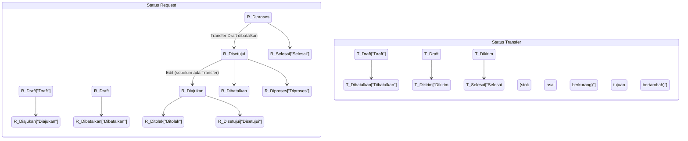
*Gambar 8. Status Request dan Transfer*

#### 5.6.4 Evaluasi Pemisahan Request dan Transfer
Pemisahan ini adalah pilihan yang tepat, dengan syarat Request hanya mencatat kebutuhan dan Transfer menjadi satu-satunya dokumen internal yang mengubah stok. Keduanya dihubungkan oleh referensi `request_id`.

| Aspek | Request | Transfer |
| :--- | :--- | :--- |
| **Pertanyaan yang dijawab** | Barang apa yang dibutuhkan dan apakah disetujui? | Barang apa yang berpindah, dari mana, ke mana? |
| **Keluaran** | Keputusan | Mutasi stok & rekap QC transit |
| **Aktor utama** | Operasional, Fulfillment, Manager | Gudang, Operasional, Fulfillment |
| **Efek stok** | Tidak ada | Ada |
| **Hubungan** | Dipenuhi oleh 1 Transfer | Bisa dari Request (1:1) atau langsung |

---

### 5.7 Analisa Stok
| FR-ID | Deskripsi Requirement |
| :--- | :--- |
| **FR-ANL-01** | Sistem menyediakan 3 profil analisa (Bahan Lokal, Bahan Impor, Produk Jadi/Fulfillment) mengikuti struktur dan rumus dari file Excel acuan (lihat Bab 6). |
| **FR-ANL-02** | Hasil Batas Minimum & Target Stock dari Analisa Stok menjadi sumber tunggal yang dipakai perhitungan Kolom Stok/Kolom Rencana pada menu Stok & Mutasi; tidak ada input Batas Minimum manual di Master Data. |
| **FR-ANL-03** | Untuk item/baris berstatus `Order` (Bahan Lokal) atau `PO` (Bahan Impor), user dapat menekan tombol **Buat PO** untuk membuat draft Purchase Order otomatis (ditandai `"Dari Analisa"`) di stage Perencanaan dengan **supplier yang dipilih**; pembuatan PO manual dari menu Purchasing tetap tersedia sebagai alternatif. |
| **FR-ANL-04** | User dapat menekan tombol **Simpan Snapshot** pada tiap profil analisa untuk mencatat hasil hitungan saat itu (tanggal, item/gudang, **supplier**, Batas Minimum, Target Stock, Status, Qty Order, LT yang dipakai, sumber LT, dan role yang menyimpan) ke tab Riwayat, sebagai jejak audit sederhana. |
| **FR-ANL-05** | Pada profil Lokal dan Impor, **user memilih barang dan supplier setiap analisa**. Sistem membaca LT **pasangan supplier-produk** bila syarat **NC-09** terpenuhi; bila tidak, memakai parameter manual. Sumber nilai yang dipakai ditampilkan sebagai label. |
| **FR-ANL-07** | Satu analisa menghasilkan **satu hasil per produk**, memakai satu supplier. Sistem menampilkan **perbandingan Average LT, Max LT, jumlah transaksi, dan Batas Minimum antarsupplier** sebagai informasi. |
| **FR-ANL-08** | Pilihan supplier hanya berisi supplier yang terdaftar aktif pada produk tersebut dan kategorinya sesuai profil (**NC-25**). |
| **FR-ANL-09** | Kolom Stok dan Kolom Rencana memakai Batas Minimum dari **analisa terakhir produk tersebut**. Sebelum ada analisa, sistem memakai parameter manual. |
| **FR-ANL-06** | Saat nilai LT supplier berubah, sistem memberi tahu Purchasing dan menghitung ulang Analisa (**NC-15**). |

---

### 5.8 Stok & Mutasi, Master Data, Laporan
| FR-ID | Deskripsi Requirement |
| :--- | :--- |
| **FR-STK-01** | Tab Stok menampilkan Kolom Stok (stok fisik + inbound, tidak dipengaruhi rencana produksi) dan Kolom Rencana (memperhitungkan alokasi/rencana aktif), masing-masing dengan status `Order`/`Tidak`. |
| **FR-STK-02** | Tab Mutasi mencatat penyesuaian stok manual dan menampilkan Kartu Stok gabungan dari seluruh sumber mutasi (PO, Transfer, produksi, mutasi manual). |
| **FR-STK-03** | Tab Opname membandingkan pemakaian bahan teoritis ($\text{BOM} \times \text{realisasi batch}$) dengan pemakaian aktual. |
| **FR-MST-01** | Master Data menyediakan CRUD untuk Produk, Gudang (dengan relasi induk-cabang), Supplier (**termasuk daftar banyak supplier per produk**), Lead Time & Buffer (parameter dasar dan cadangan saja, Batas Minimum mengikuti Analisa Stok), dan BOM. |
| **FR-LAP-01** | Laporan menyajikan ringkasan Produksi, Pemakaian Bahan, Defect (produksi & kerusakan transit per gudang per bulan), Low Stock, Purchasing/Hutang, Lead Time Supplier, dan Pergerakan Stok Fulfillment, dihitung otomatis dari data transaksi berjalan. |

---

## 6. Rumus dan Istilah dalam Sistem (Analisa Stok)

Bab 6.1 sampai 6.4 merangkum istilah dan rumus modul Analisa Stok, disalin dari file Excel acuan (*Analisa Lokal*, *Analisa Import*, *Analisa Permintaan Fulfillment*) dan tidak berubah dari v2.0. Bab 6.5 dan 6.6 adalah tambahan untuk Lead Time.

### 6.1 Istilah Umum
| Istilah | Definisi |
| :--- | :--- |
| **ADU (*Average Daily Usage*)** | Rata-rata pemakaian/penjualan harian. |
| **Lead Time** | Waktu sejak kebutuhan disadari sampai barang siap dipakai/dijual. |
| **Buffer / Safety Stock** | Cadangan akibat ketidakpastian lead time. Pada Analisa Lokal dinyatakan dalam satuan **HARI** (identik dengan Total Buffer); pada Analisa Import dinyatakan dalam satuan **QTY** ($\text{ADU ETA} \times \text{Buffer Days}$). |
| **Review Period** | Interval antar peninjauan ulang kebutuhan stok. |
| **Batas Minimum / Minimum Stock** | Ambang bawah sebelum dianggap kritis (ROP). |
| **Target Stock** | Stok ideal setelah order berikutnya tiba. |
| **Satuan Order / MOQ** | Kelipatan pembulatan qty order, disimpan sebagai master data per SKU. |
| **Klasifikasi ABC** | Kategori item (`Wajib A` / `A` / `B` / `C`) yang menentukan tambahan hari buffer pada profil Impor: Wajib A = 4 hari, A = 4 hari, B = 2 hari, C = 0 hari. |
| **Stage** | Satu dari 9 tahapan proses Purchasing. |
| **LT per stage** | Durasi satu stage pada satu PO. |
| **Total LT** | Durasi satu PO dari awal stage 1 sampai akhir stage 9. |
| **Average LT** | Total LT seluruh transaksi valid dibagi jumlah transaksi valid. |
| **Maximum LT** | Total LT terpanjang di antara transaksi valid. |
| **Putaran** | Pengulangan stage akibat penolakan. |
| **Supplier-produk** | Pasangan satu supplier dan satu produk. LT dihitung per pasangan untuk Analisa Stok. |
| **Revisi** | Perubahan data komitmen setelah Approval yang memerlukan persetujuan Manager. |

---

### 6.2 Profil Bahan Lokal
1. **Lead Time** (dirinci per 9 tahapan = 9 stage Purchasing, untuk skenario Rata-rata dan Maksimum):
   $$\text{Total Average Lead Time} = \sum_{i=1}^{9} \text{Stage}_{i,\text{avg}}$$
   $$\text{Total Max Lead Time} = \sum_{i=1}^{9} \text{Stage}_{i,\text{max}}$$
   $$\text{Total Buffer (Safety Stock dalam hari)} = (\text{Total Max Lead Time} - \text{Total Average Lead Time}) + \text{Tambahan Buffer manual}$$
2. **Analisa**:
   $$\text{ADU} = \frac{\text{Terjual (Rata-Rata 4 Bulan)}}{30}$$
   $$\text{Batas Minimum} = \text{ADU} \times (\text{Total Average Lead Time} + \text{Safety Stock})$$
   $$\text{Target Stock} = \text{ADU} \times (\text{Total Average Lead Time} + \text{Safety Stock} + \text{Review Period})$$
3. **Analisa Order**:
   $$\text{Order/Tidak} = (\text{Stok Saat Ini} + \text{Akan Datang}) \le \text{Batas Minimum}$$
   $$\text{Selisih} = (\text{Stok Saat Ini} + \text{Akan Datang}) - \text{Batas Minimum}$$
   $$\text{Qty Order} = \left\lceil \frac{|\text{Selisih}|}{\text{MOQ}} \right\rceil \times \text{MOQ} \quad (\text{bila status Order})$$
   $$\text{Total Nominal Order} = \text{Qty Order} \times \text{Harga per Satuan}$$

---

### 6.3 Profil Bahan Impor
Berlaku dua varian rumus tergantung apakah item memiliki pecahan varian (mis. warna) atau tidak:
- $\text{Out} = \text{Persentase Varian} \times \text{Out Rata-rata 4 Bulan (Gudang)}$ untuk item ber-varian; atau langsung $\text{Out Rata-rata 4 Bulan (Gudang)}$ untuk item tanpa varian.
- $\text{ADU Base} = \text{Out} \div 122$ ($\approx 4$ bulan).
- $\text{ADU ETA (ber-varian)} = \text{ADU Base} + \left(\text{ADU Base} \times \frac{\text{Lead Time Average}}{30}\right)$.
- $\text{ADU ETA (tanpa varian)} = \text{ADU Base} + \left(\frac{\text{Lead Time Average}}{\text{Review Period}}\right)$ *(direplikasi persis dari file sumber; lihat **NC-V2-7**)*.
- $\text{Buffer Days} = (\text{Lead Time Max} - \text{Lead Time Average}) + \text{Tambahan Hari (Klasifikasi ABC)}$.
- $\text{Safety Stock (qty)} = \text{ADU ETA} \times \text{Buffer Days}$.
- $\text{Minimum Stock} = \text{ADU ETA} \times \text{Lead Time Average}$.
- $\text{Target Stock} = \text{ADU ETA} \times (\text{Lead Time Average} + \text{Review Period}) + \text{Safety Stock}$.
- $\text{Proyeksi} = \text{Stok Saat Ini} + \text{Inbound (Before ETA)} - (\text{ADU ETA} \times \text{Lead Time Average})$.
- $\text{Selisih} = \text{Proyeksi} - \text{Target Stock}$.
- $\text{Status} = \text{"PO"}$ bila $\text{Selisih} < 0$, selain itu $\text{"Tidak PO"}$.
- $\text{Qty Order} = \left\lceil \frac{|\text{Selisih}|}{\text{MOQ}} \right\rceil \times \text{MOQ}$ bila Status = `PO`.

---

### 6.4 Profil Produk Jadi (Fulfillment)
Dihitung per gudang, lalu diagregasi:
- $\text{ADU (per gudang)} = \text{Terjual (Rata-Rata 4 Bulan)} \div 30$.
- $\text{Batas Minimum (per gudang)} = \text{ADU} \times (\text{Lead Time Distribusi} + \text{Buffer Distribusi})$.
- $\text{Target Stock (per gudang)} = \text{ADU} \times (\text{Lead Time Distribusi} + \text{Buffer Distribusi} + \text{Review Period})$.
- **ALL**: $\text{Batas Minimum (Total)} = \sum \text{Batas Minimum gudang}$; $\text{Target Stock (Total)} = \sum \text{Target Stock gudang}$; $\text{Stok Saat Ini (Total)} = \sum \text{Stok Saat Ini gudang}$.
- $\text{Akan Datang (level ALL)}$ = hanya diambil dari gudang yang menerima langsung dari Operasional (Fulfillment Pusat).
- $\text{Stok All} = \text{Stok Saat Ini (Total)} + \text{Akan Datang}$.
- $\text{Order/Tidak (level ALL)} = \text{Stok All} \le \text{Target Stock (Total)}$.
- $\text{Selisih} = \text{Stok All} - \text{Target Stock (Total)}$; $\text{Qty Order} = \text{pembulatan } |\text{Selisih}| \text{ ke Satuan Order}$ bila `Order`.
- Hasil `ORDER` adalah sinyal kebutuhan produksi tambahan ke Operasional (bukan PO ke supplier).

---

### 6.5 Perhitungan Lead Time

#### 6.5.1 Satuan dan Pembulatan
- Sistem menyimpan waktu mulai dan selesai sampai menit, dan menyimpan durasi dalam **menit bulat**.
- Satu hari LT $= 24\text{ jam} = 1.440\text{ menit}$. Malam, akhir pekan, dan hari libur tetap terhitung, sejalan dengan ADU per hari kalender di Bab 6.2 sampai 6.4.
- $\text{Durasi jam} = \text{menit} \div 60$ (ditampilkan 2 desimal, *half-up*).
- $\text{Durasi hari} = \text{menit} \div 1.440$. **Khusus satuan hari hanya bertoleransi 1 angka di belakang koma (`NUMERIC(10,1)`), dengan pembulatan digit ke-2 dan seterusnya mengikuti aturan half-up: angka $< 5 \to 0$, angka $\ge 5 \to 1$**.
- Perhitungan lanjutan selalu memakai **menit**, bukan angka hari yang sudah dibulatkan.
- LT memakai **waktu aktual**, bukan waktu entri. Waktu entri hanya untuk jejak audit pada `dicatat_pada`.

$$\text{Durasi stage (menit)} = \text{Waktu selesai} - \text{Waktu mulai}$$
$$\text{Durasi stage (hari)} = \text{round\_half\_up}\left(\frac{\text{Durasi menit}}{1.440},\, 1\right)$$

#### 6.5.2 Contoh Durasi Bertanggal dan Berjam
Stage Perencanaan mulai `3 Nov pukul 13.00` dan selesai `4 Nov pukul 13.45`: $24\text{ jam } 45\text{ menit} = 1.485\text{ menit} = 24,75\text{ jam} = 1,0\text{ hari}$ (nilai mentah $1,03125$ hari, digit ke-2 $= 3 < 5 \to 1,0\text{ hari}$).

| Stage | Mulai | Selesai | Menit | Jam (2 desimal) | Hari Mentah | Hari (1 desimal half-up) |
| :--- | :--- | :--- | ---: | ---: | ---: | ---: |
| **1 Perencanaan** | 3 Nov 13.00 | 4 Nov 13.45 | 1.485 | 24,75 | 1,03 | **1,0** |
| **2 Approval** | 4 Nov 13.45 | 5 Nov 09.15 | 1.170 | 19,50 | 0,81 | **0,8** |
| **3 Supplier Confirm** | 5 Nov 09.15 | 6 Nov 16.00 | 1.845 | 30,75 | 1,28 | **1,3** |
| **4 Payment** | 6 Nov 16.00 | 7 Nov 10.30 | 1.110 | 18,50 | 0,77 | **0,8** |
| **5 PO** | 7 Nov 10.30 | 7 Nov 14.00 | 210 | 3,50 | 0,15 | **0,1** *(0,1458 -> 4 < 5)* |
| **6 Pengemasan** | 7 Nov 14.00 | 10 Nov 11.00 | 4.140 | 69,00 | 2,88 | **2,9** |
| **7 Pengiriman** | 10 Nov 11.00 | 12 Nov 08.30 | 2.730 | 45,50 | 1,90 | **1,9** |
| **8 Unloading** | 12 Nov 08.30 | 12 Nov 11.15 | 165 | 2,75 | 0,11 | **0,1** |
| **9 Input** | 12 Nov 11.15 | 12 Nov 14.00 | 165 | 2,75 | 0,11 | **0,1** |
| **Total LT** | **3 Nov 13.00** | **12 Nov 14.00** | **13.020** | **217,00** | **9,04** | **9,0** |

*Gambar 9. Contoh linimasa LT per stage dan Total LT*

#### 6.5.3 LT per Stage dan Total LT
| Aspek | LT per Stage | Total LT Transaksi |
| :--- | :--- | :--- |
| **Mengukur** | Lama satu tahapan | Lama satu PO dari awal sampai akhir |
| **Rumus** | Waktu selesai $-$ waktu mulai, dijumlah bila ada beberapa putaran | Waktu selesai stage 9 $-$ waktu mulai stage 1 |
| **Sumber** | `PO_STAGE` | `PO_LEAD_TIME` |
| **Kegunaan** | Mencari titik hambatan | Performa supplier dan Analisa Stok |
| **Rata-rata** | Per stage per supplier & per supplier-produk | Per supplier & per supplier-produk |

Karena stage tersambung tanpa celah (`BR-03`), jumlah menit seluruh stage sama dengan Total LT. Jumlah angka hari yang sudah dibulatkan dapat berbeda $0,1$ dari Total LT; sistem tetap memakai nilai dari menit.

#### 6.5.4 Akumulasi Average dan Maximum LT
Average LT dihitung seperti HPP Average Cost: dari akumulasi total menit dan jumlah transaksi valid, bukan dari rata-rata sebelumnya.

$$\text{Total LT baru (menit)} = \text{Total LT lama (menit)} + \text{LT transaksi baru (menit)}$$
$$\text{Jumlah transaksi baru} = \text{Jumlah transaksi lama} + 1$$
$$\text{Average LT (hari)} = \text{round\_half\_up}\left(\frac{\text{Total LT baru (menit)}}{\text{Jumlah transaksi baru} \times 1.440},\, 1\right)$$
$$\text{Maximum LT} = \max(\text{Maximum LT lama},\, \text{LT transaksi baru})$$

| Kondisi | Jumlah Transaksi | Total LT (menit) | Total LT (hari) | Average LT (hari, 1 desimal) |
| :--- | :---: | ---: | ---: | ---: |
| Sebelum | 5 | 86.400 | 60,0 | 12,0 |
| Transaksi baru 18,0 hari | 6 | 112.320 | 78,0 | 13,0 |
| Alternatif: transaksi baru 18,3 hari ($26.352$ mnt) | 6 | 112.752 | 78,3 | 13,1 ($13,05 \to 13,1$) |

Akumulasi dihitung pada **dua level** dengan rumus yang sama:
1. **Level supplier** (`SUPPLIER_LT_SUMMARY`, `SUPPLIER_LT_STAGE_SUMMARY`): dipakai untuk menilai performa supplier.
2. **Level supplier-produk** (`SUPPLIER_PRODUK_LT_SUMMARY`, `SUPPLIER_PRODUK_LT_STAGE_SUMMARY`): dipakai untuk **Analisa Stok**.

*Contoh:* PO berisi 3 produk dengan Total LT $13.020\text{ menit}$ ($9,0\text{ hari}$) menambah $+1$ transaksi ke level supplier dan $+1$ transaksi ke masing-masing 3 pasangan supplier-produk, dengan durasi yang sama.

#### 6.5.5 Transaksi Valid dan Urutan Pemrosesan
Transaksi valid (usulan, **NC-10**):
- Status dokumen PO `Selesai`, bukan `Dibatalkan`.
- Seluruh 9 stage memiliki waktu mulai dan selesai.
- Total LT tidak negatif.
- Tidak ditandai tidak valid oleh Manager.

Saat **Input** selesai, sistem menjalankan langkah berikut dalam **satu transaksi database** (baris ringkasan dikunci `FOR UPDATE` agar dua PO yang selesai bersamaan tidak saling menimpa):
1. Menulis `PO_LEAD_TIME`.
2. Memperbarui `SUPPLIER_LT_SUMMARY` dan `SUPPLIER_LT_STAGE_SUMMARY`.
3. Memperbarui `SUPPLIER_PRODUK_LT_SUMMARY` dan `SUPPLIER_PRODUK_LT_STAGE_SUMMARY` untuk setiap produk pada PO.
4. Menulis `SUPPLIER_LT_HISTORY` (level supplier & level supplier-produk).

Saat transaksi ditandai tidak valid, total dan jumlah dikurangi, lalu Average dihitung ulang. Maximum dicari ulang dari seluruh riwayat valid.

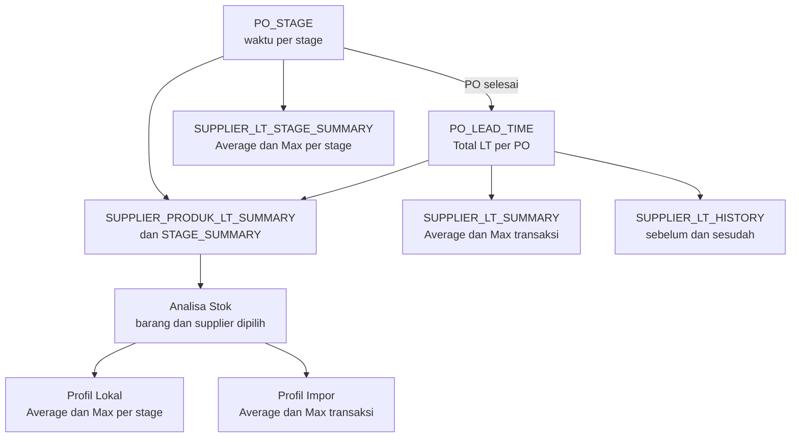
*Gambar 10. Aliran data Lead Time ke Analisa Stok*

#### 6.5.6 Subtotal Performa
| Kategori | Stage |
| :--- | :--- |
| **Internal** | 1 Perencanaan, 2 Approval, 4 Payment, 5 PO, 8 Unloading, 9 Input |
| **Supplier** | 3 Supplier Confirm, 6 Pengemasan |
| **Logistik** | 7 Pengiriman (penanggung jawab mengikuti **NC-20**) |

---

### 6.6 Integrasi Lead Time dengan Analisa Stok

#### 6.6.1 Pemetaan Sumber Data
| Profil | Input | Sumber v2.4 |
| :--- | :--- | :--- |
| **Bahan Lokal** | `LEAD_TIME_STAGE` skenario `average` | Average per stage dari `SUPPLIER_PRODUK_LT_STAGE_SUMMARY` |
| **Bahan Lokal** | `LEAD_TIME_STAGE` skenario `max` | Max per stage dari `SUPPLIER_PRODUK_LT_STAGE_SUMMARY` (**NC-04**) |
| **Bahan Impor** | `lead_time_average` | `average_lt_hari` dari `SUPPLIER_PRODUK_LT_SUMMARY` |
| **Bahan Impor** | `lead_time_max` | `max_lt_hari` dari `SUPPLIER_PRODUK_LT_SUMMARY` |
| **Lokal dan Impor** | Tambahan Buffer, Klasifikasi ABC | Tetap manual |
| **Produk Jadi** | Lead Time Distribusi, Buffer Distribusi | Tetap manual |

Analisa memakai **pasangan barang dan supplier yang dipilih user**. Bila jumlah transaksi valid pasangan itu belum memenuhi batas **NC-09**, sistem memakai parameter manual dan menampilkan label sumbernya. Nilai hari LT yang masuk ke rumus memakai presisi 1 desimal *half-up* sesuai aturan operasional.

Stok dan ADU milik produk, sehingga **satu analisa hanya memakai satu supplier** (mencegah Order ganda). Perbandingan antarsupplier ditampilkan sebagai informasi:

| Supplier Dipilih | Max LT (hari) | Batas Minimum |
| :---: | :---: | ---: |
| **A** | 18 | 26.202,17 |
| **B** | 25 | 35.372,93 |

*(Contoh memakai ADU ALK-01 = $1.310,11$/hari dan Tambahan Buffer $2$ hari).*

#### 6.6.2 Penggunaan Average LT dan Maximum LT
- **Average LT**: acuan waktu tunggu wajar (dasar Total Average LT Lokal, serta LT Average, ADU ETA, Minimum Stock, dan Proyeksi di Impor).
- **Maximum LT**: batas skenario terburuk (selisih Max dan Average membentuk Total Buffer di Lokal dan Buffer Days di Impor).

#### 6.6.3 Pengaruh terhadap ROP: Profil Lokal
Penyederhanaan rumus menunjukkan Average LT saling menghapus:
$$\text{Batas Minimum} = \text{ADU} \times (\text{Avg} + (\text{Max} - \text{Avg}) + \text{Tambahan}) = \text{ADU} \times (\text{Max} + \text{Tambahan})$$

| Average LT (hari) | Max LT (hari) | Total Buffer (hari) | Batas Minimum | Target Stock |
| :---: | :---: | :---: | ---: | ---: |
| 12 | 18 | 8 | 26.202,17 | 45.853,79 |
| 13 | 18 | 7 | 26.202,17 | 45.853,79 |
| 13 | 20 | 9 | 28.822,38 | 48.474,01 |

#### 6.6.4 Pengaruh terhadap ROP: Profil Impor
Contoh `BTL-P50` varian Bening (Out $47.312$, persentase $0,6$, stok $1.573$, inbound $10.044$, Klasifikasi A = $4$ hari, Review Period $30$ hari):

| Average | Max | ADU ETA | Buffer Days | Minimum Stock | Target Stock | Selisih |
| :---: | :---: | ---: | :---: | ---: | ---: | ---: |
| 81,8 *(81,75)* | 114 | 866,7 | 36,25 | 70.856,0 | 128.277,6 | -187.516,6 |
| 82,8 *(82,75)* | 114 | 874,5 | 35,25 | 72.364,6 | 129.425,5 | -190.173,0 |
| 85,8 *(85,75)* | 114 | 897,8 | 32,25 | 76.983,3 | 132.869,2 | -198.235,5 |
| 81,8 *(81,75)* | 118 | 866,7 | 40,25 | 70.856,0 | 131.744,5 | -190.983,6 |

#### 6.6.5 Definisi Total Max Lokal
Rumus Bab 6.2 menjumlahkan nilai maksimum tiap tahap, sedangkan Maximum LT supplier adalah transaksi terlama (**NC-04**):

| Transaksi | Stage A (hari) | Stage B (hari) | Total LT (hari) |
| :--- | :---: | :---: | :---: |
| PO 1 | 3 | 9 | 12 |
| PO 2 | 8 | 4 | 12 |
| PO 3 | 4 | 5 | 9 |
| **Maksimum** | **8** | **9** | **12** *(Jumlah max stage = 17)* |

#### 6.6.6 Riwayat Perubahan Lead Time
`SUPPLIER_LT_HISTORY` menjawab *"mengapa Batas Minimum berubah"*. Setiap baris menyimpan waktu, nomor PO, supplier, produk (bila level supplier-produk), jenis perubahan, serta Jumlah, Total, Average, dan Max sebelum dan sesudah. Label sumber LT di Analisa Stok menaut ke riwayat ini.

---

## 7. Entity Relationship Diagram (ERD)

ERD dibagi per domain agar terbaca. Warna kelompok pada rancangan asli: biru tua = Master Data & Stok, cokelat = Purchasing & Lead Time, hijau = Request & Transfer, ungu = Produksi, merah = Analisa Stok.

### 7.1 Master Data dan Stok
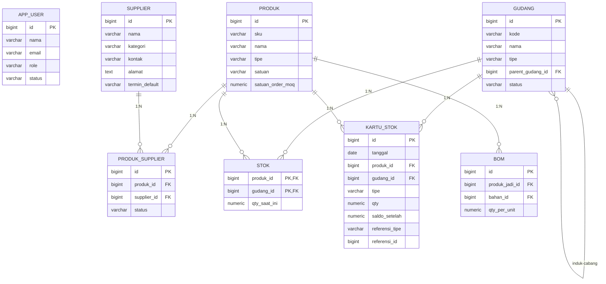
*Gambar 11. ERD Master Data dan Stok*

### 7.2 Purchasing dan Lead Time
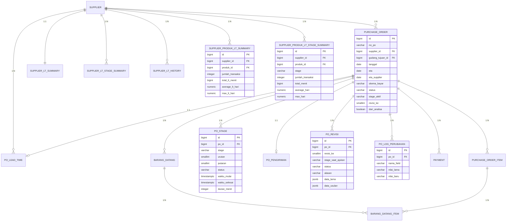
*Gambar 12. ERD Purchasing dan Lead Time*

### 7.3 Request, Transfer, dan Produksi
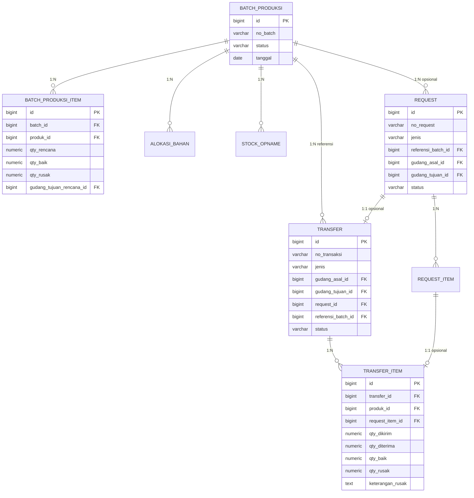
*Gambar 13. ERD Request, Transfer, dan Produksi*

### 7.4 Analisa Stok
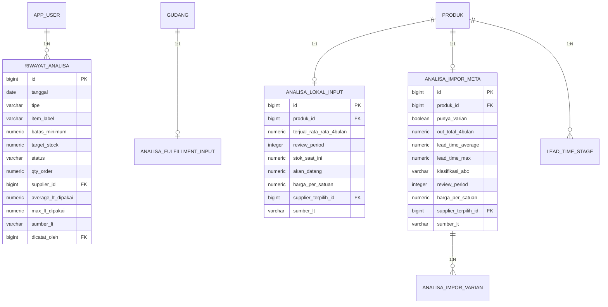
*Gambar 14. ERD Analisa Stok*

### 7.5 Penjelasan Entitas Utama
| Entitas | Deskripsi | Relasi Utama |
| :--- | :--- | :--- |
| `PRODUK` | Master seluruh SKU: bahan baku, kemas, produk jadi. | 1:N ke `BOM`, `STOK`, `KARTU_STOK`, `PURCHASE_ORDER_ITEM`, `PRODUK_SUPPLIER`, dsb. |
| `GUDANG` | Master gudang lintas tipe, mendukung relasi induk-cabang (*self-reference*) untuk Fulfillment berjenjang. | 1:N ke `STOK`, `KARTU_STOK`, `BATCH_PRODUKSI`, `REQUEST`, `TRANSFER`. |
| `STOK` | Saldo stok terkini per kombinasi produk + gudang. | Diperbarui oleh setiap transaksi yang menyebabkan pergerakan stok. |
| `KARTU_STOK` | Log seluruh mutasi stok (buku besar), menyimpan referensi ke dokumen sumber (`PO`, `Transfer`, `Batch`, dsb.) melalui `referensi_tipe` + `referensi_id`. | Polimorfik ke dokumen sumber. |
| `PURCHASE_ORDER` / `PURCHASE_ORDER_ITEM` | Header PO dan daftar item di dalamnya; satu PO dapat memuat banyak item. | 1:N ke `PAYMENT`, `BARANG_DATANG`, `PO_STAGE`, `PO_REVISI`, `PO_LOG_PERUBAHAN`; 1:1 ke `PO_PENGIRIMAN`, `PO_LEAD_TIME`. |
| `PO_STAGE` | Catatan waktu tiap stage per putaran. | N:1 ke `PURCHASE_ORDER`. |
| `PO_PENGIRIMAN` | Data Pengemasan dan Pengiriman satu PO. | 1:1 ke `PURCHASE_ORDER`. |
| `PO_LEAD_TIME` | Riwayat Total LT per PO. | 1:1 ke `PURCHASE_ORDER`; N:1 ke `SUPPLIER`. |
| `SUPPLIER_LT_SUMMARY` / `SUPPLIER_LT_STAGE_SUMMARY` | Akumulasi LT level supplier untuk menilai performa, total dan per stage. | Terhubung ke `SUPPLIER`. |
| `SUPPLIER_LT_HISTORY` | Riwayat perubahan akumulasi LT (level supplier dan level supplier-produk). | N:1 ke `SUPPLIER`, opsional ke `PRODUK`. |
| `PRODUK_SUPPLIER` | Daftar supplier setiap produk; satu produk dapat memiliki banyak supplier aktif. | N:M antara `PRODUK` dan `SUPPLIER`. |
| `SUPPLIER_PRODUK_LT_SUMMARY` / `SUPPLIER_PRODUK_LT_STAGE_SUMMARY` | Akumulasi LT per pasangan supplier-produk, sumber LT Analisa Stok. | Terhubung ke `SUPPLIER` dan `PRODUK`. |
| `PO_REVISI` / `PO_LOG_PERUBAHAN` | Revisi data yang perlu approval Manager dan log perubahan langsung. | N:1 ke `PURCHASE_ORDER`. |
| `REQUEST` / `REQUEST_ITEM` | Form permintaan barang berjenis `Request Bahan` atau `Request Produk Jadi`. | 1:1 opsional ke `TRANSFER`; N:1 opsional ke `BATCH_PRODUKSI`. |
| `TRANSFER` / `TRANSFER_ITEM` | Dokumen perpindahan barang, hasil QC transit (`qty_baik`, `qty_rusak`, `keterangan_rusak`), dan daftar itemnya. | Dapat mereferensikan `REQUEST` (1:1 unik) dan `BATCH_PRODUKSI`. |
| `BATCH_PRODUKSI` / `BATCH_PRODUKSI_ITEM` / `ALOKASI_BAHAN` | Rencana & eksekusi produksi dengan banyak produk jadi, beserta alokasi bahan yang tercipta begitu batch dibuat. | 1:N ke `BATCH_PRODUKSI_ITEM`, `STOCK_OPNAME`, `REQUEST`, `TRANSFER` (referensi). |
| `ANALISA_LOKAL_INPUT` / `LEAD_TIME_STAGE` / `ANALISA_IMPOR_META` / `ANALISA_IMPOR_VARIAN` / `ANALISA_FULFILLMENT_INPUT` | Input & parameter Analisa Stok per profil, sumber tunggal Batas Minimum & Target Stock. | 1:1 atau 1:N ke `PRODUK`/`GUDANG` sesuai profil. |
| `RIWAYAT_ANALISA` | Snapshot hasil Analisa Stok yang sengaja disimpan user sebagai jejak audit. | N:1 ke `APP_USER` (`dicatat_oleh`). |

---

## 8. Rancangan Database

Tabel `REQUEST_TRANSFER` dan `REQUEST_TRANSFER_ITEM` v2.0 diganti oleh `REQUEST`, `REQUEST_ITEM`, `TRANSFER`, dan `TRANSFER_ITEM`. Seluruh kolom hari pada modul Lead Time menggunakan `NUMERIC(10,1)` sesuai override operasional toleransi 1 desimal *half-up*.

### 8.1 Master Data

#### PRODUK
| Field | Tipe | Not Null | Keterangan (Contoh) |
| :--- | :--- | :---: | :--- |
| `id` | `BIGINT` (PK, auto increment) | Ya | `1001` |
| `sku` | `VARCHAR(30)`, unik | Ya | `ALK-01` |
| `nama` | `VARCHAR(150)` | Ya | `Alkohol 96%` |
| `tipe` | `VARCHAR(20)`: `bahan` / `kemas` / `produk_jadi` | Ya | `bahan` |
| `satuan` | `VARCHAR(10)` | Ya | `L` |
| `satuan_order_moq` | `NUMERIC(15,2)` | Ya | `5000` |
| `created_at`, `updated_at` | `TIMESTAMP` | Ya | `2026-09-07 10:00:00` |

#### BOM
| Field | Tipe | Not Null | Keterangan (Contoh) |
| :--- | :--- | :---: | :--- |
| `id` | `BIGINT` (PK, auto increment) | Ya | `1` |
| `produk_jadi_id` | `BIGINT` (FK $\to$ `PRODUK.id`) | Ya | id SKU `GOH-P50` |
| `bahan_id` | `BIGINT` (FK $\to$ `PRODUK.id`) | Ya | id SKU `ALK-01` |
| `qty_per_unit` | `NUMERIC(15,4)` | Ya | `0.05` |

#### GUDANG
| Field | Tipe | Not Null | Keterangan (Contoh) |
| :--- | :--- | :---: | :--- |
| `id` | `BIGINT` (PK, auto increment) | Ya | `1` |
| `kode` | `VARCHAR(20)`, unik | Ya | `FF-SBY` |
| `nama` | `VARCHAR(150)` | Ya | `Fulfillment SBY` |
| `tipe` | `VARCHAR(30)`: `bahan_baku` / `operasional` / `fulfillment_pusat` / `fulfillment_cabang` | Ya | `fulfillment_cabang` |
| `parent_gudang_id` | `BIGINT` (FK $\to$ `GUDANG.id`) | Tidak | `3` (id Fulfillment Pusat) |
| `status` | `VARCHAR(10)`: `aktif` / `nonaktif` | Ya | `aktif` |

#### SUPPLIER
| Field | Tipe | Not Null | Keterangan (Contoh) |
| :--- | :--- | :---: | :--- |
| `id` | `BIGINT` (PK, auto increment) | Ya | `1` |
| `nama` | `VARCHAR(150)` | Ya | `PT Alkohol Nusantara` |
| `kategori` | `VARCHAR(10)`: `lokal` / `impor` | Ya | `lokal` |
| `kontak` | `VARCHAR(100)` | Tidak | `081234500001` |
| `alamat` | `TEXT` | Tidak | `Sidoarjo, Jawa Timur` |
| `termin_default` | `VARCHAR(15)`: `tempo` / `termin` / `pelunasan` | Tidak | `termin` |

#### PRODUK_SUPPLIER *(Baru di v2.4)*
Daftar supplier setiap produk. Satu produk dapat memiliki banyak supplier. Constraint: `UNIQUE(produk_id, supplier_id)`.

| Field | Tipe | Not Null | Keterangan (Contoh) |
| :--- | :--- | :---: | :--- |
| `id` | `BIGINT` (PK, auto increment) | Ya | `1` |
| `produk_id` | `BIGINT` (FK $\to$ `PRODUK.id`) | Ya | id SKU `ALK-01` |
| `supplier_id` | `BIGINT` (FK $\to$ `SUPPLIER.id`) | Ya | id `PT Alkohol Nusantara` |
| `status` | `VARCHAR(10)`: `aktif` / `nonaktif` | Ya | `aktif` |

#### APP_USER
| Field | Tipe | Not Null | Keterangan (Contoh) |
| :--- | :--- | :---: | :--- |
| `id` | `BIGINT` (PK, auto increment) | Ya | `1` |
| `nama` | `VARCHAR(100)` | Ya | `Rina` |
| `email` | `VARCHAR(150)`, unik | Ya | `rina@heavenscent.id` |
| `role` | `VARCHAR(20)`: `purchasing` / `gudang` / `operasional` / `fulfillment` / `manager` | Ya | `purchasing` |
| `status` | `VARCHAR(10)`: `aktif` / `nonaktif` | Ya | `aktif` |

---

### 8.2 Stok & Kartu Stok

#### STOK
| Field | Tipe | Not Null | Keterangan (Contoh) |
| :--- | :--- | :---: | :--- |
| `produk_id` | `BIGINT` (PK gabungan, FK $\to$ `PRODUK.id`) | Ya | id SKU `ALK-01` |
| `gudang_id` | `BIGINT` (PK gabungan, FK $\to$ `GUDANG.id`) | Ya | id Gudang Pusat |
| `qty_saat_ini` | `NUMERIC(15,2)` | Ya | `8000` |
| `updated_at` | `TIMESTAMP` | Ya | `2026-09-07 10:00:00` |

#### KARTU_STOK
| Field | Tipe | Not Null | Keterangan (Contoh) |
| :--- | :--- | :---: | :--- |
| `id` | `BIGINT` (PK, auto increment) | Ya | `1` |
| `tanggal` | `DATE` | Ya | `2026-09-07` |
| `produk_id` | `BIGINT` (FK $\to$ `PRODUK.id`) | Ya | id SKU `ALK-01` |
| `gudang_id` | `BIGINT` (FK $\to$ `GUDANG.id`) | Ya | id Gudang Pusat |
| `tipe` | `VARCHAR(5)`: `in` / `out` | Ya | `in` |
| `qty` | `NUMERIC(15,2)` | Ya | `4000` |
| `saldo_setelah` | `NUMERIC(15,2)` | Ya | `12000` |
| `referensi_tipe` | `VARCHAR(30)`: `purchase_order` / `transfer` / `batch_produksi` / `mutasi_manual` | Ya | `purchase_order` |
| `referensi_id` | `BIGINT` *(atau UUID sesuai kunci tabel sumber)* | Ya | id Purchase Order terkait |
| `catatan` | `VARCHAR(255)` | Tidak | `Input PO-2026-001` |

---

### 8.3 Purchasing (Header-Detail)

#### PURCHASE_ORDER
| Field | Tipe | Not Null | Keterangan (Contoh) |
| :--- | :--- | :---: | :--- |
| `id` | `BIGINT` (PK, auto increment) | Ya | `1` |
| `no_po` | `VARCHAR(30)`, unik | Ya | `PO-2026-001` |
| `supplier_id` | `BIGINT` (FK $\to$ `SUPPLIER.id`) | Ya | id `PT Alkohol Nusantara` |
| `gudang_tujuan_id` | `BIGINT` (FK $\to$ `GUDANG.id`) | Ya | id Gudang Pusat (**NC-17**) |
| `tanggal` | `DATE` | Ya | `2026-09-01` |
| `eta` | `DATE` | Tidak | `2026-09-12` (ETA awal) |
| `eta_supplier` | `DATE` | Tidak | `2026-09-14` |
| `no_referensi_supplier` | `VARCHAR(50)` | Tidak | `SO-8841` |
| `sumber_dana` | `VARCHAR(50)` | Tidak | `Kas Purchasing` |
| `skema_bayar` | `VARCHAR(15)`: `tempo` / `termin` / `pelunasan` | Ya | `termin` (default dari `termin_default` supplier) |
| `status` | `VARCHAR(25)`: `draft` / `berjalan` / `selesai` / `dibatalkan` | Ya | `berjalan` |
| `stage_aktif` | `VARCHAR(20)`: `perencanaan` / `approval` / `supplier_confirm` / `payment` / `po` / `pengemasan` / `pengiriman` / `unloading` / `input` | Ya | `pengiriman` |
| `dari_analisa` | `BOOLEAN` | Ya | `true` |
| `revisi_ke` | `SMALLINT`, mulai `0` | Ya | `0` |
| `alasan_batal` | `VARCHAR(255)` | Tidak | `Supplier tidak sanggup` |
| `dibatalkan_oleh` | `BIGINT` (FK $\to$ `APP_USER.id`) | Tidak | id Andyka |
| `created_by` | `BIGINT` (FK $\to$ `APP_USER.id`) | Ya | id Rina |
| `created_at`, `updated_at` | `TIMESTAMP` | Ya | `2026-09-01 09:00:00` |

#### PURCHASE_ORDER_ITEM
| Field | Tipe | Not Null | Keterangan (Contoh) |
| :--- | :--- | :---: | :--- |
| `id` | `BIGINT` (PK, auto increment) | Ya | `1` |
| `po_id` | `BIGINT` (FK $\to$ `PURCHASE_ORDER.id`) | Ya | id `PO-2026-001` |
| `produk_id` | `BIGINT` (FK $\to$ `PRODUK.id`) | Ya | id SKU `ALK-01` |
| `qty` | `NUMERIC(15,2)` | Ya | `4000` |
| `harga_total` | `NUMERIC(18,2)` | Ya | `60000000` |
| `qty_konfirmasi` | `NUMERIC(15,2)` | Tidak | `4000` |
| `harga_konfirmasi` | `NUMERIC(18,2)` | Tidak | `60000000` |

#### PO_STAGE *(Baru)*
Constraint: `UNIQUE(po_id, stage, putaran)`; `CHECK (waktu_selesai >= waktu_mulai)`. Durasi jam dan hari dihitung saat ditampilkan.

| Field | Tipe | Not Null | Keterangan (Contoh) |
| :--- | :--- | :---: | :--- |
| `id` | `BIGINT` (PK, auto increment) | Ya | `1` |
| `po_id` | `BIGINT` (FK $\to$ `PURCHASE_ORDER.id`) | Ya | id `PO-2026-002` |
| `stage` | `VARCHAR(20)`: 9 nilai seperti `stage_aktif` | Ya | `perencanaan` |
| `urutan` | `SMALLINT`: `1` sampai `9` | Ya | `1` |
| `putaran` | `SMALLINT`, mulai `1` | Ya | `1` |
| `status` | `VARCHAR(15)`: `berjalan` / `selesai` / `dikembalikan` | Ya | `selesai` |
| `waktu_mulai` | `TIMESTAMPTZ` | Ya | `2026-11-03 13:00 +07` |
| `waktu_selesai` | `TIMESTAMPTZ` | Tidak | `2026-11-04 13:45 +07` |
| `durasi_menit` | `INTEGER` | Tidak | `1485` |
| `pic_user_id` | `BIGINT` (FK $\to$ `APP_USER.id`) | Tidak | id Rina |
| `dicatat_oleh` | `BIGINT` (FK $\to$ `APP_USER.id`) | Tidak | id Rina |
| `dicatat_pada` | `TIMESTAMPTZ` | Tidak | `2026-11-04 14:02 +07` |
| `catatan` | `VARCHAR(255)` | Tidak | Alasan penolakan |

#### PO_PENGIRIMAN *(Baru)*
| Field | Tipe | Not Null | Keterangan (Contoh) |
| :--- | :--- | :---: | :--- |
| `id` | `BIGINT` (PK, auto increment) | Ya | `1` |
| `po_id` | `BIGINT` (FK $\to$ `PURCHASE_ORDER.id`), unik | Ya | id `PO-2026-002` |
| `jumlah_koli` | `INTEGER` | Tidak | `40` |
| `berat_kg` | `NUMERIC(12,2)` | Tidak | `800.00` |
| `catatan_pengemasan` | `VARCHAR(255)` | Tidak | `Label selesai` |
| `ekspedisi` | `VARCHAR(100)` | Tidak | `Ekspedisi Nusantara` |
| `moda` | `VARCHAR(10)`: `darat` / `laut` / `udara` | Tidak | `darat` |
| `no_resi` | `VARCHAR(60)` | Tidak | `EXP-778120` |
| `no_kontainer` | `VARCHAR(30)` | Tidak | Hanya bila ada |
| `eta_tiba` | `TIMESTAMPTZ` | Tidak | `2026-11-12 08:00 +07` |

#### PO_REVISI *(Baru di v2.4)*
Satu baris per pengajuan perubahan data komitmen. Constraint: maksimal satu revisi berstatus `menunggu` per PO.

| Field | Tipe | Not Null | Keterangan (Contoh) |
| :--- | :--- | :---: | :--- |
| `id` | `BIGINT` (PK, auto increment) | Ya | `1` |
| `po_id` | `BIGINT` (FK $\to$ `PURCHASE_ORDER.id`) | Ya | id `PO-2026-002` |
| `revisi_ke` | `SMALLINT` | Ya | `1` |
| `stage_saat_ajukan` | `VARCHAR(20)` | Ya | `payment` |
| `status` | `VARCHAR(15)`: `menunggu` / `disetujui` / `ditolak` | Ya | `menunggu` |
| `alasan` | `VARCHAR(255)` | Ya | `Qty disesuaikan supplier` |
| `data_lama` | `JSONB` | Ya | Header dan item sebelum revisi |
| `data_usulan` | `JSONB` | Ya | Header dan item usulan |
| `diajukan_oleh` | `BIGINT` (FK $\to$ `APP_USER.id`) | Ya | id Rina |
| `diajukan_pada` | `TIMESTAMPTZ` | Ya | `2026-11-06 17:00 +07` |
| `diputuskan_oleh` | `BIGINT` (FK $\to$ `APP_USER.id`) | Tidak | id Andyka |
| `diputuskan_pada` | `TIMESTAMPTZ` | Tidak | `2026-11-07 09:00 +07` |
| `catatan_keputusan` | `VARCHAR(255)` | Tidak | Wajib bila ditolak |

#### PO_LOG_PERUBAHAN *(Baru di v2.4)*
Log perubahan data operasional yang boleh langsung diedit.

| Field | Tipe | Not Null | Keterangan (Contoh) |
| :--- | :--- | :---: | :--- |
| `id` | `BIGINT` (PK, auto increment) | Ya | `1` |
| `po_id` | `BIGINT` (FK $\to$ `PURCHASE_ORDER.id`) | Ya | id `PO-2026-002` |
| `nama_field` | `VARCHAR(50)` | Ya | `no_resi` |
| `nilai_lama` | `VARCHAR(255)` | Tidak | `EXP-778120` |
| `nilai_baru` | `VARCHAR(255)` | Tidak | `EXP-778121` |
| `diubah_oleh` | `BIGINT` (FK $\to$ `APP_USER.id`) | Ya | id Rina |
| `diubah_pada` | `TIMESTAMPTZ` | Ya | `2026-11-10 12:00 +07` |

#### PAYMENT
| Field | Tipe | Not Null | Keterangan (Contoh) |
| :--- | :--- | :---: | :--- |
| `id` | `BIGINT` (PK, auto increment) | Ya | `1` |
| `po_id` | `BIGINT` (FK $\to$ `PURCHASE_ORDER.id`) | Ya | id `PO-2026-001` |
| `skema` | `VARCHAR(15)`: `tempo` / `termin` / `pelunasan` | Ya | `termin` |
| `tanggal_bayar` | `DATE` | Ya | `2026-09-15` |
| `nominal` | `NUMERIC(18,2)` | Ya | `30000000` |
| `bukti_file` | `VARCHAR(255)` | Tidak | `bukti/inv-001.pdf` |

#### BARANG_DATANG & BARANG_DATANG_ITEM
| Tabel | Field | Tipe | Not Null | Keterangan (Contoh) |
| :--- | :--- | :--- | :---: | :--- |
| `BARANG_DATANG` | `id` | `BIGINT` (PK) | Ya | `1` |
| `BARANG_DATANG` | `po_id` | `BIGINT` (FK $\to$ `PURCHASE_ORDER.id`) | Ya | id `PO-2026-001` |
| `BARANG_DATANG` | `tanggal_terima` | `DATE` | Ya | `2026-09-12` |
| `BARANG_DATANG` | `waktu_tiba` | `TIMESTAMPTZ` | Ya | `2026-09-12 08:30 +07` |
| `BARANG_DATANG` | `kondisi` | `VARCHAR(20)`: `baik` / `rusak_sebagian` | Ya | `baik` |
| `BARANG_DATANG` | `status_posting` | `VARCHAR(15)`: `belum` / `diposting` | Ya | `belum` |
| `BARANG_DATANG` | `diposting_oleh` | `BIGINT` (FK $\to$ `APP_USER.id`) | Tidak | id Budi |
| `BARANG_DATANG` | `diposting_pada` | `TIMESTAMPTZ` | Tidak | `2026-09-12 14:00 +07` |
| `BARANG_DATANG_ITEM` | `id` | `BIGINT` (PK) | Ya | `1` |
| `BARANG_DATANG_ITEM` | `bardat_id` | `BIGINT` (FK $\to$ `BARANG_DATANG.id`) | Ya | id Bardat #1 |
| `BARANG_DATANG_ITEM` | `po_item_id` | `BIGINT` (FK $\to$ `PURCHASE_ORDER_ITEM.id`) | Ya | id item `ALK-01` |
| `BARANG_DATANG_ITEM` | `qty_fisik` | `NUMERIC(15,2)` | Ya | `4000` (hasil Unloading) |
| `BARANG_DATANG_ITEM` | `qty_diterima` | `NUMERIC(15,2)` | Tidak | `4000` (final saat Input) |

---

### 8.4 Lead Time

*(Seluruh kolom hari pada tabel Lead Time menggunakan `NUMERIC(10,1)` sesuai override operasional toleransi 1 angka di belakang koma half-up).*

#### PO_LEAD_TIME *(Baru)*
| Field | Tipe | Not Null | Keterangan (Contoh) |
| :--- | :--- | :---: | :--- |
| `id` | `BIGINT` (PK, auto increment) | Ya | `1` |
| `po_id` | `BIGINT` (FK $\to$ `PURCHASE_ORDER.id`), unik | Ya | id `PO-2026-002` |
| `supplier_id` | `BIGINT` (FK $\to$ `SUPPLIER.id`) | Ya | id Supplier A |
| `waktu_mulai` | `TIMESTAMPTZ` | Ya | `2026-11-03 13:00 +07` |
| `waktu_selesai` | `TIMESTAMPTZ` | Ya | `2026-11-12 14:00 +07` |
| `total_lt_menit` | `INTEGER` | Ya | `13020` |
| `total_lt_hari` | `NUMERIC(10,1)` | Ya | `9.0` *(dari 9,04)* |
| `lt_internal_menit` | `INTEGER` | Ya | `4305` |
| `lt_supplier_menit` | `INTEGER` | Ya | `5985` |
| `lt_logistik_menit` | `INTEGER` | Ya | `2730` |
| `is_valid` | `BOOLEAN` | Ya | `true` |
| `alasan_tidak_valid` | `VARCHAR(255)` | Tidak | `Data waktu salah` |
| `divalidasi_oleh` | `BIGINT` (FK $\to$ `APP_USER.id`) | Tidak | id Andyka |

#### SUPPLIER_LT_SUMMARY *(Baru)*
Satu baris per supplier, untuk menilai performa supplier.

| Field | Tipe | Not Null | Keterangan (Contoh) |
| :--- | :--- | :---: | :--- |
| `supplier_id` | `BIGINT` (PK, FK $\to$ `SUPPLIER.id`) | Ya | id Supplier A |
| `jumlah_transaksi` | `INTEGER` | Ya | `6` |
| `total_lt_menit` | `BIGINT` | Ya | `112320` |
| `average_lt_hari` | `NUMERIC(10,1)` | Ya | `13.0` |
| `max_lt_hari` | `NUMERIC(10,1)` | Ya | `18.0` |
| `diperbarui_pada` | `TIMESTAMPTZ` | Ya | `2026-11-12 14:00 +07` |

#### SUPPLIER_LT_STAGE_SUMMARY *(Baru)*
Satu baris per supplier per stage (`UNIQUE(supplier_id, stage)`).

| Field | Tipe | Not Null | Keterangan (Contoh) |
| :--- | :--- | :---: | :--- |
| `id` | `BIGINT` (PK, auto increment) | Ya | `1` |
| `supplier_id` | `BIGINT` (FK $\to$ `SUPPLIER.id`) | Ya | id Supplier A |
| `stage` | `VARCHAR(20)`: 9 nilai | Ya | `pengiriman` |
| `jumlah_transaksi` | `INTEGER` | Ya | `6` |
| `total_menit` | `BIGINT` | Ya | `16380` |
| `average_hari` | `NUMERIC(10,1)` | Ya | `1.9` |
| `max_hari` | `NUMERIC(10,1)` | Ya | `2.4` |

#### SUPPLIER_PRODUK_LT_SUMMARY *(Baru di v2.4)*
Satu baris per pasangan supplier-produk (`UNIQUE(supplier_id, produk_id)`). **Sumber LT Analisa Stok**.

| Field | Tipe | Not Null | Keterangan (Contoh) |
| :--- | :--- | :---: | :--- |
| `id` | `BIGINT` (PK, auto increment) | Ya | `1` |
| `supplier_id` | `BIGINT` (FK $\to$ `SUPPLIER.id`) | Ya | id Supplier A |
| `produk_id` | `BIGINT` (FK $\to$ `PRODUK.id`) | Ya | id SKU `ALK-01` |
| `jumlah_transaksi` | `INTEGER` | Ya | `6` |
| `total_lt_menit` | `BIGINT` | Ya | `112320` |
| `average_lt_hari` | `NUMERIC(10,1)` | Ya | `13.0` |
| `max_lt_hari` | `NUMERIC(10,1)` | Ya | `18.0` |
| `diperbarui_pada` | `TIMESTAMPTZ` | Ya | `2026-11-12 14:00 +07` |

#### SUPPLIER_PRODUK_LT_STAGE_SUMMARY *(Baru di v2.4)*
Satu baris per pasangan supplier-produk per stage (`UNIQUE(supplier_id, produk_id, stage)`).

| Field | Tipe | Not Null | Keterangan (Contoh) |
| :--- | :--- | :---: | :--- |
| `id` | `BIGINT` (PK, auto increment) | Ya | `1` |
| `supplier_id` | `BIGINT` (FK $\to$ `SUPPLIER.id`) | Ya | id Supplier A |
| `produk_id` | `BIGINT` (FK $\to$ `PRODUK.id`) | Ya | id SKU `ALK-01` |
| `stage` | `VARCHAR(20)`: 9 nilai | Ya | `pengiriman` |
| `jumlah_transaksi` | `INTEGER` | Ya | `6` |
| `total_menit` | `BIGINT` | Ya | `16380` |
| `average_hari` | `NUMERIC(10,1)` | Ya | `1.9` |
| `max_hari` | `NUMERIC(10,1)` | Ya | `2.4` |

#### SUPPLIER_LT_HISTORY *(Baru — Diperluas di v2.4)*
Riwayat perubahan akumulasi LT (*append-only*, tidak pernah diubah).

| Field | Tipe | Not Null | Keterangan (Contoh) |
| :--- | :--- | :---: | :--- |
| `id` | `BIGINT` (PK, auto increment) | Ya | `1` |
| `supplier_id` | `BIGINT` (FK $\to$ `SUPPLIER.id`) | Ya | id Supplier A |
| `produk_id` | `BIGINT` (FK $\to$ `PRODUK.id`) | Tidak | Kosong (`NULL`) untuk level supplier; terisi untuk level supplier-produk |
| `po_id` | `BIGINT` (FK $\to$ `PURCHASE_ORDER.id`) | Ya | id `PO-2026-002` |
| `jenis_event` | `VARCHAR(20)`: `transaksi_baru` / `invalidasi` / `koreksi` | Ya | `transaksi_baru` |
| `jumlah_sebelum`, `jumlah_sesudah` | `INTEGER` | Ya | `5`, `6` |
| `total_menit_sebelum`, `total_menit_sesudah` | `BIGINT` | Ya | `86400`, `112320` |
| `average_sebelum`, `average_sesudah` | `NUMERIC(10,1)` | Ya | `12.0`, `13.0` |
| `max_sebelum`, `max_sesudah` | `NUMERIC(10,1)` | Ya | `15.0`, `18.0` |
| `dicatat_oleh` | `BIGINT` (FK $\to$ `APP_USER.id`) | Tidak | Kosong bila otomatis |
| `dicatat_pada` | `TIMESTAMPTZ` | Ya | `2026-11-12 14:00 +07` |

---

### 8.5 Request (Header-Detail)

#### REQUEST *(Baru — Diperluas di v2.4)*
| Field | Tipe | Not Null | Keterangan (Contoh) |
| :--- | :--- | :---: | :--- |
| `id` | `BIGINT` (PK, auto increment) | Ya | `1` |
| `no_request` | `VARCHAR(30)`, unik | Ya | `RQ-2026-0001` |
| `jenis` | `VARCHAR(20)`: `request_bahan` / `request_produk_jadi` | Ya | `request_bahan` |
| `referensi_batch_id` | `BIGINT` (FK $\to$ `BATCH_PRODUKSI.id`) | Tidak | id Batch `B-2026-0001` |
| `gudang_asal_id` | `BIGINT` (FK $\to$ `GUDANG.id`) | Ya | id Gudang Bahan Baku Pusat |
| `gudang_tujuan_id` | `BIGINT` (FK $\to$ `GUDANG.id`) | Ya | id Gudang Operasional |
| `status` | `VARCHAR(20)`: `draft` / `diajukan` / `disetujui` / `diproses` / `selesai` / `ditolak` / `dibatalkan` | Ya | `diajukan` |
| `catatan` | `TEXT` | Tidak | `Kebutuhan produksi minggu ini` |
| `alasan_tolak` | `VARCHAR(255)` | Tidak | `Stok dialihkan` |
| `disetujui_oleh` | `BIGINT` (FK $\to$ `APP_USER.id`) | Tidak | id Andyka |
| `disetujui_pada` | `TIMESTAMPTZ` | Tidak | `2026-09-07 09:30 +07` |
| `created_by` | `BIGINT` (FK $\to$ `APP_USER.id`) | Ya | id Dedi |
| `created_at`, `updated_at` | `TIMESTAMP` | Ya | `2026-09-07 08:30:00` |

#### REQUEST_ITEM *(Baru)*
| Field | Tipe | Not Null | Keterangan (Contoh) |
| :--- | :--- | :---: | :--- |
| `id` | `BIGINT` (PK, auto increment) | Ya | `1` |
| `request_id` | `BIGINT` (FK $\to$ `REQUEST.id`) | Ya | id `RQ-2026-0001` |
| `produk_id` | `BIGINT` (FK $\to$ `PRODUK.id`) | Ya | id SKU `ALK-01` |
| `qty_diminta` | `NUMERIC(15,2)` | Ya | `2000` |

---

### 8.6 Transfer (Header-Detail)

#### TRANSFER *(Baru — 1:1 Request di v2.4)*
| Field | Tipe | Not Null | Keterangan (Contoh) |
| :--- | :--- | :---: | :--- |
| `id` | `BIGINT` (PK, auto increment) | Ya | `1` |
| `no_transaksi` | `VARCHAR(30)`, unik | Ya | `TR-2026-0001` |
| `jenis` | `VARCHAR(30)`: `pemenuhan_request_bahan` / `retur_bahan` / `kirim_produk_jadi` / `antar_fulfillment` / `retur_produk_jadi` | Ya | `pemenuhan_request_bahan` |
| `gudang_asal_id` | `BIGINT` (FK $\to$ `GUDANG.id`) | Tidak | id Gudang Pusat (`NULL` untuk `kirim_produk_jadi`) |
| `gudang_tujuan_id` | `BIGINT` (FK $\to$ `GUDANG.id`) | Ya | id Gudang Operasional |
| `request_id` | `BIGINT` (FK $\to$ `REQUEST.id`), **unik bila terisi** | Tidak | id `RQ-2026-0001` (wajib untuk `pemenuhan_request_bahan`; opsional untuk `kirim_produk_jadi`) |
| `referensi_batch_id` | `BIGINT` (FK $\to$ `BATCH_PRODUKSI.id`) | Tidak | id Batch `B1` (khusus `kirim_produk_jadi`) |
| `status` | `VARCHAR(20)`: `draft` / `dikirim` / `selesai` / `dibatalkan` | Ya | `dikirim` |
| `catatan` | `TEXT` | Tidak | `Pengiriman pagi` |
| `created_by` | `BIGINT` (FK $\to$ `APP_USER.id`) | Ya | id Budi |
| `created_at`, `updated_at` | `TIMESTAMP` | Ya | `2026-09-07 10:30:00` |

#### TRANSFER_ITEM *(Baru + Override Operasional QC Rusak)*
| Field | Tipe | Not Null | Keterangan (Contoh) |
| :--- | :--- | :---: | :--- |
| `id` | `BIGINT` (PK, auto increment) | Ya | `1` |
| `transfer_id` | `BIGINT` (FK $\to$ `TRANSFER.id`) | Ya | id `TR-2026-0001` |
| `produk_id` | `BIGINT` (FK $\to$ `PRODUK.id`) | Ya | id SKU `ALK-01` |
| `request_item_id` | `BIGINT` (FK $\to$ `REQUEST_ITEM.id`) | Tidak | id item Request |
| `qty_dikirim` | `NUMERIC(15,2)` | Ya | `2000` |
| `qty_diterima` | `NUMERIC(15,2)` | Tidak | `1950` (diisi saat Selesai; identik dengan `qty_baik`) |
| `qty_baik` | `NUMERIC(15,2)` | Tidak | `1950` (masuk ke saldo stok tujuan) |
| `qty_rusak` | `NUMERIC(15,2)` | Ya | `50` (`DEFAULT 0`; invarian $\text{qty\_dikirim} = \text{qty\_baik} + \text{qty\_rusak}$, direkap bulanan per gudang) |
| `keterangan_rusak` | `TEXT` | Tidak | `Botol pecah saat transit` |

---

### 8.7 Produksi

#### BATCH_PRODUKSI *(Diubah di v2.4 — Header)*
Field produk, qty, dan gudang tujuan dipindah ke `BATCH_PRODUKSI_ITEM`.

| Field | Tipe | Not Null | Keterangan (Contoh) |
| :--- | :--- | :---: | :--- |
| `id` | `BIGINT` (PK, auto increment) | Ya | `1` |
| `no_batch` | `VARCHAR(30)`, unik | Ya | `B-2026-0001` |
| `status` | `VARCHAR(15)`: `rencana` / `release` / `selesai` / `dibatalkan` | Ya | `rencana` |
| `tanggal` | `DATE` | Ya | `2026-09-10` |

#### BATCH_PRODUKSI_ITEM *(Baru di v2.4)*
Satu baris per produk jadi dalam satu batch. Jumlah produk tidak dibatasi. Constraint: `UNIQUE(batch_id, produk_id)`.

| Field | Tipe | Not Null | Keterangan (Contoh) |
| :--- | :--- | :---: | :--- |
| `id` | `BIGINT` (PK, auto increment) | Ya | `1` |
| `batch_id` | `BIGINT` (FK $\to$ `BATCH_PRODUKSI.id`) | Ya | id Batch `B-2026-0001` |
| `produk_id` | `BIGINT` (FK $\to$ `PRODUK.id`) | Ya | id SKU `GOH-P50` |
| `qty_rencana` | `NUMERIC(15,2)` | Ya | `80000` |
| `qty_baik` | `NUMERIC(15,2)` | Tidak | `76000` (diisi saat status `Selesai`) |
| `qty_rusak` | `NUMERIC(15,2)` | Tidak | `4000` (diisi saat status `Selesai`) |
| `gudang_tujuan_rencana_id` | `BIGINT` (FK $\to$ `GUDANG.id`) | Ya | id Fulfillment SBY |

#### ALOKASI_BAHAN
Kebutuhan seluruh produk digabung per bahan; `UNIQUE(batch_id, bahan_id)`.

| Field | Tipe | Not Null | Keterangan (Contoh) |
| :--- | :--- | :---: | :--- |
| `id` | `BIGINT` (PK, auto increment) | Ya | `1` |
| `batch_id` | `BIGINT` (FK $\to$ `BATCH_PRODUKSI.id`) | Ya | id Batch `B-2026-0001` |
| `bahan_id` | `BIGINT` (FK $\to$ `PRODUK.id`) | Ya | id SKU `ALK-01` |
| `qty_dialokasikan` | `NUMERIC(15,2)` | Ya | `4000` |
| `status` | `VARCHAR(15)`: `aktif` / `dilepas` / `dibatalkan` | Ya | `aktif` |

#### STOCK_OPNAME
| Field | Tipe | Not Null | Keterangan (Contoh) |
| :--- | :--- | :---: | :--- |
| `id` | `BIGINT` (PK, auto increment) | Ya | `1` |
| `batch_id` | `BIGINT` (FK $\to$ `BATCH_PRODUKSI.id`) | Ya | id Batch `B-2026-0001` |
| `bahan_id` | `BIGINT` (FK $\to$ `PRODUK.id`) | Ya | id SKU `ALK-01` |
| `pemakaian_teoritis` | `NUMERIC(15,2)` | Ya | `4000` |
| `pemakaian_aktual` | `NUMERIC(15,2)` | Ya | `4050` |
| `keterangan` | `VARCHAR(255)` | Tidak | `Tumpah saat pencampuran` |

---

### 8.8 Analisa Stok

#### ANALISA_LOKAL_INPUT
| Field | Tipe | Not Null | Keterangan (Contoh) |
| :--- | :--- | :---: | :--- |
| `id` | `BIGINT` (PK, auto increment) | Ya | `1` |
| `produk_id` | `BIGINT` (FK $\to$ `PRODUK.id`, unik) | Ya | id SKU `ALK-01` |
| `terjual_rata_rata_4bulan` | `NUMERIC(15,2)` | Ya | `39303.25` |
| `review_period` | `INTEGER` (hari) | Ya | `15` |
| `stok_saat_ini` | `NUMERIC(15,2)` | Ya | `8000` |
| `akan_datang` | `NUMERIC(15,2)` | Ya | `0` |
| `harga_per_satuan` | `NUMERIC(15,2)` | Ya | `526` |
| `supplier_terpilih_id` | `BIGINT` (FK $\to$ `SUPPLIER.id`) | Tidak | id `PT Alkohol Nusantara` (analisa terakhir) |
| `sumber_lt` | `VARCHAR(10)`: `historis` / `manual` | Ya | `manual` |

#### LEAD_TIME_STAGE
| Field | Tipe | Not Null | Keterangan (Contoh) |
| :--- | :--- | :---: | :--- |
| `id` | `BIGINT` (PK, auto increment) | Ya | `1` |
| `produk_id` | `BIGINT` (FK $\to$ `PRODUK.id`) | Ya | id SKU `ALK-01` |
| `skenario` | `VARCHAR(10)`: `average` / `max` | Ya | `average` |
| `tahap` | `VARCHAR(20)`: 9 tahapan stage | Ya | `supplier_confirm` |
| `jumlah_hari` | `NUMERIC(10,1)` | Ya | `2.0` |
| `tambahan_buffer_hari` | `INTEGER` | Tidak | `2` (terisi 1 baris per produk) |

#### ANALISA_IMPOR_META
| Field | Tipe | Not Null | Keterangan (Contoh) |
| :--- | :--- | :---: | :--- |
| `id` | `BIGINT` (PK, auto increment) | Ya | `1` |
| `produk_id` | `BIGINT` (FK $\to$ `PRODUK.id`, unik) | Ya | id SKU `BTL-P50` |
| `punya_varian` | `BOOLEAN` | Ya | `true` |
| `out_total_4bulan` | `NUMERIC(15,2)` | Ya | `47312` |
| `lead_time_average` | `NUMERIC(10,1)` | Ya | `81.8` *(81,75 half-up)* |
| `lead_time_max` | `NUMERIC(10,1)` | Ya | `114.0` |
| `klasifikasi_abc` | `VARCHAR(10)`: `wajib_a` / `a` / `b` / `c` | Ya | `a` |
| `review_period` | `INTEGER` (hari) | Ya | `30` |
| `harga_per_satuan` | `NUMERIC(15,2)` | Ya | `1500` |
| `supplier_terpilih_id` | `BIGINT` (FK $\to$ `SUPPLIER.id`) | Tidak | id supplier impor (analisa terakhir) |
| `sumber_lt` | `VARCHAR(10)`: `historis` / `manual` | Ya | `manual` |

#### ANALISA_IMPOR_VARIAN
| Field | Tipe | Not Null | Keterangan (Contoh) |
| :--- | :--- | :---: | :--- |
| `id` | `BIGINT` (PK, auto increment) | Ya | `1` |
| `analisa_impor_meta_id` | `BIGINT` (FK $\to$ `ANALISA_IMPOR_META.id`) | Ya | id meta `BTL-P50` |
| `nama_varian` | `VARCHAR(50)` | Tidak | `Bening` |
| `persentase_distribusi` | `NUMERIC(5,4)` | Ya | `0.6` |
| `stok_saat_ini` | `NUMERIC(15,2)` | Ya | `1573` |
| `inbound_before_eta` | `NUMERIC(15,2)` | Ya | `10044` |

#### ANALISA_FULFILLMENT_INPUT
| Field | Tipe | Not Null | Keterangan (Contoh) |
| :--- | :--- | :---: | :--- |
| `id` | `BIGINT` (PK, auto increment) | Ya | `1` |
| `gudang_id` | `BIGINT` (FK $\to$ `GUDANG.id`, unik) | Ya | id Fulfillment SBY |
| `terjual_rata_rata_4bulan` | `NUMERIC(15,2)` | Ya | `90000` |
| `lead_time_distribusi` | `INTEGER` (hari) | Ya | `2` |
| `buffer_distribusi` | `INTEGER` (hari) | Ya | `1` |
| `review_period` | `INTEGER` (hari) | Ya | `15` |
| `stok_saat_ini` | `NUMERIC(15,2)` | Ya | `4000` |
| `akan_datang` | `NUMERIC(15,2)` | Tidak | `0` (khusus Fulfillment Pusat) |

#### RIWAYAT_ANALISA
| Field | Tipe | Not Null | Keterangan (Contoh) |
| :--- | :--- | :---: | :--- |
| `id` | `BIGINT` (PK, auto increment) | Ya | `1` |
| `tanggal` | `DATE` | Ya | `2026-09-07` |
| `tipe` | `VARCHAR(30)`: `bahan_lokal` / `bahan_impor` / `produk_jadi_fulfillment` | Ya | `bahan_lokal` |
| `item_label` | `VARCHAR(100)` | Ya | `ALK-01` |
| `batas_minimum` | `NUMERIC(15,2)` | Ya | `5250` |
| `target_stock` | `NUMERIC(15,2)` | Ya | `7100` |
| `status` | `VARCHAR(10)`: `order` / `tidak` / `po` | Ya | `order` |
| `qty_order` | `NUMERIC(15,2)` | Tidak | `25000` |
| `supplier_id` | `BIGINT` (FK $\to$ `SUPPLIER.id`) | Tidak | id `PT Alkohol Nusantara` |
| `average_lt_dipakai` | `NUMERIC(10,1)` | Tidak | `12.0` |
| `max_lt_dipakai` | `NUMERIC(10,1)` | Tidak | `18.0` |
| `sumber_lt` | `VARCHAR(10)`: `historis` / `manual` | Tidak | `manual` |
| `dicatat_oleh` | `BIGINT` (FK $\to$ `APP_USER.id`) | Ya | id Rina |

---

## 9. Riwayat Keputusan

| No | Topik | Keputusan | Status v2.4 |
| :---: | :--- | :--- | :--- |
| **1** | Struktur Alert Stock | Ditampilkan sebagai 2 kolom independen: Kolom Stok (murni fisik+inbound) dan Kolom Rencana (memperhitungkan Rencana Produksi aktif). | Berlaku |
| **2** | Cakupan status Rencana Produksi pada Kolom Rencana | Rencana Produksi berstatus Rencana/Draft ke atas ikut dihitung, bukan hanya yang sudah Release & Issue. | Berlaku |
| **3** | Arah pengaruh Rencana Produksi | Bahan baku: pengurang ketersediaan. Produk jadi: penambah ketersediaan mendatang. | Berlaku |
| **4** | Pelepasan alokasi bahan | Otomatis dilepas tanpa mutasi stok bila batch Dibatalkan; berubah jadi mutasi keluar riil saat Release & Issue. | Berlaku |
| **5** | Struktur menu aplikasi | Digabung per proses bisnis (Purchasing, Produksi, Request & Transfer, Stok & Mutasi, Master Data, Laporan, Analisa Stok), bukan 1:1 dari submenu dokumen sumber. | Berlaku; Request dan Transfer menjadi dua menu (No 18) |
| **6** | Role & hak akses | Disimulasikan lewat role switcher (Purchasing, Gudang, Operasional, Fulfillment, Manager) yang menentukan menu dan aksi yang diizinkan. | Berlaku; Gudang mendapat akses terbatas ke Purchasing; Fulfillment mendapat akses menu Request |
| **7** | Mesin Request & Transfer | Satu mesin generik dengan 2 bentuk pipeline: Request (5 tahap, dengan approval, khusus Gudang $\leftrightarrow$ Operasional) dan Transfer Langsung (3 tahap, tanpa approval, untuk jenis lainnya). | Diganti No 18; kedua pipeline tetap dipakai |
| **8** | Modul Analisa Stok | Dibuat sebagai menu tersendiri yang mereplikasi persis struktur & rumus 3 file Excel acuan, dengan 3 profil: Bahan Lokal, Bahan Impor, Produk Jadi (Fulfillment). | Berlaku |
| **9** | Pembuatan PO dari Analisa | Tersedia tombol Buat PO otomatis dari hasil Analisa Stok; pembuatan PO manual dari menu Purchasing tetap tersedia sebagai opsi kedua. | Berlaku |
| **10** | Sumber Batas Minimum/Target Stock | Analisa Stok menjadi sumber tunggal; Master Lead Time & Buffer tidak lagi menyimpan Batas Minimum manual. | Berlaku |
| **11** | Riwayat/History Analisa | Disediakan sebagai snapshot manual (tombol Simpan Snapshot per profil), dicatat di tab Riwayat, bukan audit trail otomatis setiap perubahan input. | Berlaku; snapshot menyimpan supplier & LT yang dipakai |
| **12** | Struktur data Purchase Order & Request/Transfer | Dirancang *header-detail*: satu Purchase Order dapat memuat banyak item, dan satu Request/Transfer dapat memuat banyak item. | Berlaku |
| **13** | Workflow Purchasing | Purchasing memakai 9 stage dan sama dengan 9 tahap LT Bab 6.2. | Baru |
| **14** | Pengemasan dan Pengiriman | Dua stage terpisah dengan durasi masing-masing. Batasnya adalah saat barang diserahkan ke ekspedisi. | Baru |
| **15** | Satuan waktu | Waktu dicatat sampai menit, $1\text{ hari} = 1.440\text{ menit}$, durasi disimpan dalam menit; jam ditampilkan 2 desimal dan **hari bertoleransi 1 desimal half-up**. | Baru |
| **16** | Stage dan status dokumen | Stage menjadi lapisan pelacakan pada satu dokumen PO; status dokumen dipisah dari stage aktif. | Baru |
| **17** | LT kumulatif per supplier | Average dan Maximum dihitung dari seluruh transaksi valid, seperti HPP Average Cost. | Baru |
| **18** | Request dan Transfer | Dipisah menjadi dua menu dan dua dokumen. Request tidak mengubah stok; Transfer satu-satunya dokumen internal yang mengubah stok (dilengkapi penyimpanan `qty_rusak` & dashboard bulanan per gudang). | Baru |
| **19** | Waktu Lead Time | LT memakai waktu aktual, bukan waktu input. | Baru |
| **20** | Stage Payment | Selesai saat tombol `Dibayarkan` diklik, walau belum lunas. Tempo memakai `Lanjut Tempo` menuju stage PO. Pembayaran dicatat terpisah. | Baru |
| **21** | LT dan Analisa per supplier-produk | Satu produk dapat memiliki banyak supplier. Barang dan supplier dipilih setiap analisa. | Baru |
| **22** | Perubahan data setelah approval | Data komitmen memerlukan approval Manager lewat revisi. Revisi tidak mereset LT. | Baru |
| **23** | Jenis Request | `Request Bahan` dan `Request Produk Jadi`, keduanya dengan approval Manager. | Baru |
| **24** | Request dan Transfer 1:1 | Satu Request dipenuhi tepat satu Transfer. | Baru |
| **25** | Batch multi-produk | Satu batch dapat memuat banyak produk jadi dan terkait banyak Request. | Baru |

---

## 10. Ringkasan Need Clarification

Kolom default menjelaskan perilaku sistem sampai ada keputusan. Default bukan keputusan bisnis final.

### 10.1 NC yang Sudah Ditutup
| ID | Pertanyaan | Keputusan |
| :--- | :--- | :--- |
| **NC-01** | Apakah tahap Pengiriman sengaja dihapus? | **Tidak.** Pengiriman menjadi stage ke-7. |
| **NC-03** | Bagaimana stage Payment untuk Tempo? | **Urutan stage tetap.** Tempo memakai tombol `Lanjut Tempo` menuju stage PO; pembayaran dicatat terpisah. |
| **NC-07** | Bisakah satu produk punya beberapa supplier? | **Bisa.** LT dihitung per supplier-produk; barang dan supplier dipilih setiap analisa. |
| **NC-14** | LT dihitung hari kalender atau hari kerja? | **Waktu berjalan 24 jam**, dicatat sampai menit. $1\text{ hari} = 24\text{ jam}$. |
| **NC-22** | Bolehkah satu Request dipenuhi beberapa Transfer? | **Tidak.** $1\text{ Request} = 1\text{ Transfer}$; sisa qty memakai Request baru. |

### 10.2 NC Purchasing dan Lead Time
| ID | Pertanyaan | Dampak | Perilaku Default Sementara | Pemilik |
| :--- | :--- | :--- | :--- | :--- |
| **NC-02** | Apa arti stage PO, bila dokumen PO sudah ada sejak Draft? Kapan `no_po` terbit? | Syarat stage 5 dan penomoran | `no_po` sejak draft; stage 5 berarti penerbitan final ke supplier | Purchasing |
| **NC-04** | Total Max Lokal memakai LT transaksi terlama atau jumlah maksimum per stage? | Definisi Bab 6.2 dan buffer Lokal | Rumus Bab 6.2 tetap: jumlah maksimum per stage | Manager, Purchasing |
| **NC-05** | Apakah wajar Average LT tidak mengubah Batas Minimum dan Target Stock Lokal? | Harapan bisnis dapat berbeda dari rumus Excel acuan | Rumus tetap | Purchasing |
| **NC-06** | Kapan LT mulai: PO draft dibuat, atau kebutuhan disadari? | Bab 6.1 memakai *"kebutuhan disadari"*, yang belum tercatat | Mulai saat PO draft dibuat | Purchasing |
| **NC-08** | Bila barang datang bertahap, kapan LT berakhir? Bagaimana qty rusak dan kekurangan? | PO dapat punya banyak `BARANG_DATANG`; kondisi hanya di header | Stage 9 tetap `Berjalan` sampai PO ditutup; stok bertambah tiap posting; LT berakhir saat PO ditutup | Gudang, Purchasing |
| **NC-09** | Berapa transaksi minimum sebelum LT historis menggantikan parameter manual? | Satu dua transaksi belum representatif | Parameter manual tetap dipakai sampai batas ditetapkan (default implementasi: $\ge 1$ transaksi valid atau threshold konfigurabel) | Manager |
| **NC-10** | Apa kriteria final transaksi valid, dan bagaimana menangani outlier? | Maximum kumulatif tidak turun kecuali transaksi ditandai tidak valid | Kriteria Bab 6.5.5; Manager menandai dengan alasan | Manager |
| **NC-11** | Mulai stage mana PO dihitung inbound atau Akan Datang? | Salah titik membuat stok terhitung ganda atau hilang dari Alert | Tetap input manual seperti v2.0 | Gudang, Purchasing |
| **NC-12** | Status Diterima Gudang berasal dari mana? PRD v2.0 hanya punya 5 status. | Dasar pemetaan status | Dipetakan ke Unloading selesai | Purchasing |
| **NC-13** | Apakah Finance menjadi role? | Stage 4 dan laporan hutang | Payment oleh Purchasing | Manager |
| **NC-15** | Perubahan LT langsung berlaku di Analisa, atau perlu persetujuan? | Status Order dapat berubah tanpa tindakan user | Langsung berlaku dengan notifikasi | Manager |
| **NC-16** | Dokumen acuan: file bernama v3, isinya tertulis Versi 2.0, dan revisi ini memakai v2.4. Penomoran mana yang resmi? | Pelacakan versi | Isi dokumen yang menjadi acuan | Divisi IT |
| **NC-17** | Apakah semua PO masuk ke satu gudang? PRD v2.0 menyebut Gudang Pusat, tetapi tipe gudang tidak punya nilai itu. | `KARTU_STOK` butuh gudang | `gudang_tujuan_id` wajib; default gudang tipe `bahan_baku` | Gudang |
| **NC-18** | Apakah BR-07 disetujui? | Aturan baru, belum ada di v2.0 | Diterapkan sesuai Bab 5.2.4 | Manager |
| **NC-19** | Apakah stok bertambah saat Input, bukan saat Unloading? Bolehkah barang yang tiba dipakai sebelum Input? | Mengubah alur v2.0; ada celah barang fisik ada tetapi belum di sistem | Stok bertambah saat Input; barang belum boleh dialokasikan | Gudang |
| **NC-20** | Siapa penanggung jawab durasi Pengiriman, supplier atau perusahaan? | Tergantung syarat kirim; memengaruhi penilaian supplier | Subtotal Logistik terpisah | Purchasing |
| **NC-25** | Biasanya produk hanya punya supplier Lokal atau Impor. Bagaimana bila ada pengecualian? | Rumus kedua profil berbeda | Pilihan supplier mengikuti profil produk | Purchasing |
| **NC-27** | Bagaimana bila revisi menurunkan nilai PO setelah pembayaran tercatat? | Bisa terjadi kelebihan bayar | Revisi tercatat; pembayaran tidak berubah otomatis | Purchasing, Manager |
| **NC-28** | Siapa boleh mengoreksi waktu stage yang sudah selesai, dan berapa batas keterlambatan input? | Belum ada aturan koreksi waktu | Koreksi belum tersedia; keterlambatan hanya terlihat dari `dicatat_pada` | Manager |

### 10.3 NC Request, Transfer, dan Produksi
| ID | Pertanyaan | Dampak | Perilaku Default Sementara | Pemilik |
| :--- | :--- | :--- | :--- | :--- |
| **NC-21** | Apakah empat jenis Transfer langsung perlu Request atau approval? | v2.0 tidak menyebut proses persetujuannya | Tanpa Request dan approval, seperti v2.0 | Operasional, Fulfillment |
| **NC-23** | Bolehkah Manager menyetujui qty yang berbeda dari qty diminta? | Perlu field qty disetujui | Disetujui utuh per dokumen | Manager |
| **NC-24** | Apakah stok dalam perjalanan (sudah Dikirim, belum diterima) perlu ditampilkan? | Stok sudah keluar dari asal dan belum masuk tujuan | Ditampilkan sebagai daftar Transfer berstatus `Dikirim`; tidak masuk Kolom Stok | Gudang, Fulfillment |
| **NC-26** | Apakah referensi batch wajib pada Request? Bagaimana bila total diminta melebihi kebutuhan BOM? | Pengendalian bahan per batch | Referensi opsional; kelebihan hanya menampilkan peringatan | Operasional |

### 10.4 NC dari PRD v2.0
| ID | Pertanyaan | Status |
| :--- | :--- | :--- |
| **NC-V2-1** | Struktur gudang fulfillment: benar berjenjang 3 tingkat (Pusat $\to$ Hub Regional $\to$ Sub-cabang) atau cukup 2 tingkat? | Terbuka |
| **NC-V2-2** | Apakah mutasi khusus Affiliate/KOL dikecualikan dari perhitungan ADU pada Alert Stock produk jadi? | Terbuka |
| **NC-V2-3** | Pada agregasi Fulfillment, "Akan Datang" hanya diambil dari satu gudang (Fulfillment Pusat): apakah ini aturan tetap? | Terbuka |
| **NC-V2-4** | Apakah Satuan Order/MOQ bersifat tetap per SKU atau bisa berubah mengikuti kesepakatan per PO? | Terbuka |
| **NC-V2-5** | Apakah approval PO memerlukan lebih dari satu tingkat (mis. Purchasing $\to$ Manager $\to$ Finance) atau cukup satu tingkat approval oleh Manager seperti pada rancangan saat ini? | Terbuka; default satu tingkat |
| **NC-V2-6** | Apakah retur dari Fulfillment ke Operasional memerlukan proses rework/produksi ulang di sistem, atau cukup dicatat sebagai pengurang stok? | Terbuka |
| **NC-V2-7** | Rumus ADU ETA untuk item Impor tanpa varian ($\text{ADU Base} + \text{Lead Time} \div \text{Review Period}$) terlihat janggal secara satuan bila dibandingkan versi ber-varian. Apakah ini sesuai maksud aslinya? | Terbuka |
| **NC-V2-8** | Status Request dan Transfer dirancang di level header (berlaku untuk seluruh item dalam satu dokumen). Apakah perlu status per item? | Terbuka |
| **NC-V2-9** | Apakah selisih qty pada Transfer per item memerlukan catatan/alasan tersendiri per item, atau cukup satu catatan di level header dokumen? | Terbuka *(implementasi menyediakan `keterangan_rusak` per item sesuai override QC)* |

---

## Lampiran A. Keterlacakan Perubahan dari v2.0

| Item v2.0 | Item v2.4 | Perubahan |
| :--- | :--- | :--- |
| Bab 3.1 Alur Purchasing | Bab 3.1 | Status berjenjang menjadi 9 stage |
| Bab 3.3 Alur Request & Transfer | Bab 3.3 dan 3.4 | Dipisah |
| Bab 3.3 Fulfillment (nomor ganda) | Bab 3.5 | Nomor dirapikan |
| Bab 3.5 Analisa Stok | Bab 3.6 | Tambah keterkaitan LT supplier-produk |
| FR-PUR-02 | FR-PUR-02, FR-PUR-06 sampai 14 | Stage dengan spesifikasi rinci |
| FR-PUR-03 | FR-PUR-03, 13, 14 | Barang Datang menjadi Unloading dan Input |
| FR-RT-01 | FR-REQ-01, FR-TRF-01 | Dipisah per dokumen |
| *(baru)* | FR-REQ-06 sampai 08, FR-TRF-07 | Request dua jenis, relasi batch, dan 1:1 |
| *(baru)* | FR-TRF-08, FR-TRF-09 | Penyimpanan `qty_rusak` Transfer & dashboard rekap kerusakan bulanan per gudang |
| *(baru)* | FR-PUR-19 sampai 21 | Revisi data pasca-approval (`PO_REVISI` & `PO_LOG_PERUBAHAN`) |
| *(baru)* | FR-ANL-07 sampai 09 | Pemilihan barang dan supplier + perbandingan antarsupplier |
| *(baru)* | FR-PRD-04, FR-PRD-05 | Batch multi-produk & relasi banyak Request |
| FR-RT-02 | FR-TRF-02 | Request Bahan menjadi Request + Pemenuhan Request Bahan |
| FR-RT-03 | FR-REQ-02, FR-TRF-03 | Pipeline dipertahankan per dokumen |
| FR-RT-04 | FR-TRF-04 | Tetap |
| FR-RT-05 | FR-TRF-05 | Tetap; referensi ke Transfer |
| FR-PRD-03 | FR-PRD-03 | Rujukan ke Transfer multi-produk |
| FR-ANL-03, FR-ANL-04 | FR-ANL-03, FR-ANL-04 | Stage Perencanaan (supplier terpilih); snapshot menyimpan supplier & LT |
| FR-STK-02, FR-MST-01, FR-LAP-01 | Nomor sama | Penyesuaian rujukan |
| `REQUEST_TRANSFER` | `REQUEST`, `TRANSFER` | Dipisah |
| `REQUEST_TRANSFER_ITEM` | `REQUEST_ITEM`, `TRANSFER_ITEM` | `qty_diminta` ke Request; `qty_dikirim`, `qty_diterima`, `qty_baik`, `qty_rusak`, `keterangan_rusak` ke Transfer |
| `REQUEST_TRANSFER.status` | `REQUEST.status`, `TRANSFER.status` | `draft`/`diajukan`/`disetujui`/`diproses` di Request; `dikirim` di Transfer; `selesai` dan `dibatalkan` di keduanya |
| `KARTU_STOK.referensi_tipe = request_transfer` | `referensi_tipe = transfer` | Rujukan dokumen |
| `PURCHASE_ORDER.status` | `status` + `stage_aktif` + `skema_bayar` + `revisi_ke` | Dua lapis status, skema bayar, dan penghitung revisi |
| `BATCH_PRODUKSI.produk_id` dan `qty` | `BATCH_PRODUKSI_ITEM` | *Header-detail* multi-produk jadi |
| `LEAD_TIME_STAGE.jumlah_hari INTEGER` | `NUMERIC(10,1)` | Mendukung desimal dengan toleransi 1 angka di belakang koma (*half-up*) |
| NEED CONFIRMATION 1 sampai 9 | NC-V2-1 sampai NC-V2-9 | Tetap terbuka |

---

## Lampiran B. Skenario Uji

Skenario berikut menjadi dasar uji penerimaan (*Acceptance Test Cases*). Data angka sama dengan contoh di Bab 6.

| ID | Skenario | Langkah | Hasil yang Diharapkan |
| :---: | :--- | :--- | :--- |
| **TC-01** | Alur normal 9 stage | Selesaikan stage 1 sampai 9 | PO `Selesai`, stok bertambah sekali, `PO_LEAD_TIME` terbentuk |
| **TC-02** | Melompati stage | Selesaikan stage 3 saat stage 2 berjalan | Sistem menolak |
| **TC-03** | Hitung durasi & pembulatan hari 1 desimal | Mulai `3 Nov 13.00`, selesai `4 Nov 13.45` | `1.485` menit, `24,75` jam, **`1,0` hari** ($1,03125 \to$ digit ke-2 $= 3 < 5 \to 1,0$); contoh `1.512` menit ($1,05$ hari) $\to$ **`1,1` hari** ($\ge 5 \to +0,1$) |
| **TC-04** | Waktu mundur valid | Isi waktu selesai kemarin, setelah waktu mulai | Tersimpan; `dicatat_pada` berisi waktu entri |
| **TC-05** | Waktu tidak valid | Isi waktu selesai di masa depan atau sebelum waktu mulai | Sistem menolak |
| **TC-06** | Stage tersambung | Selesaikan stage 6 | Waktu mulai stage 7 sama dengan waktu selesai stage 6 |
| **TC-07** | Pengemasan dan Pengiriman terpisah | Selesaikan stage 6 dan 7 | Dua durasi tersimpan pada dua baris `PO_STAGE` |
| **TC-08** | Konfirmasi tiba terlalu dini | Gudang konfirmasi tiba saat stage 6 berjalan | Sistem menolak |
| **TC-09** | Hak akses stage | Purchasing mencoba menyelesaikan stage 8 | Sistem menolak |
| **TC-10** | Unloading tidak mengubah stok | Selesaikan stage 8 | `STOK` dan `KARTU_STOK` tetap |
| **TC-11** | Input gagal sebagian | Gagalkan penulisan `PO_LEAD_TIME` saat posting | Seluruh transaksi batal, stok tetap |
| **TC-12** | Penolakan Approval | Manager menolak | Putaran baru stage 1; waktu putaran lama tetap dihitung |
| **TC-13** | Average kumulatif | 5 transaksi 60 hari, tambah 18 hari | Average `13,0` hari, jumlah `6`, Max diperbarui |
| **TC-14** | Invalidasi transaksi | Tandai transaksi terlama tidak valid | Average dihitung ulang, Max dicari ulang, riwayat bertambah |
| **TC-15** | PO dibatalkan | Batalkan PO sebelum Unloading selesai | Tidak masuk akumulasi LT |
| **TC-16** | Sumber LT | Pasangan supplier-produk belum punya riwayat cukup | Analisa memakai parameter manual dengan label `manual` |
| **TC-17** | Rumus tetap | Ubah Average dari 12 ke 13, Max tetap 18 (Lokal) | Batas Minimum tetap `26.202,17` |
| **TC-18** | Request tidak mengubah stok | Ajukan dan setujui Request | `STOK` dan `KARTU_STOK` tetap |
| **TC-19** | Request ditolak | Tolak tanpa alasan, lalu dengan alasan | Pertama ditolak sistem; kedua status `Ditolak` |
| **TC-20** | Transfer dari Request | Buat Transfer dari Request `Diajukan` | Sistem menolak; hanya `Disetujui` yang boleh |
| **TC-21** | Kirim Transfer | Kirim 2.000 dari stok 8.000 | Stok asal `6.000`, `KARTU_STOK` `out`, referensi `transfer` |
| **TC-22** | Selisih & QC Rusak penerimaan | Terima `qty_baik = 1.950` dan `qty_rusak = 50` dari `2.000` dikirim | Stok tujuan bertambah `1.950`, `qty_rusak = 50` beserta `keterangan_rusak` tersimpan permanen |
| **TC-23** | Stok tidak cukup | Kirim melebihi stok asal | Sistem menolak |
| **TC-24** | Request selesai | Transfer pemenuhan `Selesai` | Request otomatis `Selesai` |
| **TC-25** | Transfer langsung | Buat Retur Bahan tanpa Request | Tersimpan tanpa `request_id` |
| **TC-26** | Payment cicilan | Catat DP 30%, tekan `Dibayarkan` | Stage 4 selesai, status `Belum Lunas`, PO lanjut ke stage 5 |
| **TC-27** | Tombol Dibayarkan | Belum ada pembayaran | Tombol tidak aktif |
| **TC-28** | Lanjut Tempo | PO skema `Tempo`, tekan `Lanjut Tempo` | Stage 5 terbuka tanpa `PAYMENT` |
| **TC-29** | Cicilan berikutnya | Catat pembayaran setelah stage 4 selesai | Durasi stage 4 tetap, sisa tagihan berkurang |
| **TC-30** | LT dua level | PO `Selesai` berisi 3 produk | Level supplier $+1$ transaksi; 3 pasangan supplier-produk masing-masing $+1$ |
| **TC-31** | Pilih supplier | Pilih supplier A lalu B untuk produk sama | Hasil berganti mengikuti LT pasangan; tidak ada dua hasil aktif |
| **TC-32** | Item bukan milik supplier | Buat PO dengan produk yang tidak terdaftar pada supplier | Sistem menolak |
| **TC-33** | Edit langsung | Ubah no. resi di stage 7 | Tersimpan tanpa approval; log tertulis di `PO_LOG_PERUBAHAN` |
| **TC-34** | Revisi qty | Ubah qty di stage 4 | Data aktif tetap; stage tidak dapat selesai sampai diputuskan |
| **TC-35** | Revisi disetujui | Manager menyetujui | Data aktif berubah, `revisi_ke` $+1$, waktu stage tidak berubah |
| **TC-36** | Revisi ditolak | Manager menolak tanpa alasan, lalu dengan alasan | Pertama ditolak sistem; kedua data tetap |
| **TC-37** | Data terkunci | Ajukan perubahan qty di stage 8 | Sistem menolak |
| **TC-38** | Request Produk Jadi | Fulfillment membuat Request, Manager menyetujui, Operasional membuat Transfer | `Kirim Produk Jadi` merujuk `request_id` |
| **TC-39** | Request 1:1 | Buat Transfer kedua untuk Request yang sama | Sistem menolak |
| **TC-40** | Batch multi-produk | Buat batch 4 produk dengan BOM yang berbagi bahan | Kebutuhan digabung per bahan; `qty_baik` dan `qty_rusak` dicatat per produk |
| **TC-41** | Batch dan Request | Hubungkan 2 Request ke 1 batch | Detail batch menampilkan kebutuhan, diminta, dan diterima per bahan |
| **TC-42** | Dashboard & Kalkulasi Rusak Bulanan per Gudang | Selesaikan beberapa Transfer dengan `qty_rusak > 0` lintas gudang dan bulan, lalu buka halaman Index Transfer | Dashboard menampilkan KPI kerusakan bulan berjalan serta rekap matriks bulanan jumlah barang rusak per gudang secara akurat |
